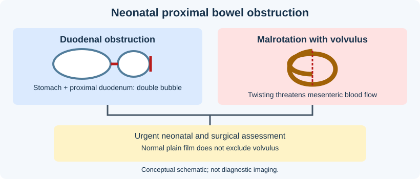

# Neonatal duodenal obstruction and volvulus

**Study-ready draft.** [20 MCQs](../MCQs/05E-Neonatal-Duodenal-Obstruction-and-Volvulus-20-MCQs.md) · [Evidence](../Previous-Year-Questions/05E-Congenital-Bowel-Obstruction-Evidence-and-Gaps.md)

Duodenum proximal small bowel hai. Duodenal atresia abnormal recanalization se linked hai, jejunoileal atresia often fetal vascular disruption se. Down syndrome association aur cardiac anomaly assessment relevant hai. Bile entry se obstruction distal ho toh bilious vomiting, proximal ho toh nonbilious vomiting possible hai. Double bubble stomach aur proximal duodenum dilation represent karta hai; specific cause specialist assess kare. Annular pancreas duodenum surround karke narrowing cause kar sakta hai.

Malrotation abnormal rotation/fixation hai. Narrow mesenteric base par volvulus se obstruction aur ischemia develop ho sakti hai. SMA midgut perfusion ke liye important hai. Green bilious vomiting with minimal distension bhi urgent hai; plain film normal hone par volvulus excluded nahi hota. Upper GI study DJ junction position assess kar sakti hai; expert ultrasound whirlpool sign identify kar sakta hai. Local specialist imaging pathway follow karo. Prescribed bowel rest, decompression, fluids, safe monitoring aur urgent surgical assessment coordinate karo. Metabolic acidosis, poor perfusion aur tenderness ischemic bowel concern hain. Temporary symptom improvement safe observation prove nahi karti. Postoperative renewed deterioration promptly report karo. TEF, Hirschsprung and anorectal malformations already covered in adjacent Child Health banks and are deliberately excluded from this bank.

[Safer Care Victoria neonatal bowel obstruction](https://www.safercare.vic.gov.au/best-practice-improvement/clinical-guidance/neonatal/bowel-obstruction-in-neonates) · [MSD malrotation](https://www.msdmanuals.com/professional/pediatrics/congenital-gastrointestinal-anomalies/malrotation-of-the-bowel) · [Neonatal ultrasound review](https://pmc.ncbi.nlm.nih.gov/articles/PMC11178722/)
