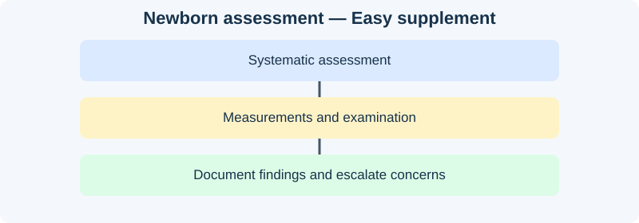

# Newborn assessment — Easy supplement

**Draft learning guide.** [MCQs](../MCQs/06A-Newborn-Assessment-Easy-Supplement-10-MCQs.md) · [Evidence](../Previous-Year-Questions/06A-Newborn-Assessment-Easy-Supplement-Evidence.md)

Measure length crown to heel, assess quiet heart rate, inspect palate for inclusion cysts and natal teeth, and review abdominal and genital findings. Mild liver-edge palpability can be normal. Distinguish undescended testis, hydrocele and concerning firm discolored swelling. Assess neck symmetry and supported primitive reflexes without unsafe manipulation. Any concerning abnormality requires clinical evaluation. Original 01A items on rooting, scalp swelling, Apgar, pulse comparison and hip relocation not repeated.

[Source](https://www.msdmanuals.com/professional/pediatrics/care-of-newborns-and-infants/physical-examination-of-the-newborn)
