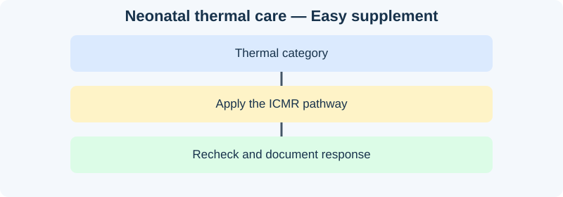

# Neonatal thermal care — Easy supplement

**Draft learning guide.** [MCQs](../MCQs/06B-Neonatal-Thermal-Care-Easy-Supplement-10-MCQs.md) · [Evidence](../Previous-Year-Questions/06B-Neonatal-Thermal-Care-Easy-Supplement-Evidence.md)

ICMR workflow distinguishes mild, moderate and severe hypothermia. Prepare the warm delivery environment and equipment before birth, measure temperature using the approved axillary technique, and monitor at-risk babies. The named mild and moderate pathways use different reassessment intervals; severe cases require stabilization and prescribed IV support. These are guideline-specific learning objectives, not universal orders. No repeat of original heat-loss mechanisms, servo probe faults, bath timing or transport incubator preparation.

[Source](https://www.icmr.gov.in/icmrobject/uploads/STWs/1726568617_thermal_care_newborn.pdf)
