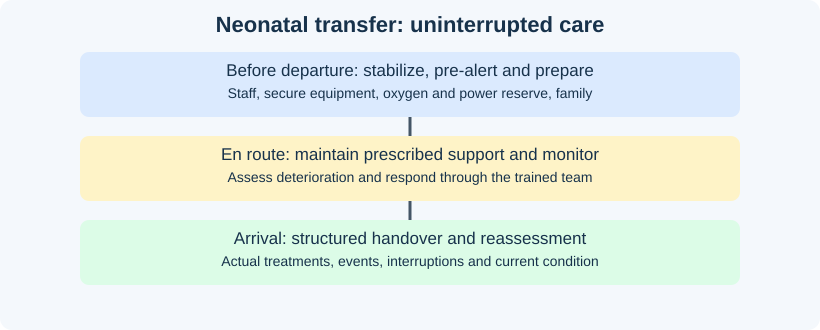

# Neonatal referral transport and handover

**Draft.** [MCQs](../MCQs/06C-Neonatal-Referral-Transport-and-Handover-20-MCQs.md) · [Evidence](../Previous-Year-Questions/06C-Neonatal-Referral-Transport-and-Handover-Evidence.md)

NHM FBNC 2025 Chapter VIII describes stabilization before referral, trained escort, equipment and advance communication. JSSK supports free referral transport. Select equipped ALS transport where available and clinically appropriate. Before loading, verify prescribed airway/respiratory support, infusion pump power, oxygen reserves, lines, clinical monitoring, and safe restraint. Coordinate safe KMC transport only for eligible infants with appropriate monitoring and transport arrangements. Family explanation and receiving-team pre-alert are essential. During transfer assess actual clinical status and equipment function; restore interrupted necessary support urgently through the trained team. On arrival communicate condition, events, actual medication administrations, infusion interruptions and treatment response. Review missing documentation without deleting original records. Example: consumption 2 L/min × 75 min = 150 L before reserve; compare with actual usable supply. This example is arithmetic, not a device-specific oxygen prescription.

[FBNC 2025](https://nhm.gov.in/images/pdf/programmes/CH-Programmes/FBNC/FBNC%20Operational%20Guidelines%202025.pdf) · [NSSK resource manual](https://nhm.gov.in/images/pdf/programmes/child-health/guidelines/NSSK/NSSK-Resource-Manual.pdf)
