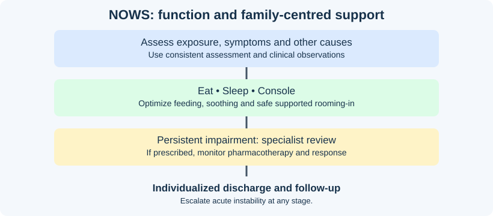

# Neonatal opioid withdrawal and discharge

**Draft learning guide.** [MCQs](../MCQs/06D-Neonatal-Opioid-Withdrawal-and-Discharge-20-MCQs.md) · [Evidence](../Previous-Year-Questions/06D-Neonatal-Opioid-Withdrawal-and-Discharge-Evidence.md)

NOWS prenatal opioid exposure ke baad withdrawal hai. Irritability, disturbed sleep, feeding problems, sweating, diarrhea and tremor possible hain; sepsis, metabolic disorders and neurological injury differential mein include karo. Finnegan symptom scoring aur ESC functional assessment distinct tools hain. CPS 2025 recommends consistent assessment for at least 72 hours and up to 120 hours after longer-acting exposure, depending on symptoms and exposure. Routine observations natural wake cycle se coordinate karo. Emergency evaluation delay nahi karni.

Supported rooming-in when stable and resources available, gentle soothing, appropriate safe swaddling, low stimulation, feeding support and respectful caregiver involvement first-line supportive measures hain. Human milk eligibility individual exposure, treatment and infection history plus local policy se assess karo. Weight, actual intake and hydration track karo. Persistent impaired feeding, sleep or consolability despite optimized support may warrant specialist pharmacotherapy review. Morphine common first-line option; medication and cardiorespiratory monitoring required. Given-order example: 3.2 kg × 0.05 mg/kg = 0.16 mg, at 0.4 mg/mL = 0.4 mL; not a universal dosing instruction. Clonidine abrupt withdrawal may cause rebound HR/BP rise. Naloxone can precipitate withdrawal; indicated neonatal ventilation and resuscitation take priority. Individualized discharge plan includes clinical readiness, caregiver education, primary and developmental follow-up, and any prescribed taper. Local Indian policy reconciliation required.

[CPS 2025](https://cps.ca/en/documents/position/nas-nows)
