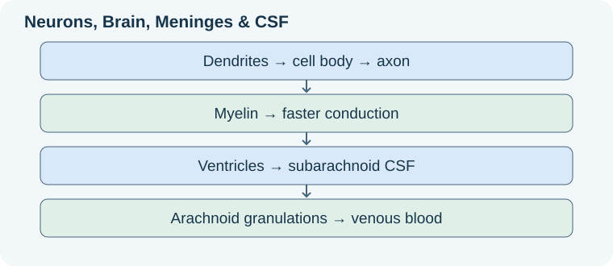

# Neurons, Brain, Meninges and CSF

**Status:** Study-ready, not yet studied. **Priority:** High (editorial exam focus, official weightage nahi).

[Chapter](../README.md) · [MCQs](../MCQs/01-Neurons-Brain-CSF.md) · [Previous Year Questions](../Previous-Year-Questions/README.md) · [Revision](../Revision/Nervous-System-Quick-Revision.md) · [References](../References.md)

## Is file mein kya padhenge?
- [Neuron aur neuroglia](#neuron-aur-neuroglia)
- [Brain ke parts](#brain-ke-parts)
- [Meninges aur CSF](#meninges-aur-csf)

Ye original revision diagram hai. Neeche poora concept samjho.

## Neuron aur neuroglia

Dekho, neuron ek message bhejne wali cell hai. Dendrites message receive karte hain, cell body usko process karti hai aur axon message aage bhejta hai. Axon ke bahar myelin ek electric wire ki insulation jaise kaam karti hai. CNS mein oligodendrocytes aur PNS mein Schwann cells myelin banati hain. Nodes of Ranvier myelin ke beech chhote gaps hain. Signal in gaps ke beech tezi se aage badhta hai, jise saltatory conduction kehte hain. Astrocytes neurons ko support karte hain aur blood-brain barrier ko maintain karne mein madad karte hain. Microglia immune defence karti hain. Ependymal cells ventricles ko line karti hain. Choroid plexus CSF banata hai.

Resting membrane potential aam taur par lagbhag -70 mV hota hai. Jab threshold milta hai, sodium andar jaata hai aur depolarization hoti hai. Phir potassium bahar jaata hai aur repolarization hoti hai. Synapse par calcium entry neurotransmitter release karwati hai. Acetylcholine neuromuscular junction par muscle ko activate karti hai. GABA major inhibitory aur glutamate major excitatory neurotransmitter hai. Dopamine movement aur reward se juda hai. Myelin damage ho toh message ki speed gir sakti hai. Multiple sclerosis mein ye concept kaam aayega.

## Brain ke parts

Brain ko control room samjho. Frontal lobe planning, behaviour aur voluntary movement karta hai. Dominant frontal lobe ka Broca area speech production mein important hai. Parietal lobe touch, position aur spatial awareness process karta hai. Temporal lobe hearing aur memory se juda hai. Dominant temporal-parietal region ka Wernicke area language samajhne mein important hai. Occipital lobe vision process karta hai. Thalamus sensory information ka relay station hai, smell iska classical exception hai. Hypothalamus temperature, hunger, thirst aur endocrine control mein help karta hai. Cerebellum balance aur movement coordination sambhalta hai. Midbrain, pons aur medulla brainstem banate hain. Medulla breathing aur cardiovascular control ke liye important hai. Reticular activating system arousal maintain karta hai.

Agar patient ko bolna mushkil ho, lekin woh baat samajh raha ho, Broca aphasia ka clue mil sakta hai. Agar patient ki speech fluent ho par meaning galat ho aur understanding kam ho, Wernicke aphasia ka clue milta hai. Cerebellar problem mein patient ki strength normal ho sakti hai par chalne mein balance bigad sakta hai.

## Meninges aur CSF

Skull ke andar dura mater strong outer covering hai, arachnoid beech mein hai aur pia mater brain ki surface se judi hai. Subarachnoid space mein CSF hota hai. CSF brain ko cushion karta hai aur environment stable rakhne mein madad karta hai. Adult mein lagbhag 150 mL CSF ek time par hota hai aur roz roughly 500 mL banta hai. Lateral ventricles se CSF foramina of Monro, third ventricle, cerebral aqueduct, fourth ventricle aur phir subarachnoid space mein jaata hai. Arachnoid granulations venous sinuses mein absorption ka classical route hain. Flow rukne par hydrocephalus ho sakta hai. Blood-brain barrier selective filter ki tarah kaam karta hai, lekin har drug ko nahi rokta.

## Teaching aur MCQ videos

| Topic | Teaching video | MCQ practice | Priority |
|---|---|---|---|
| Neuron aur neuroglia | [Related mixed-topic nursing lesson](https://www.youtube.com/watch?v=zNYeoB5vqWU) | [Related mixed-topic MCQ/revision class](https://www.youtube.com/watch?v=ONnu-lsovXY) | High |
| Brain ke parts | [Related mixed-topic nursing lesson](https://www.youtube.com/watch?v=zNYeoB5vqWU) | [Related mixed-topic MCQ/revision class](https://www.youtube.com/watch?v=ONnu-lsovXY) | High |
| Meninges aur CSF | [Related mixed-topic nursing lesson](https://www.youtube.com/watch?v=zNYeoB5vqWU) | [Related mixed-topic MCQ/revision class](https://www.youtube.com/watch?v=ONnu-lsovXY) | High |

Video titles/descriptions search mein mile hain. Har subtopic ka exact segment aur poori recording verify nahi hui hai. Community-specific video abhi pending hai.

**Reading:** [Medical reference](https://openstax.org/books/anatomy-and-physiology/pages/13-2-the-central-nervous-system) · [All sources](../References.md).

[Chapter](../README.md) · [MCQs](../MCQs/01-Neurons-Brain-CSF.md) · [Previous Year Questions](../Previous-Year-Questions/README.md) · [Revision](../Revision/Nervous-System-Quick-Revision.md) · [References](../References.md)
