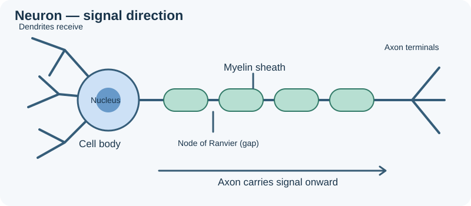
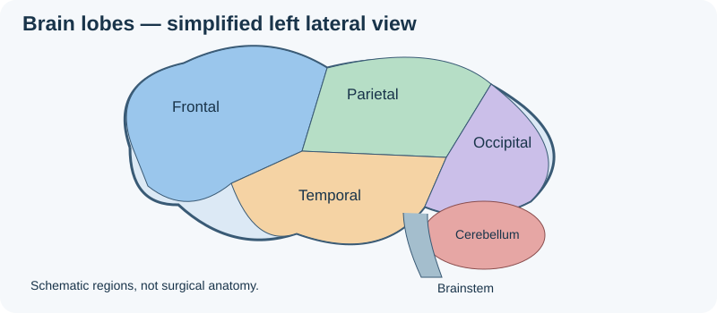
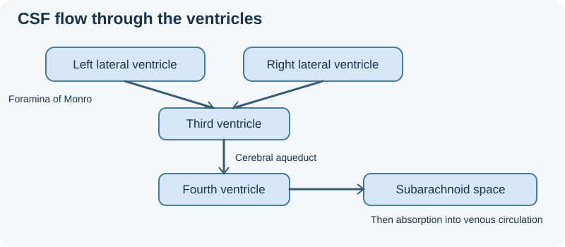

# Neurons, Brain, Meninges and CSF

> **🟠 HIGH — Exam focus:** Neuron, brain lobes aur CSF. Priority study guidance hai, official exam weightage nahi.

### ⭐ Exam ke liye sabse pehle yaad rakho

- **CNS myelin:** oligodendrocyte. **PNS myelin:** Schwann cell.
- **Broca:** speech production. **Wernicke:** language understanding.
- **CSF:** lateral ventricles → third ventricle → fourth ventricle → subarachnoid space.

**Status:** Study-ready, not yet studied. **Priority:** High (editorial exam focus, official weightage nahi).

[Chapter](../README.md) · [MCQs](../MCQs/01-Neurons-Brain-CSF.md) · [Previous Year Questions](../Previous-Year-Questions/README.md) · [Revision](../Revision/Nervous-System-Quick-Revision.md) · [References](../References.md)

## Is file mein kya padhenge?
- [Neuron aur neuroglia](#neuron-aur-neuroglia)
- [Brain ke parts](#brain-ke-parts)
- [Meninges aur CSF](#meninges-aur-csf)

Ye original revision diagram hai. Neeche poora concept samjho.

## Neuron aur neuroglia

- Dekho, neuron ek message bhejne wali cell hai.
- Dendrites message receive karte hain, cell body usko process karti hai aur axon message aage bhejta hai.
- Axon ke bahar myelin ek electric wire ki insulation jaise kaam karti hai.
- CNS mein **oligodendrocytes** aur PNS mein **Schwann cells** myelin banati hain.
- **Nodes of Ranvier** myelin ke beech chhote gaps hain.
- Signal in gaps ke beech tezi se aage badhta hai, jise **saltatory conduction** kehte hain.
- Astrocytes neurons ko support karte hain aur blood-brain barrier ko maintain karne mein madad karte hain.
- Microglia immune defence karti hain.
- Ependymal cells ventricles ko line karti hain.
- **Choroid plexus** CSF banata hai.

- Resting membrane potential aam taur par lagbhag -70 mV hota hai.
- Jab threshold milta hai, sodium andar jaata hai aur depolarization hoti hai.
- Phir potassium bahar jaata hai aur repolarization hoti hai.
- Synapse par calcium entry neurotransmitter release karwati hai.
- Acetylcholine **neuromuscular junction** par muscle ko activate karti hai.
- GABA major inhibitory aur glutamate major excitatory neurotransmitter hai.
- Dopamine movement aur reward se juda hai.
- Myelin damage ho toh message ki speed gir sakti hai.
- Multiple sclerosis mein ye concept kaam aayega.

## Brain ke parts

- Brain ko control room samjho.
- Frontal lobe planning, behaviour aur voluntary movement karta hai.
- Dominant frontal lobe ka **Broca area** speech production mein important hai.
- Parietal lobe touch, position aur spatial awareness process karta hai.
- Temporal lobe hearing aur memory se juda hai.
- Dominant temporal-parietal region ka **Wernicke area** language samajhne mein important hai.
- Occipital lobe vision process karta hai.
- Thalamus sensory information ka relay station hai, smell iska classical exception hai.
- Hypothalamus temperature, hunger, thirst aur endocrine control mein help karta hai.
- **Cerebellum** balance aur movement coordination sambhalta hai.
- Midbrain, pons aur **medulla** brainstem banate hain.
- **Medulla** breathing aur cardiovascular control ke liye important hai.
- Reticular activating system arousal maintain karta hai.

- Agar patient ko bolna mushkil ho, lekin woh baat samajh raha ho, Broca aphasia ka clue mil sakta hai.
- Agar patient ki speech fluent ho par meaning galat ho aur understanding kam ho, Wernicke aphasia ka clue milta hai.
- Cerebellar problem mein patient ki strength normal ho sakti hai par chalne mein balance bigad sakta hai.

## Meninges aur CSF

- Skull ke andar dura mater strong outer covering hai, arachnoid beech mein hai aur pia mater brain ki surface se judi hai.
- Subarachnoid space mein CSF hota hai.
- CSF brain ko cushion karta hai aur environment stable rakhne mein madad karta hai.
- Adult mein lagbhag 150 mL CSF ek time par hota hai aur roz roughly 500 mL banta hai.
- Lateral ventricles se CSF foramina of Monro, third ventricle, cerebral aqueduct, fourth ventricle aur phir subarachnoid space mein jaata hai.
- Arachnoid granulations venous sinuses mein absorption ka classical route hain.
- Flow rukne par hydrocephalus ho sakta hai.
- Blood-brain barrier selective filter ki tarah kaam karta hai, lekin har drug ko nahi rokta.

## Teaching aur MCQ videos

| Topic | Teaching video | MCQ practice | Priority |
|---|---|---|---|
| Neuron aur neuroglia | [Related mixed-topic nursing lesson](https://www.youtube.com/watch?v=zNYeoB5vqWU) | [Related mixed-topic MCQ/revision class](https://www.youtube.com/watch?v=ONnu-lsovXY) | High |
| Brain ke parts | [Related mixed-topic nursing lesson](https://www.youtube.com/watch?v=zNYeoB5vqWU) | [Related mixed-topic MCQ/revision class](https://www.youtube.com/watch?v=ONnu-lsovXY) | High |
| Meninges aur CSF | [Related mixed-topic nursing lesson](https://www.youtube.com/watch?v=zNYeoB5vqWU) | [Related mixed-topic MCQ/revision class](https://www.youtube.com/watch?v=ONnu-lsovXY) | High |

Video titles/descriptions search mein mile hain. Har subtopic ka exact segment aur poori recording verify nahi hui hai. Community-specific video abhi pending hai.

**Reading:** [Medical reference](https://openstax.org/books/anatomy-and-physiology/pages/13-2-the-central-nervous-system) · [All sources](../References.md).

[Chapter](../README.md) · [MCQs](../MCQs/01-Neurons-Brain-CSF.md) · [Previous Year Questions](../Previous-Year-Questions/README.md) · [Revision](../Revision/Nervous-System-Quick-Revision.md) · [References](../References.md)

## NCERT foundation link

[NCERT Class 11 Neural Control and Coordination catalogue](https://ndl.iitkgp.ac.in/se_document/ncert/ncert/a567ca4379fe4aaa207bb9ed9d64521c) · [LearnoHub Class 11 one-shot](https://www.youtube.com/watch?v=05qcnjl-O5g). Ye foundation video hai, nursing emergencies ke liye clinical lecture alag padho.

**Extra important points:** Na/K ATPase 3 sodium ions bahar aur 2 potassium ions andar move karwati hai. Resting voltage mainly selective ion permeability se maintain hota hai. Refractory period ke waqt neuron immediately dobara fire nahi kar pata ya stronger stimulus chahiye. Electrical synapse gap junction se direct current pass karwati hai. Chemical synapse mein neurotransmitter release hota hai. Corpus callosum hemispheres connect karta hai. Limbic system emotion aur memory mein help karta hai.

---

# Detailed learning and clinical application

## Nervous system ka basic map

**Priority: High.** Nervous system ko body ka communication network samjho. Jab tum garam cup touch karti ho, skin ka receptor heat detect karta hai. Sensory neuron information spinal cord aur brain ki taraf bhejta hai. Brain information interpret karta hai. Motor neuron muscle ko signal bhejta hai. Is tarah input, processing aur output milkar response banate hain.

- CNS mein brain aur spinal cord aate hain.
- PNS mein unse bahar ke nerves aur ganglia aate hain.
- Afferent ka matlab CNS ki taraf signal aana hai.
- Efferent ka matlab CNS se bahar signal jaana hai.
- Somatic motor system skeletal muscle ko control karta hai.
- Autonomic system smooth muscle, cardiac muscle aur glands ko regulate karta hai.

## Neuron ko cell level par samjho

- Cell body mein nucleus aur protein banane ki machinery hoti hai.
- Nissl bodies rough endoplasmic reticulum se related hain.
- Axon hillock ke paas action potential initiate hone ki jagah hoti hai.
- Axon terminals se chemical messages release hote hain.
- Axonal transport motor proteins aur microtubules ki help se material ko cell body aur terminal ke beech move karta hai.

- Multipolar neuron mein ek axon aur multiple dendrites hote hain.
- Motor neurons iska common example hain.
- Bipolar neurons retina aur olfactory pathways mein milte hain.
- Pseudounipolar sensory neurons **dorsal root** ganglia mein milte hain.

| Support cell | Location | Kaam samjho |
|---|---|---|
| Astrocyte | CNS | Ye extracellular environment regulate karne aur BBB maintain karne mein help karti hai. |
| Oligodendrocyte | CNS | Ek cell multiple axon segments ko myelinate kar sakti hai. |
| Schwann cell | PNS | Ek myelinating Schwann cell ek axon ka ek segment cover karti hai. |
| Satellite cell | PNS ganglion | Ye neuron ke cell body ke aas-paas support deti hai. |
| Ependymal cell | Ventricles aur central canal | Ye fluid-facing lining banati hai. |
| Microglia | CNS | Ye immune surveillance aur debris removal mein help karti hai. |

- Peripheral nerve injury ke baad axon regrowth possible ho sakti hai agar cell body aur guiding structures preserved hon.
- CNS regeneration generally limited hoti hai.
- Isliye injury ka location aur severity recovery affect karte hain.

## Action potential step by step

- Resting neuron ke andar bahar se zyada negative charge hota hai.
- Na/K pump ATP use karke sodium aur potassium gradients maintain karti hai.
- Resting membrane potential mein potassium leak permeability ka major role hai.
- Jab stimulus threshold tak pahunchta hai, voltage-gated sodium channels open hote hain.
- Sodium andar aata hai aur voltage positive direction mein badhta hai.
- Phir sodium channels inactivate aur potassium channels open hote hain.
- Potassium bahar jaata hai aur membrane repolarize hoti hai.
- Kuch time potassium channels open rehne se after-hyperpolarization ho sakti hai.

- All-or-none law ka matlab ek axon mein threshold cross hone par action potential full response deta hai.
- Stronger stimulus usually firing frequency ya recruited fibers badhata hai, single action potential ka amplitude nahi.
- Absolute refractory period mein sodium channel inactivation ke kaaran naya action potential initiate nahi hota.
- Relative refractory period mein stronger stimulus chahiye.

- Chemical synapse mein vesicles se transmitter release hota hai.
- Transmitter receptor se bind karke excitatory ya inhibitory effect de sakta hai.
- Signal reuptake, enzymatic breakdown ya diffusion se terminate ho sakta hai.
- EPSP membrane ko firing threshold ke paas le jaata hai.
- IPSP firing ki probability kam karta hai.
- Multiple signals time aur space mein add ho sakte hain, jise temporal aur spatial summation kehte hain.

**Clinical example:** Local anesthetic sodium channels block karke peripheral pain signal conduction reduce kar sakta hai. Myelin damage mein signal conduction slow ho sakti hai. Ye dono different mechanisms hain.

## Brain ki deeper anatomy

- Cerebral cortex ke folds ko gyri aur grooves ko sulci kehte hain.
- Longitudinal fissure hemispheres ko separate karti hai.
- Corpus callosum white matter fibers ka bundle hai jo hemispheres ko connect karta hai.
- Primary motor cortex precentral gyrus mein aur primary somatosensory cortex postcentral gyrus mein hai.
- Internal capsule compact projection fibers carry karti hai.
- Chhota lesion bhi dense motor deficit de sakta hai.

- Basal ganglia movement selection aur smooth execution mein role rakhti hain.
- Caudate, putamen aur globus pallidus important structures hain.
- Hippocampus new declarative memories banane mein help karta hai.
- Amygdala emotional processing se related hai.
- Limbic system emotion, motivation aur memory se juda hai.
- Pineal gland melatonin release karti hai aur circadian rhythm mein role hai.
- Superior colliculus visual orienting aur inferior colliculus auditory pathways se associated hai.

- **Cerebellum** movement error compare karta hai.
- Vermis trunk balance se juda hai aur hemispheres limb coordination se.
- Cerebellar lesions mein intention tremor, dysmetria, dysdiadochokinesia aur nystagmus mil sakte hain.
- Dysdiadochokinesia ka matlab rapid alternating movements karne mein problem hai.

## Brain blood supply aur protection

- Internal carotid circulation mainly anterior brain supply karti hai.
- Vertebral arteries milkar basilar artery banati hain.
- Posterior circulation brainstem, **cerebellum** aur posterior cerebral regions supply karti hai.
- Circle of Willis collateral route de sakta hai, lekin har patient mein compensation adequate nahi hota.

- ACA territory mein contralateral leg weakness prominent ho sakti hai.
- MCA territory mein face aur arm weakness, aphasia ya neglect mil sakta hai.
- PCA territory mein visual field deficit prominent ho sakta hai.
- Ye typical clues hain, exact diagnosis imaging aur clinical exam se hota hai.

- BBB brain capillary endothelial tight junctions ka selective barrier hai.
- Astrocytes is barrier ko support karti hain.
- Oxygen aur kuch lipid-soluble substances cross kar sakte hain.
- Glucose transporter ki help se enter karta hai.
- Inflammation barrier permeability alter kar sakti hai.

- Adult CSF clear hota hai.
- Typical lumbar opening pressure lateral decubitus position mein roughly 10–25 cm H2O ho sakta hai, clinical context aur technique matter karte hain.
- CSF pressure cm H2O aur intracranial monitor pressure mmHg alag units hain.
- Inko directly equal mat samjho.

## Development aur high-yield comparisons

- Neural tube se CNS develop hota hai.
- Neural crest se many peripheral ganglia aur **Schwann cells** develop hote hain.
- Prosencephalon forebrain, mesencephalon midbrain aur rhombencephalon hindbrain ke developmental regions hain.
- Gray matter mein cell bodies, dendrites aur synapses prominent hote hain.
- White matter mein myelinated axons prominent hote hain.
- Spinal cord mein gray matter central aur white matter peripheral hota hai.
- Cerebrum mein cortex gray matter ka outer layer hai.

**Exam recap:** Structure, function aur lesion ko connect karo. Sirf brain parts ke naam yaad karne se clinical question solve nahi hoga.

[Chapter](../README.md) · [Topic-wise MCQs](../MCQs/01-Neurons-Brain-CSF.md) · [Revision](../Revision/Nervous-System-Quick-Revision.md)
