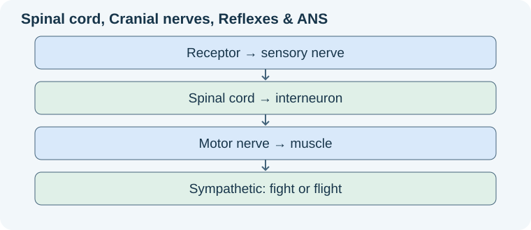

# Spinal cord, Cranial nerves, Reflexes and ANS

**Status:** Study-ready, not yet studied. **Priority:** High (editorial exam focus, official weightage nahi).

[Chapter](../README.md) · [MCQs](../MCQs/02-Spinal-Cord-Cranial-Nerves-ANS.md) · [Previous Year Questions](../Previous-Year-Questions/README.md) · [Revision](../Revision/Nervous-System-Quick-Revision.md) · [References](../References.md)

## Is file mein kya padhenge?
- [Spinal cord aur reflex arc](#spinal-cord-aur-reflex-arc)
- [Cranial nerves I–XII](#cranial-nerves-ixii)
- [Autonomic nervous system](#autonomic-nervous-system)

Ye original revision diagram hai. Neeche poora concept samjho.

## Spinal cord aur reflex arc

Spinal cord brain aur body ke beech highway hai. Adult mein cord aam taur par L1–L2 vertebral level par khatam hota hai. Neeche cauda equina nerve roots hoti hain. 31 pairs spinal nerves hoti hain: 8 cervical, 12 thoracic, 5 lumbar, 5 sacral aur 1 coccygeal. Dorsal root sensory input laati hai aur ventral root motor output le jaati hai. Dorsal column vibration aur position sense carry karta hai. Spinothalamic tract pain aur temperature carry karta hai. Corticospinal tract voluntary movement mein help karta hai.

Garam cheez touch karne par receptor signal sensory nerve se cord tak laata hai. Interneuron aur motor nerve muscle ko haath hataane ka signal dete hain. Ye withdrawal reflex hai. Knee jerk L2–L4 aur ankle jerk S1–S2 se related hai. Adult mein extensor plantar response upper motor neuron lesion ka clue hai. UMN lesion mein spasticity, hyperreflexia aur Babinski mil sakte hain. LMN lesion mein flaccidity, reduced reflexes, atrophy aur fasciculations mil sakte hain. Acute spinal shock mein temporary flaccidity ho sakti hai, isliye timing important hai.

## Cranial nerves I–XII

Cranial nerves ke 12 pairs brain se associated hote hain. Inko name, function aur bedside test ke saath padho.

| Nerve | Type | Main function / test |
|---|---|---|
| I Olfactory | Sensory | Smell |
| II Optic | Sensory | Vision, light reflex afferent |
| III Oculomotor | Motor | Most eye movements, eyelid elevation, pupil constriction |
| IV Trochlear | Motor | Superior oblique, down and in assessment |
| V Trigeminal | Mixed | Face sensation, mastication, corneal afferent |
| VI Abducens | Motor | Eye abduction |
| VII Facial | Mixed | Facial expression, anterior 2/3 taste, corneal efferent |
| VIII Vestibulocochlear | Sensory | Hearing and balance |
| IX Glossopharyngeal | Mixed | Posterior 1/3 taste, gag afferent |
| X Vagus | Mixed | Voice, swallowing, parasympathetic visceral control |
| XI Accessory | Motor | Shoulder shrug, head turn |
| XII Hypoglossal | Motor | Tongue movement |

Exam trick: Light reflex II andar signal laata hai aur III pupil ko chhota karta hai. Corneal reflex V1 input aur VII blink output deta hai. Gag reflex IX input aur X output ka classical pair hai. Gag reflex alone safe swallowing prove nahi karta.

## Autonomic nervous system

Sympathetic system ko emergency mode samjho. Ye heart rate badha sakta hai, bronchi dilate karta hai aur digestion kam karta hai. Parasympathetic system rest-and-digest mode hai. Ye heart rate kam karta hai, pupil constrict karta hai aur digestion support karta hai. Sympathetic origin T1–L2 aur parasympathetic craniosacral origin III, VII, IX, X aur S2–S4 hai. Dono systems ke preganglionic neurons acetylcholine release karte hain. Most sympathetic postganglionic neurons norepinephrine release karte hain, sweat glands classical acetylcholine exception hain. Parasympathetic postganglionic neurons acetylcholine release karte hain. Somatic nervous system skeletal muscle ko control karta hai. Enteric nervous system gut ke local functions coordinate karta hai.

## Teaching aur MCQ videos

| Topic | Teaching video | MCQ practice | Priority |
|---|---|---|---|
| Spinal cord aur reflex arc | [Related mixed-topic nursing lesson](https://www.youtube.com/watch?v=zNYeoB5vqWU) | [Related mixed-topic MCQ/revision class](https://www.youtube.com/watch?v=V07AHpfpoZg) | High |
| Cranial nerves I–XII | [Related mixed-topic nursing lesson](https://www.youtube.com/watch?v=zNYeoB5vqWU) | [Related mixed-topic MCQ/revision class](https://www.youtube.com/watch?v=V07AHpfpoZg) | High |
| Autonomic nervous system | [Related mixed-topic nursing lesson](https://www.youtube.com/watch?v=zNYeoB5vqWU) | [Related mixed-topic MCQ/revision class](https://www.youtube.com/watch?v=V07AHpfpoZg) | High |

Video titles/descriptions search mein mile hain. Har subtopic ka exact segment aur poori recording verify nahi hui hai. Community-specific video abhi pending hai.

**Reading:** [Medical reference](https://openstax.org/books/anatomy-and-physiology-2e/pages/16-3-the-cranial-nerve-exam) · [All sources](../References.md).

[Chapter](../README.md) · [MCQs](../MCQs/02-Spinal-Cord-Cranial-Nerves-ANS.md) · [Previous Year Questions](../Previous-Year-Questions/README.md) · [Revision](../Revision/Nervous-System-Quick-Revision.md) · [References](../References.md)
