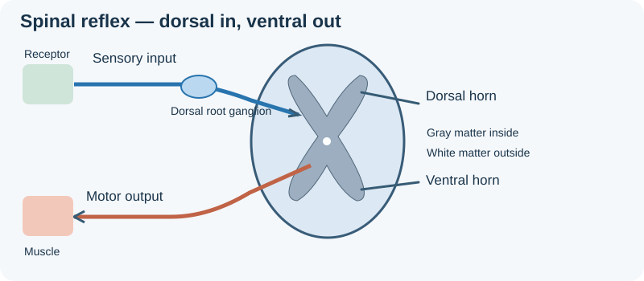

# Spinal cord, Cranial nerves, Reflexes and ANS

**Status:** Study-ready, not yet studied. **Priority:** High (editorial exam focus, official weightage nahi).

[Chapter](../README.md) · [MCQs](../MCQs/02-Spinal-Cord-Cranial-Nerves-ANS.md) · [Previous Year Questions](../Previous-Year-Questions/README.md) · [Revision](../Revision/Nervous-System-Quick-Revision.md) · [References](../References.md)

## Is file mein kya padhenge?
- [Spinal cord aur reflex arc](#spinal-cord-aur-reflex-arc)
- [Cranial nerves I–XII](#cranial-nerves-ixii)
- [Autonomic nervous system](#autonomic-nervous-system)

Ye original revision diagram hai. Neeche poora concept samjho.

## Spinal cord aur reflex arc

Spinal cord brain aur body ke beech highway hai. Adult mein cord aam taur par L1–L2 vertebral level par khatam hota hai. Neeche cauda equina nerve roots hoti hain. 31 pairs spinal nerves hoti hain: 8 cervical, 12 thoracic, 5 lumbar, 5 sacral aur 1 coccygeal. Dorsal root sensory input laati hai aur ventral root motor output le jaati hai. Dorsal column vibration aur position sense carry karta hai. Spinothalamic tract pain aur temperature carry karta hai. Corticospinal tract voluntary movement mein help karta hai.

Garam cheez touch karne par receptor signal sensory nerve se cord tak laata hai. Interneuron aur motor nerve muscle ko haath hataane ka signal dete hain. Ye withdrawal reflex hai. Knee jerk L2–L4 aur ankle jerk S1–S2 se related hai. Adult mein extensor plantar response upper motor neuron lesion ka clue hai. UMN lesion mein spasticity, hyperreflexia aur Babinski mil sakte hain. LMN lesion mein flaccidity, reduced reflexes, atrophy aur fasciculations mil sakte hain. Acute spinal shock mein temporary flaccidity ho sakti hai, isliye timing important hai.

## Cranial nerves I–XII

Cranial nerves ke 12 pairs brain se associated hote hain. Inko name, function aur bedside test ke saath padho.

| Nerve | Type | Main function / test |
|---|---|---|
| I Olfactory | Sensory | Smell |
| II Optic | Sensory | Vision, light reflex afferent |
| III Oculomotor | Motor | Most eye movements, eyelid elevation, pupil constriction |
| IV Trochlear | Motor | Superior oblique, down and in assessment |
| V Trigeminal | Mixed | Face sensation, mastication, corneal afferent |
| VI Abducens | Motor | Eye abduction |
| VII Facial | Mixed | Facial expression, anterior 2/3 taste, corneal efferent |
| VIII Vestibulocochlear | Sensory | Hearing and balance |
| IX Glossopharyngeal | Mixed | Posterior 1/3 taste, gag afferent |
| X Vagus | Mixed | Voice, swallowing, parasympathetic visceral control |
| XI Accessory | Motor | Shoulder shrug, head turn |
| XII Hypoglossal | Motor | Tongue movement |

Exam trick: Light reflex II andar signal laata hai aur III pupil ko chhota karta hai. Corneal reflex V1 input aur VII blink output deta hai. Gag reflex IX input aur X output ka classical pair hai. Gag reflex alone safe swallowing prove nahi karta.

## Autonomic nervous system

Sympathetic system ko emergency mode samjho. Ye heart rate badha sakta hai, bronchi dilate karta hai aur digestion kam karta hai. Parasympathetic system rest-and-digest mode hai. Ye heart rate kam karta hai, pupil constrict karta hai aur digestion support karta hai. Sympathetic origin T1–L2 aur parasympathetic craniosacral origin III, VII, IX, X aur S2–S4 hai. Dono systems ke preganglionic neurons acetylcholine release karte hain. Most sympathetic postganglionic neurons norepinephrine release karte hain, sweat glands classical acetylcholine exception hain. Parasympathetic postganglionic neurons acetylcholine release karte hain. Somatic nervous system skeletal muscle ko control karta hai. Enteric nervous system gut ke local functions coordinate karta hai.

## Teaching aur MCQ videos

| Topic | Teaching video | MCQ practice | Priority |
|---|---|---|---|
| Spinal cord aur reflex arc | [Related mixed-topic nursing lesson](https://www.youtube.com/watch?v=zNYeoB5vqWU) | [Related mixed-topic MCQ/revision class](https://www.youtube.com/watch?v=V07AHpfpoZg) | High |
| Cranial nerves I–XII | [Related mixed-topic nursing lesson](https://www.youtube.com/watch?v=zNYeoB5vqWU) | [Related mixed-topic MCQ/revision class](https://www.youtube.com/watch?v=V07AHpfpoZg) | High |
| Autonomic nervous system | [Related mixed-topic nursing lesson](https://www.youtube.com/watch?v=zNYeoB5vqWU) | [Related mixed-topic MCQ/revision class](https://www.youtube.com/watch?v=V07AHpfpoZg) | High |

Video titles/descriptions search mein mile hain. Har subtopic ka exact segment aur poori recording verify nahi hui hai. Community-specific video abhi pending hai.

**Reading:** [Medical reference](https://openstax.org/books/anatomy-and-physiology-2e/pages/16-3-the-cranial-nerve-exam) · [All sources](../References.md).

[Chapter](../README.md) · [MCQs](../MCQs/02-Spinal-Cord-Cranial-Nerves-ANS.md) · [Previous Year Questions](../Previous-Year-Questions/README.md) · [Revision](../Revision/Nervous-System-Quick-Revision.md) · [References](../References.md)

**Extra important:** Dermatome ek skin area hai jisko mainly ek spinal nerve root sensation deta hai. T4 nipple line aur T10 umbilicus common exam landmarks hain, exact boundary individual variation rakhti hai. Biceps reflex C5–C6, triceps reflex mainly C7 aur ankle jerk mainly S1 se associated hai.

---

# Detailed learning and clinical application

## Spinal cord ko cross-section se samjho

Spinal cord ke gray matter mein dorsal horn sensory processing karta hai aur ventral horn lower motor neurons rakhta hai. Thoracic aur upper lumbar segments mein lateral horn sympathetic neurons se related hai. Central canal mein CSF hota hai. White matter ascending aur descending tracts carry karta hai. Ascending ka matlab information brain ki taraf aur descending ka matlab command neeche body ki taraf.

Dorsal column fibers spinal cord mein same side ascend karte hain aur medulla mein cross karte hain. Spinothalamic pain-temperature fibers spinal cord mein entry ke paas cross karte hain. Lateral corticospinal tract ke majority fibers medulla mein cross kar chuke hote hain. Isliye hemisection mein lesion ke neeche same-side motor aur vibration loss aur opposite-side pain-temperature loss mil sakta hai. Is classic pattern ko Brown-Séquard syndrome kehte hain. Real injuries incomplete patterns de sakti hain.

Anterior cord syndrome mein motor aur pain-temperature function impaired ho sakta hai aur dorsal column relatively spared reh sakta hai. Central cord syndrome mein arms legs se zyada weak ho sakti hain. Conus medullaris aur cauda equina mein bladder/bowel dysfunction aur saddle sensory changes urgent clues hain.

## Plexuses aur peripheral nerve lesions

Cervical plexus C1–C4 roots se related hai. Brachial plexus typically C5–T1 se banta hai aur upper limb supply karta hai. Lumbar plexus L1–L4 aur sacral plexus L4–S4 contributions lower limb function mein help karte hain.

| Nerve | Common lesion clue |
|---|---|
| Radial | Wrist extension weak hone se wrist drop ho sakta hai. |
| Ulnar | Finger abduction/adduction weak aur little finger sensory change ho sakta hai. |
| Median | Thumb opposition aur lateral hand sensation affect ho sakti hai. |
| Common fibular | Ankle dorsiflexion weakness se foot drop ho sakta hai. |
| Femoral | Knee extension weak aur patellar reflex reduced ho sakta hai. |
| Tibial | Plantar flexion weakness aur sole sensation affected ho sakti hai. |

Erb palsy upper brachial plexus C5–C6 injury se associated hai. Klumpke palsy lower trunk C8–T1 se associated hai. In patterns ko clinical exam aur injury history ke saath interpret karo.

## Cranial nerves bedside assessment detail

CN I smell test ke liye familiar non-irritating smell use ki ja sakti hai. Ammonia trigeminal irritation create kar sakta hai, isliye routine smell assessment ke liye suitable nahi hai. CN II visual acuity, fields aur afferent pupillary pathway se related hai. CN III, IV aur VI extraocular movements assess karne mein grouped hote hain. Ptosis, dilated pupil aur eye movement deficit CN III dysfunction ka clue ho sakta hai. New painful pupil-involving palsy emergency evaluation maangti hai.

CN V ke ophthalmic, maxillary aur mandibular divisions face sensation carry karte hain. Mandibular division mastication muscles ko motor supply bhi deta hai. CN VII mein smile, eyebrow raise aur eye closure assess kiye jaate hain. CN VIII hearing aur vestibular function assess karta hai. Rinne test normal ya sensorineural hearing loss mein air conduction bone conduction se zyada ho sakti hai. Conductive hearing loss mein affected side par bone conduction relatively better ho sakti hai. Weber conductive loss mein affected side aur sensorineural loss mein better ear ki taraf lateralize kar sakta hai.

CN IX aur X pharynx, palate aur voice assessment se related hain. Swallow safety trained screen se assess karo. CN XI ke liye shoulder shrug aur head turn against resistance dekho. CN XII ke liye tongue protrusion aur movement dekho. LMN hypoglossal lesion mein tongue weak side ki taraf deviate kar sakti hai.

Mnemonic names: Oh Oh Oh To Touch And Feel Very Good Velvet AH. Type sequence: S S M M B M B S B B M M. Yahan B ka matlab both sensory and motor hai.

## Reflexes aur motor assessment

Reflex automatic response hai. Monosynaptic stretch reflex mein sensory afferent directly motor neuron se synapse karta hai. Withdrawal reflex polysynaptic hai. Crossed extensor reflex opposite limb ko body support dene mein help karta hai. Reciprocal inhibition antagonist muscle ko relax karne mein help karti hai.

Deep tendon reflex grading commonly 0 absent, 1+ diminished, 2+ average, 3+ brisk aur 4+ very brisk with possible clonus hoti hai. Bilateral comparison aur clinical context zaroori hai. Clonus rhythmic involuntary contractions hain jo sustained stretch ke baad aa sakte hain. Infant plantar extensor response developmentally normal ho sakta hai, adult mein abnormal clue hai.

## Autonomic receptors aur clinical application

Sympathetic chain ganglia spinal cord ke sides mein hoti hain. Parasympathetic ganglia target organ ke paas ya andar hoti hain. Dono preganglionic fibers nicotinic ganglionic receptors par acetylcholine use karte hain. Parasympathetic postganglionic effects mainly muscarinic receptors se hote hain.

| Receptor | Major effect |
|---|---|
| Alpha-1 | Vasoconstriction aur pupil dilation mein role. |
| Alpha-2 | Presynaptic norepinephrine release kam karne mein role. |
| Beta-1 | Heart rate aur contractility badhane mein role. |
| Beta-2 | Bronchial smooth muscle relaxation mein role. |
| M2 | Heart rate kam karne mein role. |
| M3 | Gland secretion, pupil constriction aur smooth muscle effects. |

Baroreceptor reflex BP ko short-term regulate karta hai. Carotid sinus afferent CN IX aur aortic arch afferent CN X se related hai. BP girne par reflex sympathetic activity badh sakti hai. Orthostatic hypotension mein position change ke baad BP girta hai. Common definition standing ke 3 minutes ke andar systolic fall at least 20 mmHg ya diastolic fall at least 10 mmHg hai. Symptoms aur fall risk assess karo.

Horner syndrome sympathetic pathway interruption se ptosis, miosis aur variable anhidrosis de sakta hai. Parasympathetic dysfunction aur sympathetic dysfunction ke pupil signs same nahi hote.

**Nursing link:** Nerve lesion mein sirf muscle power nahi, sensation, skin protection, safety aur function bhi assess karna hai.

[Chapter](../README.md) · [Topic-wise MCQs](../MCQs/02-Spinal-Cord-Cranial-Nerves-ANS.md) · [Revision](../Revision/Nervous-System-Quick-Revision.md)
