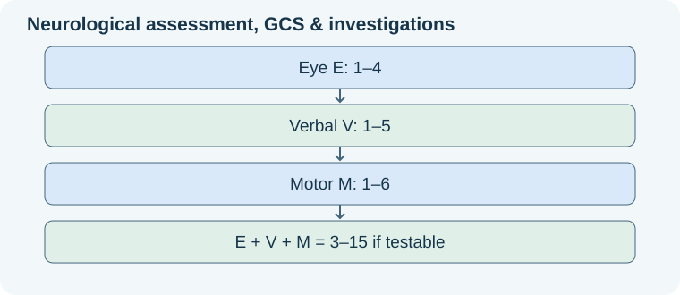

# Neurological assessment, GCS and investigations

**Status:** Study-ready, not yet studied. **Priority:** High (editorial exam focus, official weightage nahi).

[Chapter](../README.md) · [MCQs](../MCQs/03-Neuro-Assessment-GCS-Diagnostics.md) · [Previous Year Questions](../Previous-Year-Questions/README.md) · [Revision](../Revision/Nervous-System-Quick-Revision.md) · [References](../References.md)

## Is file mein kya padhenge?
- [Bedside neurological assessment](#bedside-neurological-assessment)
- [Glasgow Coma Scale](#glasgow-coma-scale)
- [CT MRI EEG LP aur EMG](#ct-mri-eeg-lp-aur-emg)

Ye original revision diagram hai. Neeche poora concept samjho.

## Bedside neurological assessment

Nurse pehle airway, breathing aur circulation dekhti hai. Phir patient ka baseline level of consciousness, orientation, speech, pupils, limb power, sensation aur vital signs document karti hai. Sudden change ko normal sleep ya medicine effect maan kar ignore mat karo. PERRLA ka matlab pupils equal, round, reactive to light and accommodation hai. Pupil size millimetres mein note karo. New unequal pupil aur falling consciousness emergency ho sakte hain. Motor power 0–5 scale mein 0 no contraction aur 5 normal strength hai. Grade 3 mein gravity ke against movement hota hai, resistance ke against nahi. Pronator drift subtle weakness ka clue hai. Romberg positive hone ka matlab sensory ya vestibular balance problem ho sakti hai. Cerebellar ataxia mein eyes open par bhi instability ho sakti hai. NIHSS trained stroke assessment hai.

## Glasgow Coma Scale

GCS patient ki eye, verbal aur motor response ko score karta hai. Eye: spontaneous 4, sound 3, pressure 2, none 1. Verbal: oriented 5, confused 4, words 3, sounds 2, none 1. Motor: obeys 6, localizes 5, normal flexion withdrawal 4, abnormal flexion 3, extension 2, none 1. Testable total 3–15 hota hai. Example: E3 V4 M5 = 12. GCS 8 ya kam severe impairment ka clue hai aur urgent airway evaluation chahiye. Intubation, sedation, language ya facial swelling assessment limit kar sakti hai. Intubated verbal ko NT document karo, artificial score mat banao. Components, time, confounders aur trend record karna total se zyada useful ho sakta hai.

## CT MRI EEG LP aur EMG

Noncontrast CT acute brain bleed jaldi identify karne mein helpful hai. MRI soft tissue detail, posterior fossa aur demyelination mein useful hai. MRI se pehle metal implants aur safety screening karo. EEG brain electrical activity record karta hai. Normal interictal EEG epilepsy ko rule out nahi karta. EMG aur nerve conduction studies muscle aur peripheral nerve function assess karti hain. Lumbar puncture aksar L3–L4 ya L4–L5 par hoti hai. Suspected mass effect, certain raised ICP situations, coagulation problem ya puncture-site infection mein pehle clinician safety assessment zaroori hai. CSF bacterial meningitis mein often neutrophils high, protein high aur glucose low hota hai. Viral meningitis mein often lymphocytes aur normal glucose milte hain. TB meningitis mein lymphocytes, high protein aur low glucose common hain. Patterns overlap kar sakte hain. LP ke baad severe positional headache report karo. Routine prolonged flat bed rest headache prevent karne ka proven method nahi hai.

## Teaching aur MCQ videos

| Topic | Teaching video | MCQ practice | Priority |
|---|---|---|---|
| Bedside neurological assessment | [Related mixed-topic nursing lesson](https://www.youtube.com/watch?v=W3PHS7Akq4k) | [Related mixed-topic MCQ/revision class](https://www.youtube.com/watch?v=OAqcR_fK9Uc) | High |
| Glasgow Coma Scale | [Related mixed-topic nursing lesson](https://www.youtube.com/watch?v=W3PHS7Akq4k) | [Related mixed-topic MCQ/revision class](https://www.youtube.com/watch?v=OAqcR_fK9Uc) | High |
| CT MRI EEG LP aur EMG | [Related mixed-topic nursing lesson](https://www.youtube.com/watch?v=W3PHS7Akq4k) | [Related mixed-topic MCQ/revision class](https://www.youtube.com/watch?v=OAqcR_fK9Uc) | High |

Video titles/descriptions search mein mile hain. Har subtopic ka exact segment aur poori recording verify nahi hui hai. Community-specific video abhi pending hai.

**Reading:** [Medical reference](https://www.glasgowcomascale.org/) · [All sources](../References.md).

[Chapter](../README.md) · [MCQs](../MCQs/03-Neuro-Assessment-GCS-Diagnostics.md) · [Previous Year Questions](../Previous-Year-Questions/README.md) · [Revision](../Revision/Nervous-System-Quick-Revision.md) · [References](../References.md)
