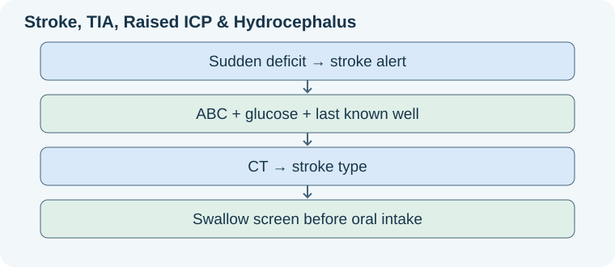

# Stroke, TIA, Raised ICP and Hydrocephalus

> **🔴 VERY HIGH — Exam focus:** Stroke, ICP aur hydrocephalus. Priority study guidance hai, official exam weightage nahi.

### ⭐ Exam ke liye sabse pehle yaad rakho

- **BE FAST → stroke alert → last known well time → glucose → urgent imaging.**
- **Swallow assessment se pehle oral intake nahi.**
- **Aspirin:** hemorrhage exclude hone se pehle nahi.

**Status:** Study-ready, not yet studied. **Priority:** Very high (editorial exam focus, official weightage nahi).

[Chapter](../README.md) · [MCQs](../MCQs/04-Stroke-TIA-ICP-Hydrocephalus.md) · [Previous Year Questions](../Previous-Year-Questions/README.md) · [Revision](../Revision/Nervous-System-Quick-Revision.md) · [References](../References.md)

## Is file mein kya padhenge?
- [Stroke aur TIA](#stroke-aur-tia)
- [Raised intracranial pressure](#raised-intracranial-pressure)
- [Hydrocephalus aur shunt](#hydrocephalus-aur-shunt)

Ye original revision diagram hai. Neeche poora concept samjho.

## Stroke aur TIA

- Stroke tab hota hai jab brain ki blood supply rukti hai ya blood vessel phat jaati hai.
- Ischemic stroke mein clot supply block karta hai.
- Hemorrhagic stroke mein bleeding brain ko damage karti hai.
- **BE FAST** se balance, eyes, face, arm, speech aur time yaad rakho.
- Sudden weakness, speech difficulty ya vision loss emergency hai.
- **Last known well** time likho, stroke alert activate karo, ABC aur glucose check karo.
- Oral water, food ya medicine tab tak mat do jab tak swallowing safe assess na ho.
- **Noncontrast CT** se bleeding evaluate hoti hai.
- Aspirin bina hemorrhage exclude kiye nahi deni hai.
- TIA mein transient neurological dysfunction without acute infarction hoti hai.
- Symptoms chale bhi jaayein toh urgent assessment zaroori hai.

- Selected ischemic patients ko alteplase ya tenecteplase generally 4.5 hours ke andar protocol ke hisaab se mil sakti hai.
- Selected imaging-based cases mein extended windows possible hain.
- Large vessel occlusion mein thrombectomy selected patients mein 24 hours tak possible ho sakti hai.
- Nurse bleeding, BP, glucose, neurological status aur swallowing monitor karti hai.
- Reperfusion eligibility doctor/stroke team decide karti hai.
- Hemorrhage mein anticoagulant reversal, BP control aur neurosurgical review as indicated hota hai.
- Rehab mein affected shoulder protection, positioning, mobility, communication support aur **aspiration** prevention important hain.

## Raised intracranial pressure

- Skull ko closed box samjho.
- Brain tissue, blood aur CSF is box ke andar hain.
- Monro-Kellie doctrine ke according ek component badhe toh pehle dusre compensate karte hain.
- Compensation khatam ho jaaye toh pressure tezi se badh sakta hai.
- Adult resting ICP aam taur par 5–15 mmHg hai.
- Severe traumatic brain injury mein sustained ICP >22 mmHg treatment threshold ka common reference hai, lekin individual protocol follow karo.
- Early clue falling consciousness ho sakta hai.
- Late **Cushing triad** mein widened pulse pressure, bradycardia aur irregular breathing hoti hai.
- **CPP** = MAP minus ICP.
- Example: MAP 90 aur ICP 20, **CPP** 70 mmHg.
- Low **CPP** se brain ko blood kam milta hai.

- Nurse head midline rakhti hai aur hemodynamics/spinal precautions allow karein toh head elevation lagbhag 30 degrees use karti hai.
- Hypoxia, **hypotension**, fever, unnecessary stimulation aur prolonged suction avoid karna important hai.
- Mannitol ya hypertonic saline prescribed protocol se diya ja sakta hai.
- Electrolytes, renal function aur fluid balance monitor karo.
- Routine prophylactic hyperventilation mat karo.
- Acute herniation concern mein emergency team temporary measures decide kar sakti hai.

## Hydrocephalus aur shunt

- CSF flow ya absorption mein problem hone par ventricles expand kar sakte hain.
- Obstructive hydrocephalus mein pathway block hai.
- Communicating hydrocephalus mein ventricular flow open ho sakta hai par absorption problem hoti hai.
- Infant mein head circumference badhna, bulging fontanelle aur sunset eyes clues hain.
- Adult normal-pressure hydrocephalus mein gait problem, cognitive decline aur urinary urgency/incontinence classical triad hai.
- VP shunt CSF ko abdomen mein drain karta hai.
- New vomiting, headache, drowsiness, fever ya shunt tract redness shunt complication ke clues hain.
- EVD ko prescribed reference level par maintain karo, unauthorized adjustment mat karo aur position change ke baad trained protocol ke according re-level karo.

## Teaching aur MCQ videos

| Topic | Teaching video | MCQ practice | Priority |
|---|---|---|---|
| Stroke aur TIA | [Related mixed-topic nursing lesson](https://www.youtube.com/watch?v=W3PHS7Akq4k) | [Related mixed-topic MCQ/revision class](https://www.youtube.com/watch?v=OAqcR_fK9Uc) | Very high |
| Raised intracranial pressure | [Related mixed-topic nursing lesson](https://www.youtube.com/watch?v=W3PHS7Akq4k) | [Related mixed-topic MCQ/revision class](https://www.youtube.com/watch?v=OAqcR_fK9Uc) | Very high |
| Hydrocephalus aur shunt | [Related mixed-topic nursing lesson](https://www.youtube.com/watch?v=W3PHS7Akq4k) | [Related mixed-topic MCQ/revision class](https://www.youtube.com/watch?v=OAqcR_fK9Uc) | Very high |

Video titles/descriptions search mein mile hain. Har subtopic ka exact segment aur poori recording verify nahi hui hai. Community-specific video abhi pending hai.

**Reading:** [Medical reference](https://www.stroke.org/en/professionals/stroke-resource-library/acute-ischemic-stroke-resources) · [All sources](../References.md).

[Chapter](../README.md) · [MCQs](../MCQs/04-Stroke-TIA-ICP-Hydrocephalus.md) · [Previous Year Questions](../Previous-Year-Questions/README.md) · [Revision](../Revision/Nervous-System-Quick-Revision.md) · [References](../References.md)

## Specific stroke video

[Adda247 Nursing — Stroke one shot by Pari Ma'am](https://www.youtube.com/watch?v=OpoWHRT2wmY). Search description mein stroke types, FAST, emergency nursing aur MCQs listed hain. Puri recording independently watch nahi ki gayi.

---

# Detailed learning and clinical application

## Stroke pathophysiology ko step by step samjho

- Brain ko continuous oxygen aur glucose chahiye.
- Artery block hone par blood flow kam hota hai.
- Sabse severely affected area infarct core ban sakta hai.
- Uske aas-paas penumbra mein tissue threatened hota hai par timely reperfusion se kuch tissue save ho sakta hai.
- Isliye time-sensitive treatment important hai.
- Thrombotic stroke local vessel clot se aur embolic stroke travelling clot se ho sakta hai.
- Atrial fibrillation cardioembolic risk badhati hai.
- Small vessel disease lacunar infarct de sakti hai.

- Hemorrhagic stroke mein blood vessel rupture ke baad blood tissue ko damage karta hai aur pressure badha sakta hai.
- Intracerebral hemorrhage brain tissue ke andar aur subarachnoid hemorrhage CSF space mein hoti hai.
- **Hypertension** major modifiable risk factor hai.
- Smoking, diabetes, dyslipidemia, atrial fibrillation, inactivity aur previous TIA risk assessment mein important hain.

## Clinical localisation aur stroke types

| Finding | Common association |
|---|---|
| Face and arm weakness greater than leg | MCA territory. |
| Leg weakness greater than arm | ACA territory. |
| Homonymous visual field loss | PCA ya visual pathway lesion. |
| Aphasia | Dominant hemisphere language network. |
| Hemispatial neglect | Often nondominant hemisphere lesion. |
| Diplopia, dysphagia, ataxia | Posterior circulation concern. |

BE FAST: Balance, Eyes, Face, Arm, Speech, Time. Posterior stroke sirf FAST screen se miss ho sakta hai. New severe imbalance, diplopia ya brainstem symptoms ko seriously assess karo.

## Acute stroke nursing workflow

1. Stroke code aur ABC response activate karo. Oxygen hypoxemia ke liye titrate hoti hai, routine high oxygen har normoxic patient ke liye necessary nahi.
2. Last known well time, baseline function, anticoagulants aur recent procedures document karo. Bedside glucose assess karo.
3. Urgent imaging aur stroke team evaluation arrange karo. NIHSS trained staff neurological deficit quantify karte hain.
4. Oral intake withheld rakho jab tak swallow screen complete na ho. Aspiration precautions aur suction readiness maintain karo.
5. BP ko blindly normal mat karo. Ischemic stroke, thrombolysis aur hemorrhage ke targets alag hain. Thrombolysis protocols traditionally treatment se pehle BP below 185/110 aur baad mein below 180/105 mmHg aim karte hain. Current local stroke team protocol follow karo.
6. Reperfusion ke baad neurological deterioration, severe headache, vomiting, bleeding aur BP changes urgently report karo. Post-thrombolysis antithrombotic timing imaging aur protocol ke according hoti hai.
7. Fever, glucose, hydration, skin, mobility, DVT risk aur nutrition manage karo.

- Antiplatelets platelet aggregation reduce karte hain.
- Anticoagulants clotting cascade affect karte hain.
- Dono interchangeable nahi hain.
- Atrial fibrillation mein anticoagulation selected patients ke liye appropriate ho sakti hai.
- Timing bleeding risk aur infarct characteristics par depend karti hai.
- Carotid disease mein selected patients revascularization ke liye evaluated hote hain.

## Stroke rehabilitation and discharge

- Hemiplegia ek side paralysis hai.
- Hemiparesis ek side weakness hai.
- Affected shoulder ko pull mat karo.
- Positioning aur supported transfer se joint injury prevent hoti hai.
- Neglect mein patient ko affected side ki awareness develop karne ke liye therapist-led scanning techniques sikhao.
- Aphasia mein simple sentences, gesture, communication board aur adequate response time do.
- Dysphagia diet consistency speech/swallow specialist decide karta hai.
- Thickened fluid har patient ke liye automatically safe nahi hai.

- Goal measurable rakho.
- Example: Patient trained assistance se safe transfer perform karega aur **aspiration** signs ke bina prescribed feeding plan tolerate karega.
- Caregiver ko recurrent stroke signs, emergency contact, medicine adherence aur home fall safety explain karo.

## Raised ICP and cerebral perfusion

- Monro-Kellie concept mein fixed skull space ke andar tissue, blood aur CSF volume balance hota hai.
- Early compensation mein CSF aur venous blood displacement ho sakti hai.
- Jab reserve finish hoti hai, chhota volume increase bhi ICP rapidly badha sakta hai.
- Cerebral edema cytotoxic (cell swelling), vasogenic (barrier leakage) ya other mechanisms se ho sakti hai.
- Brain herniation mein tissue pressure gradient ke kaaran displacement hoti hai.

- Early clues headache, vomiting, restlessness aur declining consciousness ho sakte hain.
- Papilledema prolonged raised pressure ka clue ho sakta hai, acute cases mein absent ho sakta hai.
- Uncal herniation CN III compression se ipsilateral dilated pupil de sakti hai.
- Cushing response late warning hai.
- Iske aane ka wait mat karo.

MAP approximate formula = (SBP + 2 × DBP) / 3. CPP = MAP − ICP.

**Case 1:** BP 120/60, ICP 18. MAP = (120 + 120)/3 = 80 mmHg. CPP = 62 mmHg.
**Case 2:** MAP 75, ICP 30. CPP = 45 mmHg. Ye low perfusion concern hai. Sirf ICP number nahi, hemodynamics bhi assess karo.
**Case 3:** MAP 90 unchanged hai aur ICP 15 se 25 ho gaya. CPP 75 se 65 ho gaya. Pressure rise perfusion reduce kar sakta hai.

- Mannitol plasma osmolality badhakar water shift aur diuresis kar sakta hai.
- Hypertonic saline bhi osmotic effect deti hai.
- Sodium, renal function, fluid status aur protocol targets monitor karo.
- Routine hyperventilation cerebral vasoconstriction se perfusion reduce kar sakti hai.
- Emergency rescue specialist decide karta hai.

## Subarachnoid hemorrhage aur aneurysm

- Aneurysm vessel wall ki abnormal outpouching hai.
- Rupture se thunderclap headache, vomiting, neck stiffness ya loss of consciousness ho sakta hai.
- Emergency CT aur specialist evaluation needed hai.
- Selected patients clipping ya coiling se treated hote hain.
- Delayed cerebral ischemia aur vasospasm complications ho sakte hain.
- Nimodipine aneurysmal SAH mein prescribed hoti hai to reduce risk of poor outcomes from delayed ischemia.
- BP aur neurological trend monitor karo.

## Hydrocephalus and EVD care detail

- CSF blockage, absorption failure ya rarely overproduction se hydrocephalus ho sakta hai.
- Infants mein sutures open hone se head size increase ho sakta hai.
- Adults mein skull rigid hota hai.
- Gait, cognition aur urinary symptoms NPH ka classic combination hai.

- EVD temporary external drainage system hai.
- Prescribed level, patient position, amount, colour aur patency document karo.
- System closed rakho.
- Untrained flushing, arbitrary clamping ya height change mat karo.
- Sudden excessive drainage, absent output with deterioration, leakage aur fever report karo.
- VP shunt long-term internal route hai.
- Shunt malfunction ke signs patient aur caregiver ko teach karo.

**Sources:** [Stroke nursing reference](https://openstax.org/books/medical-surgical-nursing/pages/15-introduction) · [Critical care neuro](https://openstax.org/books/medical-surgical-nursing/pages/35-4-neurological-concerns).

[Chapter](../README.md) · [Topic-wise MCQs](../MCQs/04-Stroke-TIA-ICP-Hydrocephalus.md) · [Revision](../Revision/Nervous-System-Quick-Revision.md)
