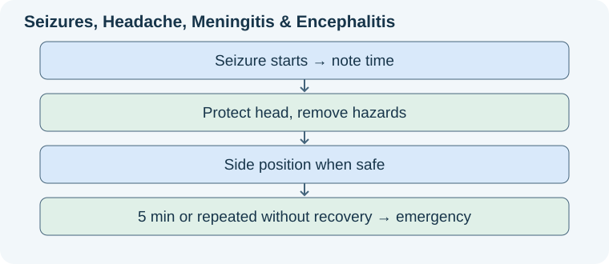

# Seizures, Headache, Meningitis and Encephalitis

**Status:** Study-ready, not yet studied. **Priority:** Very high (editorial exam focus, official weightage nahi).

[Chapter](../README.md) · [MCQs](../MCQs/05-Seizures-Headache-Neuro-Infections.md) · [Previous Year Questions](../Previous-Year-Questions/README.md) · [Revision](../Revision/Nervous-System-Quick-Revision.md) · [References](../References.md)

## Is file mein kya padhenge?
- [Seizure aur epilepsy](#seizure-aur-epilepsy)
- [Headache aur neuralgia](#headache-aur-neuralgia)
- [Meningitis aur encephalitis](#meningitis-aur-encephalitis)

Ye original revision diagram hai. Neeche poora concept samjho.

## Seizure aur epilepsy

Seizure brain ki abnormal electrical activity ka episode hai. Epilepsy mein recurrent unprovoked seizures ki tendency hoti hai. Focal seizure ek network se start hota hai. Generalized seizure dono hemispheres ke networks ko involve karta hai. Absence mein brief staring ho sakti hai. Tonic-clonic mein stiffening aur jerking hoti hai. Postictal period mein confusion ya sleepiness ho sakti hai. Convulsive seizure 5 minutes ya zyada chale ya recovery ke bina repeat ho toh status epilepticus emergency hai.

Nurse time note kare, injury se protect kare, head cushion kare aur possible ho toh safely side position de. Mouth mein spoon, fingers ya water mat daalo. Movements ko force se restrain mat karo. Airway, oxygenation, glucose aur emergency response assess karo. Protocol mein benzodiazepine first-line hota hai, phir longer-acting antiseizure medicine as ordered. Respiratory depression monitor karo. Phenytoin gingival hyperplasia aur IV administration complications se associated hai. Valproate liver toxicity aur pregnancy-related fetal risk se juda hai. Levetiracetam mood changes kar sakta hai. Carbamazepine hyponatremia aur serious rash kar sakti hai. Medicine abruptly stop mat karwao.

## Headache aur neuralgia

Migraine mein recurrent moderate/severe headache, nausea, photophobia aur kabhi aura hoti hai. Tension headache usually pressure-band jaisa hota hai. Cluster headache severe unilateral orbital pain ke saath tearing ya nasal symptoms de sakta hai. Sudden thunderclap headache, fever with neck stiffness, new focal deficit, altered consciousness ya trauma red flags hain. Subarachnoid hemorrhage mein sudden severe headache classic hai. Trigeminal neuralgia mein face par electric-shock jaisa short pain touch ya chewing se trigger ho sakta hai. Carbamazepine often prescribed first-line hai. Nurse trigger, duration, hydration aur red flags assess karti hai.

## Meningitis aur encephalitis

Meningitis meninges ki inflammation hai. Fever, headache, neck stiffness aur altered consciousness ho sakte hain, lekin sab signs har patient mein nahi hote. Kernig aur Brudzinski classical clues hain, negative sign disease exclude nahi karta. Bacterial meningitis time-critical hai. Blood cultures aur LP as safe, prompt antibiotics aur indicated dexamethasone clinician protocol se hote hain. Suspected meningococcal disease mein droplet precautions aur close-contact prophylaxis public health guidance se hoti hai. Encephalitis brain tissue ki inflammation hai. Behaviour change, seizures aur confusion prominent ho sakte hain. Suspected HSV encephalitis mein early IV acyclovir as ordered important hai. Brain abscess localized infection hai aur imaging, antibiotics aur possible drainage chahiye. Nurse airway, seizures, consciousness, temperature aur fluid balance monitor karti hai.

## Teaching aur MCQ videos

| Topic | Teaching video | MCQ practice | Priority |
|---|---|---|---|
| Seizure aur epilepsy | [Related mixed-topic nursing lesson](https://www.youtube.com/watch?v=W3PHS7Akq4k) | [Related mixed-topic MCQ/revision class](https://www.youtube.com/watch?v=OAqcR_fK9Uc) | Very high |
| Headache aur neuralgia | [Related mixed-topic nursing lesson](https://www.youtube.com/watch?v=W3PHS7Akq4k) | [Related mixed-topic MCQ/revision class](https://www.youtube.com/watch?v=OAqcR_fK9Uc) | Very high |
| Meningitis aur encephalitis | [Related mixed-topic nursing lesson](https://www.youtube.com/watch?v=W3PHS7Akq4k) | [Related mixed-topic MCQ/revision class](https://www.youtube.com/watch?v=OAqcR_fK9Uc) | Very high |

Video titles/descriptions search mein mile hain. Har subtopic ka exact segment aur poori recording verify nahi hui hai. Community-specific video abhi pending hai.

**Reading:** [Medical reference](https://www.cdc.gov/epilepsy/first-aid-for-seizures/) · [All sources](../References.md).

[Chapter](../README.md) · [MCQs](../MCQs/05-Seizures-Headache-Neuro-Infections.md) · [Previous Year Questions](../Previous-Year-Questions/README.md) · [Revision](../Revision/Nervous-System-Quick-Revision.md) · [References](../References.md)
