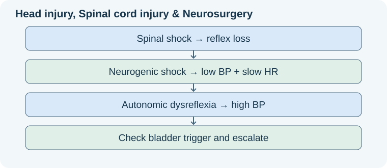
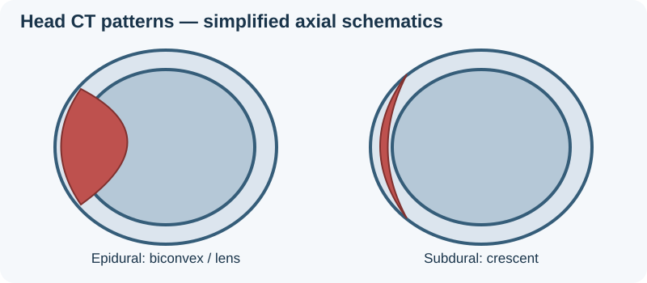

# Head injury, Spinal cord injury and Neurosurgery

**Status:** Study-ready, not yet studied. **Priority:** Very high (editorial exam focus, official weightage nahi).

[Chapter](../README.md) · [MCQs](../MCQs/06-Head-Spinal-Injury-Neurosurgery.md) · [Previous Year Questions](../Previous-Year-Questions/README.md) · [Revision](../Revision/Nervous-System-Quick-Revision.md) · [References](../References.md)

## Is file mein kya padhenge?
- [Head injury aur hematomas](#head-injury-aur-hematomas)
- [Spinal cord injury aur shocks](#spinal-cord-injury-aur-shocks)
- [Neurosurgery aur rehabilitation](#neurosurgery-aur-rehabilitation)

Ye original revision diagram hai. Neeche poora concept samjho.

## Head injury aur hematomas

Head injury mein primary damage impact se hota hai. Secondary damage hypoxia, hypotension aur swelling se badh sakta hai. Concussion transient brain dysfunction hai, normal CT possible hai. Epidural hematoma often middle meningeal artery se associated aur CT par lens-shaped hota hai. Lucid interval ho sakta hai par hamesha nahi. Subdural hematoma often bridging veins se aur crescent-shaped hota hai. Elderly aur anticoagulated patients risk mein hote hain. Subarachnoid hemorrhage subarachnoid space mein bleeding hai. Basilar skull fracture mein Battle sign, raccoon eyes ya CSF leak ho sakta hai. Suspected basal fracture mein blind nasal tube insertion avoid karo. Neck injury possible hai toh spinal alignment protect karo. Airway compromise priority hai.

## Spinal cord injury aur shocks

Cervical injury arms, legs aur breathing affect kar sakti hai. C3–C5 phrenic nerve diaphragm ko supply karti hai. Thoracic ya lumbar injury lower body ko affect kar sakti hai. Spinal shock mein lesion ke neeche temporary loss of reflexes aur flaccid paralysis hoti hai. Neurogenic shock sympathetic tone loss ki wajah se hypotension aur relative bradycardia de sakta hai, often high spinal injury mein. Hemorrhage bhi exclude karna zaroori hai. Autonomic dysreflexia usually T6 ya above established SCI mein hoti hai. Trigger full bladder, blocked catheter, bowel impaction ya skin pressure ho sakta hai. Severe hypertension, headache aur sweating above lesion mil sakti hai. Patient ko upright karo if safe, tight clothes loosen karo, BP repeatedly check karo, urinary trigger assess karo aur urgent protocol follow karo. Cauda equina mein saddle anesthesia, new urinary retention aur leg symptoms urgent imaging ke clues hain.

## Neurosurgery aur rehabilitation

Craniotomy mein skull ka bone flap temporarily remove aur usually replace kiya jaata hai. Craniectomy mein bone flap immediately replace nahi hota. Postoperative position surgeon ke order se decide hoti hai, har neurosurgical patient ka fixed position nahi hota. Nurse GCS, pupils, motor response, wound drainage, fever, fluid balance aur seizures monitor karti hai. Pituitary surgery ke baad diabetes insipidus ya SIADH possible hain. SCI rehab mein pressure injury prevention, safe transfers, bowel-bladder programme, DVT prevention as ordered, range of motion, respiratory care aur psychological support chahiye. Log roll trained team se alignment maintain karte hue karo. Halo traction weights ya devices independently adjust mat karo.

## Teaching aur MCQ videos

| Topic | Teaching video | MCQ practice | Priority |
|---|---|---|---|
| Head injury aur hematomas | [Related mixed-topic nursing lesson](https://www.youtube.com/watch?v=k87PigKgUc8) | [Related mixed-topic MCQ/revision class](https://www.youtube.com/watch?v=OAqcR_fK9Uc) | Very high |
| Spinal cord injury aur shocks | [Related mixed-topic nursing lesson](https://www.youtube.com/watch?v=k87PigKgUc8) | [Related mixed-topic MCQ/revision class](https://www.youtube.com/watch?v=OAqcR_fK9Uc) | Very high |
| Neurosurgery aur rehabilitation | [Related mixed-topic nursing lesson](https://www.youtube.com/watch?v=k87PigKgUc8) | [Related mixed-topic MCQ/revision class](https://www.youtube.com/watch?v=OAqcR_fK9Uc) | Very high |

Video titles/descriptions search mein mile hain. Har subtopic ka exact segment aur poori recording verify nahi hui hai. Community-specific video abhi pending hai.

**Reading:** [Medical reference](https://openstax.org/books/medical-surgical-nursing/pages/17-9-neurological-injuries) · [All sources](../References.md).

[Chapter](../README.md) · [MCQs](../MCQs/06-Head-Spinal-Injury-Neurosurgery.md) · [Previous Year Questions](../Previous-Year-Questions/README.md) · [Revision](../Revision/Nervous-System-Quick-Revision.md) · [References](../References.md)
