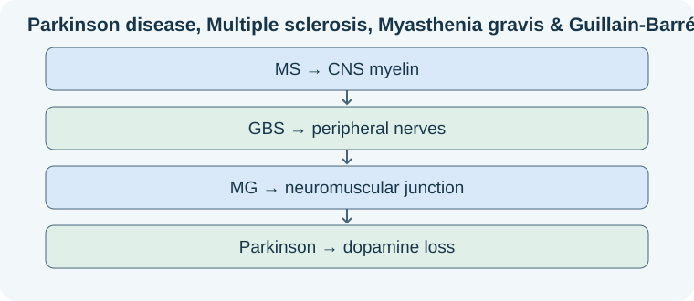
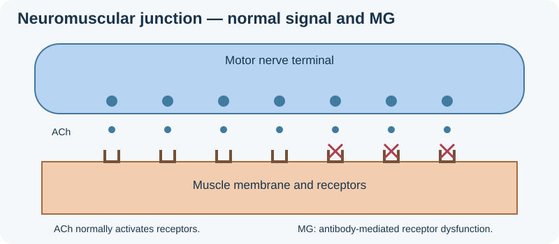

# Parkinson disease, Multiple sclerosis, Myasthenia gravis and Guillain-Barré syndrome

**Status:** Study-ready, not yet studied. **Priority:** Very high (editorial exam focus, official weightage nahi).

[Chapter](../README.md) · [MCQs](../MCQs/07-Parkinson-MS-MG-GBS.md) · [Previous Year Questions](../Previous-Year-Questions/README.md) · [Revision](../Revision/Nervous-System-Quick-Revision.md) · [References](../References.md)

## Is file mein kya padhenge?
- [Parkinson disease](#parkinson-disease)
- [Multiple sclerosis](#multiple-sclerosis)
- [Myasthenia gravis](#myasthenia-gravis)
- [Guillain-Barré syndrome](#guillain-barr-syndrome)

Ye original revision diagram hai. Neeche poora concept samjho.

## Parkinson disease

Substantia nigra ke dopamine-producing neurons kam ho jaate hain. Movement initiate karna mushkil hota hai, jise bradykinesia kehte hain. Resting tremor, rigidity, shuffling gait aur postural instability mil sakti hai. Mask-like face aur reduced arm swing clues hain. Levodopa brain mein dopamine mein convert hoti hai aur carbidopa peripheral breakdown kam karti hai. Medicine time par dena important hai, kyunki late dose se movement aur swallowing worsen ho sakte hain. Orthostatic hypotension, hallucinations aur dyskinesia monitor karo. Walking cues, fall prevention, constipation care aur swallow support help karte hain.

## Multiple sclerosis

MS mein immune system CNS myelin ko damage karta hai. Isliye signal slow ya blocked ho sakta hai. Optic neuritis, sensory symptoms, weakness, diplopia, fatigue aur bladder issues ho sakte hain. Symptoms heat mein temporarily worsen ho sakte hain, jise Uhthoff phenomenon kehte hain. MRI aur CSF oligoclonal bands diagnosis support kar sakte hain. Relapse mein prescribed steroids aur disease-modifying therapy disease control mein role rakhte hain. Nurse energy conservation, cooling, fall prevention aur infection assessment samjhati hai.

## Myasthenia gravis

MG mein antibodies neuromuscular junction par communication ko disturb karti hain. Muscles activity ke saath weak aur rest se better ho sakti hain. Ptosis, diplopia, dysphagia aur nasal speech clues hain. Sensation usually normal hai. Pyridostigmine acetylcholinesterase inhibit karke acetylcholine ka effect badhati hai. Meal timing ko medicine order ke saath coordinate karo. Myasthenic crisis mein respiratory weakness life-threatening hai. Serial vital capacity, breathing effort aur swallowing assess karo. Excess cholinergic medicine se weakness ke saath salivation, diarrhea, miosis aur bradycardia ho sakti hai. Dono crisis mein emergency clinician review chahiye. Edrophonium testing routine modern bedside distinction nahi hai.

## Guillain-Barré syndrome

GBS immune-mediated peripheral nerve disorder hai. Infection ke baad symmetric ascending weakness aur reduced reflexes common hain. Autonomic instability mein heart rate aur BP fluctuate kar sakte hain. CSF mein high protein with few cells classical finding hai, early CSF normal ho sakta hai. IVIG ya plasma exchange treatments hain. Steroids alone typical GBS treatment nahi hain. Nurse serial vital capacity, respiratory effort, cardiac rhythm, swallowing, pain aur skin monitor karti hai. Oxygen saturation normal dikhne par bhi respiratory muscles weak ho sakti hain.

## Teaching aur MCQ videos

| Topic | Teaching video | MCQ practice | Priority |
|---|---|---|---|
| Parkinson disease | [Related mixed-topic nursing lesson](https://www.youtube.com/watch?v=W3PHS7Akq4k) | [Related mixed-topic MCQ/revision class](https://www.youtube.com/watch?v=OAqcR_fK9Uc) | Very high |
| Multiple sclerosis | [Related mixed-topic nursing lesson](https://www.youtube.com/watch?v=W3PHS7Akq4k) | [Related mixed-topic MCQ/revision class](https://www.youtube.com/watch?v=OAqcR_fK9Uc) | Very high |
| Myasthenia gravis | [Related mixed-topic nursing lesson](https://www.youtube.com/watch?v=W3PHS7Akq4k) | [Related mixed-topic MCQ/revision class](https://www.youtube.com/watch?v=OAqcR_fK9Uc) | Very high |
| Guillain-Barré syndrome | [Related mixed-topic nursing lesson](https://www.youtube.com/watch?v=W3PHS7Akq4k) | [Related mixed-topic MCQ/revision class](https://www.youtube.com/watch?v=OAqcR_fK9Uc) | Very high |

Video titles/descriptions search mein mile hain. Har subtopic ka exact segment aur poori recording verify nahi hui hai. Community-specific video abhi pending hai.

**Reading:** [Medical reference](https://openstax.org/books/medical-surgical-nursing/pages/17-3-chronic-disorders-of-the-nervous-system) · [All sources](../References.md).

[Chapter](../README.md) · [MCQs](../MCQs/07-Parkinson-MS-MG-GBS.md) · [Previous Year Questions](../Previous-Year-Questions/README.md) · [Revision](../Revision/Nervous-System-Quick-Revision.md) · [References](../References.md)
