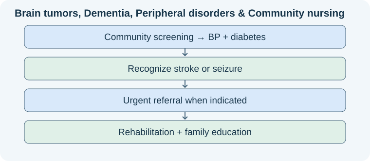

# Brain tumors, Dementia, Peripheral disorders and Community nursing

**Status:** Study-ready, not yet studied. **Priority:** High (editorial exam focus, official weightage nahi).

[Chapter](../README.md) · [MCQs](../MCQs/08-Tumors-Dementia-Neuropathy-Community.md) · [Previous Year Questions](../Previous-Year-Questions/README.md) · [Revision](../Revision/Nervous-System-Quick-Revision.md) · [References](../References.md)

## Is file mein kya padhenge?
- [Brain aur spinal tumors](#brain-aur-spinal-tumors)
- [Dementia, delirium, ALS aur Huntington disease](#dementia-delirium-als-aur-huntington-disease)
- [Peripheral nerve disorders aur Bell palsy](#peripheral-nerve-disorders-aur-bell-palsy)
- [Community, paediatric aur preventive nursing](#community-paediatric-aur-preventive-nursing)

Ye original revision diagram hai. Neeche poora concept samjho.

## Brain aur spinal tumors

Tumor space occupy karta hai. Isse headache, seizures, focal weakness ya raised ICP ho sakta hai. Symptoms location ke hisaab se change hote hain. Glioma glial lineage se related tumor hai, meningioma meninges se arise hota hai aur vestibular schwannoma hearing/balance symptoms de sakta hai. MRI, tissue diagnosis aur specialist planning se treatment decide hota hai. Dexamethasone selected tumor-related edema mein help karta hai, har raised ICP mein nahi. Spinal tumor mein progressive pain, weakness aur bowel-bladder change urgent assessment maangte hain.

## Dementia, delirium, ALS aur Huntington disease

Dementia mein cognition ka gradual decline daily life affect karta hai. Alzheimer disease mein memory aur later other cognitive skills impair ho sakti hain. Delirium acute fluctuating inattention hai aur infection, drugs, dehydration ya metabolic problems se ho sakta hai. Sudden confusion ko dementia progression mat samjho. Nurse orientation cues, familiar routine, hearing aids, hydration aur cause assessment use karti hai. ALS motor neurons ko damage karta hai, UMN aur LMN signs coexist kar sakte hain. Respiratory aur swallowing support central hain. Huntington disease autosomal dominant disorder hai, chorea, behavioural aur cognitive symptoms de sakta hai.

## Peripheral nerve disorders aur Bell palsy

Bell palsy acute peripheral facial nerve weakness hai. Forehead aur lower face dono affected ho sakte hain. Eye fully close na ho toh lubrication aur protection important hai. Stroke suspicion ho toh immediate evaluation chahiye. Diabetic neuropathy mein feet numb ho sakte hain aur unnoticed injury ka risk badhta hai. Daily foot inspection, proper footwear aur glucose management sikhao. Carpal tunnel syndrome median nerve compression hai. Thumb, index, middle aur radial ring finger mein tingling ho sakti hai. Trigeminal neuralgia facial shock-like pain hai. Chronic neuropathic pain mein burning ya electric sensation ho sakti hai.

## Community, paediatric aur preventive nursing

Community nurse BP, diabetes, tobacco use aur physical activity par education dekar stroke prevention mein help karti hai. Seizure first aid, medicine adherence, safe bathing aur stigma reduction sikhao. Suspected rabies exposure mein wound ko soap aur running water se lagbhag 15 minutes wash karo aur urgent post-exposure prophylaxis assessment karwao. Category III exposure mein vaccine aur indicated immunoglobulin/approved antibody product ki zaroorat ho sakti hai. Previously vaccinated logon ka protocol alag hai. Japanese encephalitis mosquito-borne infection hai, vaccination as per local programme aur mosquito protection important hain. Polio acute flaccid paralysis de sakta hai. Acute flaccid paralysis ko surveillance programme ke according urgently report karo. Spina bifida neural tube defect hai. Preconception folic acid prevention mein help karta hai. Open lesion ko sterile moist non-adherent dressing aur pressure protection chahiye as per neonatal protocol. Cerebral palsy non-progressive developing brain injury se movement/posture disorder hai, manifestations time ke saath badal sakte hain. Febrile seizure usually 6 months–5 years mein hota hai. Prolonged, focal ya repeated event urgent evaluation maangta hai. Disability rehab mein family education, physiotherapy, assistive devices, caregiver respite aur referral important hain.

## Teaching aur MCQ videos

| Topic | Teaching video | MCQ practice | Priority |
|---|---|---|---|
| Brain aur spinal tumors | [Related mixed-topic nursing lesson](https://www.youtube.com/watch?v=k87PigKgUc8) | [Related mixed-topic MCQ/revision class](https://www.youtube.com/watch?v=OAqcR_fK9Uc) | High |
| Dementia, delirium, ALS aur Huntington disease | [Related mixed-topic nursing lesson](https://www.youtube.com/watch?v=k87PigKgUc8) | [Related mixed-topic MCQ/revision class](https://www.youtube.com/watch?v=OAqcR_fK9Uc) | High |
| Peripheral nerve disorders aur Bell palsy | [Related mixed-topic nursing lesson](https://www.youtube.com/watch?v=k87PigKgUc8) | [Related mixed-topic MCQ/revision class](https://www.youtube.com/watch?v=OAqcR_fK9Uc) | High |
| Community, paediatric aur preventive nursing | [Related mixed-topic nursing lesson](https://www.youtube.com/watch?v=k87PigKgUc8) | [Related mixed-topic MCQ/revision class](https://www.youtube.com/watch?v=OAqcR_fK9Uc) | High |

Video titles/descriptions search mein mile hain. Har subtopic ka exact segment aur poori recording verify nahi hui hai. Community-specific video abhi pending hai.

**Reading:** [Medical reference](https://www.who.int/news-room/fact-sheets/detail/rabies/) · [All sources](../References.md).

[Chapter](../README.md) · [MCQs](../MCQs/08-Tumors-Dementia-Neuropathy-Community.md) · [Previous Year Questions](../Previous-Year-Questions/README.md) · [Revision](../Revision/Nervous-System-Quick-Revision.md) · [References](../References.md)

---

# Detailed learning and clinical application

## Brain tumor assessment and treatment

Primary tumor brain structures se originate karta hai. Metastatic tumor elsewhere cancer se spread hota hai. Benign histology ka matlab brain location mein harmless hona nahi hai. Closed skull mein slow-growing lesion bhi pressure, seizures aur focal deficits de sakta hai. Glioblastoma aggressive glioma hai. Meningioma meninges-related tumor hai. Pituitary adenoma hormonal disturbance ya optic chiasm compression se bitemporal visual field loss de sakta hai. Vestibular schwannoma unilateral hearing symptoms aur balance problem de sakta hai.

Assessment mein new headache pattern, morning vomiting, seizures, vision, personality, motor function aur endocrine clues note karo. MRI and tissue classification treatment guide karte hain. Surgery, radiation, chemotherapy ya targeted therapy type/location par depend karte hain. Dexamethasone selected vasogenic edema reduce kar sakti hai. Glucose, infection risk, GI symptoms aur prescribed taper monitor karo. Seizure prophylaxis har seizure-naive tumor patient mein routine necessary nahi hai, specialist plan follow karo.

## Dementia versus delirium

Alzheimer disease progressive neurodegenerative condition hai with amyloid and tau pathology association. Early recent-memory impairment common hai. Later language, recognition, daily activities aur swallowing affect ho sakte hain. Vascular cognitive impairment cerebrovascular disease se related hai. Lewy body dementia mein cognitive fluctuation, visual hallucinations aur parkinsonism ho sakta hai. Frontotemporal dementia mein behaviour ya language changes early prominent ho sakte hain.

Delirium hours/days mein develop hota hai aur attention fluctuate karti hai. Hypoactive delirium quiet drowsiness jaisa dikh sakta hai, isliye miss ho sakta hai. Infection, hypoxia, pain, retention, constipation, dehydration aur drugs common precipitants hain. CAM-type assessment acute change/fluctuation aur inattention ke saath disorganized thinking ya altered consciousness evaluate karta hai.

| Feature | Delirium | Dementia |
|---|---|---|
| Onset | Acute | Usually gradual |
| Attention | Impaired | Early stages mein relatively preserved ho sakti hai |
| Course | Fluctuating | Progressive or stepwise |
| Priority | Cause identify and treat | Function and long-term support |

Nurse glasses/hearing aids, daylight, sleep routine, mobility, hydration aur orientation support karti hai. Restraints delirium worsen kar sakti hain aur last-resort policy follow hoti hai. Cholinesterase inhibitors selected dementia cases mein symptomatic benefit de sakte hain. Bradycardia/GI effects monitor karo. Memantine NMDA receptor modulation se related hai. Medicine cure nahi hai. Caregiver burden aur wandering safety assess karo.

## ALS, Huntington and other movement disorders

ALS progressive upper and lower motor neuron disorder hai. Weakness, fasciculations, atrophy, spasticity, dysarthria aur dysphagia possible hain. Sensation usually relatively preserved hai. Respiratory insufficiency major concern hai. Noninvasive ventilation, cough support, nutrition, communication aids aur palliative planning multidisciplinary care ka part hain. Riluzole selected disease therapy hai, liver monitoring protocol important hai.

Huntington disease HTT CAG repeat expansion se associated autosomal dominant disorder hai. Chorea involuntary irregular movements hain. Mood, behaviour aur cognition affect ho sakte hain. Genetic counselling voluntary informed decision ke saath honi chahiye. Nurse injury prevention, nutrition, swallow safety, mental health aur family support par focus karti hai.

Essential tremor commonly action/postural tremor hota hai unlike classical Parkinson resting tremor. Dystonia sustained/intermittent abnormal muscle contractions se posture twisting de sakti hai. Akathisia inner restlessness aur movement urge hai. Tardive dyskinesia long-term dopamine-blocking drug exposure se involuntary movements de sakti hai.

## Peripheral neuropathy and cranial nerve disorders

Peripheral neuropathy diabetes, nutritional deficiency, alcohol, toxins, medicines, immune disease aur compression se ho sakti hai. Polyneuropathy multiple nerves affect karti hai. Mononeuropathy single nerve. Distal symmetric neuropathy stocking-glove pattern de sakti hai. Loss of protective sensation foot ulcers ka risk badhata hai. Daily skin inspection, suitable shoes, podiatry referral aur glycemic management important hain. Heating pad ya hot water se numb skin burn ho sakti hai.

Bell palsy peripheral CN VII weakness hai. Forehead weakness aur incomplete eye closure ho sakte hain. Central lesions often forehead relatively spare karte hain but rule absolute nahi. Sudden facial weakness mein stroke signs assess karo. Early prescribed corticosteroid selected Bell palsy treatment hai. Eye lubricant, night protection and corneal symptoms monitoring important hain. Ear vesicles with facial palsy Ramsay Hunt syndrome concern ho sakti hain.

Trigeminal neuralgia brief severe shock-like facial pain hai. Trigger zones light touch se attacks initiate kar sakte hain. Carbamazepine/oxcarbazepine common prescribed options hain. Poor oral intake and dental hygiene impact assess karo. Atypical numbness or bilateral symptoms specialist evaluation maangte hain.

## Paediatric neurological nursing

Neural tube defects mein spina bifida occulta, meningocele aur myelomeningocele forms hain. Meningocele mein meninges protrude karti hain, myelomeningocele mein neural tissue bhi involve ho sakta hai. Hydrocephalus/Chiari II association possible hai. Open sac protect karo, latex sensitivity risk consider karo, temperature, infection aur lower limb/bladder function monitor karo. Preconception folic acid common standard-risk recommendation 400 micrograms daily hai, higher-risk doses clinician and national guidelines se decide hote hain.

Cerebral palsy developing brain ki nonprogressive disturbance se movement/posture impairment hai. Spastic, dyskinetic aur ataxic patterns ho sakte hain. Feeding, communication, seizures, hearing, vision aur developmental support assess karo. Physiotherapy, occupational therapy, orthoses and selected spasticity therapy functional goals support karte hain.

Febrile seizure commonly 6 months to 5 years age range mein hota hai. Simple febrile seizure generally generalized, less than 15 minutes and once in 24 hours hota hai. Complex features focal, prolonged or recurrent ho sakte hain. First aid seizure safety jaisa hai. Fever cause, meningitis red flags aur recovery assess karo. Antipyretics comfort ke liye hain, febrile seizure recurrence reliably prevent nahi karte.

## Community neurological health and surveillance

Stroke prevention ke liye BP screening, diabetes control, tobacco cessation, physical activity, balanced diet aur atrial fibrillation identification as appropriate important hain. Community health officer acute focal deficits recognize karke emergency referral coordinate kare. Suspected stroke ko routine OPD follow-up mein delay mat karo.

Rabies exposure mein wound wash roughly 15 minutes, immediate healthcare evaluation, vaccination aur indicated rabies immunoglobulin/approved antibody product important hain. Category I intact skin contact, Category II minor scratches without bleeding aur Category III transdermal bites/scratches or saliva contact with mucosa/broken skin classical WHO categories hain. Local national protocol and previous vaccination history regimen decide karte hain. Symptoms start hone ke baad rabies almost always fatal hoti hai, prevention time-critical hai.

Japanese encephalitis Culex mosquitoes se spread ho sakti hai. Humans typically dead-end hosts hain. Vaccination eligible endemic areas mein programme ke according aur mosquito bite prevention important hai. Encephalitis signs fever, altered consciousness aur seizures urgent referral maangte hain. Acute encephalitis syndrome surveillance case definition programme ke according apply karo.

Poliovirus fecal-oral spread kar sakta hai aur anterior horn motor neurons affect karke flaccid paralysis de sakta hai. AFP surveillance children under 15 and suspected polio at any age ke programme definitions par based hai. Stool specimen timing and transport local surveillance team coordinate karti hai. OPV/IPV national immunization schedule as updated follow karo. Tetanus toxin inhibitory neurotransmitter release block karke rigidity/spasms de sakta hai. Wound care aur immunization prevention mein important hain.

## Rehabilitation, home care and nursing process

Assessment mein ADL, mobility, swallow, communication, cognition, continence, skin, caregiver capacity aur home barriers dekho. Nursing diagnoses patient-specific ho sakte hain: impaired mobility, risk for aspiration, impaired verbal communication, risk for pressure injury, self-care deficit aur caregiver strain. Measurable goals set karo. Intervention evaluate karo aur plan adjust karo.

Home modification mein grab bars, adequate lighting, clutter removal, safe footwear, accessible toilets aur assistive devices useful ho sakte hain. Seizure patient ko supervised swimming, safe cooking/bathing aur emergency action plan counsel karo. Disability benefits and rehabilitation referral local services ke according discuss karo. Family ko medication list, follow-up, emergency warning signs aur respectful communication sikhao.

**Sources:** [Medical-surgical nursing neurological disorders](https://openstax.org/books/medical-surgical-nursing/pages/17-introduction) · [WHO rabies](https://www.who.int/news-room/fact-sheets/detail/rabies) · [WHO Japanese encephalitis](https://www.who.int/news-room/fact-sheets/detail/japanese-encephalitis).

[Chapter](../README.md) · [Topic-wise MCQs](../MCQs/08-Tumors-Dementia-Neuropathy-Community.md) · [Revision](../Revision/Nervous-System-Quick-Revision.md)
