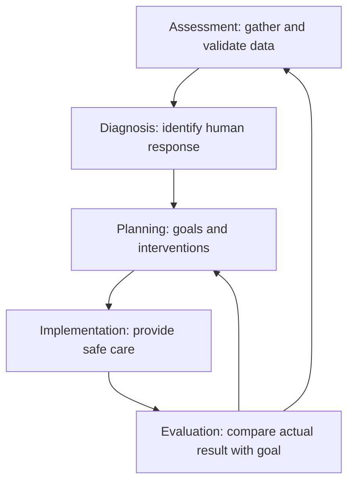

# 📚 Nursing process and care planning

**Topic priority:** 🟠 HIGH YIELD · **Study-ready, not studied.** 17 earlier group 01 questions (Q1–3, 5–9, 11–16, 18–20) + [13 new questions](../MCQs/01A-Nursing-Process-and-Care-Planning-13-MCQs.md) = 30 allocated. Three remaining earlier questions assigned to clinical judgment. Allocation does not duplicate authorship.

## 🔹 ADPIE ka simple meaning

<!-- job4-metadata -->
**Section priority:** 🔴 MOST IMPORTANT (editorial)

**Related MCQs:** [Q2](../MCQs/01A-Nursing-Process-and-Care-Planning-13-MCQs.md#q2-a-patient-is-admitted-with-an-established-chronic-illness-which-assessment-best-provides-a-baseline-for-subsequent-individualized-care) · [Q5](../MCQs/01A-Nursing-Process-and-Care-Planning-13-MCQs.md#q5-which-combination-best-supports-an-individualized-nursing-diagnosis-rather-than-an-unsupported-assumption) · [Q12](../MCQs/01A-Nursing-Process-and-Care-Planning-13-MCQs.md#q12-an-outcome-is-partially-achieved-because-a-patient-can-transfer-with-one-assistant-but-not-independently-as-planned-what-is-the-best-evaluation)

**Exam evidence:** **[🟣 AIIMS Jodhpur 2019 — related tested concept](https://testbook.com/question-answer/which-of-the-following-is-a-stage-of-the-nursing-p--625d555433fbce0163e0cb79)**. Related concepts only, not an exact question match. [Reported adaptations](../Previous-Year-Questions/01-Nursing-Process-Reported-Evidence.md)

**Learning reference:** [OpenStax nursing process](https://openstax.org/books/clinical-nursing-skills/pages/1-3-nursing-process)

**🎬 [Teaching — ADPIE Nursing Process Steps Explained](https://www.youtube.com/watch?v=A_Y7DtgZbyg)** · Bhushan Science – Nursing; previously indexed ADPIE lesson, playback pending.

**▶️ [YouTube MCQ practice — Nursing process, ADPIE scenarios](https://www.youtube.com/watch?v=Nczi2xT76QA)** · ADAPT NCLEX REVIEW, description and published topic chapters verified, supplementary practice not Indian exam evidence; exact question coverage pending.
<!-- /job4-metadata -->

Nursing process ko aap patient ki dekhbhaal karne ka ek systematic tareeka samjho. Nurse pehle patient ki zaroorat samajhti hai. Phir woh uske hisaab se care ka plan banati hai, care deti hai aur dekhti hai ki patient ko kitna fayda hua. Ye cycle baar-baar chalti hai, kyunki patient ki condition badal sakti hai.

Maan lo operation ke baad patient kehta hai ki use chalne mein dikkat ho rahi hai. Nurse pehle poochti hai ki dard kitna hai aur operation se pehle patient kitna chal paata tha. Woh patient ki movement, vital signs aur safety bhi check karti hai. Is information se nurse samajhti hai ki patient ko kis tarah ki madad chahiye. Phir woh ek achievable goal banati hai. Safe assistance dene ke baad nurse dobara check karti hai ki patient ki movement mein improvement hua ya nahi.

| Step | Meaning | Example |
|---|---|---|
| Assessment | Nurse patient ki batayi hui aur khud observe ya measure ki hui information collect karti hai aur zaroorat par use verify karti hai. | Patient chakkar aane ki baat batata hai aur nurse uski observations check karti hai. |
| Diagnosis | Nurse evidence ke basis par patient ki health problem se judi response ya risk ko identify karti hai. | Findings ke hisaab se nurse activity intolerance ya fall risk identify kar sakti hai. |
| Planning | Nurse patient ke saath measurable goal aur safe care plan banati hai. | Patient agreed review time tak safe transfer ka tareeka dikha sakega. |
| Implementation | Nurse apni competence aur scope ke andar planned care deti hai aur patient ki condition badalne par care adjust karti hai. | Nurse suitable equipment aur staff ki madad se patient ko safely transfer karwati hai. |
| Evaluation | Nurse actual result ko planned goal ke saath compare karti hai. | Nurse record karti hai ki patient ko kitni madad chahiye thi aur zaroorat par plan revise karti hai. |

Kuch professional standards mein outcome identification, yaani patient mein kya result chahiye, planning se alag step hota hai. Isliye unmein chhe phases hote hain. ADPIE nursing process ke paanch steps yaad rakhne ka valid teaching mnemonic hai. Exam mein dekho ki question kis framework ke hisaab se poochha gaya hai. Ye steps har situation mein fixed order mein karna zaroori nahi hai. Agar patient ki jaan ko turant khatra hai, toh nurse assessment ke saath-saath zaroori safety action bhi leti hai.

## 🔹 Assessment and data validation

<!-- job4-metadata -->
**Section priority:** 🔴 MOST IMPORTANT (editorial)

**Related MCQs:** [Q1](../MCQs/01A-Nursing-Process-and-Care-Planning-13-MCQs.md#q1-a-stable-patient-reports-a-weight-loss-of-5-kg-but-serial-recorded-weights-show-a-decrease-of-only-1-kg-what-should-the-nurse-do-before-finalizing-the-assessment) · [Q2](../MCQs/01A-Nursing-Process-and-Care-Planning-13-MCQs.md#q2-a-patient-is-admitted-with-an-established-chronic-illness-which-assessment-best-provides-a-baseline-for-subsequent-individualized-care) · [Q3](../MCQs/01A-Nursing-Process-and-Care-Planning-13-MCQs.md#q3-a-stable-inpatient-reports-a-new-localized-skin-itch-following-use-of-a-different-adhesive-which-assessment-approach-best-matches-this-new-complaint) · [Q4](../MCQs/01A-Nursing-Process-and-Care-Planning-13-MCQs.md#q4-a-patient-with-limited-consciousness-cannot-provide-a-reliable-history-which-approach-to-nursing-assessment-is-appropriate)

**Exam evidence:** **[🟣 AIIMS Jodhpur 2019 — related tested concept](https://testbook.com/question-answer/which-of-the-following-is-a-stage-of-the-nursing-p--625d555433fbce0163e0cb79)** · **[🟣 GMCH 2025 — related tested concept, booklet text](https://gmch.chdadmnrectt.in/pdf/qns-ans-booklet-2025.pdf)**. Related concepts only, not an exact question match. [Reported adaptations](../Previous-Year-Questions/01-Nursing-Process-Reported-Evidence.md)

**Learning reference:** [OpenStax nursing process](https://openstax.org/books/clinical-nursing-skills/pages/1-3-nursing-process)

**🎬 [Teaching — ADPIE Nursing Process Steps Explained](https://www.youtube.com/watch?v=A_Y7DtgZbyg)** · Bhushan Science – Nursing; previously indexed ADPIE lesson, playback pending.

**▶️ [YouTube MCQ practice — Nursing process, ADPIE scenarios](https://www.youtube.com/watch?v=Nczi2xT76QA)** · ADAPT NCLEX REVIEW, description and published topic chapters verified, supplementary practice not Indian exam evidence; exact question coverage pending.
<!-- /job4-metadata -->

Subjective data woh information hai jo patient apne experience ke baare mein batata hai. Jaise patient kehta hai ki use ulti jaisa lag raha hai. Objective data woh information hai jo nurse observe ya measure kar sakti hai, jaise thermometer se measure kiya hua temperature.

Aam taur par patient khud information ka primary source hota hai. Caregiver, purane records aur healthcare team ki observations secondary sources ho sakti hain. Nurse ko record mein batana chahiye ki information kahan se mili.

Initial comprehensive assessment mein nurse patient ki overall condition ka baseline samajhti hai, taaki baad mein changes pehchaan sake. Focused assessment mein nurse kisi ek specific nayi problem ko detail mein check karti hai. Emergency assessment mein nurse jaan ko turant khatra pahunchane wali problems pehle dhoondhti hai. Ongoing reassessment se nurse ko pata chalta hai ki patient ki condition badal rahi hai ya nahi.

Agar patient ki baat aur recorded measurement match nahi karte, toh nurse ko measurement ka time, tareeka aur situation check karni chahiye. Woh patient se bhi clarification leti hai. Sirf isliye patient ki takleef ko galat nahi maana ja sakta ki abhi objective evidence nahi mila hai.

## 🔹 Diagnosis, planning and implementation

<!-- job4-metadata -->
**Section priority:** 🔴 MOST IMPORTANT (editorial)

**Related MCQs:** [Q5](../MCQs/01A-Nursing-Process-and-Care-Planning-13-MCQs.md#q5-which-combination-best-supports-an-individualized-nursing-diagnosis-rather-than-an-unsupported-assumption) · [Q6](../MCQs/01A-Nursing-Process-and-Care-Planning-13-MCQs.md#q6-a-nurse-writes-a-care-plan-problem-as-diabetes-mellitus-related-to-excessive-thirst-what-is-the-main-correction-needed) · [Q7](../MCQs/01A-Nursing-Process-and-Care-Planning-13-MCQs.md#q7-a-patient-wants-to-regain-independence-in-dressing-while-the-nurse-initially-proposes-a-different-functional-goal-which-planning-action-is-most-appropriate) · [Q8](../MCQs/01A-Nursing-Process-and-Care-Planning-13-MCQs.md#q8-a-care-plan-says-the-patient-will-drink-adequate-fluids-by-evening-why-should-this-outcome-be-revised) · [Q9](../MCQs/01A-Nursing-Process-and-Care-Planning-13-MCQs.md#q9-a-ward-nurse-writes-a-discharge-goal-for-a-patient-learning-a-new-self-care-skill-which-measure-best-tests-actual-performance) · [Q10](../MCQs/01A-Nursing-Process-and-Care-Planning-13-MCQs.md#q10-an-intervention-in-a-care-plan-requires-equipment-unavailable-on-the-ward-what-is-the-best-implementation-decision) · [Q11](../MCQs/01A-Nursing-Process-and-Care-Planning-13-MCQs.md#q11-a-nurse-carries-out-a-prescribed-treatment-and-adds-appropriate-comfort-measures-within-scope-how-should-the-actions-be-recorded)

**Exam evidence:** **[🟣 GMCH 2025 — related tested concept, booklet text](https://gmch.chdadmnrectt.in/pdf/qns-ans-booklet-2025.pdf)**. Related concepts only, not an exact question match. [Reported adaptations](../Previous-Year-Questions/01-Nursing-Process-Reported-Evidence.md)

**Learning reference:** [OpenStax nursing process](https://openstax.org/books/clinical-nursing-skills/pages/1-3-nursing-process)

**🎬 [Teaching — ADPIE Nursing Process Steps Explained](https://www.youtube.com/watch?v=A_Y7DtgZbyg)** · Bhushan Science – Nursing; previously indexed ADPIE lesson, playback pending.

**▶️ [YouTube MCQ practice — Nursing process, ADPIE scenarios](https://www.youtube.com/watch?v=Nczi2xT76QA)** · ADAPT NCLEX REVIEW, description and published topic chapters verified, supplementary practice not Indian exam evidence; exact question coverage pending.
<!-- /job4-metadata -->

Medical diagnosis se pata chalta hai ki patient ko kaunsi disease hai. Nursing diagnosis mein nurse samajhti hai ki health condition ki wajah se patient ko kya problem ho rahi hai ya kis problem ka risk hai.

Problem-focused nursing diagnosis mein PES teaching structure use kiya ja sakta hai. P ka matlab problem, E ka matlab etiology ya related factor, aur S ka matlab signs aur symptoms hai jo problem ko support karte hain. Risk diagnosis tab use hota hai jab problem ka risk maujood hai, lekin us specific problem ke defining signs abhi nahi hain. Health promotion diagnosis patient ki health-related habits improve karne ki readiness se related hota hai. Nurse ko apne institution mein approved terminology use karni chahiye.

Nurse related findings ko ek saath dekhti hai, taaki diagnosis evidence par based ho. Bina information ke assumptions banana ya patient ko stigmatizing label dena sahi nahi hai. Priority decide karte waqt nurse dekhti hai ki kaunsi problem urgent hai aur delay se kitna nuksaan ho sakta hai. Sirf ek fixed rule har patient par apply nahi karna chahiye.

Goal ka matlab hai ki care ke baad patient mein hum kya result dekhna chahte hain. SMART goal specific, measurable, achievable, relevant aur time-bound hota hai. Iska matlab hai ki goal clear ho, result check kiya ja sake, patient use achieve kar sake, woh patient ki zaroorat se related ho aur uska ek review time ho.

Goal aur intervention alag hote hain. Maan lo goal ye hai ki patient shift ke end tak agreed transfer technique safely dikha sake. Intervention ye hai ki nurse patient ko correct technique sikhaye aur transfer mein zaroori madad de. Fluid aur movement ke targets patient ki ability aur restrictions ko dhyan mein rakhkar banane chahiye. Nurse ko patient ki preferences aur information samajhne ke baad care se mana karne ke decision ka respect karna chahiye.

Kuch interventions nurse apne approved scope mein independently kar sakti hai. Kuch ke liye prescription ya order chahiye hota hai aur kuch healthcare team ke saath milkar kiye jaate hain. Inka distinction local policy aur professional scope se samajhna chahiye.

Care dene se pehle nurse patient ki current condition check karti hai aur dekhti hai ki koi contraindication toh nahi hai. Contraindication ka matlab hai aisi condition jismein woh intervention unsafe ya inappropriate ho sakta hai. Agar zaroori equipment nahi mil raha hai, toh nurse ko safe aur validated alternative arrange karna chahiye. Nurse wahi care aur patient ka response record kare jo actually hua hai. Jo care nahi di gayi, use complete dikhana sahi nahi hai.

## 🔹 Evaluation and clinical example

<!-- job4-metadata -->
**Section priority:** 🟠 HIGH YIELD (editorial)

**Related MCQs:** [Q12](../MCQs/01A-Nursing-Process-and-Care-Planning-13-MCQs.md#q12-an-outcome-is-partially-achieved-because-a-patient-can-transfer-with-one-assistant-but-not-independently-as-planned-what-is-the-best-evaluation) · [Q13](../MCQs/01A-Nursing-Process-and-Care-Planning-13-MCQs.md#q13-a-patients-care-plan-goal-has-been-achieved-and-remains-stable-on-reassessment-which-action-best-demonstrates-ongoing-nursing-process)

**Exam evidence:** Historical exam evidence pending. DSSSB evaluation source could not be retrieved. [Reported adaptations](../Previous-Year-Questions/01-Nursing-Process-Reported-Evidence.md)

**Learning reference:** [OpenStax nursing process](https://openstax.org/books/clinical-nursing-skills/pages/1-3-nursing-process)

**🎬 [Teaching — ADPIE Nursing Process Steps Explained](https://www.youtube.com/watch?v=A_Y7DtgZbyg)** · Bhushan Science – Nursing; previously indexed ADPIE lesson, playback pending.

**▶️ [YouTube MCQ practice — Nursing process, ADPIE scenarios](https://www.youtube.com/watch?v=Nczi2xT76QA)** · ADAPT NCLEX REVIEW, description and published topic chapters verified, supplementary practice not Indian exam evidence; exact question coverage pending.
<!-- /job4-metadata -->

Maan lo goal tha ki patient bina kisi ki madad ke transfer kar paaye. Ab patient ek person ki assistance se transfer kar paa raha hai. Iska matlab hai ki improvement hua hai, lekin goal abhi poori tarah achieve nahi hua. Nurse ko check karna chahiye ki dard, thakaan ya weakness ki wajah se patient ko abhi madad toh nahi chahiye. Phir woh findings ke hisaab se care plan safely adjust karti hai.

Agar goal achieve ho gaya hai, toh nurse dekhti hai ki care jaari rakhni hai, band karni hai ya kisi nayi zaroorat ke liye plan banana hai. Agar patient ki condition kharab ho rahi hai, toh urgent assessment aur zaroori escalation pehle honi chahiye. Routine paperwork baad mein kiya ja sakta hai. Isi wajah se nursing process ek continuous cycle hai.

## ▶️ References and practice

[OpenStax nursing process](https://openstax.org/books/clinical-nursing-skills/pages/1-3-nursing-process) · [OpenStax assessment](https://openstax.org/books/fundamentals-nursing/pages/12-3-collection-of-assessment-data) · [OpenStax implementation](https://openstax.org/books/fundamentals-nursing/pages/14-1-the-nurses-role-in-implementation) · [OpenStax clinical judgment](https://openstax.org/books/fundamentals-nursing/pages/43-1-clinical-judgment-measure-model)

- Teaching: [Bhushan Science – Nursing, ADPIE Nursing Process Steps Explained, FON-2](https://www.youtube.com/watch?v=A_Y7DtgZbyg), 10 August 2026, indexed ADPIE and care-plan teaching.
- Practice: [N. Manda — Fundamental of Nursing, 300 Scenario MCQs, NORCET 10 Mains](https://www.youtube.com/watch?v=m-VzFBSO1BI), indexed description explicitly includes ADPIE applications.
- Practice: [Iram Fatima — NORCET Fundamentals of Nursing PYQs](https://www.youtube.com/watch?v=9jVmMFtv9Mg), indexed nursing process coverage, reported PYQ claims not independently authenticated. Full video playback and question-level coverage not reviewed.
- [Source-linked reported questions](../Previous-Year-Questions/01-Nursing-Process-Reported-Evidence.md).
