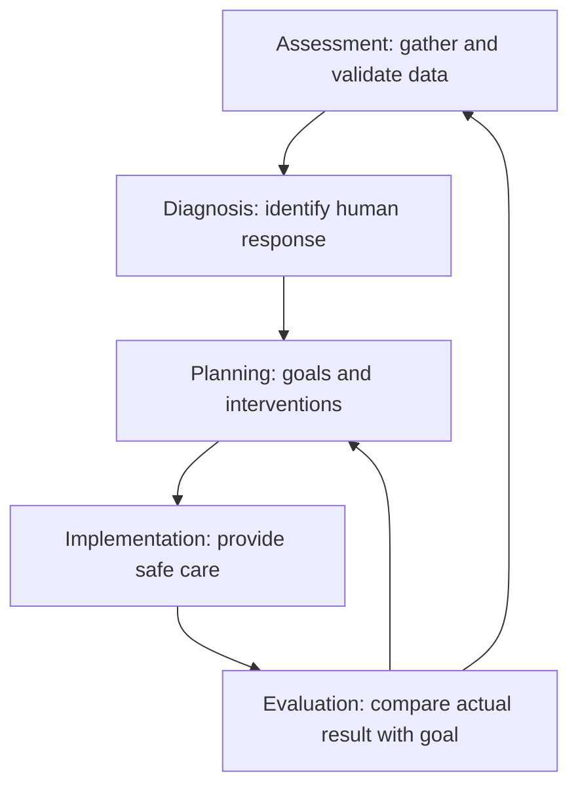

# 📚 Nursing process and care planning

**Topic priority:** 🟠 HIGH YIELD · **Study-ready, not studied.** 17 earlier group 01 questions (Q1–3, 5–9, 11–16, 18–20) + [13 new questions](../MCQs/01A-Nursing-Process-and-Care-Planning-13-MCQs.md) = 30 allocated. Three remaining earlier questions assigned to clinical judgment. Allocation does not duplicate authorship.

## 🔹 ADPIE ka simple meaning

<!-- job4-metadata -->
**Section priority:** 🔴 MOST IMPORTANT (editorial)

**Related MCQs:** [Q2](../MCQs/01A-Nursing-Process-and-Care-Planning-13-MCQs.md#q2-a-patient-is-admitted-with-an-established-chronic-illness-which-assessment-best-provides-a-baseline-for-subsequent-individualized-care) · [Q5](../MCQs/01A-Nursing-Process-and-Care-Planning-13-MCQs.md#q5-which-combination-best-supports-an-individualized-nursing-diagnosis-rather-than-an-unsupported-assumption) · [Q12](../MCQs/01A-Nursing-Process-and-Care-Planning-13-MCQs.md#q12-an-outcome-is-partially-achieved-because-a-patient-can-transfer-with-one-assistant-but-not-independently-as-planned-what-is-the-best-evaluation)

**Exam evidence:** **[🟣 AIIMS Jodhpur 2019 — related tested concept](https://testbook.com/question-answer/which-of-the-following-is-a-stage-of-the-nursing-p--625d555433fbce0163e0cb79)**. Related concepts only, not an exact question match. [Reported adaptations](../Previous-Year-Questions/01-Nursing-Process-Reported-Evidence.md)

**Learning reference:** [OpenStax nursing process](https://openstax.org/books/clinical-nursing-skills/pages/1-3-nursing-process)

**🎬 [Teaching — ADPIE Nursing Process Steps Explained](https://www.youtube.com/watch?v=A_Y7DtgZbyg)** · Bhushan Science – Nursing; previously indexed ADPIE lesson, playback pending.

**▶️ [YouTube MCQ practice — Nursing process, ADPIE scenarios](https://www.youtube.com/watch?v=Nczi2xT76QA)** · ADAPT NCLEX REVIEW, description and published topic chapters verified, supplementary practice not Indian exam evidence; exact question coverage pending.
<!-- /job4-metadata -->

Nursing process patient ki needs samajhne, safe care plan banane, implement karne aur result check karne ka repeated cycle hai. Imagine patient operation ke baad chalne mein difficulty report karta hai. Nurse pehle pain, mobility, baseline function, safety and vital signs assess karti hai. Phir human response identify karti hai, achievable goal set karti hai, planned safe assistance deti hai, aur reassess karti hai.

| Step | Meaning | Example |
|---|---|---|
| Assessment | Subjective and objective information collect/validate | Patient reports dizziness, nurse measures observations |
| Diagnosis | Evidence-supported patient response identify | Activity intolerance or fall risk as appropriate |
| Planning | Patient-centered measurable goals and safe interventions | Patient demonstrates agreed safe transfer technique by review |
| Implementation | Planned care within competence, adapt to changes | Assist transfer using appropriate equipment and staff |
| Evaluation | Actual result compare with target | Record assistance level and revise plan |

Some professional standards separate outcome identification from planning, producing six named phases. ADPIE five-step teaching mnemonic valid hai, exam question ka framework identify karo. Cycle rigid sequence nahi hai: life-threatening problem mein immediate safety action and assessment parallel ho sakte hain.

## 🔹 Assessment and data validation

<!-- job4-metadata -->
**Section priority:** 🔴 MOST IMPORTANT (editorial)

**Related MCQs:** [Q1](../MCQs/01A-Nursing-Process-and-Care-Planning-13-MCQs.md#q1-a-stable-patient-reports-a-weight-loss-of-5-kg-but-serial-recorded-weights-show-a-decrease-of-only-1-kg-what-should-the-nurse-do-before-finalizing-the-assessment) · [Q2](../MCQs/01A-Nursing-Process-and-Care-Planning-13-MCQs.md#q2-a-patient-is-admitted-with-an-established-chronic-illness-which-assessment-best-provides-a-baseline-for-subsequent-individualized-care) · [Q3](../MCQs/01A-Nursing-Process-and-Care-Planning-13-MCQs.md#q3-a-stable-inpatient-reports-a-new-localized-skin-itch-following-use-of-a-different-adhesive-which-assessment-approach-best-matches-this-new-complaint) · [Q4](../MCQs/01A-Nursing-Process-and-Care-Planning-13-MCQs.md#q4-a-patient-with-limited-consciousness-cannot-provide-a-reliable-history-which-approach-to-nursing-assessment-is-appropriate)

**Exam evidence:** **[🟣 AIIMS Jodhpur 2019 — related tested concept](https://testbook.com/question-answer/which-of-the-following-is-a-stage-of-the-nursing-p--625d555433fbce0163e0cb79)** · **[🟣 GMCH 2025 — related tested concept, booklet text](https://gmch.chdadmnrectt.in/pdf/qns-ans-booklet-2025.pdf)**. Related concepts only, not an exact question match. [Reported adaptations](../Previous-Year-Questions/01-Nursing-Process-Reported-Evidence.md)

**Learning reference:** [OpenStax nursing process](https://openstax.org/books/clinical-nursing-skills/pages/1-3-nursing-process)

**🎬 [Teaching — ADPIE Nursing Process Steps Explained](https://www.youtube.com/watch?v=A_Y7DtgZbyg)** · Bhushan Science – Nursing; previously indexed ADPIE lesson, playback pending.

**▶️ [YouTube MCQ practice — Nursing process, ADPIE scenarios](https://www.youtube.com/watch?v=Nczi2xT76QA)** · ADAPT NCLEX REVIEW, description and published topic chapters verified, supplementary practice not Indian exam evidence; exact question coverage pending.
<!-- /job4-metadata -->

Subjective means patient ka reported experience, e.g. nausea. Objective means measured/observed finding, e.g. temperature. Primary source usually patient. Secondary sources caregivers, records and team observations, source attribute karo. Initial comprehensive assessment overall baseline, focused assessment specific new concern, emergency assessment immediate life threats and ongoing reassessment change detect karti hai. Contradiction ko ignore mat karo. Check timing, measurement technique, context and patient explanation. A reported symptom is not false just because objective evidence is not yet available.

## 🔹 Diagnosis, planning and implementation

<!-- job4-metadata -->
**Section priority:** 🔴 MOST IMPORTANT (editorial)

**Related MCQs:** [Q5](../MCQs/01A-Nursing-Process-and-Care-Planning-13-MCQs.md#q5-which-combination-best-supports-an-individualized-nursing-diagnosis-rather-than-an-unsupported-assumption) · [Q6](../MCQs/01A-Nursing-Process-and-Care-Planning-13-MCQs.md#q6-a-nurse-writes-a-care-plan-problem-as-diabetes-mellitus-related-to-excessive-thirst-what-is-the-main-correction-needed) · [Q7](../MCQs/01A-Nursing-Process-and-Care-Planning-13-MCQs.md#q7-a-patient-wants-to-regain-independence-in-dressing-while-the-nurse-initially-proposes-a-different-functional-goal-which-planning-action-is-most-appropriate) · [Q8](../MCQs/01A-Nursing-Process-and-Care-Planning-13-MCQs.md#q8-a-care-plan-says-the-patient-will-drink-adequate-fluids-by-evening-why-should-this-outcome-be-revised) · [Q9](../MCQs/01A-Nursing-Process-and-Care-Planning-13-MCQs.md#q9-a-ward-nurse-writes-a-discharge-goal-for-a-patient-learning-a-new-self-care-skill-which-measure-best-tests-actual-performance) · [Q10](../MCQs/01A-Nursing-Process-and-Care-Planning-13-MCQs.md#q10-an-intervention-in-a-care-plan-requires-equipment-unavailable-on-the-ward-what-is-the-best-implementation-decision) · [Q11](../MCQs/01A-Nursing-Process-and-Care-Planning-13-MCQs.md#q11-a-nurse-carries-out-a-prescribed-treatment-and-adds-appropriate-comfort-measures-within-scope-how-should-the-actions-be-recorded)

**Exam evidence:** **[🟣 GMCH 2025 — related tested concept, booklet text](https://gmch.chdadmnrectt.in/pdf/qns-ans-booklet-2025.pdf)**. Related concepts only, not an exact question match. [Reported adaptations](../Previous-Year-Questions/01-Nursing-Process-Reported-Evidence.md)

**Learning reference:** [OpenStax nursing process](https://openstax.org/books/clinical-nursing-skills/pages/1-3-nursing-process)

**🎬 [Teaching — ADPIE Nursing Process Steps Explained](https://www.youtube.com/watch?v=A_Y7DtgZbyg)** · Bhushan Science – Nursing; previously indexed ADPIE lesson, playback pending.

**▶️ [YouTube MCQ practice — Nursing process, ADPIE scenarios](https://www.youtube.com/watch?v=Nczi2xT76QA)** · ADAPT NCLEX REVIEW, description and published topic chapters verified, supplementary practice not Indian exam evidence; exact question coverage pending.
<!-- /job4-metadata -->

Medical diagnosis disease identify karti hai, nursing diagnosis human response or vulnerability. Problem-focused diagnostic statement may use problem, related factors and supporting evidence (PES teaching structure). Risk diagnosis existing risk factors describes, not current defining signs of that specific problem. Use institution-approved terminology. Health promotion diagnoses concern readiness for improved health behavior. Cluster relevant cues, avoid unsupported assumptions and stigmatizing labels. Choose priorities based on urgency and harm, not rigid rules.

Goals patient-centered, specific, measurable, achievable, relevant and time-bound (SMART). Goals patient results hain, interventions nurse/team actions. Example: goal patient safely demonstrates agreed transfer technique by end of shift. Intervention nurse assists and teaches correct transfer. Fluid or mobility targets individual restrictions and ability ke according choose karo. Patient preferences and informed refusal respect karo.

Independent, prescribed/dependent and collaborative interventions ka distinction local scope and policy se guide hota hai. Implementation se pehle current condition and contraindications check karo. Equipment missing ho toh safe validated alternative arrange karo. Document actual care and response, never fabricate completion.

## 🔹 Evaluation and clinical example

<!-- job4-metadata -->
**Section priority:** 🟠 HIGH YIELD (editorial)

**Related MCQs:** [Q12](../MCQs/01A-Nursing-Process-and-Care-Planning-13-MCQs.md#q12-an-outcome-is-partially-achieved-because-a-patient-can-transfer-with-one-assistant-but-not-independently-as-planned-what-is-the-best-evaluation) · [Q13](../MCQs/01A-Nursing-Process-and-Care-Planning-13-MCQs.md#q13-a-patients-care-plan-goal-has-been-achieved-and-remains-stable-on-reassessment-which-action-best-demonstrates-ongoing-nursing-process)

**Exam evidence:** Historical exam evidence pending. DSSSB evaluation source could not be retrieved. [Reported adaptations](../Previous-Year-Questions/01-Nursing-Process-Reported-Evidence.md)

**Learning reference:** [OpenStax nursing process](https://openstax.org/books/clinical-nursing-skills/pages/1-3-nursing-process)

**🎬 [Teaching — ADPIE Nursing Process Steps Explained](https://www.youtube.com/watch?v=A_Y7DtgZbyg)** · Bhushan Science – Nursing; previously indexed ADPIE lesson, playback pending.

**▶️ [YouTube MCQ practice — Nursing process, ADPIE scenarios](https://www.youtube.com/watch?v=Nczi2xT76QA)** · ADAPT NCLEX REVIEW, description and published topic chapters verified, supplementary practice not Indian exam evidence; exact question coverage pending.
<!-- /job4-metadata -->

Target independent transfer tha, patient one-person assistance se transfer kar sakta hai. Goal partially met hai, not full success. Check pain, fatigue and weakness, then adjust plan safely. Achieved goal ke baad maintenance, discontinuation or new need review karo. Deterioration mein urgent assessment and escalation, routine paperwork baad mein. Nursing process continuous cycle hai.

## ▶️ References and practice

[OpenStax nursing process](https://openstax.org/books/clinical-nursing-skills/pages/1-3-nursing-process) · [OpenStax assessment](https://openstax.org/books/fundamentals-nursing/pages/12-3-collection-of-assessment-data) · [OpenStax implementation](https://openstax.org/books/fundamentals-nursing/pages/14-1-the-nurses-role-in-implementation) · [OpenStax clinical judgment](https://openstax.org/books/fundamentals-nursing/pages/43-1-clinical-judgment-measure-model)

- Teaching: [Bhushan Science – Nursing, ADPIE Nursing Process Steps Explained, FON-2](https://www.youtube.com/watch?v=A_Y7DtgZbyg), 10 August 2026, indexed ADPIE and care-plan teaching.
- Practice: [N. Manda — Fundamental of Nursing, 300 Scenario MCQs, NORCET 10 Mains](https://www.youtube.com/watch?v=m-VzFBSO1BI), indexed description explicitly includes ADPIE applications.
- Practice: [Iram Fatima — NORCET Fundamentals of Nursing PYQs](https://www.youtube.com/watch?v=9jVmMFtv9Mg), indexed nursing process coverage, reported PYQ claims not independently authenticated. Full video playback and question-level coverage not reviewed.
- [Source-linked reported questions](../Previous-Year-Questions/01-Nursing-Process-Reported-Evidence.md).
