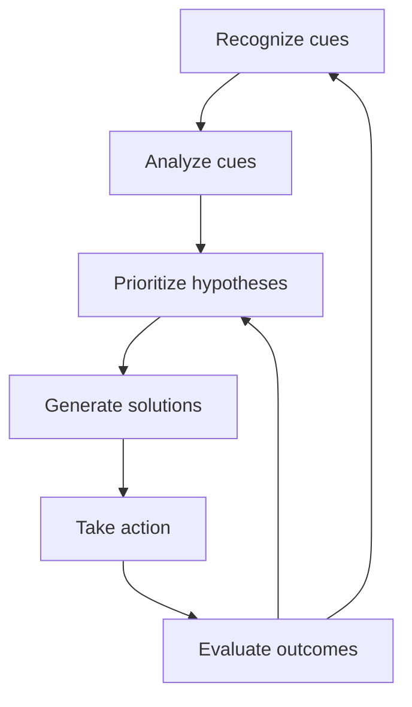

# 📚 Clinical judgment and reasoning

<!-- job4-metadata -->
**Related MCQs:** [Q1](../MCQs/01B-Clinical-Judgment-and-Reasoning-27-MCQs.md#q1-a-nurse-notices-that-a-patients-usual-conversational-behavior-has-changed-to-unusual-drowsiness-which-clinical-judgment-activity-does-identifying-this-new-finding-illustrate) · [Q2](../MCQs/01B-Clinical-Judgment-and-Reasoning-27-MCQs.md#q2-a-patient-has-poor-oral-intake-orthostatic-symptoms-and-reduced-urine-output-which-reasoning-activity-links-these-findings-into-a-possible-explanation) · [Q3](../MCQs/01B-Clinical-Judgment-and-Reasoning-27-MCQs.md#q3-a-nurse-considers-several-plausible-causes-of-a-patients-acute-deterioration-which-factor-should-most-influence-the-initial-priority-among-hypotheses) · [Q4](../MCQs/01B-Clinical-Judgment-and-Reasoning-27-MCQs.md#q4-after-identifying-likely-dehydration-in-a-stable-patient-the-nurse-compares-appropriate-fluid-support-options-and-their-restrictions-with-the-team-which-reasoning-activity-is-demonstrated) · [Q5](../MCQs/01B-Clinical-Judgment-and-Reasoning-27-MCQs.md#q5-a-nurse-applies-a-prescribed-intervention-selected-after-assessment-and-planning-which-component-of-the-clinical-judgment-model-is-this) · [Q6](../MCQs/01B-Clinical-Judgment-and-Reasoning-27-MCQs.md#q6-following-a-nursing-intervention-a-measured-clinical-variable-improves-but-the-patients-symptoms-worsen-what-is-the-best-reasoning-response)

**Exam evidence:** Exact historical appearance not established. Further verification pending. [Learning reference: OpenStax clinical judgment](https://openstax.org/books/fundamentals-nursing/pages/43-1-clinical-judgment-measure-model). The CJMM is an educational framework, not a verified NORCET exam blueprint.

**🎬 [Teaching — Clinical Judgment Measurement Model](https://www.youtube.com/watch?v=V_5xgAx-07Q)** · Center for Medical Education, description verified; supplementary NCLEX framework, playback pending.

**▶️ [YouTube MCQ practice — Nursing process and critical thinking](https://www.youtube.com/watch?v=Nczi2xT76QA)** · ADAPT NCLEX REVIEW, description and published topic chapters verified; supplementary clinical reasoning scenarios, exact question coverage/playback pending.
<!-- /job4-metadata -->

**Topic priority:** 🟠 HIGH YIELD · **Study-ready, not studied.** Earlier group 01 Q4, Q10 and Q17 + [27 new questions](../MCQs/01B-Clinical-Judgment-and-Reasoning-27-MCQs.md) = 30 allocated. Group 30 integrated prioritization cases remain separately assigned and not counted here.

Clinical judgment ka matlab hai ki nurse patient ki condition samajhkar ek safe decision leti hai. Clinical reasoning woh sochne ka process hai jisse nurse decision tak pahunchti hai. Critical thinking ka matlab hai ki nurse evidence ko dhyan se dekhti hai, apne assumptions ko check karti hai aur doosri possible explanations par bhi sochti hai.

Maan lo ek patient pehle theek se baat kar raha tha, lekin ab use baar-baar jagana pad raha hai. Sirf itna dekhkar ki patient so raha hai, nurse ye decide nahi karegi ki sab theek hai. Woh patient ki breathing, vital signs, medicines, pehle ki condition aur doosri relevant findings ko ek saath dekhegi. Nurse apne experience, clinical guidelines, patient ki actual condition aur preferences ko dhyan mein rakhkar decision leti hai.

Clinical Judgment Measurement Model, jise CJMM kehte hain, nursing students ko is tarah sochna sikhane ka ek educational framework hai. Ye official NORCET model hone ka claim nahi hai.

| Activity | Simple explanation | Example |
|---|---|---|
| Recognize cues | Nurse aisi relevant finding ko pehchaanti hai jo patient ki condition samajhne mein madad kar sakti hai. | Jo patient aam taur par alert rehta tha, woh ab unusually sleepy lag raha hai. |
| Analyze cues | Nurse related findings ko ek saath dekhti hai aur samajhti hai ki unka kya matlab ho sakta hai. | Nurse neend, breathing mein badlav, medicine history aur observations ko ek saath dekhti hai. |
| Prioritize hypotheses | Nurse possible problems mein se pehle us problem ko consider karti hai jo evidence se support hoti hai aur jismein delay se serious nuksaan ho sakta hai. | Nurse ventilation aur doosri serious causes ko turant assess karti hai. |
| Generate solutions | Nurse sochti hai ki patient ki current condition mein kaunse steps safe hain aur practically kiye ja sakte hain. | Nurse prompt assessment, urgent help aur protocol ke hisaab se care ka plan banati hai. |
| Take action | Nurse zaroori action leti hai aur relevant healthcare team ko patient ki condition batati hai. | Nurse deterioration ko escalate karti hai aur indicated support deti hai. |
| Evaluate outcomes | Nurse dobara patient ki condition check karti hai aur dekhti hai ki action ka kya result hua. | Agar reassessment mein condition aur kharab milti hai, toh nurse care ko adjust karti hai aur zaroori help leti hai. |

Agar patient ki jaan ko turant khatra hai, toh nurse ko poori history lene ke liye urgent care delay nahi karni chahiye. ABC ka matlab airway, breathing aur circulation hai. ABCDE mein disability, yaani neurological condition, aur exposure, yaani zaroorat ke hisaab se body examine karna, bhi aata hai. Ye structured assessment helpful hai, lekin patient ki actual situation ko dhyan mein rakhna zaroori hai. Cardiac arrest mein appropriate resuscitation algorithm follow kiya jaata hai.

Exam mein kabhi-kabhi kaha jaata hai ki actual problem ko risk se pehle address karo. Lekin ye har situation ka fixed rule nahi hai. Agar kisi serious problem ka risk turant jaan ko khatre mein daal sakta hai, toh woh bhi priority ban sakta hai.

Early warning score nurse ko deterioration pehchaanne mein madad karta hai, lekin ye clinical judgment ki jagah nahi le sakta. Agar nayi finding concerning hai, toh score zyada na hone par bhi nurse ko review arrange karna chahiye. Purane baseline ke saath nayi findings compare karne se trend samajh aata hai. Kabhi ek hi bahut abnormal value bhi urgent response ki wajah ban sakti hai.

## 🔹 Common cognitive errors

<!-- job4-metadata -->
**Section priority:** 🟠 HIGH YIELD (editorial)

**Related MCQs:** [Q7](../MCQs/01B-Clinical-Judgment-and-Reasoning-27-MCQs.md#q7-a-nurse-initially-assumes-a-patients-new-confusion-is-caused-by-age-and-ignores-a-recent-change-in-oxygenation-which-cognitive-error-is-most-evident) · [Q8](../MCQs/01B-Clinical-Judgment-and-Reasoning-27-MCQs.md#q8-a-nurse-selects-only-findings-that-support-an-initial-suspicion-and-dismisses-contradictory-observations-without-checking-them-which-bias-is-illustrated) · [Q9](../MCQs/01B-Clinical-Judgment-and-Reasoning-27-MCQs.md#q9-a-clinician-concludes-a-patient-has-a-familiar-benign-condition-and-stops-considering-serious-alternatives-before-adequate-assessment-which-reasoning-problem-does-this-represent) · [Q10](../MCQs/01B-Clinical-Judgment-and-Reasoning-27-MCQs.md#q10-a-stable-patients-automated-measurement-is-unexpectedly-abnormal-and-inconsistent-with-clinical-appearance-what-best-reduces-reasoning-error) · [Q14](../MCQs/01B-Clinical-Judgment-and-Reasoning-27-MCQs.md#q14-during-a-bedside-assessment-a-nurse-finds-a-patients-current-data-disagree-with-a-previous-shifts-report-what-is-the-best-response) · [Q26](../MCQs/01B-Clinical-Judgment-and-Reasoning-27-MCQs.md#q26-a-nurse-retrospectively-reviews-a-decision-that-had-a-poor-outcome-despite-following-reasonable-evidence-available-at-the-time-which-principle-is-important)

**Exam evidence:** Exact historical appearance not established. Further verification pending. [Learning reference: OpenStax clinical judgment](https://openstax.org/books/fundamentals-nursing/pages/43-1-clinical-judgment-measure-model). The CJMM is an educational framework, not a verified NORCET exam blueprint.

**🎬 [Teaching — Clinical Judgment Measurement Model](https://www.youtube.com/watch?v=V_5xgAx-07Q)** · Center for Medical Education, description verified; supplementary NCLEX framework, playback pending.

**YouTube MCQ practice: verification pending** — dedicated cognitive-bias question practice not verified.
<!-- /job4-metadata -->

Anchoring tab hota hai jab nurse pehli possible explanation par atak jaati hai aur nayi information milne par bhi apni soch nahi badalti. Maan lo kisi patient ki drowsiness ko pehle thakaan maana gaya tha. Agar baad mein breathing abnormal milti hai, toh nurse ko thakaan wali explanation par atke nahi rehna chahiye.

Confirmation bias tab hota hai jab hum sirf wahi evidence dekhte hain jo hamari pehle se bani hui soch ko support karta hai. Premature closure tab hota hai jab hum doosri possible causes ko check kiye bina bahut jaldi conclusion par pahunch jaate hain. Hindsight bias tab hota hai jab outcome pata chalne ke baad humein lagta hai ki pehle se hi sab kuch clear hona chahiye tha, jabki us waqt information limited ho sakti thi.

In mistakes se bachne ke liye nurse ko un findings par bhi dhyan dena chahiye jo uski pehli explanation se match nahi karti hain. Nurse timing check karti hai, doosri possibilities par sochti hai, zaroorat padne par team se advice leti hai aur apni uncertainty ko accept karke reassessment karti hai. Data verify karna important hai, lekin unstable patient ko zaroori urgent care dene mein delay nahi hona chahiye.

## 🔹 Nursing role and examples

<!-- job4-metadata -->
**Section priority:** 🔴 MOST IMPORTANT (editorial)

**Related MCQs:** [Q11](../MCQs/01B-Clinical-Judgment-and-Reasoning-27-MCQs.md#q11-an-experienced-nurse-senses-that-a-patient-is-worsening-before-a-formal-score-changes-significantly-which-response-is-appropriate) · [Q12](../MCQs/01B-Clinical-Judgment-and-Reasoning-27-MCQs.md#q12-a-nursing-assistant-reports-that-a-previously-independent-patient-could-not-complete-morning-grooming-what-should-the-registered-nurse-do-with-this-information) · [Q13](../MCQs/01B-Clinical-Judgment-and-Reasoning-27-MCQs.md#q13-a-stable-patient-reports-a-persistent-symptom-but-initial-assessment-is-unrevealing-what-approach-best-avoids-dismissive-reasoning) · [Q15](../MCQs/01B-Clinical-Judgment-and-Reasoning-27-MCQs.md#q15-a-nurse-reviews-several-days-of-a-patients-observations-why-can-a-trend-be-more-informative-than-a-single-value) · [Q16](../MCQs/01B-Clinical-Judgment-and-Reasoning-27-MCQs.md#q16-a-care-team-identifies-a-potential-safety-problem-that-has-not-yet-caused-symptoms-which-prioritization-principle-is-most-accurate) · [Q17](../MCQs/01B-Clinical-Judgment-and-Reasoning-27-MCQs.md#q17-a-stable-patient-refuses-a-low-risk-proposed-care-activity-after-receiving-adequate-information-how-should-clinical-judgment-guide-the-nurse) · [Q18](../MCQs/01B-Clinical-Judgment-and-Reasoning-27-MCQs.md#q18-a-nurse-is-considering-a-nonurgent-intervention-with-uncertain-evidence-of-benefit-what-is-the-best-evidence-informed-approach) · [Q19](../MCQs/01B-Clinical-Judgment-and-Reasoning-27-MCQs.md#q19-two-staff-members-offer-different-plausible-interpretations-of-a-patients-symptoms-which-communication-approach-best-supports-clinical-judgment) · [Q20](../MCQs/01B-Clinical-Judgment-and-Reasoning-27-MCQs.md#q20-a-nurse-anticipates-that-a-stable-patients-care-needs-may-exceed-the-wards-current-monitoring-capability-which-reasoning-response-is-appropriate) · [Q21](../MCQs/01B-Clinical-Judgment-and-Reasoning-27-MCQs.md#q21-a-nurse-receives-a-critical-laboratory-result-for-a-patient-whose-condition-has-changed-which-reasoning-approach-is-appropriate) · [Q22](../MCQs/01B-Clinical-Judgment-and-Reasoning-27-MCQs.md#q22-a-patient-has-several-abnormal-findings-and-a-time-sensitive-concern-which-principle-guides-additional-data-gathering) · [Q23](../MCQs/01B-Clinical-Judgment-and-Reasoning-27-MCQs.md#q23-a-nurse-has-performed-an-intervention-and-is-uncertain-when-to-reassess-its-effect-what-should-determine-the-review-interval) · [Q24](../MCQs/01B-Clinical-Judgment-and-Reasoning-27-MCQs.md#q24-during-review-of-a-near-miss-the-nurse-identifies-that-interruptions-and-unclear-equipment-labels-influenced-the-decision-what-type-of-clinical-judgment-improvement-is-most-appropriate) · [Q25](../MCQs/01B-Clinical-Judgment-and-Reasoning-27-MCQs.md#q25-a-nursing-student-correctly-recalls-a-guideline-but-cannot-apply-it-when-several-patient-cues-conflict-what-learning-approach-is-most-suitable) · [Q27](../MCQs/01B-Clinical-Judgment-and-Reasoning-27-MCQs.md#q27-an-older-patient-reports-a-preference-for-family-involvement-but-the-team-has-not-yet-confirmed-what-information-may-be-shared-how-should-the-nurse-integrate-this-cue-into-care-planning)

**Exam evidence:** Exact historical appearance not established. Further verification pending. [Learning reference: OpenStax clinical judgment](https://openstax.org/books/fundamentals-nursing/pages/43-1-clinical-judgment-measure-model). The CJMM is an educational framework, not a verified NORCET exam blueprint.

**🎬 [Teaching — Clinical Judgment Measurement Model](https://www.youtube.com/watch?v=V_5xgAx-07Q)** · Center for Medical Education, description verified; supplementary NCLEX framework, playback pending.

**▶️ [YouTube MCQ practice — Nursing process and critical thinking](https://www.youtube.com/watch?v=Nczi2xT76QA)** · ADAPT NCLEX REVIEW, description and published topic chapters verified; supplementary clinical reasoning scenarios, exact question coverage/playback pending.
<!-- /job4-metadata -->

Maan lo nursing assistant batata hai ki patient pehle khud grooming kar leta tha, lekin aaj nahi kar paa raha hai. Ye ek valuable clue hai. Nurse ki responsibility hai ki woh patient ka assessment kare aur samjhe ki ye change kyun hua ho sakta hai.

Agar patient kisi symptom ki report karta hai aur shuru mein objective sign nahi milta, toh nurse ko patient ki baat dismiss nahi karni chahiye. Nurse dobara assessment karti hai aur agar concern bana rehta hai, toh relevant team ko batati hai. Agar team ke members ki rai alag hai, toh discussion evidence aur patient ki urgent safety par focused hona chahiye.

Agar required monitoring available nahi hai, toh nurse ko ye problem jaldi escalate karni chahiye. Critical test result aane par nurse protocol ke hisaab se team ko inform karti hai aur patient ki condition assess karti hai. Reassessment kab karna hai, ye intervention ka effect shuru hone ke expected time, patient ke risk aur applicable protocol par depend karta hai.

Care plan banate waqt nurse patient ki consent, values, family preferences aur cultural context ko dhyan mein rakhti hai. Kisi incident ke baad reflection ka matlab hai ki team ye samjhe ki individual decision-making aur system ki conditions ne outcome ko kaise affect kiya. Sirf kisi ko blame karne ki jagah improvement par focus karna useful hota hai.

## ▶️ References and videos

[OpenStax nursing process](https://openstax.org/books/clinical-nursing-skills/pages/1-3-nursing-process) · [OpenStax assessment](https://openstax.org/books/fundamentals-nursing/pages/12-3-collection-of-assessment-data) · [OpenStax implementation](https://openstax.org/books/fundamentals-nursing/pages/14-1-the-nurses-role-in-implementation) · [OpenStax clinical judgment](https://openstax.org/books/fundamentals-nursing/pages/43-1-clinical-judgment-measure-model)

- Teaching: [OpenStax Clinical Judgment Measurement Model](https://openstax.org/books/clinical-nursing-skills/pages/28-1-clinical-judgment-measurement-model), illustrated text reference. Dedicated clinical-judgment teaching video not confirmed.
- Scenario practice: [N. Manda — 300 Scenario MCQs, NORCET 10 Mains](https://www.youtube.com/watch?v=m-VzFBSO1BI), indexed scenario-based FON and ADPIE practice. Full playback not reviewed, dedicated clinical-judgment-only video pending.
- [Reported evidence and gaps](../Previous-Year-Questions/01-Nursing-Process-Reported-Evidence.md).
