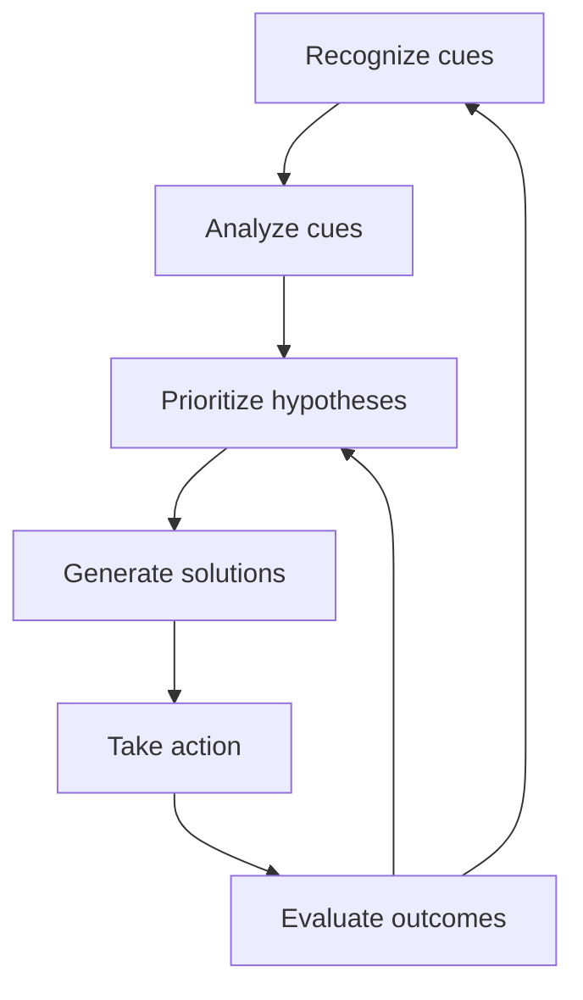

# Clinical judgment and reasoning

**Priority High. Study-ready, not studied.** Earlier group 01 Q4, Q10 and Q17 + [27 new questions](../MCQs/01B-Clinical-Judgment-and-Reasoning-27-MCQs.md) = 30 allocated. Group 30 integrated prioritization cases remain separately assigned and not counted here.

Clinical judgment means patient ki information ko samajhkar safe decision lena. Clinical reasoning is thinking process behind decision. Critical thinking means evidence question karna, assumptions identify karna and alternatives evaluate karna. Nurse observation, experience, guidelines, clinical context and patient preferences integrate karti hai. Clinical judgment measurement model (CJMM) is an educational framework, not claim of official NORCET model.

| Activity | Simple explanation | Example |
|---|---|---|
| Recognize cues | Relevant clue notice karo | Usual alert patient unusually sleepy |
| Analyze cues | Related clues connect karo | Drowsiness plus changed breathing, medication history and observations |
| Prioritize hypotheses | Most urgent and supported possible problem pehle consider karo | Assess ventilation and other serious causes |
| Generate solutions | Safe feasible options identify karo | Prompt assessment, urgent help and protocol-based action |
| Take action | Appropriate intervention and communication | Escalate deterioration and provide indicated support |
| Evaluate outcomes | Response compare karo | Repeat clinical assessment, adjust if worsening |

Life threats require immediate response, not exhaustive history first. ABC or ABCDE structured assessment useful hai, but immediate context matters. Cardiac arrest uses resuscitation algorithm. Actual problem always wins over risk is not universal, imminent severe risk can be more urgent. Early warning scores support, not replace, clinical judgment. New concerning findings warrant review even if score not yet high. Trend compare with baseline. One severe value may also require immediate response.

## Common cognitive errors

Anchoring = first explanation par atak jana. Confirmation bias = sirf supporting evidence choose karna. Premature closure = alternatives check kiye bina conclusion. Hindsight bias = later outcome dekhkar assume karna ki pehle sab clear tha. Correct approach: check contradictory cues, review timing, consider alternative explanations, seek team advice, identify uncertainty and reassess. Data validation is important, but unstable patient care delay nahi hona chahiye.

## Nursing role and examples

Assistant reports new inability to groom. Nurse is responsible for assessment and interpretation, assistant report valuable cue hai. Patient reports symptom with no initial objective sign, don't dismiss, reassess and communicate persistent concern. Team disagreements evidence and urgent safety actions par focus karein. Unavailable required monitoring early escalate karo. Critical result notify per protocol while assessing patient. Reassessment timing intervention onset, risk and protocol-dependent. Patient consent, values, family preference and cultural context care plan mein include karo. Reflection after incidents individual reasoning plus system factors evaluate karti hai, nonpunitive improvement useful hai.

## References and videos

[OpenStax nursing process](https://openstax.org/books/clinical-nursing-skills/pages/1-3-nursing-process) · [OpenStax assessment](https://openstax.org/books/fundamentals-nursing/pages/12-3-collection-of-assessment-data) · [OpenStax implementation](https://openstax.org/books/fundamentals-nursing/pages/14-1-the-nurses-role-in-implementation) · [OpenStax clinical judgment](https://openstax.org/books/fundamentals-nursing/pages/43-1-clinical-judgment-measure-model)

- Teaching: [OpenStax Clinical Judgment Measurement Model](https://openstax.org/books/clinical-nursing-skills/pages/28-1-clinical-judgment-measurement-model), illustrated text reference. Dedicated clinical-judgment teaching video not confirmed.
- Scenario practice: [N. Manda — 300 Scenario MCQs, NORCET 10 Mains](https://www.youtube.com/watch?v=m-VzFBSO1BI), indexed scenario-based FON and ADPIE practice. Full playback not reviewed, dedicated clinical-judgment-only video pending.
- [Reported evidence and gaps](../Previous-Year-Questions/01-Nursing-Process-Reported-Evidence.md).
