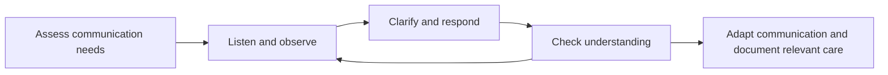

# Therapeutic communication

**Priority High. Study-ready, not studied.** Earlier group 02 Q1–4, 10–11, 14–15, 18 (9 allocated) + [21 new questions](../MCQs/02A-Therapeutic-Communication-21-MCQs.md) = 30.

## Meaning and techniques

Therapeutic communication ka purpose patient ko support karna, accurate information samajhna aur patient ko care decisions mein participate karana hai. Sirf friendly baat karna enough nahi hai. Nurse patient ki concern sun kar relevant response, privacy and safe care ensure karti hai. Sender message bhejta hai, receiver uska meaning interpret karta hai, feedback se meaning confirm hota hai. Noise, language, sensory impairment, pain, fear and assumptions barriers ho sakte hain.

| Technique | Simple meaning and example |
|---|---|
| Open-ended question | Patient ko explain karne ka space. What is worrying you most? |
| Focused closed question | Specific fact quickly clarify karna, especially urgent situation. Is the pain new? |
| Reflection | Feeling ko gently reflect karna. You sound worried about going home. |
| Clarification | Unclear message confirm karna. What do you mean by feeling weak? |
| Focusing | Patient ki main concern identify karke explore karna |
| Offering self | Appropriate presence. I can sit with you while we discuss this. |
| Silence | Patient ko think and express karne ka time |
| Summarizing | Key points and agreed plan review, corrections invite |
| Empathy | Patient ki experience and emotion understand karne ki effort, without claiming exact same experience |

False reassurance, dismissive generalization, unsolicited personal advice, arguing, changing subject and judgmental labels communication block kar sakte hain. Closed questions automatically wrong nahi hote. Urgent targeted assessment mein useful ho sakte hain. A patient feeling scared does not need an unsupported guarantee. Acknowledge emotion and explain what is known, unknown and next action.

## Barriers and adaptation

Language barrier mein qualified interpreter arrange karo. Patient se directly baat karo, short segments use karo and understanding confirm karo. Do not depend on a child interpreter for complex or sensitive decisions. Hearing or visual difficulty mein preferred accessible method ask karo. Aphasia or temporary inability to speak does not automatically mean loss of decision-making capacity. Appropriate communication aid provide karo. Patient nods yes toh understanding assume mat karo. Teach-back: patient apne words mein next step explain kare, nurse clarity check kare. Complex teaching small chunks mein do. Cultural norms and nonverbal behavior context mein interpret karo, stereotypes avoid karo. Sensitive topics private space mein discuss karo and safeguarding if indicated. Remote communication secure approved method and reliable connection se.

## Professional relationship

Orientation: role, purpose, trust and confidentiality limits. Working: concerns explore, agreed strategies and goals practice. Termination: progress and ending feelings review, continuity arrange. Professional boundaries patient-centered relationship protect karti hain. Personal friendship or informal medical advice channel replace nahi karta. Respect informed choices, do not impose personal preferences. Patient participates according to abilities and consent.

## Sources and resources

[OpenStax therapeutic communication](https://openstax.org/books/fundamentals-nursing/pages/2-4-therapeutic-communication) · [Communication barriers](https://openstax.org/books/fundamentals-nursing/pages/2-5-barriers-to-communication) · [AHRQ teach-back](https://www.ahrq.gov/health-literacy/improve/precautions/tool5.html) · [AHRQ clear communication](https://www.ahrq.gov/health-literacy/improve/precautions/tool4.html)

- Concept: [Therapeutic Communication + Nurse–Patient Relationship — NORCET 11 Mental Health Nursing](https://www.youtube.com/watch?v=JAB2nyI-8Ds), indexed topic-specific lecture, YourMindGuru appears in metadata, channel identity not independently opened.
- Practice: [NORCET 11 MAINS — The Communication Files](https://www.youtube.com/watch?v=rugVZApzrjM), indexed description explicitly includes case-based MCQs, techniques and barriers. Channel and full playback not independently verified.
- [Group 02 historical question evidence](../Previous-Year-Questions/02-Communication-Documentation-Handover-Reported-Evidence.md). Mental Health chapter may separately cover psychiatric application, avoid duplicate stems and count each question once.
