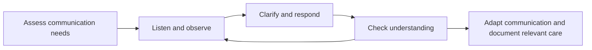

# 📚 Therapeutic communication

**Topic priority:** 🟠 HIGH YIELD · **Study-ready, not studied.** Earlier group 02 Q1–4, 10–11, 14–15, 18 (9 allocated) + [21 new questions](../MCQs/02A-Therapeutic-Communication-21-MCQs.md) = 30.

## 🔹 Meaning and techniques

<!-- job4-metadata -->
**Section priority:** 🔴 MOST IMPORTANT (editorial)

**Related MCQs:** [Q1](../MCQs/02A-Therapeutic-Communication-21-MCQs.md#q1-a-patient-says-everyone-tells-me-i-should-be-grateful-but-i-feel-disappointed-which-response-is-most-therapeutic) · [Q2](../MCQs/02A-Therapeutic-Communication-21-MCQs.md#q2-a-patient-is-discussing-several-worries-at-once-and-has-difficulty-identifying-the-main-concern-which-technique-is-most-helpful) · [Q3](../MCQs/02A-Therapeutic-Communication-21-MCQs.md#q3-which-response-is-an-example-of-offering-self-rather-than-giving-false-reassurance) · [Q4](../MCQs/02A-Therapeutic-Communication-21-MCQs.md#q4-a-patient-says-the-treatment-plan-seems-overwhelming-the-nurse-replies-you-sound-concerned-about-managing-several-new-tasks-which-technique-is-most-evident) · [Q5](../MCQs/02A-Therapeutic-Communication-21-MCQs.md#q5-at-the-end-of-an-interview-the-nurse-reviews-the-patients-main-concerns-and-agreed-next-steps-what-is-the-primary-purpose) · [Q6](../MCQs/02A-Therapeutic-Communication-21-MCQs.md#q6-a-patient-describes-a-fear-that-the-nurse-believes-is-unlikely-to-occur-which-response-best-maintains-trust) · [Q13](../MCQs/02A-Therapeutic-Communication-21-MCQs.md#q13-which-feature-makes-a-closed-ended-question-appropriate-during-a-time-critical-assessment)

**Exam evidence:** 🟣 Related concept — **[🟣 NVS Staff Nurse September 2019 — related tested concept](https://testbook.com/question-answer/which-of-the-following-responses-isare-not-forb--61e15d80e44ce4e754c97dfe)**. Third-party page inspected, not official key. NORCET 6 reflection lead not retrievable. [Reported adaptations](../Previous-Year-Questions/02-Communication-Documentation-Handover-Reported-Evidence.md)

**Learning reference:** [OpenStax therapeutic communication](https://openstax.org/books/fundamentals-nursing/pages/2-4-therapeutic-communication)

**▶️ [YouTube MCQ practice — NORCET 11 communication](https://www.youtube.com/watch?v=rugVZApzrjM)** · Previously indexed case-based techniques and barriers; direct retrieval failed this run; exact coverage pending.

**🎬 [Teaching — Therapeutic communication and nurse–patient relationship](https://www.youtube.com/watch?v=JAB2nyI-8Ds)** · YourMindGuru title/metadata indexed; playback pending.
<!-- /job4-metadata -->

Therapeutic communication ka matlab hai patient se aise baat karna jisse uski takleef samajh aaye, use emotional support mile aur woh apni care ke decisions mein participate kar sake. Sirf friendly baat karna kaafi nahi hai. Nurse dhyan se sunti hai, relevant questions poochti hai, privacy ka respect karti hai aur patient ko safe care samjhati hai.

Communication mein ek person message bhejta hai aur doosra uska meaning samajhta hai. Feedback se pata chalta hai ki message sahi samjha gaya ya nahi. Maan lo nurse medicine ka time batati hai, lekin patient language barrier ki wajah se confuse ho jaata hai. Nurse ko ye check karna chahiye ki patient ne actually kya samjha. Noise, language difference, hearing ya vision ki dikkat, pain, fear aur pehle se bani assumptions communication mein rukawat ban sakti hain.

| Technique | Simple meaning and example |
|---|---|
| Open-ended question | Nurse aisa question poochti hai jisme patient apni baat detail mein bata sake. Jaise, What is worrying you most? |
| Focused closed question | Nurse ek specific fact jaldi clarify karti hai, khaaskar urgent assessment mein. Jaise, Is the pain new? |
| Reflection | Nurse patient ki feeling ko gently reflect karti hai, taaki use lage ki uski baat samjhi gayi hai. Jaise, You sound worried about going home. |
| Clarification | Jab patient ka message clear nahi hai, toh nurse uska actual meaning poochti hai. Jaise, What do you mean by feeling weak? |
| Focusing | Nurse patient ki main concern identify karti hai aur usi par relevant questions poochkar baat ko aage badhati hai. |
| Offering self | Nurse appropriate presence aur support offer karti hai. Jaise, I can sit with you while we discuss this. |
| Silence | Nurse patient ko sochne aur apni baat kehne ka samay deti hai, bina har pause ko turant bharne ki koshish kiye. |
| Summarizing | Nurse important points aur agreed plan dobara batati hai aur patient ko correction ya clarification ka mauka deti hai. |
| Empathy | Nurse patient ki feelings aur experience samajhne ki koshish karti hai, bina ye claim kiye ki usne bilkul wahi experience khud kiya hai. |

False reassurance ka matlab hai patient ko aisi guarantee dena jiske liye nurse ke paas evidence nahi hai. Maan lo patient operation se dar raha hai. Sirf ye kehna ki sab kuch pakka theek hoga, uske concern ko address nahi karta. Nurse uski feeling acknowledge karti hai aur batati hai ki abhi kya pata hai, kya uncertain hai aur next step kya hoga. Patient ki baat dismiss karna, personal advice thopna, argue karna, topic badalna aur judgmental labels use karna communication ko block kar sakte hain. Closed questions har baar galat nahi hote. Jab urgent situation mein specific information jaldi chahiye, tab focused closed questions useful ho sakte hain.

## 🔹 Barriers and adaptation

<!-- job4-metadata -->
**Section priority:** 🔴 MOST IMPORTANT (editorial)

**Related MCQs:** [Q7](../MCQs/02A-Therapeutic-Communication-21-MCQs.md#q7-a-patient-who-speaks-a-different-language-must-understand-a-complex-treatment-decision-which-communication-arrangement-is-most-appropriate) · [Q8](../MCQs/02A-Therapeutic-Communication-21-MCQs.md#q8-during-an-interpreted-conversation-the-nurse-uses-lengthy-paragraphs-containing-technical-terms-which-adjustment-is-best) · [Q9](../MCQs/02A-Therapeutic-Communication-21-MCQs.md#q9-a-patient-with-low-vision-needs-teaching-about-an-unfamiliar-device-what-is-the-best-adaptation) · [Q10](../MCQs/02A-Therapeutic-Communication-21-MCQs.md#q10-a-patient-has-difficulty-speaking-because-of-a-temporary-airway-device-but-is-alert-and-able-to-communicate-which-nursing-intervention-promotes-autonomy) · [Q11](../MCQs/02A-Therapeutic-Communication-21-MCQs.md#q11-a-patient-becomes-overwhelmed-when-given-many-discharge-instructions-together-which-strategy-best-reduces-cognitive-load) · [Q12](../MCQs/02A-Therapeutic-Communication-21-MCQs.md#q12-a-nurse-asks-a-patient-did-you-understand-everything-the-patient-says-yes-but-looks-uncertain-what-is-a-better-communication-check) · [Q14](../MCQs/02A-Therapeutic-Communication-21-MCQs.md#q14-a-patients-cultural-practice-differs-from-the-nurses-usual-expectations-regarding-eye-contact-which-response-supports-respectful-communication) · [Q20](../MCQs/02A-Therapeutic-Communication-21-MCQs.md#q20-a-patient-appears-upset-during-a-video-consultation-and-the-connection-repeatedly-interrupts-the-conversation-what-is-appropriate) · [Q21](../MCQs/02A-Therapeutic-Communication-21-MCQs.md#q21-a-patient-repeatedly-provides-different-answers-to-a-sensitive-question-when-visitors-are-present-which-approach-is-most-appropriate)

**Exam evidence:** Historical exam match pending. [Reported adaptations](../Previous-Year-Questions/02-Communication-Documentation-Handover-Reported-Evidence.md)

**Learning reference:** [OpenStax therapeutic communication](https://openstax.org/books/fundamentals-nursing/pages/2-4-therapeutic-communication)

**▶️ [YouTube MCQ practice — NORCET 11 communication](https://www.youtube.com/watch?v=rugVZApzrjM)** · Previously indexed case-based techniques and barriers; direct retrieval failed this run; exact coverage pending.

**🎬 [Teaching — Therapeutic communication and nurse–patient relationship](https://www.youtube.com/watch?v=JAB2nyI-8Ds)** · YourMindGuru title/metadata indexed; playback pending.
<!-- /job4-metadata -->

Jab patient aur nurse ki language alag ho, toh qualified interpreter arrange karna chahiye. Nurse interpreter ke through bhi patient se directly baat karti hai, information chhote parts mein deti hai aur understanding check karti hai. Complex ya sensitive care decisions ke liye kisi bachche ko interpreter banana appropriate nahi hai. Agar patient ko sunne ya dekhne mein dikkat hai, toh nurse usse poochti hai ki kaunsa accessible communication method use karna aasaan rahega.

Aphasia ka matlab language ko samajhne ya express karne mein difficulty ho sakti hai. Patient bol nahi paa raha hai, iska matlab ye automatically nahi hai ki woh decision lene mein incapable hai. Nurse appropriate communication aid arrange karti hai. Patient sir hila kar haan bolta hai, toh understanding assume nahi karni chahiye. Teach-back mein nurse patient se apne words mein next step batane ko kehti hai, taaki nurse check kar sake ki uski teaching kitni clear thi. Complex information ko chhote parts mein samjhana useful hai.

Nurse cultural norms aur nonverbal behavior ko patient ke context mein samajhti hai aur stereotypes se bachti hai. Sensitive baat private jagah par karni chahiye aur safeguarding concern ho toh appropriate action lena chahiye. Remote communication mein approved secure method aur reliable connection use karna chahiye.

## 🔹 Professional relationship

<!-- job4-metadata -->
**Section priority:** 🟠 HIGH YIELD (editorial)

**Related MCQs:** [Q15](../MCQs/02A-Therapeutic-Communication-21-MCQs.md#q15-a-patient-asks-the-nurse-to-meet-socially-outside-the-hospital-to-maintain-their-relationship-what-is-the-most-appropriate-professional-response) · [Q16](../MCQs/02A-Therapeutic-Communication-21-MCQs.md#q16-at-the-first-encounter-what-should-a-nurse-establish-to-support-the-orientation-phase-of-a-therapeutic-relationship) · [Q17](../MCQs/02A-Therapeutic-Communication-21-MCQs.md#q17-during-the-working-phase-of-a-therapeutic-relationship-which-activity-is-most-characteristic) · [Q18](../MCQs/02A-Therapeutic-Communication-21-MCQs.md#q18-a-planned-therapeutic-relationship-is-nearing-discharge-which-action-best-supports-termination) · [Q19](../MCQs/02A-Therapeutic-Communication-21-MCQs.md#q19-a-patient-asks-for-the-nurses-personal-opinion-about-choosing-between-two-reasonable-care-options-which-response-supports-informed-decision-making)

**Exam evidence:** Historical exam match pending. [Reported adaptations](../Previous-Year-Questions/02-Communication-Documentation-Handover-Reported-Evidence.md)

**Learning reference:** [OpenStax therapeutic communication](https://openstax.org/books/fundamentals-nursing/pages/2-4-therapeutic-communication)

**▶️ [YouTube MCQ practice — NORCET 11 communication](https://www.youtube.com/watch?v=rugVZApzrjM)** · Previously indexed case-based techniques and barriers; direct retrieval failed this run; exact coverage pending.

**🎬 [Teaching — Therapeutic communication and nurse–patient relationship](https://www.youtube.com/watch?v=JAB2nyI-8Ds)** · YourMindGuru title/metadata indexed; playback pending.
<!-- /job4-metadata -->

Professional nurse-patient relationship ke orientation phase mein nurse apna role aur care ka purpose samjhati hai, trust develop karti hai aur confidentiality ki limits batati hai. Working phase mein nurse patient ki concerns explore karti hai aur agreed goals aur strategies par kaam karti hai. Termination phase mein nurse progress aur relationship khatam hone se judi feelings review karti hai aur zaroorat par continuity of care arrange karti hai.

Professional boundaries ka purpose patient-centered relationship ko protect karna hai. Nurse ka role personal friendship ya informal medical advice channel nahi hai. Nurse apni preferences patient par impose nahi karti aur uske informed decisions ka respect karti hai. Patient apni abilities aur consent ke hisaab se care mein participate karta hai.

## ▶️ Sources and resources

[OpenStax therapeutic communication](https://openstax.org/books/fundamentals-nursing/pages/2-4-therapeutic-communication) · [Communication barriers](https://openstax.org/books/fundamentals-nursing/pages/2-5-barriers-to-communication) · [AHRQ teach-back](https://www.ahrq.gov/health-literacy/improve/precautions/tool5.html) · [AHRQ clear communication](https://www.ahrq.gov/health-literacy/improve/precautions/tool4.html)

- Concept: [Therapeutic Communication + Nurse–Patient Relationship — NORCET 11 Mental Health Nursing](https://www.youtube.com/watch?v=JAB2nyI-8Ds), indexed topic-specific lecture, YourMindGuru appears in metadata, channel identity not independently opened.
- Practice: [NORCET 11 MAINS — The Communication Files](https://www.youtube.com/watch?v=rugVZApzrjM), indexed description explicitly includes case-based MCQs, techniques and barriers. Channel and full playback not independently verified.
- [Group 02 historical question evidence](../Previous-Year-Questions/02-Communication-Documentation-Handover-Reported-Evidence.md). Mental Health chapter may separately cover psychiatric application, avoid duplicate stems and count each question once.
