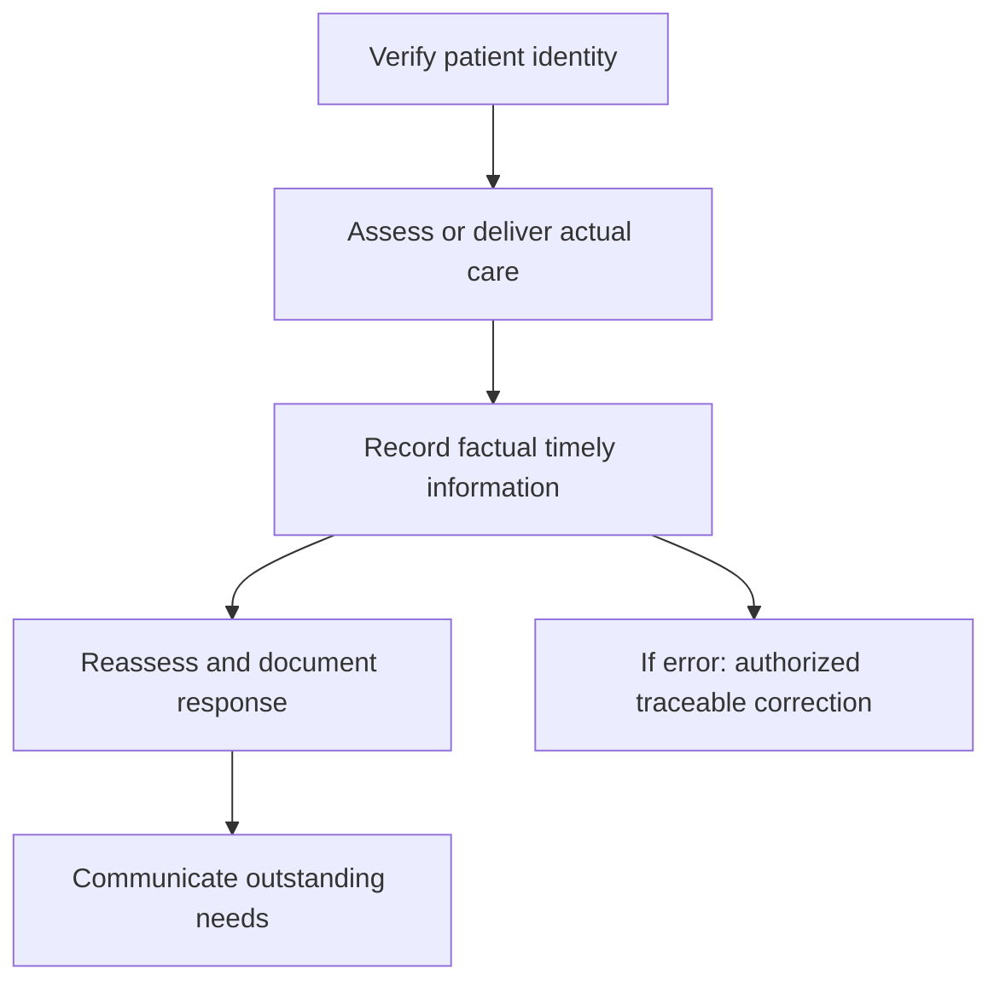

# Nursing documentation and records

**Priority High. Study-ready, not studied.** Earlier group 02 Q6–7, 9, 12–13, 16, 20 (7) + [23 new MCQs](../MCQs/02B-Nursing-Documentation-and-Records-23-MCQs.md) = 30 allocated.

Documentation patient care ka reliable record hai. Next nurse ko current condition, actual treatment, response and unfinished tasks samajhne mein help milti hai. Record legal accountability, continuity and quality improvement support karta hai. Good record factual, accurate, relevant, complete, concise, timely and attributable hona chahiye. Policy-specific terminology and approved abbreviations use karo.

## Practical recording

- Actual observed facts and patient-reported statements separately record karo. Judgmental labels ki jagah relevant behavior and context.
- Event ka actual time, assessment, intervention, response, communication and plan record karo. Anticipated care ko completed mat likho. Omitted or refused medicine, relevant reason and action document karo.
- Late entry actual event time and current entry time honestly identify karti hai. Backdating misleading hai.
- Paper correction original entry readable and correction attributable rakhe, according to policy. EHR approved correction workflow and audit trail preserve karo. Never erase or overwrite history deceptively.
- Copy-forward content current assessment se verify karo. Wrong patient record open ho toh stop and approved identifiers verify karo.
- Downtime approved paper/electronic fallback records use karo, restoration par reconcile and avoid duplicate medication administration.

## Common formats

| Format | Meaning |
|---|---|
| SOAP | Subjective, Objective, Assessment, Plan |
| SOAPIE | SOAP plus Intervention and Evaluation, terminology varies by system |
| SOAPIER | Expanded format adds revision |
| PIE | Problem, Intervention, Evaluation |
| DAR focus charting | Data, Action, Response |
| Source-oriented | Entries organized by professional source |
| Flow sheet | Repeated observations and trends |
| Charting by exception | Deviations from defined standards, with routine documentation according to policy |
| Kardex | Concise care summary where used, not a substitute for required permanent clinical records |

Example SOAP: S patient reports poor sleep. O observed awakenings at recorded times. A sleep concern based on findings. P agreed review and appropriate comfort strategies. Do not insert unsupported diagnosis. Evaluation describes actual response. For a fall or incident, clinical chart records facts, assessment, care and notification, separate incident report completed as required. Speculative blame avoid karo.

## Privacy and accountability

Access authorized clinical purpose ke liye relevant information only. Individual login share mat karo. Audit trail who changed what and when identify karta hai, not proof all clinical content is correct. Patient record access requests approved identity-verified process and applicable law se facilitate karo. Confidential information unapproved apps or personal accounts par mat send karo. Document education content, return demonstration, remaining gaps and plan. Urgent notification time, recipient, concern and response record karo, but charting alone does not replace escalation. Audit missing response entries and address workflow, technology and competency gaps.

## Sources and practice

[OpenStax documentation](https://openstax.org/books/fundamentals-nursing/pages/14-5-guidelines-for-effective-documentation) · [OpenStax EHR](https://openstax.org/books/clinical-nursing-skills/pages/4-1-foundations-for-a-complete-electronic-health-record-accurate-health-history) · [Privacy and informatics](https://openstax.org/books/fundamentals-nursing/pages/9-3-security-privacy-and-informatics)

- Teaching: [Nursing Foundations I, Unit 5 — Documentation and Reporting](https://www.youtube.com/watch?v=7hGx3Gv2XUg), indexed reports/records and forms sections, channel not independently confirmed.
- MCQ practice: [Documentation and Reporting MCQ — Unit 5 Nursing Foundations I](https://www.youtube.com/watch?v=nSbm7v2OiZE), indexed dedicated exam practice. Channel and playback not independently confirmed.
- [Historical reported evidence](../Previous-Year-Questions/02-Communication-Documentation-Handover-Reported-Evidence.md), including 2026 RRB source and SGPGI wording caution.
