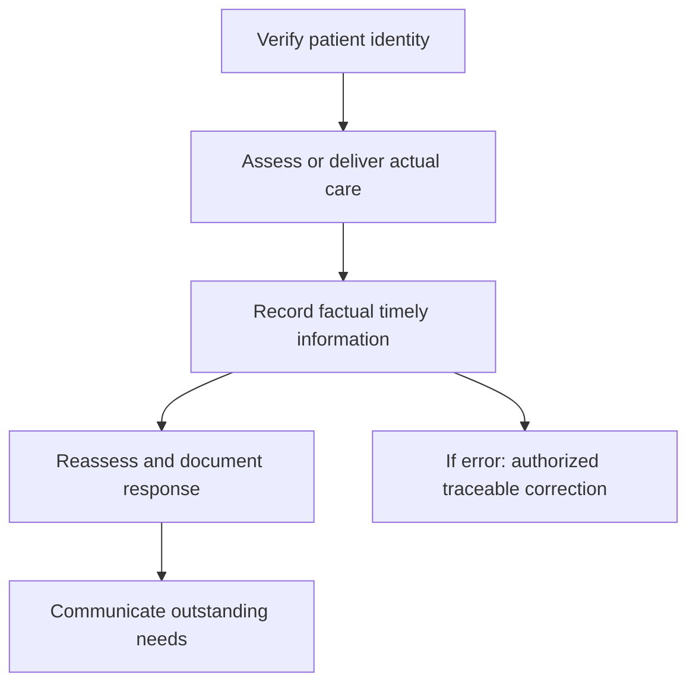

# 📚 Nursing documentation and records

**Topic priority:** 🟠 HIGH YIELD · **Study-ready, not studied.** Earlier group 02 Q6–7, 9, 12–13, 16, 20 (7) + [23 new MCQs](../MCQs/02B-Nursing-Documentation-and-Records-23-MCQs.md) = 30 allocated.

Nursing documentation ka matlab hai patient ki care ka reliable written ya electronic record banana. Maan lo next shift ki nurse patient ko pehli baar dekh rahi hai. Record padhkar use pata chalna chahiye ki patient ki current condition kya hai, kaunsa treatment diya gaya, patient ka response kya tha aur kaunsa kaam abhi baaki hai. Documentation se continuity of care, legal accountability aur quality improvement mein madad milti hai. Nurse ko facts accurately, relevant details ke saath, poore aur concise tareeke se, time par record karne chahiye. Entry se pata chalna chahiye ki record kisne banaya. Facility ke approved terms aur abbreviations hi use karne chahiye.

## 🔹 Practical recording

<!-- job4-metadata -->
**Section priority:** 🔴 MOST IMPORTANT (editorial)

**Related MCQs:** [Q1](../MCQs/02B-Nursing-Documentation-and-Records-23-MCQs.md#q1-a-nurse-realizes-at-the-end-of-a-shift-that-a-care-event-was-not-documented-when-it-occurred-which-action-is-appropriate) · [Q2](../MCQs/02B-Nursing-Documentation-and-Records-23-MCQs.md#q2-in-a-handwritten-record-a-nurse-makes-a-minor-factual-error-what-is-the-usual-safe-correction-principle) · [Q3](../MCQs/02B-Nursing-Documentation-and-Records-23-MCQs.md#q3-an-electronic-record-automatically-carries-forward-a-previous-shifts-physical-examination-what-should-the-nurse-do-before-accepting-it) · [Q4](../MCQs/02B-Nursing-Documentation-and-Records-23-MCQs.md#q4-a-nurse-plans-to-administer-a-scheduled-drug-in-ten-minutes-which-medication-documentation-practice-is-safest) · [Q5](../MCQs/02B-Nursing-Documentation-and-Records-23-MCQs.md#q5-a-patient-refuses-an-offered-medication-which-record-is-most-appropriate) · [Q6](../MCQs/02B-Nursing-Documentation-and-Records-23-MCQs.md#q6-a-nurse-documents-patient-was-difficult-all-morning-what-is-the-key-improvement-needed) · [Q7](../MCQs/02B-Nursing-Documentation-and-Records-23-MCQs.md#q7-a-patient-tells-the-nurse-about-a-symptom-using-an-unusual-expression-which-documentation-method-best-preserves-the-subjective-information) · [Q14](../MCQs/02B-Nursing-Documentation-and-Records-23-MCQs.md#q14-a-nurse-finds-a-duplicate-patient-identifier-in-an-electronic-chart-before-entering-assessment-findings-what-is-the-safest-response) · [Q15](../MCQs/02B-Nursing-Documentation-and-Records-23-MCQs.md#q15-the-electronic-health-record-is-temporarily-unavailable-which-documentation-approach-supports-safe-continuity)

**Exam evidence:** 🟣 Related concepts — [RRB Nursing Superintendent 12 March 2026 shift II report, timeliness](https://testbook.com/question-answer/during-a-health-camp-a-nurse-ensures-that-all-pat--69df45d9ad0cd59c4a82a634) and [SGPGI 28 February 2024 shift I Q7, documentation characteristics](https://www.adda247.com/jobs/wp-content/uploads/sites/22/2025/06/16124443/SGPGI-Staff-Nurse-Official-Paper-Held-On_-28-Feb-2024-Shift-1.pdf). Third-party sources inspected, paper screenshot unavailable. Do not interpret the SGPGI key as discouraging complete records. [Reported adaptations](../Previous-Year-Questions/02-Communication-Documentation-Handover-Reported-Evidence.md)

**Learning reference:** [OpenStax documentation](https://openstax.org/books/clinical-nursing-skills/pages/4-2-data-collection-and-documentation). 

**🎬 [Teaching — Documentation and reporting](https://www.youtube.com/watch?v=7hGx3Gv2XUg)** · Previously indexed teaching resource; specific subsection coverage/playback pending.

**▶️ [YouTube MCQ practice — Documentation and reporting](https://www.youtube.com/watch?v=nSbm7v2OiZE)** · Medical Knowledge Online; indexed description confirms dedicated MCQ practice. Exact question/subsection coverage and playback pending; no historical exam claim.
<!-- /job4-metadata -->

- Nurse jo facts khud observe karti hai aur jo baat patient khud batata hai, unhe alag tarah se record karti hai. Judgmental label lagane ki jagah actual relevant behavior aur context likhna chahiye.
- Nurse event ka actual time, assessment, diya gaya intervention, patient ka response, communication aur next plan record karti hai. Jo care abhi sirf planned hai, use completed nahi likhna chahiye. Agar medicine omit hui ya patient ne refuse ki, toh relevant reason aur liya gaya action document karna chahiye.
- Agar kisi event ki entry baad mein karni padti hai, toh nurse actual event time aur entry karne ka current time honestly identify karti hai. Backdating, yaani entry ko purane time par ki gayi dikhana, misleading hai.
- Paper record mein correction facility policy ke hisaab se aisi honi chahiye ki original entry readable rahe aur pata chale ki correction kisne ki. Electronic health record, yaani EHR, mein approved correction method aur audit trail preserve karna chahiye. Purani history ko deceptively erase ya overwrite nahi karna chahiye.
- Purani entry se copy-forward ki gayi information ko current assessment ke saath verify karna chahiye. Agar galat patient ka record khul gaya hai, toh nurse rukkar approved identifiers se correct patient verify karti hai.
- Agar electronic system temporarily kaam nahi kar raha hai, toh nurse approved backup paper ya electronic record use karti hai. System restore hone par records reconcile karti hai, taaki information miss na ho aur medicine galti se dobara administer na ho.

## 🔹 Common formats

<!-- job4-metadata -->
**Section priority:** 🟠 HIGH YIELD (editorial)

**Related MCQs:** [Q8](../MCQs/02B-Nursing-Documentation-and-Records-23-MCQs.md#q8-a-hospital-uses-problem-oriented-documentation-with-soap-which-entry-belongs-primarily-in-the-assessment-component) · [Q9](../MCQs/02B-Nursing-Documentation-and-Records-23-MCQs.md#q9-in-a-soap-record-which-example-belongs-primarily-under-plan) · [Q10](../MCQs/02B-Nursing-Documentation-and-Records-23-MCQs.md#q10-which-nursing-documentation-format-explicitly-links-a-stated-problem-to-interventions-and-their-evaluation) · [Q11](../MCQs/02B-Nursing-Documentation-and-Records-23-MCQs.md#q11-in-focus-charting-what-does-the-r-in-dar-usually-represent) · [Q12](../MCQs/02B-Nursing-Documentation-and-Records-23-MCQs.md#q12-a-unit-uses-charting-by-exception-what-prerequisite-makes-this-method-meaningful) · [Q13](../MCQs/02B-Nursing-Documentation-and-Records-23-MCQs.md#q13-which-record-is-most-useful-for-visualizing-repeated-observations-over-time) · [Q20](../MCQs/02B-Nursing-Documentation-and-Records-23-MCQs.md#q20-a-clinician-is-reviewing-an-incident-that-caused-a-minor-injury-which-distinction-between-clinical-chart-and-safety-incident-report-is-appropriate)

**Exam evidence:** 🟣 Incident reporting concept — [SGPGI 28 February 2024 shift I Q8, ID 34](https://www.adda247.com/jobs/wp-content/uploads/sites/22/2025/06/16124443/SGPGI-Staff-Nurse-Official-Paper-Held-On_-28-Feb-2024-Shift-1.pdf), third-party paper text inspected, screenshot unavailable. Specific SOAP/PIE/DAR historical matches pending. [Reported adaptations](../Previous-Year-Questions/02-Communication-Documentation-Handover-Reported-Evidence.md)

**Learning reference:** [OpenStax documentation](https://openstax.org/books/clinical-nursing-skills/pages/4-2-data-collection-and-documentation). 

**🎬 [Teaching — Documentation and reporting](https://www.youtube.com/watch?v=7hGx3Gv2XUg)** · Previously indexed teaching resource; specific subsection coverage/playback pending.

**▶️ [YouTube MCQ practice — Documentation and reporting](https://www.youtube.com/watch?v=nSbm7v2OiZE)** · Medical Knowledge Online; indexed description confirms dedicated MCQ practice. Exact question/subsection coverage and playback pending; no historical exam claim.
<!-- /job4-metadata -->

| Format | Meaning |
|---|---|
| SOAP | Is format mein nurse Subjective data, Objective findings, Assessment aur Plan ko alag record karti hai. |
| SOAPIE | SOAP ke saath Intervention aur Evaluation record kiye jaate hain. Terminology system ke hisaab se badal sakti hai. |
| SOAPIER | Is expanded format mein Revision bhi add hoti hai, jisse zaroorat par care plan mein change record kiya ja sakta hai. |
| PIE | Nurse Problem, Intervention aur Evaluation ko organize karke record karti hai. |
| DAR focus charting | Nurse specific focus ke liye Data, Action aur Response record karti hai. |
| Source-oriented | Entries ko information dene wale professional source ke according organize kiya jaata hai. |
| Flow sheet | Nurse repeated observations ko aise record karti hai ki time ke saath trend compare kiya ja sake. |
| Charting by exception | Nurse defined standards se deviations document karti hai aur routine documentation facility policy ke according karti hai. |
| Kardex | Jahan Kardex use hota hai, wahan ye care ka concise summary deta hai. Ye required permanent clinical record ka substitute nahi hai. |

SOAP ko ek simple example se samjho. S mein nurse record karti hai ki patient ne poor sleep report ki hai. O mein woh actual observed awakenings aur unka time record karti hai. A mein available findings ke basis par sleep-related concern likhti hai. P mein agreed review aur appropriate comfort strategies ka plan record karti hai. Nurse ko unsupported diagnosis nahi likhna chahiye. Evaluation mein actual response record hota hai.

Agar fall ya koi incident hota hai, toh clinical chart mein relevant facts, assessment, diya gaya care aur notification record karni chahiye. Facility ke rules ke hisaab se separate incident report bhi complete ki jaati hai. Bina evidence kisi ko blame nahi karna chahiye.

## 🔹 Privacy and accountability

<!-- job4-metadata -->
**Section priority:** 🔴 MOST IMPORTANT (editorial)

**Related MCQs:** [Q16](../MCQs/02B-Nursing-Documentation-and-Records-23-MCQs.md#q16-a-colleague-asks-to-use-the-nurses-electronic-login-because-their-account-is-locked-what-is-appropriate) · [Q17](../MCQs/02B-Nursing-Documentation-and-Records-23-MCQs.md#q17-a-nurse-needs-to-review-records-of-a-patient-from-another-unit-for-an-assigned-consultation-which-privacy-principle-applies) · [Q18](../MCQs/02B-Nursing-Documentation-and-Records-23-MCQs.md#q18-an-electronic-system-retains-the-date-user-identity-and-prior-versions-of-changed-entries-what-is-the-main-purpose-of-this-feature) · [Q19](../MCQs/02B-Nursing-Documentation-and-Records-23-MCQs.md#q19-a-nurse-provides-teaching-on-a-complex-home-procedure-which-documentation-most-clearly-demonstrates-the-teaching-outcome) · [Q21](../MCQs/02B-Nursing-Documentation-and-Records-23-MCQs.md#q21-a-nurse-records-that-an-urgent-concern-was-communicated-to-the-provider-which-detail-improves-continuity-most) · [Q22](../MCQs/02B-Nursing-Documentation-and-Records-23-MCQs.md#q22-an-audit-finds-many-nursing-entries-missing-the-patients-response-to-interventions-which-improvement-is-most-useful) · [Q23](../MCQs/02B-Nursing-Documentation-and-Records-23-MCQs.md#q23-a-patient-requests-access-to-their-clinical-record-what-should-the-nurse-do)

**Exam evidence:** 🟣 Related documentation quality concept — [RRB Nursing Superintendent 12 March 2026 shift I reported question](https://testbook.com/question-answer/during-a-quality-assurance-review-incomplete-nurs--69df436f10b5dd8cb689e310). Specific privacy exam matches pending. [Reported adaptations](../Previous-Year-Questions/02-Communication-Documentation-Handover-Reported-Evidence.md)

**Learning reference:** [OpenStax documentation](https://openstax.org/books/clinical-nursing-skills/pages/4-2-data-collection-and-documentation). 

**🎬 [Teaching — Documentation and reporting](https://www.youtube.com/watch?v=7hGx3Gv2XUg)** · Previously indexed teaching resource; specific subsection coverage/playback pending.

**▶️ [YouTube MCQ practice — Documentation and reporting](https://www.youtube.com/watch?v=nSbm7v2OiZE)** · Medical Knowledge Online; indexed description confirms dedicated MCQ practice. Exact question/subsection coverage and playback pending; no historical exam claim.
<!-- /job4-metadata -->

Nurse patient record ki sirf wahi information access karti hai jo authorized clinical purpose ke liye relevant hai. Apna individual login kisi doosre person ke saath share nahi karna chahiye. Audit trail se pata chalta hai ki record mein kisne, kya aur kab change kiya. Lekin audit trail se ye automatically prove nahi hota ki saari clinical information correct hai.

Agar patient apna record access karna chahta hai, toh applicable law aur facility ke approved identity-verified process ke according request facilitate karni chahiye. Confidential information unapproved apps ya personal accounts par share nahi karni chahiye. Nurse patient education ka content, return demonstration, remaining learning gaps aur next plan document karti hai. Urgent notification ka time, recipient, concern aur response record karna zaroori hai. Lekin sirf chart mein likhna actual escalation ka substitute nahi hai. Agar audit mein response entries missing milti hain, toh workflow, technology aur staff competency se judi problems identify karke improve karni chahiye.

## ▶️ Sources and practice

[OpenStax documentation](https://openstax.org/books/fundamentals-nursing/pages/14-5-guidelines-for-effective-documentation) · [OpenStax EHR](https://openstax.org/books/clinical-nursing-skills/pages/4-1-foundations-for-a-complete-electronic-health-record-accurate-health-history) · [Privacy and informatics](https://openstax.org/books/fundamentals-nursing/pages/9-3-security-privacy-and-informatics)

- Teaching: [Nursing Foundations I, Unit 5 — Documentation and Reporting](https://www.youtube.com/watch?v=7hGx3Gv2XUg), indexed reports/records and forms sections, channel not independently confirmed.
- MCQ practice: [Documentation and Reporting MCQ — Unit 5 Nursing Foundations I](https://www.youtube.com/watch?v=nSbm7v2OiZE), indexed dedicated exam practice. Channel and playback not independently confirmed.
- [Historical reported evidence](../Previous-Year-Questions/02-Communication-Documentation-Handover-Reported-Evidence.md), including 2026 RRB source and SGPGI wording caution.
