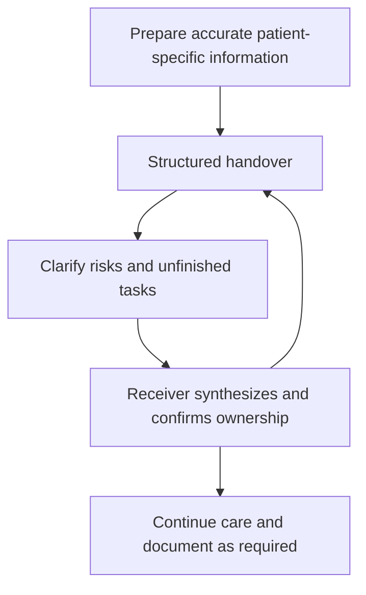

# 📚 Clinical handover and team communication

**Topic priority:** 🟠 HIGH YIELD · **Study-ready, not studied.** Earlier group 02 Q5, 8, 17, 19 (4) + [26 new MCQs](../MCQs/02C-Clinical-Handover-and-Team-Communication-26-MCQs.md) = 30 allocated. Transfer/admission and management chapters have separate clinical scope, avoid repeated stems.

Handover ka matlab information aur current care responsibility ko safely next responsible clinician/team tak transfer karna hai. Message bhejna alone enough nahi, recipient understands and accepts relevant tasks, questions clarify hoti hain. Use facility-approved structure. Critical current condition and urgency first, relevant context and tasks next. Patient identification approved identifiers se verify karo.

## 🔹 SBAR and I-PASS

<!-- job4-metadata -->
**Section priority:** 🔴 MOST IMPORTANT (editorial)

**Related MCQs:** [Q1](../MCQs/02C-Clinical-Handover-and-Team-Communication-26-MCQs.md#q1-a-nurse-begins-an-sbar-call-about-an-abrupt-change-in-a-patients-condition-what-belongs-in-situation) · [Q2](../MCQs/02C-Clinical-Handover-and-Team-Communication-26-MCQs.md#q2-during-sbar-communication-which-information-best-belongs-in-background) · [Q3](../MCQs/02C-Clinical-Handover-and-Team-Communication-26-MCQs.md#q3-a-nurse-reports-an-important-current-finding-and-states-concern-about-the-patients-deteriorating-condition-which-sbar-component-is-this) · [Q4](../MCQs/02C-Clinical-Handover-and-Team-Communication-26-MCQs.md#q4-which-statement-best-demonstrates-a-clear-action-request-during-urgent-team-communication) · [Q5](../MCQs/02C-Clinical-Handover-and-Team-Communication-26-MCQs.md#q5-a-clinician-asks-the-nurse-to-repeat-a-communicated-numerical-result-and-then-confirms-it-is-correct-which-communication-mechanism-is-demonstrated) · [Q6](../MCQs/02C-Clinical-Handover-and-Team-Communication-26-MCQs.md#q6-a-nurse-repeats-an-instruction-incorrectly-during-a-check-back-what-should-the-sender-do) · [Q7](../MCQs/02C-Clinical-Handover-and-Team-Communication-26-MCQs.md#q7-during-a-rapidly-evolving-team-emergency-one-nurse-announces-a-critical-observation-aloud-so-the-entire-responding-team-is-aware-which-teamstepps-communication-tool-is-most-closely-represented) · [Q8](../MCQs/02C-Clinical-Handover-and-Team-Communication-26-MCQs.md#q8-a-team-leader-assigns-a-specific-urgent-task-to-a-staff-member-by-role-or-name-why-should-the-recipient-acknowledge-the-assignment) · [Q9](../MCQs/02C-Clinical-Handover-and-Team-Communication-26-MCQs.md#q9-which-component-of-i-pass-indicates-how-clinically-stable-or-unstable-the-patient-is) · [Q10](../MCQs/02C-Clinical-Handover-and-Team-Communication-26-MCQs.md#q10-in-i-pass-which-information-belongs-mainly-in-the-action-list) · [Q11](../MCQs/02C-Clinical-Handover-and-Team-Communication-26-MCQs.md#q11-which-handover-statement-best-demonstrates-situation-awareness-and-contingency-planning) · [Q12](../MCQs/02C-Clinical-Handover-and-Team-Communication-26-MCQs.md#q12-why-is-synthesis-by-the-receiver-included-in-i-pass-handover) · [Q24](../MCQs/02C-Clinical-Handover-and-Team-Communication-26-MCQs.md#q24-a-team-conducts-a-short-discussion-before-a-planned-complex-procedure-to-clarify-roles-resources-and-anticipated-risks-which-teamwork-activity-is-this) · [Q25](../MCQs/02C-Clinical-Handover-and-Team-Communication-26-MCQs.md#q25-during-a-shift-unexpected-workload-and-patient-deterioration-change-the-units-priorities-which-short-team-meeting-is-most-appropriate-to-reassess-the-current-plan) · [Q26](../MCQs/02C-Clinical-Handover-and-Team-Communication-26-MCQs.md#q26-after-a-difficult-transfer-staff-review-what-worked-what-communication-failed-and-how-to-improve-next-time-which-teamwork-activity-is-demonstrated)

**Evidence and learning references:** Historical exam-specific evidence pending. [AHRQ SBAR](https://www.ahrq.gov/teamstepps-program/curriculum/communication/tools/sbar.html) · [AHRQ check-back](https://www.ahrq.gov/teamstepps-program/curriculum/communication/tools/checkback.html) · [AHRQ I-PASS](https://www.ahrq.gov/teamstepps-program/curriculum/communication/tools/ipass.html). 

**🎬 [Teaching — How to give an SBAR Report](https://www.youtube.com/watch?v=LSYTFJqvEug)** · Lecturio Nursing; previously indexed SBAR teaching, playback pending.

**YouTube MCQ practice: verification pending** — dedicated handover question-solving video not verified. [Supplementary written handoff and SBAR practice](https://nursing.growthoval.com/practice/fundamentals-safety/handoff-sbar/) (indexed; not a YouTube video or Indian exam provenance).
<!-- /job4-metadata -->

| SBAR | Meaning |
|---|---|
| Situation | Who, what is happening now, urgency |
| Background | Relevant diagnosis, history, treatment or recent procedure |
| Assessment | Current findings and reasoned clinical concern |
| Recommendation | Specific requested action and urgency |

Example: Situation patient has new concerning clinical change. Background recent treatment and relevant diagnosis. Assessment actual observations and concern. Recommendation prompt bedside review and agreed escalation. Do not delay emergency care to finish a template. ISBAR adds Identification/Introduction according to the local format.

| I-PASS | Meaning |
|---|---|
| Illness severity | Current stability/urgency |
| Patient summary | Relevant clinical context and course |
| Action list | Tasks, who and when |
| Situation awareness and contingency planning | What changes to watch and what to do |
| Synthesis by receiver | Receiver confirms understanding and clarifies |

Check-back closed-loop: sender communicates, receiver repeats key content, sender verifies or corrects. Teach-back checks patient understanding, check-back verifies staff communication. Call-out important urgent information team ko announce karta hai. Task assignment named person/role and acknowledgment ke saath. Brief shared plan before activity, huddle changing situation mein replan, debrief activity ke baad learning. Persistent safety concern respectfully restate karo, supporting evidence and approved escalation pathway follow karo.

## 🔹 Transfer and shift safety

<!-- job4-metadata -->
**Section priority:** 🔴 MOST IMPORTANT (editorial)

**Related MCQs:** [Q13](../MCQs/02C-Clinical-Handover-and-Team-Communication-26-MCQs.md#q13-a-nurse-hands-over-a-patient-with-an-ongoing-infusion-which-information-is-most-important-to-verify-at-the-transition) · [Q14](../MCQs/02C-Clinical-Handover-and-Team-Communication-26-MCQs.md#q14-a-patient-is-moving-to-another-unit-and-has-an-active-isolation-requirement-what-is-the-correct-handover-principle) · [Q15](../MCQs/02C-Clinical-Handover-and-Team-Communication-26-MCQs.md#q15-an-outgoing-nurse-reports-that-a-patient-has-an-allergy-but-the-exact-reaction-is-unclear-what-should-the-receiving-nurse-do) · [Q16](../MCQs/02C-Clinical-Handover-and-Team-Communication-26-MCQs.md#q16-during-transfer-a-patient-carries-an-order-for-restricted-oral-intake-that-is-absent-from-the-receiving-units-summary-which-action-is-most-appropriate) · [Q17](../MCQs/02C-Clinical-Handover-and-Team-Communication-26-MCQs.md#q17-a-shift-handover-is-repeatedly-interrupted-by-unrelated-nonurgent-requests-which-system-improvement-best-protects-communication-quality) · [Q18](../MCQs/02C-Clinical-Handover-and-Team-Communication-26-MCQs.md#q18-a-bedside-handover-includes-information-the-patient-has-requested-be-discussed-privately-what-is-the-best-approach) · [Q19](../MCQs/02C-Clinical-Handover-and-Team-Communication-26-MCQs.md#q19-a-patient-notices-a-discrepancy-during-bedside-handover-about-their-usual-mobility-assistance-how-should-the-team-respond) · [Q20](../MCQs/02C-Clinical-Handover-and-Team-Communication-26-MCQs.md#q20-a-nurse-receives-a-nonurgent-routine-report-by-secure-message-but-the-receiving-clinician-has-not-acknowledged-a-time-sensitive-task-what-is-appropriate) · [Q21](../MCQs/02C-Clinical-Handover-and-Team-Communication-26-MCQs.md#q21-an-outgoing-nurse-is-asked-to-hand-over-an-unfamiliar-patient-immediately-after-receiving-incomplete-information-what-is-safest) · [Q22](../MCQs/02C-Clinical-Handover-and-Team-Communication-26-MCQs.md#q22-a-nurse-has-escalated-a-serious-clinical-concern-but-the-initial-recipient-dismisses-it-despite-persistent-concerning-findings-what-is-the-safest-next-step) · [Q23](../MCQs/02C-Clinical-Handover-and-Team-Communication-26-MCQs.md#q23-a-transfer-summary-includes-a-pending-consultation-but-no-identified-person-responsible-for-following-it-up-what-should-be-corrected)

**Evidence and learning references:** Related transfer-safety concept — **[🟣 RRB Nursing Superintendent 12 March 2026 shift III — related tested concept](https://testbook.com/question-answer/what-is-the-most-appropriate-action-for-a-nurse-if--69df4796a0ef8fa701f49667)**, third-party page inspected, no exact match asserted. [AHRQ TeamSTEPPS](https://www.ahrq.gov/teamstepps-program/resources/modules/index.html). 

**🎬 [Teaching — How to give an SBAR Report](https://www.youtube.com/watch?v=LSYTFJqvEug)** · Lecturio Nursing; previously indexed SBAR teaching, playback pending.

**YouTube MCQ practice: verification pending** — dedicated handover question-solving video not verified. [Supplementary written handoff and SBAR practice](https://nursing.growthoval.com/practice/fundamentals-safety/handoff-sbar/) (indexed; not a YouTube video or Indian exam provenance).
<!-- /job4-metadata -->

Current medicines/infusions, access, allergies and reaction uncertainty, precautions, functional needs, restrictions, observations, pending tests and consultations, escalation plan communicate karo as relevant. Verify discrepancies against authorized current orders. Time-sensitive outstanding tasks have responsible person and due time. Sent secure message is not proof of receipt or action. Protect handover from nonurgent interruptions but emergency response remains priority. Bedside involvement helps identify discrepancies, sensitive details privately share with authorized team according to consent and law. Incomplete information clearly identify, do not invent gaps. Receiving team accepts current responsibility according to policy. Clinical chart and handover complement each other.

## ▶️ Sources and resources

[AHRQ SBAR](https://www.ahrq.gov/teamstepps-program/curriculum/communication/tools/sbar.html) · [Check-back](https://www.ahrq.gov/teamstepps-program/curriculum/communication/tools/checkback.html) · [I-PASS](https://www.ahrq.gov/teamstepps-program/curriculum/communication/tools/ipass.html) · [TeamSTEPPS communication tools](https://www.ahrq.gov/teamstepps-program/resources/modules/index.html)

- Concept: [Lecturio Nursing — How to give an SBAR Report](https://www.youtube.com/watch?v=LSYTFJqvEug), 16 November 2021, Samantha Rhea, indexed SBAR and interdisciplinary communication teaching.
- Demonstration: [How to do a nursing handover the RIGHT way](https://www.youtube.com/watch?v=D01x7W6aEE8), indexed SBAR and ISOBAR coverage, channel not independently confirmed.
- Practice: [Handoff & SBAR nursing practice questions](https://nursing.growthoval.com/practice/fundamentals-safety/handoff-sbar/), indexed applied NCLEX-format supplementary resource. Dedicated nursing handover MCQ-solving YouTube video not confirmed. [General documentation and reporting MCQ video](https://www.youtube.com/watch?v=nSbm7v2OiZE) is related, handover-specific questions unverified. Full playback pending.
- [Historical exam evidence and gaps](../Previous-Year-Questions/02-Communication-Documentation-Handover-Reported-Evidence.md).
