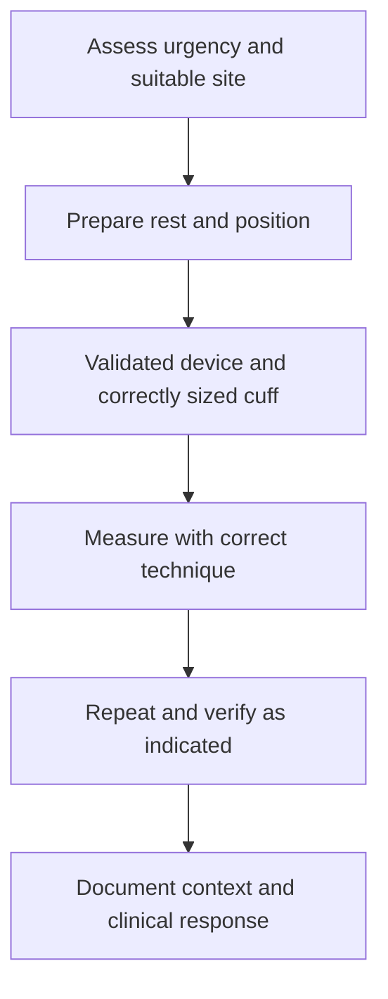

# 📚 Blood pressure measurement and interpretation

**Topic priority:** 🟠 HIGH YIELD · **Study-ready, not studied.** [23 new MCQs](../MCQs/03A-Blood-Pressure-Measurement-23-MCQs.md) + earlier group 03 Q1–3, 11, 17–18, 20 = 30 allocated, no double counting.

Blood pressure, jise hum BP kehte hain, woh pressure hai jo blood arteries ki walls par daalta hai. Jab heart contract karke blood ko arteries mein pump karta hai, toh pressure apne highest level par pahunchta hai. Ise systolic blood pressure ya SBP kehte hain. Jab heart beats ke beech relax karta hai, toh arterial pressure apne lowest level tak aa jaata hai. Ise diastolic blood pressure ya DBP kehte hain. BP ko millimeters of mercury, yaani mmHg, mein measure kiya jaata hai.

Maan lo patient ka BP 150/90 mmHg hai. Yahan systolic pressure 150 hai aur diastolic pressure 90 hai. Pulse pressure dono ka difference hai, yaani 150 − 90 = 60 mmHg. Mean arterial pressure ya MAP poore cardiac cycle ke dauran average arterial pressure ka estimate hai. Ordinary resting heart rate par iska approximate formula DBP + pulse pressure/3 hai. Is example mein MAP lagbhag 90 + 60/3 = 110 mmHg hoga. Ye calculation ek estimate hai. Isse directly confirm nahi hota ki patient ke har organ tak sufficient blood supply pahunch rahi hai.

## 🔹 Standardized routine adult assessment

<!-- job4-metadata -->
**🟣 NORCET 7 Prelims 2024 — related concept:** [Reported brachial artery question](https://testbook.com/question-answer/when-measuring-blood-pressure-the-nurse-places-th--67a2efd17c9026fd432d5810). Retrieved third-party memory-based source, not an authenticated exact PYQ.

**▶️ YouTube MCQ practice:** [Vital-signs practice resources](#references-and-learning-resources) below, including Ritika Ma'am's description-indexed BP errors and precautions. Exact question/playback pending.

**📝 Practice bank:** [23 BP MCQs](../MCQs/03A-Blood-Pressure-Measurement-23-MCQs.md)
<!-- /job4-metadata -->

Routine BP measurement se pehle patient ko aise prepare karte hain ki reading uski resting condition ko reasonably represent kare. Agar patient stable hai, toh measurement se lagbhag 30 minute pehle exercise, smoking aur caffeine avoid karna chahiye. Bladder empty hona chahiye aur patient ko kam se kam paanch minute quietly rest karne dena chahiye. Patient ka back supported ho, dono feet floor par flat hon aur legs cross na hon. Arm ko support dekar heart level par rakho. Cuff bare upper arm par lagao aur tight clothing se arm constrict nahi hona chahiye. Reading lete waqt patient aur nurse dono unnecessary baat na karein.

Cuff ka size patient ki arm circumference measure karke aur device ki markings dekhkar select karo. Cuff ke andar inflatable bladder hota hai. AHA 2019 statement ke according bladder ki length arm circumference ki 75–100% aur width 37–50% hoti hai. Exams mein traditional approximation length 80% aur width 40% bhi poochhi ja sakti hai. Maan lo cuff bahut chhota hai. Artery compress karne ke liye zyada pressure lag sakta hai aur reading falsely high aa sakti hai. Agar patient mein acute deterioration ho rahi hai, toh routine resting preparation complete karne ke chakkar mein urgent assessment delay nahi karna chahiye.

Manual BP measurement mein nurse brachial artery locate karti hai. Palpatory systolic estimate lene se nurse ko approximate systolic pressure ka idea milta hai. Isse auscultatory gap ki wajah se systolic reading miss hone ka risk kam ho sakta hai. Nurse applicable protocol ke according cuff ko estimated systolic pressure se appropriately upar inflate karti hai aur stethoscope se Korotkoff sounds sunti hui pressure lagbhag 2 mmHg per second ki speed se release karti hai.

Korotkoff phase I mein pehli repeated tapping sound sunai deti hai. Routine adult measurement mein ye systolic pressure represent karti hai. Phase V mein sounds disappear ho jaati hain aur ye usually diastolic pressure hota hai. Agar sounds zero ke paas tak sunai deti rahein, toh phase IV, yaani sounds muffled hone ka point, useful ho sakta hai. Atypical sound pattern ko clearly record karna chahiye.

Auscultatory gap tab hota hai jab cuff deflate karte waqt sounds beech mein kuch der ke liye gayab hoti hain aur phir wapas aati hain. Is temporary silence ko final diastolic pressure nahi samajhna chahiye. Cuff bahut chhota ho toh reading falsely high aur bahut bada ho toh falsely low ho sakti hai. Arm heart level se neeche rakhi ho toh reading high aur upar rakhi ho toh low aa sakti hai. Isliye position aur cuff size dono accurate reading ke liye important hain.

Initial assessment mein, jab appropriate ho, dono arms mein BP measure kiya ja sakta hai. Agar readings mein difference mile, toh persistent difference confirm karna chahiye. Routine follow-up mein consistently higher reading wali arm use ki jaati hai. Patient ki dialysis fistula wali arm ko protect karo aur applicable policy ke according suitable alternative site use karke site record karo.

Automatic oscillometric BP machine cuff pressure mein heartbeat se hone wali changes analyze karti hai. Accurate use ke liye validated device aur suitable cuff chahiye. Irregular heart rhythm se reading ki accuracy affect ho sakti hai. Wrist device use karne par correct positioning bahut important hai aur generally validated upper-arm device preferred hota hai. Chronic hypertension confirm karne ke liye repeated standardized readings aur appropriate clinical confirmation chahiye. Lekin ek severe reading ke saath concerning symptoms hon, toh timely clinical assessment zaroori hai.

## 🔹 Orthostatic assessment and perfusion

<!-- job4-metadata -->
**YouTube MCQ practice: verification pending** — specific orthostatic assessment and perfusion scenarios not confirmed in a question-solving video. [Related topic questions](../MCQs/03A-Blood-Pressure-Measurement-23-MCQs.md).
<!-- /job4-metadata -->

Orthostatic assessment mein nurse dekhti hai ki patient ki position lying se standing karne par blood pressure kaise change hota hai. Standing par gravity ki wajah se blood legs ki taraf shift ho sakta hai aur body normally circulation maintain karne ke liye adjust karti hai. Agar compensation sufficient nahi hai, toh patient ko dizziness ya faintness ho sakti hai. Common orthostatic BP threshold standing ke teen minute ke andar systolic pressure mein kam se kam 20 mmHg ya diastolic pressure mein kam se kam 10 mmHg ki fall hai.

Applicable protocol follow karo. Aam taur par supine rest ke baad standing observations ek aur teen minute par li jaati hain. Agar patient ko marked dizziness ho, toh use safely baithne ya letne mein help karo. Sirf reading complete karne ke liye forcefully standing position maintain mat karwao. Actual BP, position, timing aur symptoms document karo. Yaad rakho ki normal BP hone par bhi poor tissue perfusion possible hai. Patient ki overall clinical condition aur doosri relevant findings bhi assess karni chahiye.

## ▶️ References and learning resources

- [AHA 2019 measurement scientific statement](https://pmc.ncbi.nlm.nih.gov/articles/PMC11409525/)
- [CDC measuring BP](https://www.cdc.gov/high-blood-pressure/measure/)
- [2024 ESC guideline](https://academic.oup.com/eurheartj/article/45/38/3912/7741010)
- Teaching: [Nursing Hub — Vital Sign Introduction, Hindi](https://www.youtube.com/watch?v=MFILV_Igcm8), 8 February 2026, indexed principles and timing.
- Practice: [Nidhya Medical Academy, NG Naik Sir — Vital Signs MCQs](https://www.youtube.com/watch?v=MGcl1u11Na4), 5 June 2026, indexed BP, pulse, respiration and temperature NORCET/CHO/staff nurse coverage.
- Practice: [VS Nursing Academy, Ritika Ma'am — Vital Signs MCQ Session](https://www.youtube.com/watch?v=LM37c_byRHs), indexed BP and vital-sign practice. Playback not independently reviewed.
- [Reported evidence](../Previous-Year-Questions/03A-BP-Reported-Evidence.md).
