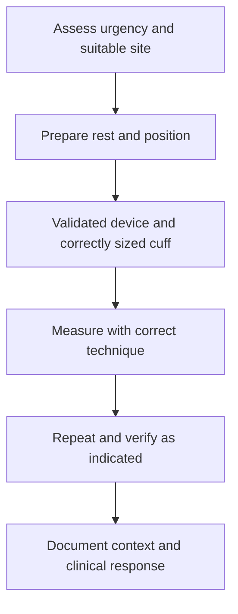

# 📚 Blood pressure measurement and interpretation

**Topic priority:** 🟠 HIGH YIELD · **Study-ready, not studied.** [23 new MCQs](../MCQs/03A-Blood-Pressure-Measurement-23-MCQs.md) + earlier group 03 Q1–3, 11, 17–18, 20 = 30 allocated, no double counting.

BP arterial wall par blood pressure hai. Systolic peak pressure, diastolic relaxation-associated lowest pressure. Unit mmHg. Pulse pressure SBP − DBP, MAP approximately DBP + PP/3 at ordinary resting heart rate. Example 150/90 gives PP 60, MAP about 110. Formula estimate hai, not direct tissue perfusion.

## 🔹 Standardized routine adult assessment

<!-- job4-metadata -->
**🟣 NORCET 7 Prelims 2024 — related concept:** [Reported brachial artery question](https://testbook.com/question-answer/when-measuring-blood-pressure-the-nurse-places-th--67a2efd17c9026fd432d5810). Retrieved third-party memory-based source, not an authenticated exact PYQ.

**▶️ YouTube MCQ practice:** [Vital-signs practice resources](#references-and-learning-resources) below, including Ritika Ma'am's description-indexed BP errors and precautions. Exact question/playback pending.

**📝 Practice bank:** [23 BP MCQs](../MCQs/03A-Blood-Pressure-Measurement-23-MCQs.md)
<!-- /job4-metadata -->

Stable office BP: exercise, smoking and caffeine avoid about 30 minutes, empty bladder, quiet rest five minutes. Back supported, feet flat, legs uncrossed, arm supported at heart level. Bare arm, no constrictive clothing. No talking. Cuff size measured circumference and device markings se choose karo. AHA 2019 statement bladder length 75–100% and width 37–50% of circumference. Traditional exam approximation length 80% and width 40%. Do not delay urgent evaluation to obtain routine standardized rest.

Manual BP: locate brachial artery. Palpatory systolic estimate helps avoid missed auscultatory gap. Inflate appropriately above estimate per protocol and deflate about 2 mmHg/sec. Phase I first repeated sound = usual systolic, phase V disappearance = usual adult diastolic. Phase IV muffling may help if sounds persist near zero. Temporary disappearance and return = auscultatory gap, not final diastolic. Record atypical pattern. Too small cuff may falsely elevate, too large may underestimate, arm below heart level may elevate and above may lower reading.

Initial bilateral assessment where appropriate, confirm persistent difference, use consistently higher arm for routine follow-up. Protect dialysis fistula, use suitable alternative and record site. Oscillometric devices need validation and appropriate fit, irregular rhythm may affect accuracy. Wrist devices need correct positioning, validated upper arm generally preferred. Repeated standardized readings and clinical confirmation for chronic hypertension. Single severe symptomatic finding requires timely assessment.

## 🔹 Orthostatic assessment and perfusion

<!-- job4-metadata -->
**YouTube MCQ practice: verification pending** — specific orthostatic assessment and perfusion scenarios not confirmed in a question-solving video. [Related topic questions](../MCQs/03A-Blood-Pressure-Measurement-23-MCQs.md).
<!-- /job4-metadata -->

Common threshold fall ≥20 systolic OR ≥10 diastolic within three minutes of standing. Use applicable protocol, usually supine rest then standing observations at one and three minutes. Marked dizziness means assist to safe position, do not force standing. Document actual findings. Normal BP does not guarantee perfusion, clinical status and other observations matter.

## ▶️ References and learning resources

- [AHA 2019 measurement scientific statement](https://pmc.ncbi.nlm.nih.gov/articles/PMC11409525/)
- [CDC measuring BP](https://www.cdc.gov/high-blood-pressure/measure/)
- [2024 ESC guideline](https://academic.oup.com/eurheartj/article/45/38/3912/7741010)
- Teaching: [Nursing Hub — Vital Sign Introduction, Hindi](https://www.youtube.com/watch?v=MFILV_Igcm8), 8 February 2026, indexed principles and timing.
- Practice: [Nidhya Medical Academy, NG Naik Sir — Vital Signs MCQs](https://www.youtube.com/watch?v=MGcl1u11Na4), 5 June 2026, indexed BP, pulse, respiration and temperature NORCET/CHO/staff nurse coverage.
- Practice: [VS Nursing Academy, Ritika Ma'am — Vital Signs MCQ Session](https://www.youtube.com/watch?v=LM37c_byRHs), indexed BP and vital-sign practice. Playback not independently reviewed.
- [Reported evidence](../Previous-Year-Questions/03A-BP-Reported-Evidence.md).
