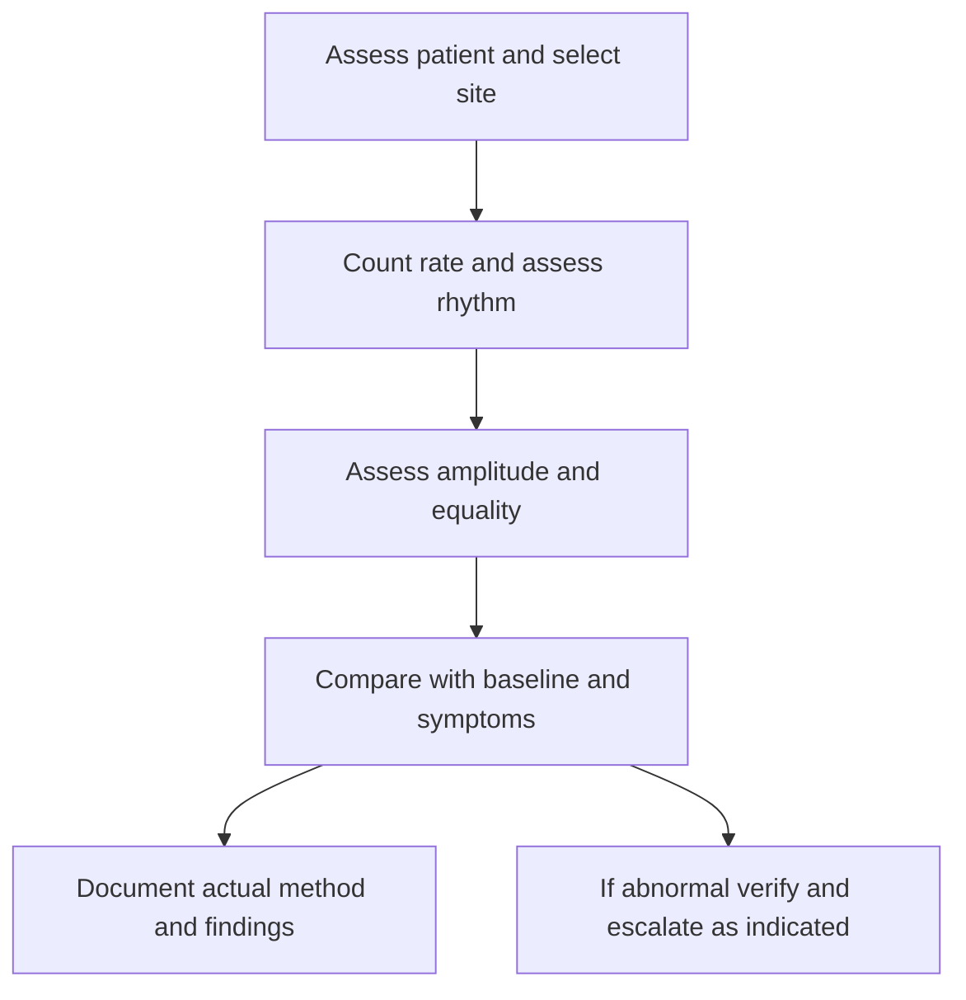

# 📚 Pulse assessment

**Topic priority:** 🟠 HIGH YIELD · **Study-ready, not studied.** [27 new questions](../MCQs/03B-Pulse-Assessment-27-MCQs.md) + earlier group 03 Q4,5,16 = 30 allocated. No reused questions counted as new.

Pulse heartbeat se generated arterial pressure wave hai. Rate (beats/min), rhythm (regularity), amplitude (strength) and symmetry assess karo. Common resting adult reference 60–100/min, age, conditioning, medicines, illness, pain and activity affect interpretation. Patient baseline important hai. Slow rate alone athletic adult mein disease prove nahi karti, but slow pulse with dizziness, hypotension or altered alertness requires urgent review.

## 🔹 Sites and methods

<!-- job4-metadata -->
**Exam evidence:** **🟣 [HPSSC Staff Nurse 2021](https://testbook.com/question-answer/location-of-auscultation-for-apical-pulse-is--697c4a25d11d912710e86065)** — apical auscultation landmark; **🟣 [SGPGI Staff Nurse 2024](https://testbook.com/question-answer/as-part-of-cardiac-assessment-to-palpate-th--685baa2301bacc852687a084)** — related palpation landmark; **🟣 [ESIC Staff Nurse 2019](https://testbook.com/question-answer/when-a-pulse-rate-is-irregular-it-is-best-to-coun--619cfc8ec37377aece1592c7)** — full-minute irregular pulse; **🟣 [RRB Staff Nurse 2019](https://testbook.com/question-answer/what-is-pulse-deficit--61a8a4a934f46b35766a7916)** and **🟣 [AIIMS Bhatinda Nursing Officer 2019](https://testbook.com/question-answer/pulse-deficit-is-the-difference-between--617655fdd2f531c4f1ae5444)** — pulse deficit. Retrieved third-party sources, related concepts, not independently authenticated official papers or keys.

**▶️ [YouTube MCQ practice — Physical Examination, study Room](https://www.youtube.com/watch?v=aTGm3WCiS9w)** · Published description explicitly lists apical pulse site. Additional [vital-signs MCQ resources](#sources-and-video-practice) include description-indexed pulse characteristics and sites. Specific pulse-deficit questions and playback pending.
<!-- /job4-metadata -->

| Site | Landmark |
|---|---|
| Radial | Thumb side wrist |
| Brachial | Medial upper arm / near antecubital region |
| Carotid | Side of neck, gently one side at a time when indicated |
| Femoral | Groin region |
| Popliteal | Behind knee |
| Posterior tibial | Behind and below medial malleolus |
| Dorsalis pedis | Dorsum of foot |
| Apical | Usual adult left fifth intercostal space near midclavicular line |

Use index and middle fingers, not thumb own pulsation. Stable regular rate may be counted 30 seconds × 2 per policy. Irregular pulse count full minute, appropriate apical and rhythm evaluation as indicated. Infant routine HR generally apical auscultation for full minute. S1-S2 pair one beat. Apical impulse palpation and apical rate auscultation related but distinct. Anatomy varies.

Pulse deficit = simultaneous apical minus radial rate, ideally two observers for full minute. Some cardiac contractions may not generate palpable peripheral pulses. Common amplitude 0 absent, 1+ weak, 2+ expected, 3+ increased, 4+ bounding, local scales vary. Regular rhythm does not prove good amplitude. Thready/weak pulse may suggest poor perfusion but not diagnostic alone. Compare limbs, assess color, warmth, sensation, movement and clinical signs. New asymmetric or absent pulse especially after procedure needs prompt review. Doppler detection differs from palpable pulse, document method. A detected signal does not guarantee adequate tissue perfusion.

Pulsus alternans alternating amplitude with regular rhythm. Pulsus paradoxus exaggerated inspiratory systolic pressure decrease conventionally >10 mmHg, not reversal of arterial flow. Clinical context and appropriate measurement required. These terms support examination vocabulary, advanced differential diagnosis assigned to cardiovascular chapter.

## 🔹 Nursing judgment

<!-- job4-metadata -->
**▶️ YouTube MCQ practice:** [Vital-signs practice resources](#sources-and-video-practice) cover pulse abnormalities and influencing factors at topic level. Dedicated vascular and emergency escalation scenarios remain unverified. [Related practice bank](../MCQs/03B-Pulse-Assessment-27-MCQs.md).
<!-- /job4-metadata -->

Record activity, timing, site, rate, rhythm, amplitude and relevant symptoms. Compare baseline and trend. Medicines and fever may alter rate. New symptomatic rate change, weak pulses with clammy skin or altered alertness, or acute unilateral neurovascular changes require prompt assessment and escalation. Monitor electrical activity and mechanical perfusing beats can differ. Check actual patient and device signal, seek ECG evaluation as indicated.

## ▶️ Sources and video practice

- [OpenStax heart rate](https://openstax.org/books/clinical-nursing-skills/pages/15-5-heart-rate)
- [OpenStax vital-sign procedure](https://openstax.org/books/fundamentals-nursing/pages/7-2-how-to-perform-vital-signs)
- [Open RN cardiovascular assessment](https://www.ncbi.nlm.nih.gov/books/NBK596723/)
- Teaching: [PW Nursing College Prep — Vital Sign Procedure](https://www.youtube.com/watch?v=NnU_veHD0sQ), Himani Joshi, 11 March 2026, indexed overview includes pulse, temperature-focused timestamp listing. Pulse-specific segment not independently confirmed.
- Practice: [Nidhya Medical Academy — Vital Signs MCQs](https://www.youtube.com/watch?v=MGcl1u11Na4), NG Naik Sir, 5 June 2026, description explicitly includes pulse MCQs and NORCET/CHO practice. [VS Nursing Academy — Ritika Ma'am vital-sign MCQs](https://www.youtube.com/watch?v=LM37c_byRHs), indexed pulse practice.
- Dedicated pulse-only procedure video and full playback not independently confirmed.
- [Historical exam evidence](../Previous-Year-Questions/03B-Pulse-Reported-Evidence.md).
