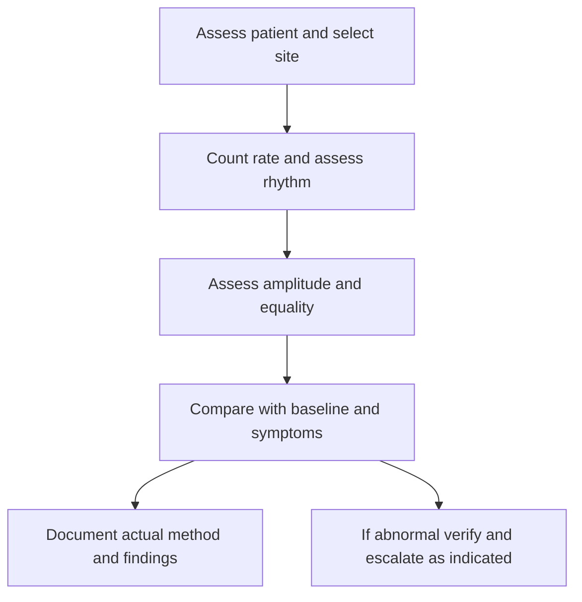

# 📚 Pulse assessment

**Topic priority:** 🟠 HIGH YIELD · **Study-ready, not studied.** [27 new questions](../MCQs/03B-Pulse-Assessment-27-MCQs.md) + earlier group 03 Q4,5,16 = 30 allocated. No reused questions counted as new.

Jab heart contract karke blood arteries mein pump karta hai, toh arterial wall mein pressure wave travel karti hai. Isi wave ko hum suitable artery par fingers se feel kar sakte hain aur ise pulse kehte hain. Pulse assess karte waqt nurse sirf number count nahi karti. Woh rate, yaani ek minute mein beats ki sankhya, rhythm, yaani beats kitni regular hain, amplitude, yaani pulse kitni strong feel hoti hai, aur symmetry, yaani dono sides par pulse comparable hai ya nahi, check karti hai.

Resting adult mein 60–100 beats per minute commonly used reference range hai. Lekin age, fitness, medicines, fever, illness, pain aur activity se pulse rate change ho sakti hai. Maan lo trained athlete ki resting pulse slow hai aur use koi symptom nahi hai. Sirf slow rate se disease confirm nahi hoti. Lekin slow pulse ke saath dizziness, low BP ya altered alertness ho, toh urgent clinical review zaroori hai. Patient ke usual baseline aur current symptoms ko saath mein samjho.

## 🔹 Sites and methods

<!-- job4-metadata -->
**Exam evidence:** **🟣 [HPSSC Staff Nurse 2021](https://testbook.com/question-answer/location-of-auscultation-for-apical-pulse-is--697c4a25d11d912710e86065)** — apical auscultation landmark; **🟣 [SGPGI Staff Nurse 2024](https://testbook.com/question-answer/as-part-of-cardiac-assessment-to-palpate-th--685baa2301bacc852687a084)** — related palpation landmark; **🟣 [ESIC Staff Nurse 2019](https://testbook.com/question-answer/when-a-pulse-rate-is-irregular-it-is-best-to-coun--619cfc8ec37377aece1592c7)** — full-minute irregular pulse; **🟣 [RRB Staff Nurse 2019](https://testbook.com/question-answer/what-is-pulse-deficit--61a8a4a934f46b35766a7916)** and **🟣 [AIIMS Bhatinda Nursing Officer 2019](https://testbook.com/question-answer/pulse-deficit-is-the-difference-between--617655fdd2f531c4f1ae5444)** — pulse deficit. Retrieved third-party sources, related concepts, not independently authenticated official papers or keys.

**▶️ [YouTube MCQ practice — Physical Examination, study Room](https://www.youtube.com/watch?v=aTGm3WCiS9w)** · Published description explicitly lists apical pulse site. Additional [vital-signs MCQ resources](#sources-and-video-practice) include description-indexed pulse characteristics and sites. Specific pulse-deficit questions and playback pending.
<!-- /job4-metadata -->

| Site | Landmark |
|---|---|
| Radial | Wrist ke thumb wali side par radial artery palpate ki jaati hai. |
| Brachial | Upper arm ke medial side par, elbow ke antecubital region ke paas, brachial pulse locate ki ja sakti hai. |
| Carotid | Neck ke side par carotid pulse feel ki jaati hai. Jab indicated ho, tab gently ek time par sirf ek side assess karni chahiye. |
| Femoral | Groin region mein femoral artery ki pulse assess ki ja sakti hai. |
| Popliteal | Knee ke peeche popliteal artery locate ki jaati hai. |
| Posterior tibial | Ankle ke medial malleolus ke peeche aur thoda neeche posterior tibial pulse feel ki ja sakti hai. |
| Dorsalis pedis | Foot ki upper surface, yaani dorsum, par dorsalis pedis pulse locate ki jaati hai. |
| Apical | Adult mein apical heart rate usually left fifth intercostal space mein midclavicular line ke paas stethoscope se assess ki jaati hai. |

Peripheral pulse palpate karne ke liye nurse index aur middle fingers use karti hai. Thumb use karne se apni khud ki pulse feel ho sakti hai aur confusion ho sakta hai. Stable patient mein regular pulse ko facility policy permit kare toh 30 seconds count karke do se multiply kar sakte hain. Agar rhythm irregular ho, toh full minute count karo aur indicated apical rate ya rhythm evaluation arrange karo. Infant ka routine heart rate generally apical auscultation se full minute count kiya jaata hai. Heart sounds mein S1 aur S2 ka ek pair ek heartbeat represent karta hai. Apical impulse ko palpate karna aur apical heart rate ko stethoscope se sunna related lekin alag assessments hain. Patient ki anatomy mein variation ho sakti hai.

Pulse deficit ka matlab simultaneously measured apical heart rate aur radial pulse rate ke beech difference hai. Kabhi heart contract karta hai lekin contraction se itni effective arterial wave generate nahi hoti ki wrist par pulse feel ho sake. Ideally do observers ek hi samay full minute ke liye apical aur radial rate count karte hain. Phir apical rate mein se radial rate subtract karte hain. Maan lo apical rate 90 hai aur radial rate 82 hai. Pulse deficit 8 beats per minute hoga.

Pulse amplitude ke liye commonly 0 ka matlab absent, 1+ weak, 2+ expected, 3+ increased aur 4+ bounding hota hai. Local grading scale alag ho sakti hai. Regular rhythm hone se pulse ki strength automatically normal nahi ho jaati. Thready ya weak pulse poor perfusion ka clue ho sakti hai, lekin sirf isi finding se diagnosis confirm nahi hota. Nurse dono limbs compare karti hai aur skin colour, warmth, sensation, movement aur doosre clinical findings assess karti hai. Procedure ke baad nayi asymmetric ya absent pulse milne par prompt review zaroori hai. Agar Doppler se signal detect hota hai, toh method clearly document karo. Doppler signal aur palpable pulse alag findings hain aur detected signal se adequate tissue perfusion automatically prove nahi hoti.

Pulsus alternans mein rhythm regular ho sakti hai, lekin ek pulse strong aur next pulse weak feel hoti hai. Pulsus paradoxus mein inspiration, yaani saans andar lene ke dauran, systolic BP ki fall unusually zyada hoti hai. Conventionally ye fall 10 mmHg se zyada hoti hai. Iska matlab arterial blood flow reverse hona nahi hai. Dono terms ko appropriate measurement aur clinical context ke saath interpret karna chahiye. Ye examination vocabulary ke liye important hain. Inke advanced causes aur differential diagnosis cardiovascular chapter mein detail se padhe jaayenge.

## 🔹 Nursing judgment

<!-- job4-metadata -->
**▶️ YouTube MCQ practice:** [Vital-signs practice resources](#sources-and-video-practice) cover pulse abnormalities and influencing factors at topic level. Dedicated vascular and emergency escalation scenarios remain unverified. [Related practice bank](../MCQs/03B-Pulse-Assessment-27-MCQs.md).
<!-- /job4-metadata -->

Pulse document karte waqt nurse batati hai ki patient kis activity ya position mein tha, reading kis time aur kis site par li gayi, rate kya thi, rhythm aur amplitude kaisi thi aur relevant symptoms kya the. Usual baseline aur previous readings se compare karne par change ki direction samajh aati hai. Medicines aur fever bhi rate affect kar sakte hain.

Agar patient mein nayi symptomatic rate change, weak pulse ke saath clammy skin ya altered alertness, ya ek limb mein sudden neurovascular change milta hai, toh prompt assessment aur escalation chahiye. Monitor par electrical heart rate aur actually perfusing mechanical beats ki sankhya alag ho sakti hai. Isliye nurse patient ko directly assess karti hai, device signal check karti hai aur indicated ECG evaluation arrange karti hai.

## ▶️ Sources and video practice

- [OpenStax heart rate](https://openstax.org/books/clinical-nursing-skills/pages/15-5-heart-rate)
- [OpenStax vital-sign procedure](https://openstax.org/books/fundamentals-nursing/pages/7-2-how-to-perform-vital-signs)
- [Open RN cardiovascular assessment](https://www.ncbi.nlm.nih.gov/books/NBK596723/)
- Teaching: [PW Nursing College Prep — Vital Sign Procedure](https://www.youtube.com/watch?v=NnU_veHD0sQ), Himani Joshi, 11 March 2026, indexed overview includes pulse, temperature-focused timestamp listing. Pulse-specific segment not independently confirmed.
- Practice: [Nidhya Medical Academy — Vital Signs MCQs](https://www.youtube.com/watch?v=MGcl1u11Na4), NG Naik Sir, 5 June 2026, description explicitly includes pulse MCQs and NORCET/CHO practice. [VS Nursing Academy — Ritika Ma'am vital-sign MCQs](https://www.youtube.com/watch?v=LM37c_byRHs), indexed pulse practice.
- Dedicated pulse-only procedure video and full playback not independently confirmed.
- [Historical exam evidence](../Previous-Year-Questions/03B-Pulse-Reported-Evidence.md).
