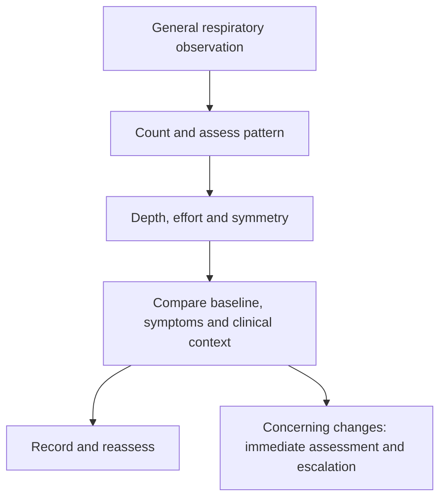

# 📚 Respiration assessment

**Topic priority:** 🟠 HIGH YIELD · **Study-ready, not studied.** [26 new MCQs](../MCQs/03C-Respiration-Assessment-26-MCQs.md), four assigned earlier group 03 items Q6,12,13,15 = 30 provisional working slots. Q13 systemic deterioration allocation to be refined at semantic audit. Advanced respiratory diseases and oxygen administration separately assigned.

Respiration ka bedside assessment sirf breaths count karna nahi hai. Rate, rhythm, depth, work of breathing, symmetry, symptoms and consciousness together evaluate karo. Ventilation means air movement, oxygenation means blood oxygenation, and cellular respiration metabolic process hai. Normal SpO2 alone ventilation establish nahi karta.

## 🔹 Procedure

<!-- job4-metadata -->
**▶️ YouTube MCQ practice:** [Vital Signs — VS Nursing Academy](https://www.youtube.com/watch?v=LM37c_byRHs) · Indexed description confirms respiration-rate topic coverage; specific question and playback pending. [Related bank](../MCQs/03C-Respiration-Assessment-26-MCQs.md).
<!-- /job4-metadata -->

Explain general vital sign assessment and maintain privacy. Stable resting patient mein spontaneous quiet breathing observe karo, often immediately after pulse measurement to minimize conscious alteration. One rise and fall = one breath. Regular stable pattern 30 seconds × 2 if policy permits, irregular breathing full minute and document pauses. Common adult resting reference 12–20/min, age and clinical context matter. Record activity, position, timing, rate and other findings. Assess sooner if symptoms or changes occur, not only scheduled times. Verify monitor discrepancies by direct patient assessment. Acute respiratory distress means urgent care, not waiting for perfect resting count.

| Term | Meaning |
|---|---|
| Eupnea | Quiet regular breathing |
| Tachypnea | Rate above expected range |
| Bradypnea | Rate below expected range |
| Apnea | Absence of breathing, urgency depends on context but emergency signs require immediate action |
| Dyspnea | Subjective breathing discomfort |
| Orthopnea | Breathlessness lying flat, improved upright |
| Cheyne–Stokes | Cyclic waxing/waning depth with apnea |
| Kussmaul | Deep sustained, often rapid breathing with metabolic acidosis |
| Biot-type/cluster | Clusters and irregular apneic pauses, labels vary |

Tachypnea is not automatically hyperventilation. Hyperventilation relates to alveolar ventilation exceeding metabolic CO2 production. Total minute ventilation = rate × tidal volume. Example 20 × 300 mL = 6 L/min. Effective alveolar ventilation also accounts for dead space. Normal rate with shallow breathing may be inadequate. Breathing patterns provide cues, never definitive diagnosis or exact brain lesion localization on their own.

## 🔹 Recognition of distress

<!-- job4-metadata -->
**Exam evidence:** **🟣 [UPSC ESIC Nursing Officer 2024](https://testbook.com/question-answer/which-one-of-the-following-breathing-patterns-indi--668e61cc48fdcf6e24fe6ebc)** and **🟣 [PGIMER Chandigarh Staff Nurse Grade II 2015](https://testbook.com/question-answer/a-nurse-would-assess-that-a-client-is-experiencing--62b71382a1d4d4397be49032)** — Cheyne–Stokes rhythm; **🟣 [DSSSB Nursing Officer 2019 · Shift III](https://testbook.com/question-answer/what-is-biots-respiration--615ffeda0c98a2dcd2b708f9)** — Biot breathing. Retrieved reported questions, not exact authenticated PYQs.

**▶️ [YouTube MCQ practice — Abnormal respiratory patterns, Lung Health](https://www.youtube.com/watch?v=91CH6NbsC74&t=372s)** · Published 06:12 practice-question segment, specific item and playback pending. Do not infer cause from pattern alone. Dedicated distress and escalation scenario videos pending.
<!-- /job4-metadata -->

Retractions, nasal flaring, accessory muscle use, tripod posture, grunting in infants, asymmetry, stridor and changed consciousness are important cues. Exhaustion with declining apparent effort may represent fatigue, not improvement. Assess patient and seek timely emergency help according to condition. Respect tolerated position. New trends may be significant even before dramatic measurement abnormality. Postoperative pain and sedation affect depth and ventilation, assess both. An unresponsive patient with abnormal/absent breathing needs trained emergency/BLS response, not a mandatory waiting period or routine charting.

## ▶️ Sources and video practice

- [OpenStax respiration](https://openstax.org/books/clinical-nursing-skills/pages/15-6-respiration)
- [OpenStax thorax assessment](https://openstax.org/books/clinical-nursing-skills/pages/23-2-physical-assessment-of-the-thorax)
- [Open RN respiratory assessment](https://www.ncbi.nlm.nih.gov/sites/books/NBK596716/)
- Teaching/demo: [RegisteredNurseRN — Vital Signs Nursing](https://www.youtube.com/watch?v=gUWJ-6nL5-8), indexed live respiration and other vital-sign procedure.
- Procedure: [Assessing Respiration — Nursing Clinical Skills, Procedure 15](https://www.youtube.com/watch?v=AtyTBnyu_U8), indexed procedure description. Channel attribution not independently confirmed.
- Practice: [Nidhya Medical Academy — Vital Signs MCQs](https://www.youtube.com/watch?v=MGcl1u11Na4), explicit respiration, BP, pulse and temperature coverage, NORCET/CHO exam practice.
- Full playback and exact question coverage unverified. [Reported historical exam evidence](../Previous-Year-Questions/03C-Respiration-Reported-Evidence.md).
