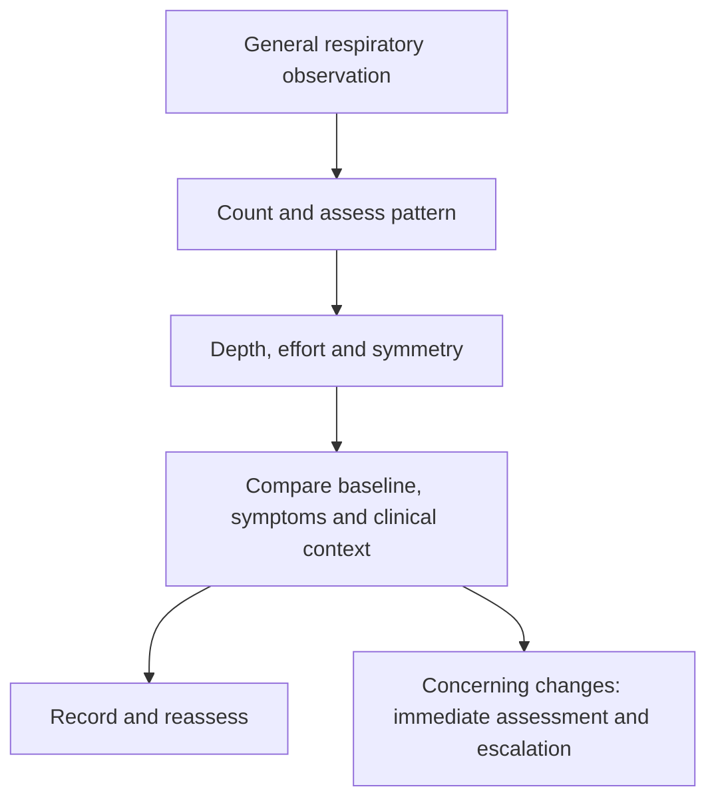

# 📚 Respiration assessment

**Topic priority:** 🟠 HIGH YIELD · **Study-ready, not studied.** [26 new MCQs](../MCQs/03C-Respiration-Assessment-26-MCQs.md), four assigned earlier group 03 items Q6,12,13,15 = 30 provisional working slots. Q13 systemic deterioration allocation to be refined at semantic audit. Advanced respiratory diseases and oxygen administration separately assigned.

Respiration assess karte waqt nurse sirf ye nahi dekhti ki patient ek minute mein kitni baar saans le raha hai. Woh rhythm, breath ki depth, saans lene ke liye kitni mehnat lag rahi hai, chest dono taraf equally move ho raha hai ya nahi, symptoms aur consciousness bhi check karti hai.

Ventilation ka matlab lungs ke andar aur bahar air ka movement hai. Oxygenation ka matlab blood mein oxygenation ki process hai. Cellular respiration mein cells metabolic processes se energy banate hain. Ye related concepts hain, lekin ek hi cheez nahi hain. Maan lo patient oxygen support par hai aur SpO2 normal dikh rahi hai, lekin uski breathing bahut shallow hai. Sirf saturation number se ye confirm nahi hota ki ventilation adequate hai.

## 🔹 Procedure

<!-- job4-metadata -->
**▶️ YouTube MCQ practice:** [Vital Signs — VS Nursing Academy](https://www.youtube.com/watch?v=LM37c_byRHs) · Indexed description confirms respiration-rate topic coverage; specific question and playback pending. [Related bank](../MCQs/03C-Respiration-Assessment-26-MCQs.md).
<!-- /job4-metadata -->

Nurse patient ko general vital-sign assessment samjhati hai aur privacy maintain karti hai. Stable resting patient ki natural quiet breathing observe karni chahiye. Aksar pulse assess karne ke turant baad breathing count ki jaati hai, taaki patient jaan-boojhkar apni breathing pattern change na kare. Chest ka ek baar rise aur fall hona ek breath count hota hai. Agar breathing stable aur regular hai, toh policy permit karne par 30 seconds count karke do se multiply kar sakte hain. Irregular breathing mein full minute count karo aur pauses bhi record karo.

Resting adult mein commonly 12–20 breaths per minute reference range hoti hai. Age, activity aur clinical condition ke according interpretation change ho sakti hai. Nurse activity, position, time, measured rate aur doosri relevant findings record karti hai. Agar symptoms develop hon ya condition badle, toh next scheduled measurement ka wait nahi karna chahiye. Monitor aur patient ki actual condition match na kare, toh direct assessment se discrepancy check karo. Acute respiratory distress mein urgent care ko perfect resting count lene ke liye delay nahi karna chahiye.

| Term | Meaning |
|---|---|
| Eupnea | Patient shaant aur regular tareeke se saans le raha hota hai. |
| Tachypnea | Respiratory rate patient ke expected range se zyada hoti hai. |
| Bradypnea | Respiratory rate expected range se kam hoti hai. |
| Apnea | Breathing temporarily ya completely absent hoti hai. Emergency signs hone par immediate action lena zaroori hai. |
| Dyspnea | Patient khud saans lene mein takleef ya discomfort feel karta hai. |
| Orthopnea | Patient ko flat letne par breathlessness hoti hai aur upright position mein relief milta hai. |
| Cheyne–Stokes | Breathing ki depth cyclically badhti aur kam hoti hai, aur beech mein apnea ke pauses aa sakte hain. |
| Kussmaul | Patient sustained deep aur aksar rapid breathing karta hai, jo metabolic acidosis ke saath mil sakti hai. |
| Biot-type/cluster | Breaths groups mein aati hain aur irregular apneic pauses ho sakte hain. Different references mein terminology vary kar sakti hai. |

Tachypnea ka matlab sirf rate fast hona hai. Hyperventilation mein alveolar ventilation body ki metabolic carbon dioxide production se zyada ho jaati hai. Isliye har fast breathing hyperventilation nahi hoti. Minute ventilation calculate karne ke liye breaths per minute ko tidal volume se multiply karte hain. Tidal volume har breath mein move hone wali air ki quantity hai. Maan lo patient ek minute mein 20 breaths leta hai aur har breath ka tidal volume 300 mL hai. Total minute ventilation 20 × 300 = 6000 mL/min, yaani 6 L/min hogi.

Effective alveolar ventilation mein dead space bhi consider karna hota hai, kyunki saari inhaled air gas exchange mein participate nahi karti. Patient ki respiratory rate normal ho sakti hai, lekin breaths bahut shallow hon toh ventilation inadequate ho sakti hai. Breathing pattern possible clinical concern ka clue deta hai. Sirf pattern dekhkar exact disease ya brain lesion ki location confirm nahi karni chahiye.

## 🔹 Recognition of distress

<!-- job4-metadata -->
**Exam evidence:** **🟣 [UPSC ESIC Nursing Officer 2024](https://testbook.com/question-answer/which-one-of-the-following-breathing-patterns-indi--668e61cc48fdcf6e24fe6ebc)** and **🟣 [PGIMER Chandigarh Staff Nurse Grade II 2015](https://testbook.com/question-answer/a-nurse-would-assess-that-a-client-is-experiencing--62b71382a1d4d4397be49032)** — Cheyne–Stokes rhythm; **🟣 [DSSSB Nursing Officer 2019 · Shift III](https://testbook.com/question-answer/what-is-biots-respiration--615ffeda0c98a2dcd2b708f9)** — Biot breathing. Retrieved reported questions, not exact authenticated PYQs.

**▶️ [YouTube MCQ practice — Abnormal respiratory patterns, Lung Health](https://www.youtube.com/watch?v=91CH6NbsC74&t=372s)** · Published 06:12 practice-question segment, specific item and playback pending. Do not infer cause from pattern alone. Dedicated distress and escalation scenario videos pending.
<!-- /job4-metadata -->

Respiratory distress mein patient ko normal se zyada mehnat karke saans leni pad sakti hai. Nurse chest wall ke andar khinchne, yaani retractions, nostrils ke phailne, yaani nasal flaring, accessory muscles use hone aur aage jhukkar tripod position lene jaise signs check karti hai. Infants mein grunting important warning sign ho sakti hai. Chest movement asymmetry, stridor aur consciousness change ko bhi seriously lena chahiye.

Maan lo patient pehle bahut mehnat se saans le raha tha aur ab suddenly uski breathing effort kam dikh rahi hai. Ye zaroori nahi ki woh improve ho gaya ho. Ho sakta hai woh thak gaya ho aur effective ventilation maintain na kar paa raha ho. Nurse overall condition assess karti hai aur indicated emergency help arrange karti hai. Patient ki tolerated safe position respect karo. Nayi trend ko ignore mat karo, chahe monitor par dramatic abnormality abhi na dikhe. Operation ke baad pain aur sedation dono breathing depth aur ventilation affect kar sakte hain, isliye dono assess karo. Unresponsive patient mein normal breathing absent ya abnormal ho toh trained emergency/BLS response shuru karna zaroori hai. Routine charting ya fixed waiting period ke liye emergency action delay nahi karna chahiye.

## ▶️ Sources and video practice

- [OpenStax respiration](https://openstax.org/books/clinical-nursing-skills/pages/15-6-respiration)
- [OpenStax thorax assessment](https://openstax.org/books/clinical-nursing-skills/pages/23-2-physical-assessment-of-the-thorax)
- [Open RN respiratory assessment](https://www.ncbi.nlm.nih.gov/sites/books/NBK596716/)
- Teaching/demo: [RegisteredNurseRN — Vital Signs Nursing](https://www.youtube.com/watch?v=gUWJ-6nL5-8), indexed live respiration and other vital-sign procedure.
- Procedure: [Assessing Respiration — Nursing Clinical Skills, Procedure 15](https://www.youtube.com/watch?v=AtyTBnyu_U8), indexed procedure description. Channel attribution not independently confirmed.
- Practice: [Nidhya Medical Academy — Vital Signs MCQs](https://www.youtube.com/watch?v=MGcl1u11Na4), explicit respiration, BP, pulse and temperature coverage, NORCET/CHO exam practice.
- Full playback and exact question coverage unverified. [Reported historical exam evidence](../Previous-Year-Questions/03C-Respiration-Reported-Evidence.md).
