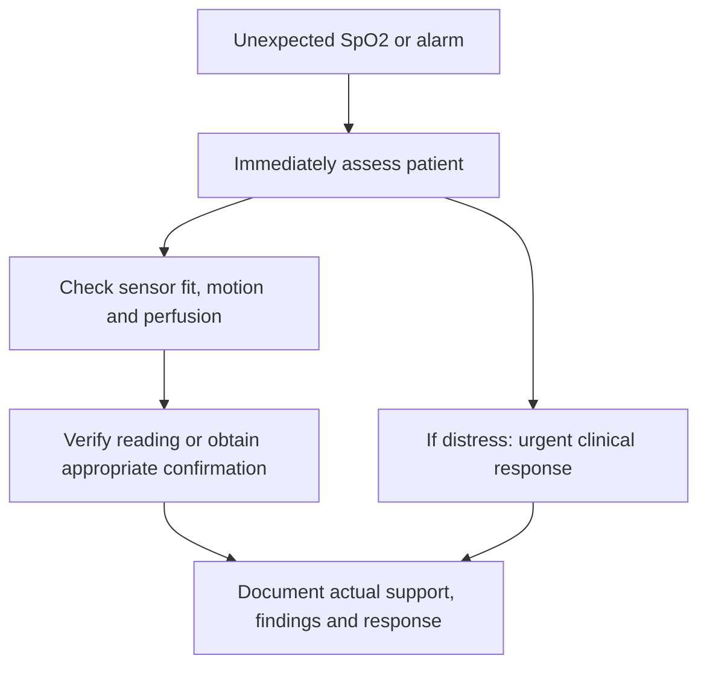

# 📚 Pulse oximetry assessment

**Topic priority:** 🟠 HIGH YIELD · **Study-ready, not studied.** Earlier group 03 Q7 + [29 additional MCQs](../MCQs/03D-Pulse-Oximetry-Assessment-29-MCQs.md) = 30 allocated. Oxygen device selection and therapy remain separate group 15 scope.

## 🔹 Meaning, mechanism and interpretation

<!-- job4-metadata -->
**Exam evidence:** **🟣 [GMCH Chandigarh Staff Nurse 2022](https://testbook.com/question-answer/pulse-oximeter-is-used-to-measure--630dab74426ebd28603fbbf2)** — device measurements; **🟣 [AIIMS NORCET 2020](https://testbook.com/question-answer/the-activity-not-recorded-by-pulse-oximeter--6177b8dc6b46604c7256c0c6)** — device measurement scope versus ECG, memory-based. Both third-party question pages retrieved, no exact official match authenticated.

**▶️ [YouTube MCQ practice — Nursing Margdarshan R.N.M., image-based equipment questions](https://www.youtube.com/watch?v=tUteiKjol8s)** · Description lists pulse oximeter among equipment MCQs; device-level practice only, exact question and playback pending.
<!-- /job4-metadata -->

SpO2 peripheral arterial hemoglobin oxygen saturation ka noninvasive estimate hai. Conventional sensor red and infrared light use karta hai because oxygenated and deoxygenated hemoglobin differently absorb karte hain. Device pulsatile arterial optical signal analyze karta hai. Display usually SpO2 percentage and pulse rate show karta hai, not ECG rhythm, PaCO2 or hemoglobin concentration.

Healthy adult at sea level often has SpO2 95–100%, but baseline, altitude and illness matter. Target saturation individualized hota hai, not everyone must reach 100%. Some patients at risk of hypercapnic respiratory failure have prescribed 88–92% targets. Follow local protocol and clinician plan. New distress needs urgent assessment regardless of number.

| Parameter | Meaning | Limitation |
|---|---|---|
| SpO2 | Estimated oxygen-bound hemoglobin percentage | Not total oxygen content or ventilation |
| PaO2 | Arterial dissolved oxygen partial pressure | Not identical to saturation |
| PaCO2 | Arterial carbon dioxide pressure | Not measured by pulse oximeter |
| Hemoglobin | Oxygen-carrying protein concentration | Low Hb can reduce oxygen content despite high SpO2 |

Example: bus mein available seats 98% occupied hain, but bus mein seats bahut kam hain toh passengers total kam honge. Similarly severe anemia mein saturation high ho sakti hai, total oxygen content low. Oxygen delivery also circulation par depend karti hai. Oxygen dissociation curve sigmoid hai, upper flat portion par PaO2 may change substantially with little saturation change. Oximeter cannot quantify hyperoxia.

## 🔹 Safe procedure

<!-- job4-metadata -->
**YouTube MCQ practice: verification pending** — specific sensor placement, care and error-management questions not established; existing teaching resources below retained. [Related original practice](../MCQs/03D-Pulse-Oximetry-Assessment-29-MCQs.md).
<!-- /job4-metadata -->

Explain, verify patient, hand hygiene and check current condition. Choose validated compatible sensor for age and approved site, e.g. finger or appropriate ear/infant sensor. Inspect skin and perfusion. Apply per manufacturer instructions, avoid excessive pressure. Reduce motion and interfering nail products when feasible. Check signal quality and compare displayed pulse with clinical pulse as appropriate. Record stable reading plus time, oxygen support, device/flow or concentration and symptoms. Continuous monitoring needs ordered targets, appropriate alarms, skin checks and site rotation per policy. Clean reusable sensors between patients. Do not delay urgent care to obtain a perfect reading.

## 🔹 Common errors and traps

<!-- job4-metadata -->
**Exam evidence:** **🟣 [AIIMS Delhi Nursing Officer 2019](https://testbook.com/question-answer/why-is-it-necessary-to-remove-dark-colored-nail-pa--62bd6c77227856e1e58349c8)** — nail polish interference, retrieved memory-based report; related concept only.

**YouTube MCQ practice: verification pending** — specific artifacts and clinical scenarios not established. Do not infer accuracy from an apparently normal display alone.
<!-- /job4-metadata -->

- Motion, cold extremities, low perfusion, nail products, ambient light and poor sensor fit can compromise accuracy.
- BP cuff inflation on same limb may temporarily interrupt pulsatile signal. Use suitable alternate site when feasible.
- Skin pigmentation-related bias is a documented limitation, not a reason to apply fixed numerical corrections. Symptoms and confirmatory assessment when indicated are essential.
- Conventional two-wavelength SpO2 may be falsely reassuring in carbon monoxide poisoning and unreliable in methemoglobinemia. Appropriate co-oximetry and clinical evaluation needed.
- Oxygenation is not ventilation. A sedated patient may retain CO2 despite normal saturation on oxygen.
- Same saturation on increasing oxygen support can indicate deterioration.
- Consumer wellness monitors may lack medical-purpose validation. Do not rely on them alone for concerning symptoms.
- Alarm acknowledgment is not clinical resolution. Assess patient, verify equipment, act and reassess.

## 🔹 Clinical references

[FDA pulse oximeter basics](https://www.fda.gov/consumers/consumer-updates/pulse-oximeter-basics) · [Open RN oxygen therapy](https://www.ncbi.nlm.nih.gov/books/NBK596733/) · [OpenStax vital sign procedure](https://openstax.org/books/fundamentals-nursing/pages/7-2-how-to-perform-vital-signs) · [Oxygen saturation monitoring and interpretation, StatPearls](https://www.ncbi.nlm.nih.gov/books/NBK525974/)

## ▶️ Video mapping and evidence gap

- Teaching Q1–12: [Voogly/Sahu Sir — Pulse Oximetry Procedure SpO₂](https://www.youtube.com/watch?v=OlRQpfldOIY), retrieved indexed description covers technique, error prevention and monitoring. Exact channel display and full playback not independently checked.
- Teaching Q1–12, Q13–29 supplementary: [Osmosis — Vital signs: Oxygen saturation](https://www.osmosis.org/learn/Vital_signs_-_Oxygen_saturation_%28SpO2%29%3A_Nursing_skills), indexed chapters on mechanism, probes, values, care and procedure. Not YouTube.
- Related exam practice Q1–29: [Nidhya Medical Academy, NG Naik Sir — Vital Signs MCQs](https://www.youtube.com/watch?v=MGcl1u11Na4), mixed vital-sign MCQ session. Indexed coverage confirms pulse, respiration, BP and temperature, **specific oximetry questions not confirmed**. This is a related resource, not verified question-level match.
- Dedicated oximetry question-solving YouTube source and transcript/timestamps remain pending. No video-derived historical question or verified timestamp claimed. [Reported exam questions](../Previous-Year-Questions/03D-Oximetry-Reported-Evidence.md).
