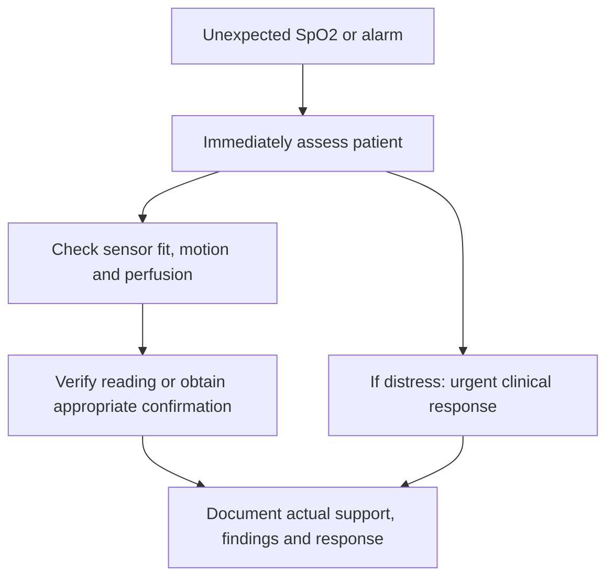

# 📚 Pulse oximetry assessment

**Topic priority:** 🟠 HIGH YIELD · **Study-ready, not studied.** Earlier group 03 Q7 + [29 additional MCQs](../MCQs/03D-Pulse-Oximetry-Assessment-29-MCQs.md) = 30 allocated. Oxygen device selection and therapy remain separate group 15 scope.

## 🔹 Meaning, mechanism and interpretation

<!-- job4-metadata -->
**Exam evidence:** **🟣 [GMCH Chandigarh Staff Nurse 2022](https://testbook.com/question-answer/pulse-oximeter-is-used-to-measure--630dab74426ebd28603fbbf2)** — device measurements; **🟣 [AIIMS NORCET 2020](https://testbook.com/question-answer/the-activity-not-recorded-by-pulse-oximeter--6177b8dc6b46604c7256c0c6)** — device measurement scope versus ECG, memory-based. Both third-party question pages retrieved, no exact official match authenticated.

**▶️ [YouTube MCQ practice — Nursing Margdarshan R.N.M., image-based equipment questions](https://www.youtube.com/watch?v=tUteiKjol8s)** · Description lists pulse oximeter among equipment MCQs; device-level practice only, exact question and playback pending.
<!-- /job4-metadata -->

Pulse oximeter ek noninvasive device hai jo peripheral arterial blood mein hemoglobin ki oxygen saturation estimate karta hai. SpO2 ka matlab hai ki available hemoglobin ke oxygen-binding sites ka approximate kitna percentage oxygen se occupied hai. Conventional pulse oximeter sensor red aur infrared light use karta hai. Oxygenated aur deoxygenated hemoglobin in lights ko alag tareeke se absorb karte hain. Device pulsatile arterial optical signal analyze karke saturation estimate karta hai.

Display par usually SpO2 percentage aur pulse rate dikhte hain. Ye ECG nahi hai, isliye exact electrical heart rhythm establish nahi karta. Ye PaCO2, yaani arterial carbon dioxide pressure, ya hemoglobin concentration bhi directly measure nahi karta.

Sea level par healthy adult ki SpO2 aksar 95–100% hoti hai. Lekin patient ki usual baseline, altitude aur clinical condition bhi matter karti hai. Har patient ko 100% saturation tak pahunchana zaroori nahi hai. Kuch patients jinmein hypercapnic respiratory failure ka risk hai, unke liye clinician 88–92% target prescribe kar sakta hai. Nurse patient-specific target, local protocol aur authorized treatment plan follow karti hai. Agar patient ko nayi breathing distress ho rahi hai, toh number apparently normal hone par bhi urgent assessment chahiye.

| Parameter | Meaning | Limitation |
|---|---|---|
| SpO2 | Ye oxygen se occupied hemoglobin ka approximate percentage batata hai. | Isse total oxygen content ya ventilation directly pata nahi chalti. |
| PaO2 | Ye arterial blood mein dissolved oxygen ka partial pressure batata hai. | Ye hemoglobin saturation ke exactly barabar nahi hota. |
| PaCO2 | Ye arterial blood mein carbon dioxide ka partial pressure batata hai. | Pulse oximeter PaCO2 measure nahi karta. |
| Hemoglobin | Ye blood mein oxygen carry karne wale protein ki concentration hai. | Hemoglobin kam ho toh high SpO2 ke bawajood total oxygen content kam ho sakta hai. |

Is concept ko bus ke example se samjho. Ek bus mein agar 98% seats occupied hain, toh occupancy percentage high hai. Lekin agar bus mein total seats hi bahut kam hain, toh total passengers bhi kam ho sakte hain. Isi tarah severe anemia mein available hemoglobin kam hota hai. Us hemoglobin ka saturation high ho sakta hai, lekin blood ka total oxygen content phir bhi kam ho sakta hai. Tissues tak oxygen delivery blood circulation par bhi depend karti hai.

Oxygen dissociation curve hemoglobin saturation aur PaO2 ka relationship dikhati hai aur iska shape sigmoid, yaani S jaisa, hota hai. Curve ke upper flat part par PaO2 mein considerable change hone ke bawajood saturation mein sirf chhota change dikh sakta hai. Isliye pulse oximeter high saturation ke basis par hyperoxia, yaani oxygen ka excessive level, quantify nahi kar sakta.

## 🔹 Safe procedure

<!-- job4-metadata -->
**YouTube MCQ practice: verification pending** — specific sensor placement, care and error-management questions not established; existing teaching resources below retained. [Related original practice](../MCQs/03D-Pulse-Oximetry-Assessment-29-MCQs.md).
<!-- /job4-metadata -->

Pulse oximetry se pehle nurse patient ki identity verify karti hai, procedure samjhati hai, hand hygiene karti hai aur current condition assess karti hai. Patient ki age aur approved measurement site ke according validated compatible sensor choose karna chahiye. Finger sensor, appropriate ear sensor ya infant sensor alag situations mein use ho sakte hain. Nurse skin aur perfusion check karti hai aur manufacturer instructions ke according sensor lagati hai, taaki excessive pressure na pade.

Agar patient move kar raha hai ya nail products reading interfere kar rahe hain, toh feasible hone par interference kam karo. Signal quality check karo aur zaroorat ke hisaab se displayed pulse rate ko patient ki clinical pulse se compare karo. Stable reading ke saath time, symptoms, oxygen support aur applicable device, flow rate ya concentration record karo. Continuous monitoring mein prescribed targets, appropriate alarms, skin checks aur policy ke according sensor site rotation chahiye. Reusable sensor ko patients ke beech approved method se clean karna chahiye. Agar patient unstable hai, toh perfect reading ka wait karke urgent care delay nahi karni chahiye.

## 🔹 Common errors and traps

<!-- job4-metadata -->
**Exam evidence:** **🟣 [AIIMS Delhi Nursing Officer 2019](https://testbook.com/question-answer/why-is-it-necessary-to-remove-dark-colored-nail-pa--62bd6c77227856e1e58349c8)** — nail polish interference, retrieved memory-based report; related concept only.

**YouTube MCQ practice: verification pending** — specific artifacts and clinical scenarios not established. Do not infer accuracy from an apparently normal display alone.
<!-- /job4-metadata -->

- Patient ki movement, cold extremities, poor perfusion, nail products, ambient light aur loose ya unsuitable sensor fit se reading inaccurate ho sakti hai. Nurse patient aur signal dono check karti hai.
- Agar BP cuff aur oximeter same limb par hain, toh cuff inflate hone par pulsatile signal temporarily interrupt ho sakta hai. Feasible hone par suitable alternate site use ki ja sakti hai.
- Skin pigmentation-related measurement bias documented limitation hai. Iska solution har patient ki reading mein fixed number add ya subtract karna nahi hai. Symptoms, clinical findings aur indicated confirmatory assessment ko saath mein consider karo.
- Carbon monoxide poisoning mein conventional two-wavelength oximeter falsely reassuring saturation dikha sakta hai. Methemoglobinemia mein bhi reading unreliable ho sakti hai. Aise concerns mein appropriate co-oximetry aur clinical evaluation chahiye.
- Oxygenation aur ventilation alag hain. Maan lo sedated patient oxygen support par hai. SpO2 normal dikh sakti hai, lekin ventilation inadequate hone se carbon dioxide retain ho sakti hai. Nurse ko breathing aur consciousness bhi assess karni chahiye.
- Agar same SpO2 maintain karne ke liye oxygen support badhana pad raha hai, toh ye patient ki condition deteriorate hone ka clue ho sakta hai. Number ke saath support requirement ka trend bhi dekho.
- Consumer wellness monitor necessarily medical-purpose validated nahi hota. Concerning symptoms hone par sirf aise monitor ki reading par depend nahi karna chahiye.
- Alarm acknowledge karne se underlying clinical concern solve nahi ho jaati. Nurse patient assess karti hai, equipment aur signal verify karti hai, indicated action leti hai aur response dobara check karti hai.

## 🔹 Clinical references

[FDA pulse oximeter basics](https://www.fda.gov/consumers/consumer-updates/pulse-oximeter-basics) · [Open RN oxygen therapy](https://www.ncbi.nlm.nih.gov/books/NBK596733/) · [OpenStax vital sign procedure](https://openstax.org/books/fundamentals-nursing/pages/7-2-how-to-perform-vital-signs) · [Oxygen saturation monitoring and interpretation, StatPearls](https://www.ncbi.nlm.nih.gov/books/NBK525974/)

## ▶️ Video mapping and evidence gap

- Teaching Q1–12: [Voogly/Sahu Sir — Pulse Oximetry Procedure SpO₂](https://www.youtube.com/watch?v=OlRQpfldOIY), retrieved indexed description covers technique, error prevention and monitoring. Exact channel display and full playback not independently checked.
- Teaching Q1–12, Q13–29 supplementary: [Osmosis — Vital signs: Oxygen saturation](https://www.osmosis.org/learn/Vital_signs_-_Oxygen_saturation_%28SpO2%29%3A_Nursing_skills), indexed chapters on mechanism, probes, values, care and procedure. Not YouTube.
- Related exam practice Q1–29: [Nidhya Medical Academy, NG Naik Sir — Vital Signs MCQs](https://www.youtube.com/watch?v=MGcl1u11Na4), mixed vital-sign MCQ session. Indexed coverage confirms pulse, respiration, BP and temperature, **specific oximetry questions not confirmed**. This is a related resource, not verified question-level match.
- Dedicated oximetry question-solving YouTube source and transcript/timestamps remain pending. No video-derived historical question or verified timestamp claimed. [Reported exam questions](../Previous-Year-Questions/03D-Oximetry-Reported-Evidence.md).
