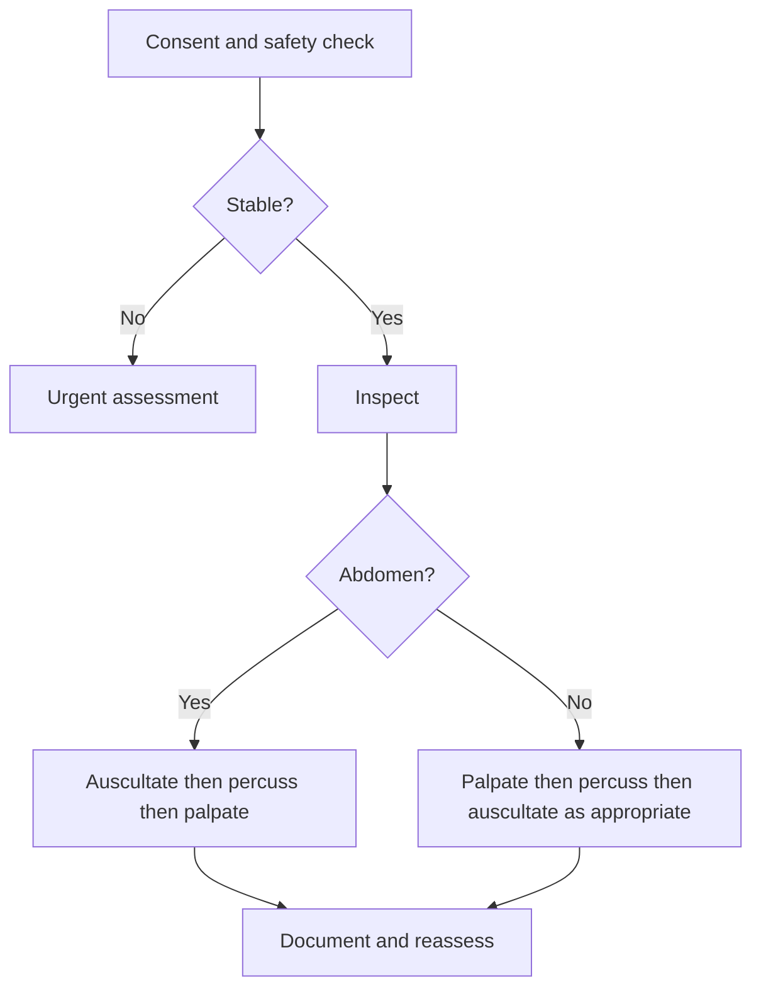

# 📚 Physical examination and health assessment

**Study-ready, not studied.** 🟠 HIGH YIELD. [27 original MCQs](../MCQs/03E-Physical-Examination-27-MCQs.md) + original group 03 Q8–10 = 30 allocated. Nursing assessment is not independent medical diagnosis.

## 🔹 Methods and preparation

<!-- job4-metadata -->
**Exam evidence:** **🟣 [NVS Staff Nurse — 8 March 2022](https://testbook.com/question-answer/what-is-called-percussion-in-physical-examination--624d4e073de2bf986ba48f0a)** — retrieved reported percussion question, related tested concept only. Official key not independently authenticated.

**▶️ YouTube MCQ practice:** [Physical examination MCQ resource](#sources-and-videos) below; description confirms IPPA techniques. Exact item and playback pending.
<!-- /job4-metadata -->

Physical examination ka matlab hai ki nurse patient ki body ko systematically observe aur examine karke relevant objective findings collect karti hai. Patient ki khud batayi hui history bhi important hai, kyunki examination aur history milkar care needs samajhne mein help karte hain. Nurse pehle hand hygiene karti hai, patient ki identity verify karti hai, procedure explain karti hai aur ongoing consent aur privacy maintain karti hai. Required equipment aur lighting check karti hai. Examination ke liye sirf zaroori body part expose karna chahiye. Agar patient unstable hai, toh detailed routine examination se pehle immediate safety assessment zaroori hai.

| Method | Meaning | Example |
|---|---|---|
| Inspection | Nurse body ki appearance aur movement observe karti hai. | Jaise nurse dono shoulders ki symmetry compare karti hai. |
| Palpation | Nurse suitable pressure se touch karke relevant finding assess karti hai. | Jaise superficial lump ki texture gently assess ki ja sakti hai. |
| Percussion | Nurse body surface par tap karke resulting sound interpret karti hai. | Jaise aerated lung area mein resonance assess ki ja sakti hai. |
| Auscultation | Nurse internal body sounds ko sunti hai, usually stethoscope ki help se. | Jaise heart sounds aur bowel sounds sune ja sakte hain. |

General physical examination ka commonly taught order IPPA hai, yaani Inspection, Palpation, Percussion aur Auscultation. Lekin abdomen assess karte waqt usual order inspection, auscultation, percussion aur palpation hota hai. Iska reason hai ki abdomen ko touch ya tap karne se bowel activity change ho sakti hai. Isliye bowel sounds pehle sune jaate hain. Tender area ko last mein gently assess karna chahiye. Agar naya pulsatile abdominal mass mile, toh repeated deep palpation avoid karke promptly report karo.

Stethoscope ko comfortable temperature par rakhna patient ke comfort ke liye helpful ho sakta hai. Nurse appropriate bare skin sites par sounds sunti hai aur corresponding sides compare karti hai. Traditional stethoscope ka bell light contact par low-frequency sounds sunne mein useful hai aur diaphragm higher-frequency sounds ke liye useful hota hai. Specific device ki instructions follow karna chahiye.

Percussion mein different tissue aur underlying air ya fluid ki wajah se different sounds aa sakti hain. Aerated lung par resonance, solid tissue ya fluid par dullness, gas-filled stomach par tympany aur very dense tissue par flatness mil sakti hai. Ek finding se disease confirm nahi hoti. Agar kuch der sunne par bowel sounds na milen, toh sirf isi finding se ileus confirm nahi hota. Worsening abdominal distension, pain ya nausea ko promptly report karna chahiye.

[MCQ Q1–11](../MCQs/03E-Physical-Examination-27-MCQs.md) · [Reported technique question](../Previous-Year-Questions/03E-Physical-Examination-Reported-Evidence.md).

## 🔹 Systematic examination

<!-- job4-metadata -->
**▶️ YouTube MCQ practice:** [Physical examination MCQ resource](#sources-and-videos) below, with indexed heart, lung and abdominal assessment topics. Specific neurological and vascular scenarios remain unverified.
<!-- /job4-metadata -->

🟠 HIGH YIELD. General survey mein nurse patient ko overall dekhti hai aur uski appearance, awareness, mobility aur distress assess karti hai. Skin assess karte waqt colour, moisture, warmth, skin intact hai ya nahi, aur edema check kiya jaata hai. Different skin tones mein colour change samajhne ke liye mucosa aur sclera bhi useful assessment sites ho sakti hain.

Pitting edema mein gentle pressure release karne ke baad skin mein indentation reh jaati hai. Nurse affected site, extent aur agreed grading method record karti hai. Older adults mein skin elasticity naturally kam ho sakti hai, isliye sirf skin turgor se hydration ka conclusion nahi nikalna chahiye. Intake-output, mucosa, vital signs aur doosri relevant findings ko saath mein assess karo. Cold temperature capillary refill ko affect kar sakta hai. Sirf delayed capillary refill se shock ka definitive diagnosis confirm nahi hota.

Basic neurological screening mein nurse patient ki speech, facial symmetry, pupils aur dono sides ke limb movements assess karti hai. Jab ek pupil par light padti hai aur wahi pupil constrict karti hai, toh ise direct light response kehte hain. Doosri pupil bhi constrict kare, toh ise consensual response kehte hain. Muscle strength compare karte waqt dono sides par same safe movement aur comparable resistance use karo. Sensation assess karte waqt corresponding sites par similar safe light-touch stimulus use karo. Nayi facial droop ya slurred speech stroke jaisi urgent condition ka sign ho sakti hai. Aisi finding mein prompt escalation aur urgent assessment delay nahi karna chahiye.

Gait assessment mein nurse patient ke chalne ka pattern dekhti hai. Patient ko chalne ke liye kehne se pehle dizziness, balance aur fall risk assess karo. Agar patient unstable hai, toh unsupported walking avoid karo aur appropriate assistance arrange karo. Ek calf mein nayi swelling aur tenderness ho toh promptly report karo. Provocative Homan sign reliable diagnostic test nahi hai. Posterior chest examine karna ho aur patient independently position maintain na kar sake, toh safe supported position use karo aur examination ki actual limitations document karo.

[MCQ Q12–24](../MCQs/03E-Physical-Examination-27-MCQs.md).

## 🔹 Documentation and escalation

<!-- job4-metadata -->
**YouTube MCQ practice: verification pending** — specific documentation and escalation scenario coverage not established. [Original practice bank](../MCQs/03E-Physical-Examination-27-MCQs.md).
<!-- /job4-metadata -->

🔴 MOST IMPORTANT. Nurse objective observations ko aise record karti hai ki next healthcare professional actual finding samajh sake. Maan lo left ankle right ankle se visibly zyada swollen hai aur skin intact hai. Nurse ye observed details record karti hai, na ki bina relevant evidence ke koi disease label confirm kar deti hai. Serial comparison ke liye consistent assessment method, site, timing aur measurement approach use karna helpful hai.

Agar patient suddenly unresponsive ho jaaye, toh routine head-to-toe examination rokna chahiye. Nurse responsiveness aur breathing assess karti hai, emergency response activate karti hai aur apni training aur applicable local emergency protocol ke according zaroori action leti hai. Patient ko diya gaya care aur uska actual response record karna bhi important hai.

[MCQ Q25–27](../MCQs/03E-Physical-Examination-27-MCQs.md).

## ▶️ Sources and videos

- [Open RN general survey](https://www.ncbi.nlm.nih.gov/sites/books/NBK593193/) and [head-to-toe checklist](https://www.ncbi.nlm.nih.gov/books/NBK593191/).
- [OpenStax general survey](https://openstax.org/books/clinical-nursing-skills/pages/15-1-performing-a-general-survey) and [abdominal assessment](https://openstax.org/books/clinical-nursing-skills/pages/27-2-physical-assessment).
- [Physical Examination One Shot — NORCET/RRB](https://www.youtube.com/watch?v=yTebyL3FrGY), teaching.
- [40 Health Assessment & Physical Examination MCQs 2026 — #studyroom31](https://www.youtube.com/watch?v=aTGm3WCiS9w), Q1–27 topic-level practice.
- Indexed titles and descriptions confirm topic, not exact question coverage. Full playback, channel display, timestamps, official keys and full clinical and semantic audits pending.
