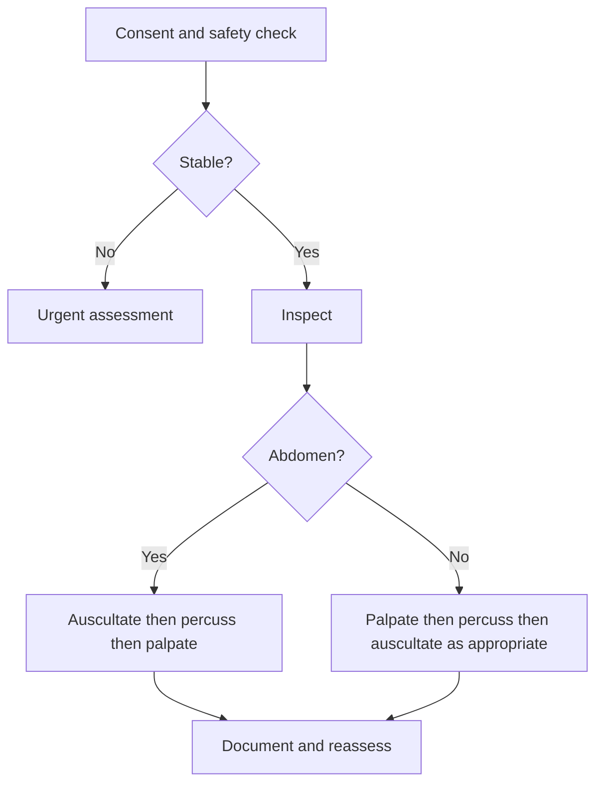

# Physical examination and health assessment

**Study-ready, not studied.** 🟠 HIGH YIELD. [27 original MCQs](../MCQs/03E-Physical-Examination-27-MCQs.md) + original group 03 Q8–10 = 30 allocated. Nursing assessment is not independent medical diagnosis.

## Methods and preparation

Physical examination objective findings collect karne ka systematic method hai. Subjective history bhi important hai. Hand hygiene, identity, explanation, ongoing consent, privacy, equipment aur lighting check karo. Sirf required part expose karo. Unstable patient mein immediate assessment first.

| Method | Meaning | Example |
|---|---|---|
| Inspection | Observe appearance and movement | Compare shoulder symmetry |
| Palpation | Touch with appropriate pressure | Superficial lump texture |
| Percussion | Tap and interpret resulting sound | Lung resonance |
| Auscultation | Listen to internal sounds | Heart and bowel sounds |

Routine general order IPPA. Abdomen mein inspection, auscultation, percussion, palpation, because touching may alter bowel activity. Tender area last aur gentle pressure use karo. New pulsatile abdominal mass par repeated deep palpation avoid karke promptly report karo.

Stethoscope warm kar sakte ho. Bare skin par corresponding sites compare karo. Traditional bell light contact par low-frequency sounds ke liye useful hai, diaphragm higher frequencies ke liye. Device instructions follow karo. Percussion notes include resonance over aerated lung, dullness over solid tissue or fluid, tympany over gas-filled stomach, flatness over very dense tissue. Ek finding se disease confirm nahi hoti. Brief absence of bowel sounds alone ileus prove nahi karta. Worsening distension, pain ya nausea promptly report karo.

[MCQ Q1–11](../MCQs/03E-Physical-Examination-27-MCQs.md) · [Reported technique question](../Previous-Year-Questions/03E-Physical-Examination-Reported-Evidence.md).

## Systematic examination

🟠 HIGH YIELD. General survey mein appearance, awareness, mobility aur distress observe karo. Skin color, moisture, warmth, intactness and edema assess karo. Mucosa aur sclera different skin tones mein color change assess karne mein help karte hain. Pitting edema mein gentle pressure release ke baad indentation rehti hai. Site, extent aur agreed grading method record karo. Older adults mein skin elasticity naturally kam ho sakti hai. Hydration ke liye intake/output, mucosa, vitals aur other findings combine karo. Cold temperature refill affect kar sakta hai, capillary refill alone shock establish nahi karta.

Neurological screen mein speech, facial symmetry, pupils aur bilateral limb movement assess karo. Illuminated pupil constriction direct response hai, opposite pupil constriction consensual response. Strength same safe movement aur comparable resistance se test karo. Sensation similar safe light-touch stimuli at matching sites se compare karo. New facial droop or slurred speech urgent stroke evaluation require kar sakti hai. Delay mat karo.

Gait assessment se pehle dizziness aur fall risk check karo. Unsupported walking avoid karo if unstable. Unilateral calf swelling and tenderness promptly report karo, provocative Homan sign reliable diagnostic test nahi hai. Posterior chest examination ke liye supported position adapt karo aur limitations document karo.

[MCQ Q12–24](../MCQs/03E-Physical-Examination-27-MCQs.md).

## Documentation and escalation

🔴 MOST IMPORTANT. Objective observations record karo, e.g. left ankle right se visibly swollen hai, skin intact. Observation se disease label automatically conclude mat karo. Serial comparisons ke liye consistent method, site, time aur measurements use karo. Sudden unresponsiveness mein routine examination stop karo, responsiveness and breathing assess karo and emergency response activate karke trained local protocol follow karo. Action aur response record karo.

[MCQ Q25–27](../MCQs/03E-Physical-Examination-27-MCQs.md).

## Sources and videos

- [Open RN general survey](https://www.ncbi.nlm.nih.gov/sites/books/NBK593193/) and [head-to-toe checklist](https://www.ncbi.nlm.nih.gov/books/NBK593191/).
- [OpenStax general survey](https://openstax.org/books/clinical-nursing-skills/pages/15-1-performing-a-general-survey) and [abdominal assessment](https://openstax.org/books/clinical-nursing-skills/pages/27-2-physical-assessment).
- [Physical Examination One Shot — NORCET/RRB](https://www.youtube.com/watch?v=yTebyL3FrGY), teaching.
- [40 Health Assessment & Physical Examination MCQs 2026 — #studyroom31](https://www.youtube.com/watch?v=aTGm3WCiS9w), Q1–27 topic-level practice.
- Indexed titles and descriptions confirm topic, not exact question coverage. Full playback, channel display, timestamps, official keys and full clinical and semantic audits pending.
