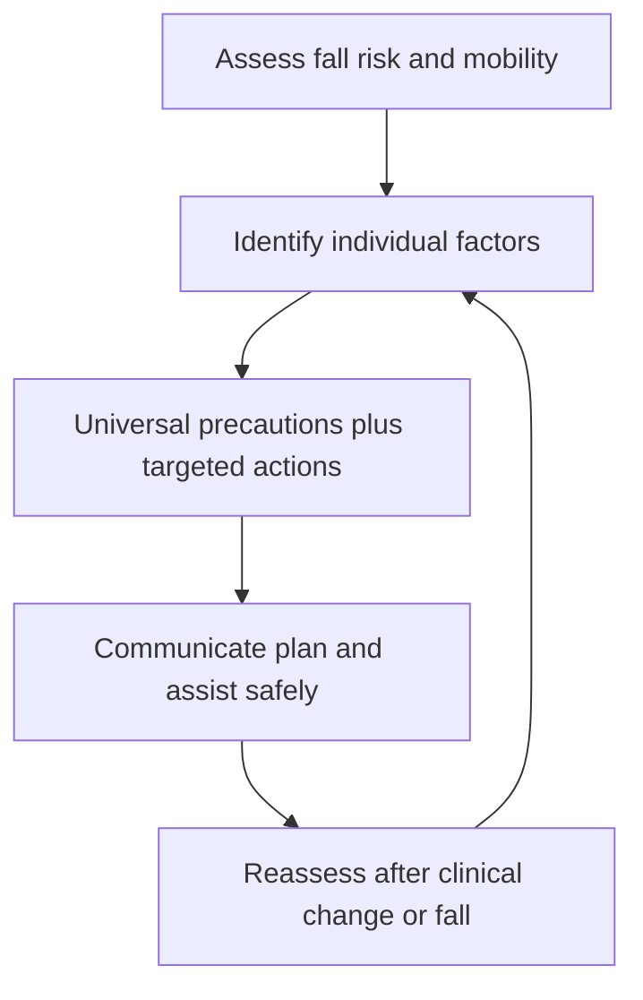

# 📚 Fall risk assessment and prevention

**Study-ready, unattempted.** 🔴 MOST IMPORTANT — patient safety. [24 new MCQs](../MCQs/04A-Fall-Risk-and-Prevention-24-MCQs.md) + original group 04 Q2,3,4,11,13,19 = 30 allocated.

## 🔹 Risk assessment

<!-- job4-metadata -->
**YouTube MCQ practice: verification pending** — specific Morse calculations and reassessment scenarios not confirmed. Existing teaching video below is separate. [Question bank](../MCQs/04A-Fall-Risk-and-Prevention-24-MCQs.md).
<!-- /job4-metadata -->

Fall ka matlab hai ki patient bina planning ke floor ya kisi neeche ke level par gir jaata hai. Agar injury nahi bhi hui, tab bhi ise fall maana jaata hai. Jab patient admit hota hai, tab nurse uske girne ka risk assess karti hai. Agar patient ki condition ya medicine badalti hai, ward transfer hota hai ya patient gir jaata hai, toh nurse risk dobara assess karti hai. Pehle gir chuka patient, chalne mein kamzori, anjaan room, kam dikhna, khade hote hi chakkar aana, neend laane wali medicines, jaldi toilet jaane ki zarurat aur sochne ya samajhne mein dikkat jaise factors risk badha sakte hain. Risk score nurse ki clinical judgment ko support karta hai, lekin patient ko dekhkar liye gaye decision ki jagah nahi leta.

Morse Fall Scale ek tool hai jise hospital mein admitted adult patients ka fall risk assess karne ke liye aam taur par use kiya jaata hai. Ismein alag-alag risk factors ke points jodkar score nikala jaata hai. Neeche kuch example item weights diye gaye hain:

| Factor | Example scores |
|---|---|
| Recent fall | Yes 25, no 0 |
| More than one diagnosis | Yes 15, no 0 |
| Walking aid | Furniture 30, walker or cane 15, none or nurse assist 0 |
| IV or heparin lock | Yes 20, no 0 |
| Gait | Impaired 20, weak 10, normal or bed rest 0 |
| Awareness of mobility limitations | Overestimates or forgets 15, recognizes limitations 0 |

Example: 25 + 15 + 15 + 20 + 10 + 0 = 85. Is patient ka total score 85 aata hai. Nurse apni facility mein validated tool ke version aur uske cutoff ke hisaab se score interpret karti hai, kyunki har setting mein threshold same nahi hota. Mental status wale item mein nurse dekhti hai ki patient apni chalne ki limitations ko samajhta hai ya apni ability ko zarurat se zyada maanta hai. Sirf aaj ki date sahi bata dene se yeh item decide nahi hota.

[MCQ Q1–4](../MCQs/04A-Fall-Risk-and-Prevention-24-MCQs.md).

## 🔹 Individualized prevention

<!-- job4-metadata -->
**Exam evidence:** **🟣 [AIIMS Bhopal Nursing Officer 2018 · Shift II](https://testbook.com/question-answer/fall-risk-interventions-do-not-include--6295d3038df0620303a3f97e)** — related fall-prevention concept, retrieved reported question. Ambiguous options: neither routine sedation nor routine restraints prevent falls safely. [Reported adaptations](../Previous-Year-Questions/04A-Fall-Risk-Reported-Evidence.md).

**YouTube MCQ practice: verification pending** — the general patient-safety session below remains supplementary.
<!-- /job4-metadata -->

🟠 HIGH YIELD. Universal precautions woh basic safety measures hain jo har patient ke liye useful hote hain. Nurse floor se rukawat hataati hai, roshni theek rakhti hai, bed ko safe position mein rakhkar brakes lagati hai aur call bell aur zaruri samaan patient ki reach mein rakhti hai. Nurse suitable footwear aur room ki orientation bhi ensure karti hai. Ab individual plan mein patient ke actual risk ke hisaab se extra help add hoti hai. Agar patient ko baar-baar jaldi toilet jaana padta hai, toh nurse samay par assisted toileting arrange karti hai. Agar patient ko kam dikhta hai, toh room ka layout consistent rakha jaata hai. Agar patient ko chakkar aata hai, toh chalne se pehle symptoms assess kiye jaate hain. Kamzori hone par trained staff aur prescribed walking aid ki madad li jaati hai. Nurse patient aur family ko plan samjhati hai aur teach-back se check karti hai ki woh apne shabdon mein sahi safety steps bata pa rahe hain.

Alarm staff ko alert karta hai, wristband risk ki pehchan mein madad karta hai aur score assessment ko organize karta hai. Lekin in teenon se apne aap fall nahi rukta. Staff ka samay par response dena aur patient ke hisaab se care dena zaruri hai. Nurse side rails use karne se pehle patient ke liye unka benefit aur hazard assess karti hai. Har patient ke saare rails utha dena ya routine sedation dena safe fall prevention nahi hai. Agar patient rail ke upar se utarne ki koshish karta hai, toh usse aur zyada injury ho sakti hai. Restraint ki policy aur indications ko alag topic mein samjhenge.

[MCQ Q5–15](../MCQs/04A-Fall-Risk-and-Prevention-24-MCQs.md).

## 🔹 Post-fall assessment

<!-- job4-metadata -->
**YouTube MCQ practice: verification pending** — dedicated post-fall assessment and injury escalation question coverage not established. [Related question bank](../MCQs/04A-Fall-Risk-and-Prevention-24-MCQs.md).
<!-- /job4-metadata -->

🔴 MOST IMPORTANT. Jab patient gir jaata hai, toh nurse sabse pehle surroundings ki safety dekhti hai aur patient ki responsiveness, breathing aur circulation assess karti hai. Zarurat ke hisaab se urgent help bulayi jaati hai. Agar head ya spinal injury ka doubt ho, severe pain ho, body part ki shape badli ho ya neurological changes dikh rahe hon, toh unnecessary movement se bacha jaata hai aur local emergency protocol follow kiya jaata hai. Agar anticoagulant medicine lene wale patient ke sir par chot lagi hai, toh shuru mein theek dikhne par bhi prompt clinical assessment chahiye, kyunki bleeding baad mein bhi nazar aa sakti hai. Injury turant nazar na aaye tab bhi relevant observations aur escalation zaruri hain. Nurse event ki objective details, di gayi care, patient ka response aur monitoring record karti hai. Uske baad local procedure ke mutabik incident report complete karti hai, fall prevention plan revise karti hai aur team ko changes batati hai.

[MCQ Q16–20](../MCQs/04A-Fall-Risk-and-Prevention-24-MCQs.md).

## 🔹 Quality and mobility

<!-- job4-metadata -->
**YouTube MCQ practice: verification pending** — fall-rate calculations and rehabilitation safety scenarios not confirmed. [Related question bank](../MCQs/04A-Fall-Risk-and-Prevention-24-MCQs.md).
<!-- /job4-metadata -->

Fall rate per 1,000 patient-days = number of falls / patient-days × 1,000. Patient-days ka matlab hai ki sabhi admitted patients ke hospital mein rehne ke din jode jaate hain. Example: agar 2,000 patient-days mein 6 falls hue, toh 6 / 2,000 × 1,000 = 3 falls per 1,000 patient-days hoga. Do wards ke rates compare karte samay patient population aur reporting ke differences ko dhyan mein rakhna chahiye. Sirf risk score complete karna is baat ka proof nahi hai ki patient ko safety care bhi mili. Nurse aur quality team check karte hain ki patient-specific interventions sach mein implement hue ya nahi. Supervised mobility aur rehabilitation patient ki function aur strength preserve karne mein madad karte hain. Bina zarurat bed rest dene se muscles kamzor ho sakti hain aur deconditioning, yaani physical capacity kam hone ki problem, badh sakti hai.

[MCQ Q21–24](../MCQs/04A-Fall-Risk-and-Prevention-24-MCQs.md).

## ▶️ Sources and video coverage

- [Open RN safety](https://www.ncbi.nlm.nih.gov/books/NBK610816/) · [AHRQ Fall TIPS](https://www.ahrq.gov/patient-safety/settings/hospital/fall-tips/index.html) · [World falls guidelines](https://pmc.ncbi.nlm.nih.gov/articles/PMC9523684/) · [AHRQ falls primer](https://psnet.ahrq.gov/primer/falls).
- Teaching Q1–4: [VITAL SUPPORT SAS — Morse Scale | Fall Risk Assessment](https://www.youtube.com/watch?v=2avAZyfN1d0), indexed description includes components and examples.
- Related practice Q5–24: [VS Nursing Academy, Ritika Mam — Patient Safety and Positioning MCQ Sessions](https://www.youtube.com/watch?v=SISfTMUsLHg). Indexed topic risk prevention, not confirmed individual fall questions. Full playback and dedicated fall MCQ source pending.
- [Reported historical evidence](../Previous-Year-Questions/04A-Fall-Risk-Reported-Evidence.md). Official key and full semantic audit pending.
