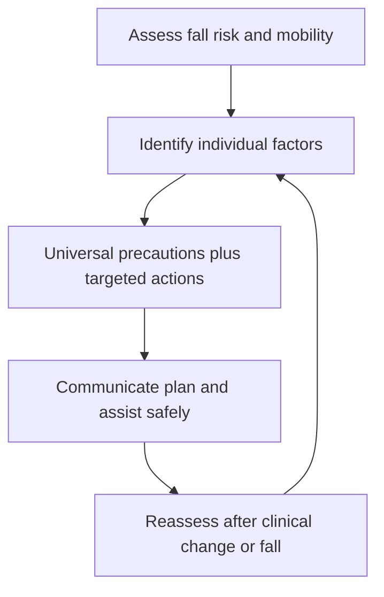

# 📚 Fall risk assessment and prevention

**Study-ready, unattempted.** 🔴 MOST IMPORTANT — patient safety. [24 new MCQs](../MCQs/04A-Fall-Risk-and-Prevention-24-MCQs.md) + original group 04 Q2,3,4,11,13,19 = 30 allocated.

## 🔹 Risk assessment

<!-- job4-metadata -->
**YouTube MCQ practice: verification pending** — specific Morse calculations and reassessment scenarios not confirmed. Existing teaching video below is separate. [Question bank](../MCQs/04A-Fall-Risk-and-Prevention-24-MCQs.md).
<!-- /job4-metadata -->

Fall ka meaning unplanned descent to floor ya lower level hai, injury ho ya na ho. Admission par assess karo aur change in condition, medicine, ward transfer ya fall ke baad reassess karo. Previous fall, weak gait, unfamiliar surroundings, impaired vision, postural dizziness, sedating medicines, urgent toileting and cognition important factors hain. Score clinical judgment replace nahi karta.

Morse Fall Scale commonly used adult inpatient tool hai. Example item weights:

| Factor | Example scores |
|---|---|
| Recent fall | Yes 25, no 0 |
| More than one diagnosis | Yes 15, no 0 |
| Walking aid | Furniture 30, walker or cane 15, none or nurse assist 0 |
| IV or heparin lock | Yes 20, no 0 |
| Gait | Impaired 20, weak 10, normal or bed rest 0 |
| Awareness of mobility limitations | Overestimates or forgets 15, recognizes limitations 0 |

Example: 25 + 15 + 15 + 20 + 10 + 0 = 85. Local validated tool version and cutoff follow karo. Different settings use different thresholds. Mental status item orientation to one's mobility ability assess karta hai, date recall alone nahi.

[MCQ Q1–4](../MCQs/04A-Fall-Risk-and-Prevention-24-MCQs.md).

## 🔹 Individualized prevention

<!-- job4-metadata -->
**Exam evidence:** **🟣 [AIIMS Bhopal Nursing Officer 2018 · Shift II](https://testbook.com/question-answer/fall-risk-interventions-do-not-include--6295d3038df0620303a3f97e)** — related fall-prevention concept, retrieved reported question. Ambiguous options: neither routine sedation nor routine restraints prevent falls safely. [Reported adaptations](../Previous-Year-Questions/04A-Fall-Risk-Reported-Evidence.md).

**YouTube MCQ practice: verification pending** — the general patient-safety session below remains supplementary.
<!-- /job4-metadata -->

🟠 HIGH YIELD. Universal precautions mein uncluttered floor, appropriate lighting, safe bed position and brakes, reachable call bell, personal items, suitable footwear aur orientation include hote hain. Individual plan mein actual risk ka matching intervention add karo. Urgency ho toh timely assisted toileting, visual impairment ho toh consistent room layout, dizziness ho toh symptom assessment before mobility, weakness ho toh trained assistance and prescribed aid. Patient and family ko plan samjhao, teach-back use karo.

Alarms, wristbands aur scores alone falls prevent nahi karte. Staff response aur tailored care essential hai. Side rails patient-specific benefit and hazards assess karke use karo, routine all-rail restriction ya sedation falls prevent karne ke liye appropriate nahi. Rail climbing se injury risk badh sakta hai. Restraint policy separate topic hai.

[MCQ Q5–15](../MCQs/04A-Fall-Risk-and-Prevention-24-MCQs.md).

## 🔹 Post-fall assessment

<!-- job4-metadata -->
**YouTube MCQ practice: verification pending** — dedicated post-fall assessment and injury escalation question coverage not established. [Related question bank](../MCQs/04A-Fall-Risk-and-Prevention-24-MCQs.md).
<!-- /job4-metadata -->

🔴 MOST IMPORTANT. Immediate safety and responsiveness, breathing and circulation assess karo, urgent help as indicated. Suspected head/spinal injury, severe pain, deformity or neurological changes mein unnecessary movement avoid karo and local emergency protocol follow karo. Anticoagulant patient with head impact needs prompt clinical assessment even if initially well. Injury absent lagne par bhi relevant observations and escalation follow karo. Objective event details, care, response and monitoring document karo. Incident report local procedure se complete karo, plan revise karo and team ko communicate karo.

[MCQ Q16–20](../MCQs/04A-Fall-Risk-and-Prevention-24-MCQs.md).

## 🔹 Quality and mobility

<!-- job4-metadata -->
**YouTube MCQ practice: verification pending** — fall-rate calculations and rehabilitation safety scenarios not confirmed. [Related question bank](../MCQs/04A-Fall-Risk-and-Prevention-24-MCQs.md).
<!-- /job4-metadata -->

Fall rate per 1,000 patient-days = number of falls / patient-days × 1,000. Example 6 falls in 2,000 patient-days = 3. Rate compare karte time population and reporting differences consider karo. Score completed hona care delivered hone ka proof nahi. Patient-specific intervention implementation audit karo. Supervised mobility and rehab function preserve karte hain, unnecessary bed rest deconditioning badha sakta hai.

[MCQ Q21–24](../MCQs/04A-Fall-Risk-and-Prevention-24-MCQs.md).

## ▶️ Sources and video coverage

- [Open RN safety](https://www.ncbi.nlm.nih.gov/books/NBK610816/) · [AHRQ Fall TIPS](https://www.ahrq.gov/patient-safety/settings/hospital/fall-tips/index.html) · [World falls guidelines](https://pmc.ncbi.nlm.nih.gov/articles/PMC9523684/) · [AHRQ falls primer](https://psnet.ahrq.gov/primer/falls).
- Teaching Q1–4: [VITAL SUPPORT SAS — Morse Scale | Fall Risk Assessment](https://www.youtube.com/watch?v=2avAZyfN1d0), indexed description includes components and examples.
- Related practice Q5–24: [VS Nursing Academy, Ritika Mam — Patient Safety and Positioning MCQ Sessions](https://www.youtube.com/watch?v=SISfTMUsLHg). Indexed topic risk prevention, not confirmed individual fall questions. Full playback and dedicated fall MCQ source pending.
- [Reported historical evidence](../Previous-Year-Questions/04A-Fall-Risk-Reported-Evidence.md). Official key and full semantic audit pending.
