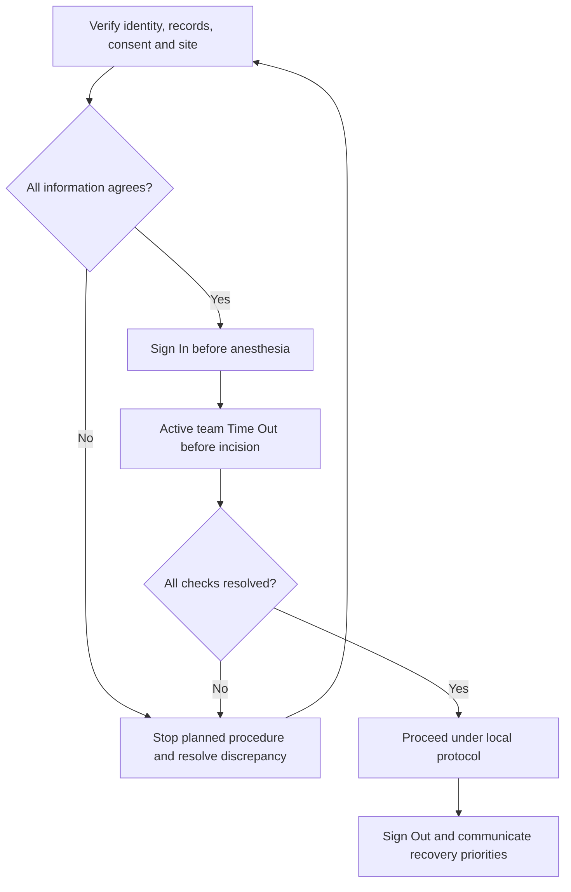

# 📚 Patient identification and procedure safety

**Study-ready, not studied.** 🔴 MOST IMPORTANT — safety-critical fundamentals. [28 new original MCQs](../MCQs/04B-Patient-Identification-and-Procedure-Safety-28-MCQs.md) + original group 04 Q1 and Q15 = 30 allocated. Procedure-specific technique and medication administration are separate topic scopes.

## 🔹 Identity verification

<!-- job4-metadata -->
**🎬 [Teaching — Barcodes vs. Wristbands: Which is the correct identification?](https://www.youtube.com/watch?v=Bp0g3k1anV8)** · Nursing and Patient Safety, description confirms identity verification principles. Teaching only, playback pending.

**YouTube MCQ practice: verification pending** — dedicated identity-question coverage not confirmed. [Reported NORCET 6 adaptation](../Previous-Year-Questions/04B-Identification-Procedure-Reported-Evidence.md#q1-before-administering-a-scheduled-medicine-to-a-patient-who-can-communicate-which-identification-workflow-is-most-appropriate) retains earlier inspected source, current direct recheck failed.
<!-- /job4-metadata -->

🟠 HIGH YIELD. Patient identification ka matlab hai care dene se pehle confirm karna ki saamne wahi patient hai jiske liye care plan ki gayi hai. Nurse do approved patient-specific identifiers match karti hai, jaise registered name aur date of birth (DOB), ya unique hospital number. Room ya bed number patient ki identity nahi hai, kyunki patient ka bed badal sakta hai. Agar patient jawab de sakta hai, toh nurse usse apna naam aur doosra identifier khud batane ko kehti hai. Sirf haan ya na wala leading question poochne se galat confirmation mil sakta hai. Nurse wristband, current record aur jo care deni hai, un sabko match karti hai. Barcode scanner is verification mein madad karta hai, lekin nurse ki apni clinical safety judgment ki jagah nahi leta.

Example: maan lo ek ward mein do patients ka naam same hai. Agar nurse sirf naam dekhegi, toh galat patient ko care mil sakti hai. Isliye woh doosra approved identifier bhi match karti hai. Agar wristband galat hai, padhne mein nahi aa raha, naam mein difference hai ya record match nahi kar raha, toh nurse discrepancy ko resolve karne tak planned care rok deti hai.

Agar patient bol nahi pa raha ya communication mein dikkat hai, toh nurse written communication, appropriate interpreter ya facility ka approved alternative identification method use karti hai. Newborn twins ke liye alag assigned identities zaruri hain, kyunki dono ki pehchan mix ho sakti hai. Agar emergency patient ki identity pata nahi hai, toh unique temporary ID aur traceable record banaya jaata hai. Is wajah se urgent life-saving care delay nahi honi chahiye. Baad mein jab identity verify ho jaaye, toh authorized process se dono records link kiye jaate hain. Purane treatment records delete nahi kiye jaate.

[MCQ Q1–8](../MCQs/04B-Patient-Identification-and-Procedure-Safety-28-MCQs.md).

## 🔹 Specimen and record traceability

<!-- job4-metadata -->
**🎬 Teaching:** The identity-verification video above also describes specimen labeling and record traceability. **YouTube MCQ practice: verification pending** — specific specimen scenarios not established.
<!-- /job4-metadata -->

🟠 HIGH YIELD. Sample collect karne se pehle nurse patient ki identity verify karti hai. Sample lene ke turant baad collection ki jagah par patient ki presence mein appropriate label lagaya jaata hai. Kai patients ke samples jama karke baad mein ek saath label lagane se mix-up ka risk badhta hai, isliye batch labeling avoid ki jaati hai. Agar routine sample par label nahi hai, toh laboratory ka rejection aur recollection protocol follow kiya jaata hai. Agar sample dobara milna possible nahi hai, toh discrepancy ko authorized team documented process se resolve karti hai. Nurse guess karke ya chupchaap label badalkar problem solve nahi karti. Surgical specimen ke liye anatomical site aur body ki side bhi clinically important hoti hai. Agar galat patient ki report milti hai, toh nurse use ya copy nahi karti. Woh responsible team ko inform karti hai aur patient ki confidentiality maintain karti hai.

[MCQ Q9–12](../MCQs/04B-Patient-Identification-and-Procedure-Safety-28-MCQs.md).

## 🔹 Procedure safety

<!-- job4-metadata -->
**▶️ YouTube MCQ practice:** [Surgical checklist questions and answers in resources below](#sources-and-practice-resources). Indexed description confirms Sign In, Time Out and Sign Out Q&A. Exact question, channel and playback pending. [Reported adaptations](../Previous-Year-Questions/04B-Identification-Procedure-Reported-Evidence.md).
<!-- /job4-metadata -->

🔴 MOST IMPORTANT. Pre-procedure verification mein nurse aur authorized team confirm karte hain ki patient ki identity, planned procedure, consent, relevant imaging aur body ki site aur side aapas mein match karte hain. Jab local policy site marking require karti hai, toh mark clearly visible hona chahiye aur uska meaning confusing nahi hona chahiye. Agar consent aur imaging mein mismatch ho, toh planned procedure ko pause karke patient aur authorized team se clarification li jaati hai. Consent ek ongoing process hai, isliye pehle sign liya gaya hona akela kaafi nahi hai.

| WHO checklist phase | Timing | Key purpose |
|---|---|---|
| Sign In | Before anesthesia induction | Team patient ki identity, procedure, site aur anesthesia se jude relevant risks verify karti hai. |
| Time Out | Before surgical incision | Team milkar confirm karti hai ki patient, site aur planned operation sahi hain aur relevant concerns discuss karti hai. |
| Sign Out | Before leaving operating room | Team completed procedure, counts, specimen labels, equipment issues aur recovery concerns confirm karti hai. |

Checklist par tick lagana actual safety discussion ki jagah nahi le sakta. Har team member ko actively verification mein participate karna chahiye. Agar multiple procedures ya teams involved hain, toh local policy ke hisaab se dobara verification aur time-out kiya jaata hai. Bedside par invasive procedure karne se pehle bhi applicable identity checks aur time-out ki zarurat ho sakti hai. Emergency mein urgent care ko bina zarurat delay nahi karna chahiye. Team applicable emergency protocol follow karti hai.

[MCQ Q13–24](../MCQs/04B-Patient-Identification-and-Procedure-Safety-28-MCQs.md).

## 🔹 Implementation and audit

<!-- job4-metadata -->
**YouTube MCQ practice: verification pending** — specific audit and discrepancy-resolution scenarios not established. [Related question bank](../MCQs/04B-Patient-Identification-and-Procedure-Safety-28-MCQs.md).
<!-- /job4-metadata -->

🟠 HIGH YIELD. Nurse patient ko samjhati hai ki baar-baar identity check karna ek safety barrier hai, patient par doubt karna nahi hai. Senior ka pressure, time ki kami ya patient se pehle ki jaan-pehchan safety check skip karne ka valid reason nahi hai. Agar staff ko mismatch dikhe, toh woh awaaz uthata hai aur discrepancy resolve karwata hai. Audit mein team dekhti hai ki identity verification ka sahi process asal mein follow hua ya nahi, kya verification document hui aur kaun si rukawatein thi. Sirf scanner use hua tha, is baat se poori compliance prove nahi hoti.

[MCQ Q25–28](../MCQs/04B-Patient-Identification-and-Procedure-Safety-28-MCQs.md).

## ▶️ Sources and practice resources

- [Open RN General Survey](https://www.ncbi.nlm.nih.gov/books/NBK596717/), patient identification section directly retrieved.
- [Open RN specimen collection](https://www.ncbi.nlm.nih.gov/books/NBK596718/), indexed procedure guidance.
- [WHO Safe Surgery](https://www.who.int/news-room/questions-and-answers/item/safe-surgery-saves-lives-frequently-asked-questions), directly retrieved three safety phases and implementation guidance.
- [WHO correct patient and site](https://www.ncbi.nlm.nih.gov/sites/books/NBK143245/?report=printable), indexed guidance, direct retrieval failed.
- [MediQuality Partners — WHO Surgical Safety Checklist, 3 Pauses](https://www.youtube.com/watch?v=4JLzNVARbO0), teaching Q13–24 and 28, description verified.
- [VS Nursing Academy — Patient Safety and Positioning MCQ Sessions](https://www.youtube.com/watch?v=SISfTMUsLHg), related topic practice Q1–12 and 25–27, exact identity items not verified.
- [Questions and Answers on Surgical Check List, Sign In, Sign Out, and Time Out](https://www.youtube.com/watch?v=rPGaGw-eSoI), question-practice lead Q13–24 and 28, indexed description only, direct playback failed and channel display not confirmed.
- [Reported NORCET and RMLIMS adaptations](../Previous-Year-Questions/04B-Identification-Procedure-Reported-Evidence.md). Official keys, video transcripts, dedicated identity question video and full bank-wide semantic audit pending.
