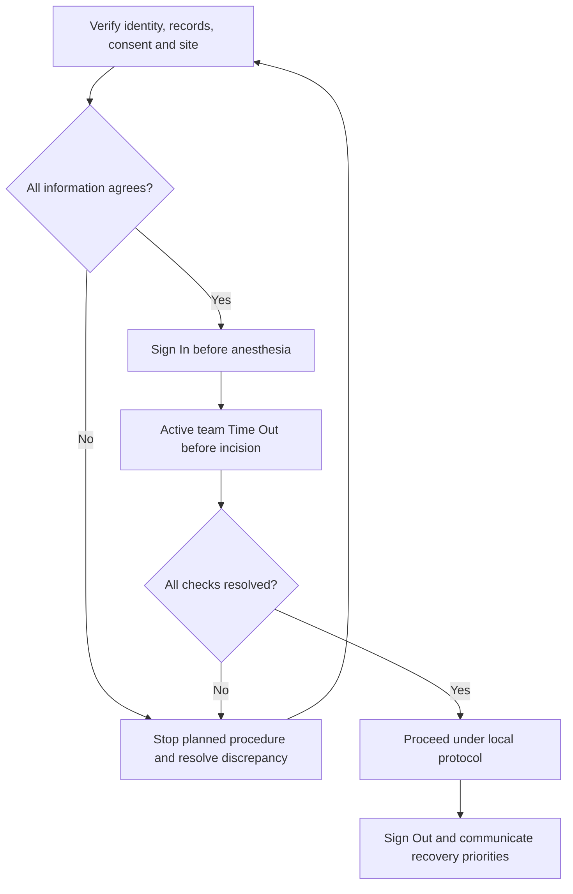

# Patient identification and procedure safety

**Study-ready, not studied.** 🔴 MOST IMPORTANT — safety-critical fundamentals. [28 new original MCQs](../MCQs/04B-Patient-Identification-and-Procedure-Safety-28-MCQs.md) + original group 04 Q1 and Q15 = 30 allocated. Procedure-specific technique and medication administration are separate topic scopes.

## Identity verification

🟠 HIGH YIELD. Two approved patient-specific identifiers use karo, jaise registered name and DOB or unique hospital number. Room or bed number identity nahi hai. Capable patient se identifiers khud state karwao instead of leading yes/no question. Wristband, current record and intended care match karo. Barcode technology verification support karti hai, independent clinical safety judgment replace nahi karti.

Example: same name wale do patients ward mein hain. Sirf name dekhna insufficient hai. Second approved identifier match karo. Wrong or illegible band, name discrepancy or mismatched record ko resolve kiye bina planned care proceed mat karo.

Communication difficulty mein written communication, appropriate interpreter or approved alternative verification use karo. Newborn twins ko distinct assigned identities chahiye. Unidentified emergency patient ke liye unique temporary ID and traceable record use karo without delaying urgent life-saving care. Later verified identity ko authorized process se link karo, old treatment records delete nahi karo.

[MCQ Q1–8](../MCQs/04B-Patient-Identification-and-Procedure-Safety-28-MCQs.md).

## Specimen and record traceability

🟠 HIGH YIELD. Collection se pehle identity verify karo. Sample ko patient ke presence mein point of collection par appropriate label lagao. Batch labeling avoid karo. Routine unlabeled sample ke liye laboratory rejection/recollection protocol follow karo. Irreplaceable specimen discrepancy mein authorized documented resolution chahiye, guess ya silent relabeling nahi. Surgical specimen mein anatomical site aur side clinically important hain. Incorrect patient report ko use ya copy mat karo, responsible team ko notify karo and confidentiality maintain karo.

[MCQ Q9–12](../MCQs/04B-Patient-Identification-and-Procedure-Safety-28-MCQs.md).

## Procedure safety

🔴 MOST IMPORTANT. Pre-procedure verification mein identity, intended procedure, consent, relevant imaging and site/laterality check karo. Local policy ke according required site marking visible and unambiguous honi chahiye. Consent ya imaging mismatch ho toh planned procedure pause karo, authorized team aur patient se clarification lo. Patient ki consent ongoing hai.

| WHO checklist phase | Timing | Key purpose |
|---|---|---|
| Sign In | Before anesthesia induction | Verify identity, procedure, site and relevant anesthesia risks |
| Time Out | Before surgical incision | Team actively confirms intended patient, site and operation, discusses relevant concerns |
| Sign Out | Before leaving operating room | Confirm completed procedure, counts and specimen labels, equipment issues and recovery concerns |

Checklist tick karna actual safety discussion ka substitute nahi. Team members actively participate karein. Multiple procedures ya teams ke liye local policy ke according fresh verification and time-out use karo. Bedside invasive procedures mein bhi applicable time-out and identity checks required ho sakte hain. Emergency cases mein urgent care ko unnecessary delay mat karo, applicable emergency protocol use karo.

[MCQ Q13–24](../MCQs/04B-Patient-Identification-and-Procedure-Safety-28-MCQs.md).

## Implementation and audit

🟠 HIGH YIELD. Patient ko batao repeated verification safety barrier hai, distrust nahi. Senior pressure, time shortage ya familiarity safety check skip karne ka justification nahi. Staff should speak up and resolve discrepancies. Audit mein observed correct identification workflow, documented actual verification and barriers check karo. Scanner use alone proof of full compliance nahi hai.

[MCQ Q25–28](../MCQs/04B-Patient-Identification-and-Procedure-Safety-28-MCQs.md).

## Sources and practice resources

- [Open RN General Survey](https://www.ncbi.nlm.nih.gov/books/NBK596717/), patient identification section directly retrieved.
- [Open RN specimen collection](https://www.ncbi.nlm.nih.gov/books/NBK596718/), indexed procedure guidance.
- [WHO Safe Surgery](https://www.who.int/news-room/questions-and-answers/item/safe-surgery-saves-lives-frequently-asked-questions), directly retrieved three safety phases and implementation guidance.
- [WHO correct patient and site](https://www.ncbi.nlm.nih.gov/sites/books/NBK143245/?report=printable), indexed guidance, direct retrieval failed.
- [MediQuality Partners — WHO Surgical Safety Checklist, 3 Pauses](https://www.youtube.com/watch?v=4JLzNVARbO0), teaching Q13–24 and 28, description verified.
- [VS Nursing Academy — Patient Safety and Positioning MCQ Sessions](https://www.youtube.com/watch?v=SISfTMUsLHg), related topic practice Q1–12 and 25–27, exact identity items not verified.
- [Questions and Answers on Surgical Check List, Sign In, Sign Out, and Time Out](https://www.youtube.com/watch?v=rPGaGw-eSoI), question-practice lead Q13–24 and 28, indexed description only, direct playback failed and channel display not confirmed.
- [Reported NORCET and RMLIMS adaptations](../Previous-Year-Questions/04B-Identification-Procedure-Reported-Evidence.md). Official keys, video transcripts, dedicated identity question video and full bank-wide semantic audit pending.
