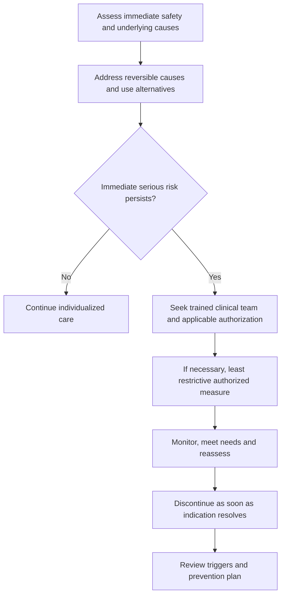

# 📚 Restraint safety

**Study-ready, unattempted.** 🔴 MOST IMPORTANT. [29 new MCQs](../MCQs/04C-Restraint-Safety-29-MCQs.md) and original Group 04 Q10 give 30 allocated. Clinical application must follow applicable Indian law, facility policy and trained authorized staff. These notes are not instructions for applying restraints.

## 🔹 Least restrictive care

<!-- job4-metadata -->
**Exam evidence:** **🟣 [PGIMER Chandigarh Staff Nurse Grade II 2015](https://testbook.com/question-answer/which-action-by-a-patient-should-the-nurse-report--62b713536128efc333837720/amp)** — indexed full question and exam attribution inspected, direct reopen failed. Device-protection review does not automatically justify restraint. [Reported adaptation](../Previous-Year-Questions/04C-Restraint-Reported-Evidence.md).

**YouTube MCQ practice: verification pending.** [Archer Review NCLEX restraint question](https://www.youtube.com/watch?v=LoRg1MH2xLg) is a supplementary topic lead, exact scenario and playback pending.
<!-- /job4-metadata -->

Restraint ka matlab hai kisi patient ki apni marzi se movement karne ya apne sharir ke kisi hisse tak pahunchne ki ability ko restrict karna. Sirf device ka naam dekhkar nurse decide nahi kar sakti ki woh restraint hai ya nahi. Yeh dekhna zaruri hai ki device asal mein kitni restriction karta hai, patient use khud hata sakta hai ya nahi, uska purpose kya hai aur applicable policy kya kehti hai. Agar medicine sirf staff ki convenience ke liye patient ki movement rokne ke purpose se di jaati hai, toh woh inappropriate chemical restraint ho sakti hai. Lekin diagnosed condition ke treatment ke liye clinically indicated medicine dena apne aap restraint nahi ban jaata.

Agar patient restless ya agitated hai, toh nurse pehle samajhne ki koshish karti hai ki aisa kyun ho raha hai. Hypoxia yaani oxygen ki kami, pain, delirium yaani achanak confusion, urine pass karne ki zarurat, anjaan environment aur communication difficulty iske possible causes hain. Jo cause correct kiya ja sakta hai, use appropriate clinical care se address kiya jaata hai. Shant tareeke se baat karna, familiar support, observation, accessible call system, safe mobility aur unnecessary devices ki zarurat review karna restraint ki need kam kar sakte hain. Family ki request, punishment, routine fall prevention ya staff ki kami apne aap restraint ko justify nahi karti. Clinical necessity aur required authorization establish karna zaruri hai. Goal yeh hai ki jab restraint ki zarurat safely khatam ho, toh use jitni jaldi possible ho discontinue kiya jaaye.

[Practice Q1–8](../MCQs/04C-Restraint-Safety-29-MCQs.md).

## 🔹 Monitoring and documentation

<!-- job4-metadata -->
**YouTube MCQ practice: verification pending** — specific monitoring and documentation scenario not verified. [Related original bank](../MCQs/04C-Restraint-Safety-29-MCQs.md). Existing teaching resource below remains separate.
<!-- /job4-metadata -->

🔴 MOST IMPORTANT. Restraint ke dauran bhi patient ki dignity, hydration, elimination, comfort, skin integrity aur safe positioning ka dhyan rakhna zaruri hai. Nurse monitoring ki frequency patient ki clinical condition, restraint ke type, applicable law aur local policy ke hisaab se follow karti hai. International exam resources mein alag monitoring intervals ho sakte hain. Agar patient ko koi naya symptom develop hota hai, toh scheduled observation ka wait nahi karna chahiye.

Agar limb thanda, swollen ya numb ho jaata hai, toh yeh impaired perfusion ka sign ho sakta hai, yaani tissue tak blood supply theek se nahi pahunch rahi ho. Is situation mein trained authorized staff ko promptly safe relief, assessment aur urgent review arrange karna chahiye. Agar patient ki breathing difficult ho ya responsiveness kam ho jaaye, toh emergency assessment aur help ki zarurat hai. Restrictive hazard ko trained team safely aur immediately address karti hai. Paperwork ke liye urgent care delay nahi honi chahiye. Nurse objective behavior, pehle try kiye gaye alternatives, clinical justification, authorization, start aur end time, monitoring findings, patient response, ongoing need aur release ko document karti hai. Handover ke dauran current risks aur restraint discontinue karne ke criteria team ko bataye jaate hain.

[Practice Q9–18](../MCQs/04C-Restraint-Safety-29-MCQs.md).

## 🔹 Indian mental healthcare law

<!-- job4-metadata -->
**YouTube MCQ practice: verification pending** — Indian Act-specific question solving not located. Retain statutory source and use the linked original practice bank. Overseas NCLEX order and monitoring rules are not Indian law.
<!-- /job4-metadata -->

🔴 MOST IMPORTANT. Mental Healthcare Act 2017 ka section 97 apne applicable setting mein persons with mental illness ke restraint aur seclusion ko specifically govern karta hai. Iska matlab hai ki mental healthcare ke is legal context mein kuch specific restrictions aur safeguards follow karne hote hain. In provisions ko generic hospital ward ki policy ya overseas nursing exam ke rules ke saath confuse nahi karna chahiye.

| Provision | Exam-relevant meaning |
|---|---|
| Section 95 | Mental illness ke treatment ke roop mein kisi person ko chain karna prohibited hai. |
| Section 97(1) | Seclusion ya solitary confinement prohibited hai. Physical restraint tabhi use ho sakta hai jab imminent aur immediate harm prevent karne ka yahi ek available means ho aur psychiatrist in charge ne authorize kiya ho. |
| Section 97(2)–(3) | Restraint ki duration sirf utni honi chahiye jitni absolutely necessary hai. Method, nature, justification aur duration ko immediately document karna zaruri hai. |
| Section 97(4) | Punishment, deterrence ya sirf staff shortage ke kaaran restraint use nahi karna chahiye. |
| Section 97(5)–(7) | Nominated representative ko 24 hours ke andar inform karna hota hai. Regular ongoing medical supervision maintain ki jaati hai aur sabhi instances ki monthly reporting concerned Board ko ki jaati hai. |

Example: maan lo ek person verbally upset hai, lekin imminent harm ka threat nahi hai. Staff restraint ko deterrence, yaani dobara aisa behavior na karne ke liye dar dikhane, ke purpose se use nahi kar sakta. Staff causes address karta hai, de-escalation se situation shant karne ki koshish karta hai aur authorized clinical care follow karta hai. Nominated representative ko 24 hours ke andar notify karne ka rule restraint ko 24 hours tak continue karne ka rule nahi hai.

[Practice Q19–25](../MCQs/04C-Restraint-Safety-29-MCQs.md).

## 🔹 Quality improvement

<!-- job4-metadata -->
**YouTube MCQ practice: verification pending** — restraint quality measures and debriefing questions not confirmed. [Related practice bank](../MCQs/04C-Restraint-Safety-29-MCQs.md).
<!-- /job4-metadata -->

Quality improvement mein sirf restraint episodes count karna sufficient nahi hai. Team yeh bhi assess karti hai ki restraint kitni der raha, patient ko baar-baar exposure hua ya nahi, koi injury hui ya nahi, alternatives document hue ya nahi aur patient ka experience kaisa tha. Restraint discontinue hone ke baad patient ke saath respectfully triggers discuss kiye jaate hain aur individual prevention plan revise hota hai. Least restrictive care patient safety ke saath patient ke rights protect karne ka bhi goal hai.

[Practice Q26–29](../MCQs/04C-Restraint-Safety-29-MCQs.md).

## ▶️ References and video mapping

- [OpenStax Clinical Nursing Skills 9.5](https://openstax.org/books/clinical-nursing-skills/pages/9-5-limited-movement-devices), restraint principles directly retrieved. US-specific orders and intervals are not universal.
- [Open RN Nursing Fundamentals Safety](https://www.ncbi.nlm.nih.gov/books/NBK610816/), indexed guidance, direct classic page retrieval failed.
- [Mental Healthcare Act text](https://indiankanoon.org/doc/14507371/) and [India Code PDF](https://www.indiacode.nic.in/bitstream/123456789/15313/1/mental_healthcare_act%2C2017.pdf), sections 95 and 97 indexed text. Visual PDF verification pending.
- Teaching Q1–18 and 28–29: [Level Up RN — Fall Prevention and Restraints](https://www.youtube.com/watch?v=B54Y3q3DIrg).
- Related practice Q1–18 and 28–29: [NGN QOTW: Restraints](https://www.youtube.com/watch?v=TAf3VKwhT0g), NCLEX question-practice metadata only. Exact questions, playback, channel and timestamps unverified. Q19–25 Indian law requires Act text, dedicated video pending.
- [Reported recruitment evidence](../Previous-Year-Questions/04C-Restraint-Reported-Evidence.md). Full clinical, semantic and exam syllabus audits pending.
