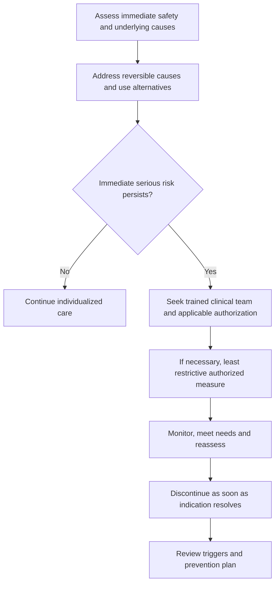

# 📚 Restraint safety

**Study-ready, unattempted.** 🔴 MOST IMPORTANT. [29 new MCQs](../MCQs/04C-Restraint-Safety-29-MCQs.md) and original Group 04 Q10 give 30 allocated. Clinical application must follow applicable Indian law, facility policy and trained authorized staff. These notes are not instructions for applying restraints.

## 🔹 Least restrictive care

<!-- job4-metadata -->
**Exam evidence:** **🟣 [PGIMER Chandigarh Staff Nurse Grade II 2015](https://testbook.com/question-answer/which-action-by-a-patient-should-the-nurse-report--62b713536128efc333837720/amp)** — indexed full question and exam attribution inspected, direct reopen failed. Device-protection review does not automatically justify restraint. [Reported adaptation](../Previous-Year-Questions/04C-Restraint-Reported-Evidence.md).

**YouTube MCQ practice: verification pending.** [Archer Review NCLEX restraint question](https://www.youtube.com/watch?v=LoRg1MH2xLg) is a supplementary topic lead, exact scenario and playback pending.
<!-- /job4-metadata -->

Restraint patient ki voluntary movement ya access restrict karta hai. Device ka name alone classification decide nahi karta. Actual restriction, patient ki ability to remove it, purpose and policy matter karte hain. Medication jo sirf staff convenience ke liye movement restrict karti hai inappropriate chemical restraint ho sakti hai. Indicated medication to treat a diagnosed condition automatically restraint nahi hai.

Patient ki agitation ka cause assess karo, e.g. hypoxia, pain, delirium, urinary urgency, unfamiliar surroundings or communication difficulty. Correctable causes ko address karo. Calm communication, familiar support, observation, accessible call system, safe mobility, review of unnecessary devices and appropriate clinical treatment can reduce the need for restraint. Family request, punishment, routine fall prevention or staffing shortage restraint justify nahi karte. Clinical necessity aur required authorization establish karo. Earliest safe discontinuation aim hai.

[Practice Q1–8](../MCQs/04C-Restraint-Safety-29-MCQs.md).

## 🔹 Monitoring and documentation

<!-- job4-metadata -->
**YouTube MCQ practice: verification pending** — specific monitoring and documentation scenario not verified. [Related original bank](../MCQs/04C-Restraint-Safety-29-MCQs.md). Existing teaching resource below remains separate.
<!-- /job4-metadata -->

🔴 MOST IMPORTANT. Restraint mein bhi patient ka dignity, hydration, elimination, comfort, skin integrity aur safe positioning maintain karo. Monitoring frequency depends on clinical status, restraint type, applicable law and local policy. International exam resources may describe different intervals. New symptoms mein scheduled observation ka wait mat karo.

Cool, swollen, numb limb may indicate impaired perfusion. Prompt safe relief, assessment and urgent review are important. Labored breathing or reduced responsiveness needs emergency assessment, help and immediate removal of restrictive hazards safely. Avoid delay for paperwork. Document objective behavior, alternatives, clinical justification, authorization, start and end times, monitoring findings, response, ongoing need and release. Handover mein current risks and release criteria communicate karo.

[Practice Q9–18](../MCQs/04C-Restraint-Safety-29-MCQs.md).

## 🔹 Indian mental healthcare law

<!-- job4-metadata -->
**YouTube MCQ practice: verification pending** — Indian Act-specific question solving not located. Retain statutory source and use the linked original practice bank. Overseas NCLEX order and monitoring rules are not Indian law.
<!-- /job4-metadata -->

🔴 MOST IMPORTANT. Mental Healthcare Act 2017 section 97 specifically governs restraint and seclusion of persons with mental illness in its applicable setting. Isko generic ward policy ke saath confuse mat karo.

| Provision | Exam-relevant meaning |
|---|---|
| Section 95 | Chaining as treatment for mental illness prohibited |
| Section 97(1) | Seclusion or solitary confinement prohibited. Physical restraint only when necessary as the sole available means to prevent imminent and immediate harm, with authorization by psychiatrist in charge |
| Section 97(2)–(3) | Shortest absolutely necessary duration and immediate documentation of method, nature, justification and duration |
| Section 97(4) | No punishment, deterrence or use merely due to staff shortage |
| Section 97(5)–(7) | Inform nominated representative within 24 hours, maintain regular ongoing medical supervision, report all instances monthly to concerned Board |

Example: A person is verbally upset but no imminent threat exists. Staff cannot use restraint as deterrence. Address causes, de-escalate and follow authorized clinical care. The 24-hour notification requirement is not a mandatory duration of restraint.

[Practice Q19–25](../MCQs/04C-Restraint-Safety-29-MCQs.md).

## 🔹 Quality improvement

<!-- job4-metadata -->
**YouTube MCQ practice: verification pending** — restraint quality measures and debriefing questions not confirmed. [Related practice bank](../MCQs/04C-Restraint-Safety-29-MCQs.md).
<!-- /job4-metadata -->

Episode count alone sufficient outcome nahi hai. Duration, repeated exposure, injury, documented alternatives and patient experience assess karo. After discontinuation, discuss triggers respectfully and revise individual prevention measures. Least restrictive care is a patient-safety and rights goal.

[Practice Q26–29](../MCQs/04C-Restraint-Safety-29-MCQs.md).

## ▶️ References and video mapping

- [OpenStax Clinical Nursing Skills 9.5](https://openstax.org/books/clinical-nursing-skills/pages/9-5-limited-movement-devices), restraint principles directly retrieved. US-specific orders and intervals are not universal.
- [Open RN Nursing Fundamentals Safety](https://www.ncbi.nlm.nih.gov/books/NBK610816/), indexed guidance, direct classic page retrieval failed.
- [Mental Healthcare Act text](https://indiankanoon.org/doc/14507371/) and [India Code PDF](https://www.indiacode.nic.in/bitstream/123456789/15313/1/mental_healthcare_act%2C2017.pdf), sections 95 and 97 indexed text. Visual PDF verification pending.
- Teaching Q1–18 and 28–29: [Level Up RN — Fall Prevention and Restraints](https://www.youtube.com/watch?v=B54Y3q3DIrg).
- Related practice Q1–18 and 28–29: [NGN QOTW: Restraints](https://www.youtube.com/watch?v=TAf3VKwhT0g), NCLEX question-practice metadata only. Exact questions, playback, channel and timestamps unverified. Q19–25 Indian law requires Act text, dedicated video pending.
- [Reported recruitment evidence](../Previous-Year-Questions/04C-Restraint-Reported-Evidence.md). Full clinical, semantic and exam syllabus audits pending.
