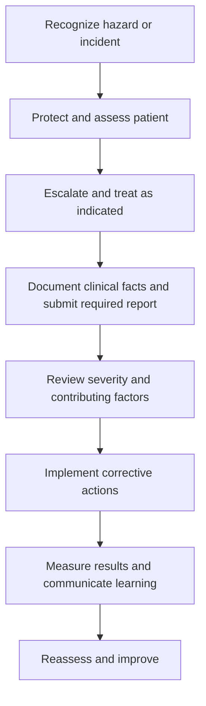

# 📚 Incident reporting and quality management

**Study-ready, unattempted.** 🔴 MOST IMPORTANT — nursing patient safety. [26 new MCQs](../MCQs/04D-Incident-Reporting-and-Quality-Management-26-MCQs.md) plus earlier Group 04 Q5, Q6, Q17 and Q20 = 30 allocated.

## 🔹 Event classification

<!-- job4-metadata -->
**YouTube MCQ practice: verification pending.** [Supplementary Level Up RN lesson and quiz](https://leveluprn.com/blogs/fundamentals-of-nursing/7-quality-improvement-patient-safety-events-incident-reporting) — publisher transcript and 08:48 quiz chapter available. Direct YouTube watch URL and specific question verification pending. Existing DSSSB reported concept source reopened.
<!-- /job4-metadata -->

Patient safety incident ka matlab care se juda aisa event ya circumstance hai jisse patient ko unnecessary harm ho sakta tha ya ho chuka hai. Dekho, har safety problem mein patient ko injury hona zaruri nahi hai. WHO terminology mein hum yeh dekhte hain ki hazard pehle hi pakda gaya, incident patient tak pahuncha ya nahi aur usse koi harm hua ya nahi. Neeche ke examples se in categories ka difference samjho:

| Category | Meaning | Example |
|---|---|---|
| Unsafe condition | Incident hone se pehle hi hazard identify ho jaata hai. | Staff ko ek faulty trolley milti hai jise abhi use nahi kiya gaya tha. |
| Near miss | Incident patient tak nahi pahunchta hai. | Galat sample ko use karne se pehle hi pakad liya jaata hai. |
| No-harm incident | Incident patient tak pahunchta hai lekin koi discernible harm nahi milta hai. | Patient ko unintended dose milti hai, lekin abhi tak koi injury detect nahi hui hai. |
| Harmful incident | Care se related event ki wajah se patient ko harm hota hai. | Galat treatment ki wajah se patient ko injury ho jaati hai. |

Alag reporting frameworks mein near miss ka meaning thoda broader ho sakta hai. Isliye exam mein agar framework specify kiya hai, toh uski definition ke hisaab se answer do. Agar incident mein abhi harm nahi dikha hai, tab bhi monitoring aur applicable reporting ki zarurat khatam nahi hoti. Adverse event, yaani care ke saath juda harmful event, preventable error ke bina bhi ho sakta hai. Sirf outcome dekhkar yeh decide nahi kiya ja sakta ki negligence hui thi ya event prevent kiya ja sakta tha.

Sentinel event safety incidents ki ek particularly serious category hai. Is category ko decide karne ke liye current applicable accreditation aur hospital ki definitions dekhni hoti hain. Agar illness ke natural course se unrelated death, severe harm ya permanent harm hota hai, toh event criteria meet kar sakta hai. Kuch specified events harm na hone par bhi sentinel event qualify kar sakte hain. Isliye har fall ko automatically sentinel event nahi kaha jaata.

[MCQs Q1–5](../MCQs/04D-Incident-Reporting-and-Quality-Management-26-MCQs.md). [🔵 DSSSB Nursing Officer 28 August 2019 Shift 3 — reported concept](../Previous-Year-Questions/04D-Incident-Quality-Reported-Evidence.md).

## 🔹 Reporting and just culture

<!-- job4-metadata -->
**YouTube MCQ practice: verification pending** — specific just-culture questions not confirmed. Existing teaching links below are separate.
<!-- /job4-metadata -->

Jab koi incident ho, toh nurse ki first priority patient ki care hoti hai. Nurse patient ko assess karti hai, zarurat ke hisaab se stabilize karti hai, appropriate clinician aur supervisor ko inform karti hai aur clinical risk ke mutabik monitoring karti hai. Uske baad required safety reporting complete ki jaati hai. Clinical record mein actual event, assessment findings, interventions, kisko inform kiya aur patient ka response document hota hai. Separate incident report institutional policy ke hisaab se complete ki jaati hai. Yeh report clinical care documentation ki jagah nahi leti. Nurse observed facts aur assumptions ko alag rakhti hai aur existing records preserve karti hai. Baad mein information chhupana ya falsify karna sahi nahi hai. Jo facts establish ho chuke hain, unhe appropriate disclosure process se honestly communicate kiya jaata hai.

Just culture ka matlab hai fair accountability aur system ki problems se seekhna. Iska matlab yeh nahi hai ki kisi ko apne actions ke liye kabhi accountable nahi maana jaayega. Anjaane mein hui error, risky shortcut aur reckless behavior ko review karte samay situation aur person ke choices dono dekhe jaate hain, taaki response proportionate ho. Sirf incident reports ki sankhya se actual harm incidence prove nahi hota. Jab staff ka reporting system par trust badhta hai, toh zyada incidents report ho sakte hain. Isliye confidentiality, timely feedback aur corrective actions ko track karna bhi zaruri hai.

[MCQs Q6–12](../MCQs/04D-Incident-Reporting-and-Quality-Management-26-MCQs.md).

## 🔹 Investigation and prevention

<!-- job4-metadata -->
**YouTube MCQ practice: verification pending** — specific RCA, FMEA and improvement-tool question coverage not confirmed. [Related original bank](../MCQs/04D-Incident-Reporting-and-Quality-Management-26-MCQs.md).
<!-- /job4-metadata -->

| Method | Purpose |
|---|---|
| RCA | Root Cause Analysis mein event hone ke baad usmein contribute karne wale factors ko systematically investigate kiya jaata hai. |
| FMEA | Failure Mode and Effects Analysis mein event hone se pehle process ke possible failures identify kiye jaate hain aur unki priority decide ki jaati hai. |
| Fishbone diagram | Team possible causes ko categories mein organize karti hai, taaki investigation systematic ho. |
| Pareto chart | Team problem categories ko unki frequency ke hisaab se rank karti hai. |

Example: maan lo do alag systems ke connectors physically fit ho gaye, jabki unhe aapas mein connect nahi karna chahiye tha. Is wajah se wrong connection hua. Sirf nurse ko yaad dilana comparatively weak corrective action hai, kyunki future mein kisi aur se bhi wahi galti ho sakti hai. Agar approved design change galat connection ko physically prevent karta hai, toh staff ko sirf memory par depend nahi rehna padta. Intervention implement karne se pehle usko validate karna aur baad mein unintended consequences monitor karna zaruri hai. RCA sirf meeting karke khatam nahi hota. Corrective action ke liye responsible person assign hona chahiye aur result evaluate kiya jaana chahiye.

[MCQs Q13–16](../MCQs/04D-Incident-Reporting-and-Quality-Management-26-MCQs.md).

## 🔹 Improvement and measurement

<!-- job4-metadata -->
**Exam evidence:** **🟣 [AIIMS NORCET 2021 — related PDSA concept](https://testbook.com/question-answer/pdsa-stands-for--6250027a5e89fec2ed168ce4)** — memory-based report dated 20 November 2021 retrieved, not an exact original practice question.

**YouTube MCQ practice: verification pending** — specific PDSA and audit-measurement question videos not established. [Related MCQs](../MCQs/04D-Incident-Reporting-and-Quality-Management-26-MCQs.md).
<!-- /job4-metadata -->

PDSA = Plan, Do, Study, Act. Plan mein team aim aur prediction decide karti hai. Do mein proposed change ko small scale par test karti hai. Study mein actual data ko prediction se compare karti hai. Act mein result ke hisaab se change adopt, adapt ya abandon kiya jaata hai aur zarurat par dobara test hota hai. Audit cycle mein actual practice ko defined standard se compare kiya jaata hai, zaruri change implement hota hai aur phir re-audit karke dekha jaata hai ki practice improve hui ya nahi.

| Measure | Example |
|---|---|
| Structure | Team dekhti hai ki functioning emergency equipment available hai ya nahi. |
| Process | Team measure karti hai ki eligible patients mein se kitne patients ko required assessment mila. |
| Outcome | Team care-related injury rate measure karti hai. |
| Balancing | Urgent-care process badalne ke baad team routine-care waiting time bhi measure karti hai, taaki doosre patients par possible adverse effect samajh aaye. |

Compliance = compliant eligible cases / total eligible cases × 100. Example: agar 90 eligible cases mein 72 cases standard follow karte hain, toh 72/90 × 100 = 80% compliance hogi. Agar compliance 60% se 75% ho jaaye, toh difference 15 percentage points hai. Relative increase (75 − 60)/60 × 100 = 25% hai. Dono calculations ka meaning alag hai. Rates compare karte samay same definitions aur meaningful denominators use karo. Patient case mix aur reporting completeness ko bhi dhyan mein rakho. Quality assurance mein standards follow ho rahe hain ya nahi, yeh check kiya jaata hai. Quality improvement mein changes test karke unka effect evaluate kiya jaata hai. Detailed management statistics is starter topic ke scope se bahar hain.

[MCQs Q17–26](../MCQs/04D-Incident-Reporting-and-Quality-Management-26-MCQs.md).

## ▶️ Teaching, practice and references

- [WHO patient safety definitions](https://cdn.who.int/media/docs/default-source/integrated-health-services-%28ihs%29/psf/curriculum-guide/resources/ps-curr-handouts/course01a_handout_patient-safety-definitions.pdf), indexed text supports terminology, PDF visual verification pending.
- [AHRQ incident investigation](https://psnet.ahrq.gov/primer/strategies-and-approaches-investigating-patient-safety-events) directly retrieved. [AHRQ reporting](https://psnet.ahrq.gov/primer/reporting-patient-safety-events), [AHRQ measurement](https://psnet.ahrq.gov/primer/measurement-patient-safety), [IHI PDSA](https://www.ihi.org/library/model-for-improvement/testing-changes) indexed guidance.
- [Joint Commission sentinel event policy](https://www.jointcommission.org/en-us/knowledge-library/support-center/standards-interpretation/sentinel-event-policy-and-procedures), indexed definition, not universal Indian statutory criteria.
- Teaching Q1–16: [Hospital Quality Insights — PSQ 7, Incident Reporting, RCA, CAPA & Sentinel Events](https://www.youtube.com/watch?v=9q-XjOLD9sM). Q1–8 supplementary teaching [Carol Forde-Johnston — Clinical Incident Reporting, Near Misses and Never Events](https://www.youtube.com/watch?v=lgZt8rePsqo).
- Teaching Q17–26: [Quality Assurance & Audit, NORCET 6](https://www.youtube.com/watch?v=uHc64TxyQ8s), title indexed. No full video playback or timestamp confirmation.
- Dedicated YouTube question-solving links: 0 exact matches, 0 confirmed topic-level question-solving matches, 26 pending. [Written practice questions](https://testustad.com/subjects/nursing-management-and-ethics/quality-and-patient-safety) are a supplemental non-video resource. Teaching is not counted as question solving.
- [Reported evidence](../Previous-Year-Questions/04D-Incident-Quality-Reported-Evidence.md). Full clinical, semantic and syllabus-depth review pending.
