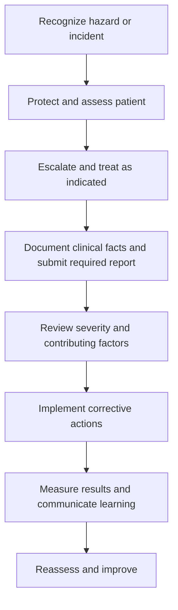

# 📚 Incident reporting and quality management

**Study-ready, unattempted.** 🔴 MOST IMPORTANT — nursing patient safety. [26 new MCQs](../MCQs/04D-Incident-Reporting-and-Quality-Management-26-MCQs.md) plus earlier Group 04 Q5, Q6, Q17 and Q20 = 30 allocated.

## 🔹 Event classification

<!-- job4-metadata -->
**YouTube MCQ practice: verification pending.** [Supplementary Level Up RN lesson and quiz](https://leveluprn.com/blogs/fundamentals-of-nursing/7-quality-improvement-patient-safety-events-incident-reporting) — publisher transcript and 08:48 quiz chapter available. Direct YouTube watch URL and specific question verification pending. Existing DSSSB reported concept source reopened.
<!-- /job4-metadata -->

Patient safety incident ka meaning care-related event ya circumstance hai jo unnecessary harm cause kar sakta tha ya kar chuka hai. WHO terminology mein distinction important hai:

| Category | Meaning | Example |
|---|---|---|
| Unsafe condition | Hazard identified before an incident | Faulty trolley found unused |
| Near miss | Incident patient tak nahi pahuncha | Incorrect sample intercepted before use |
| No-harm incident | Patient tak pahuncha but discernible harm nahi hua | Unintended dose, no detected injury yet |
| Harmful incident | Care-related harm hua | Injury from an incorrect treatment |

Different reporting frameworks near miss ko broader sense mein use kar sakte hain. Question mein specified definition follow karo. No-harm does not mean no monitoring or reporting. Adverse event can occur even without a preventable error. Negligence or preventability cannot be inferred solely from outcome.

Sentinel event ek particularly serious safety event category hai. Current applicable accreditation and institutional definitions matter. Severe or permanent harm or death unrelated to the natural course of illness may meet criteria, and specified events can qualify irrespective of harm. Har fall automatically sentinel event nahi hota.

[MCQs Q1–5](../MCQs/04D-Incident-Reporting-and-Quality-Management-26-MCQs.md). [🔵 DSSSB Nursing Officer 28 August 2019 Shift 3 — reported concept](../Previous-Year-Questions/04D-Incident-Quality-Reported-Evidence.md).

## 🔹 Reporting and just culture

<!-- job4-metadata -->
**YouTube MCQ practice: verification pending** — specific just-culture questions not confirmed. Existing teaching links below are separate.
<!-- /job4-metadata -->

Immediate patient care first. Assess, stabilize, notify appropriate clinician and supervisor, monitor according to clinical risk, then complete required safety reporting. Clinical record mein actual event, findings, intervention, notifications and response document karo. Separate incident report institutional policy ke according complete karo. Report care documentation replace nahi karta. Facts aur assumptions separate rakho. Preserve records, do not retrospectively conceal or falsify information. Communicate established facts honestly through appropriate disclosure process.

Just culture means fair accountability and systems learning, not blame-free immunity. Unintentional error, risky shortcuts and reckless behavior need proportionate review of context and choices. Reporting numbers alone true harm incidence prove nahi karte. Reporting trust improve hone se counts increase ho sakte hain. Confidentiality, timely feedback and action tracking important hain.

[MCQs Q6–12](../MCQs/04D-Incident-Reporting-and-Quality-Management-26-MCQs.md).

## 🔹 Investigation and prevention

<!-- job4-metadata -->
**YouTube MCQ practice: verification pending** — specific RCA, FMEA and improvement-tool question coverage not confirmed. [Related original bank](../MCQs/04D-Incident-Reporting-and-Quality-Management-26-MCQs.md).
<!-- /job4-metadata -->

| Method | Purpose |
|---|---|
| RCA | Retrospective analysis of contributing factors after event |
| FMEA | Prospective identification and prioritization of possible process failures |
| Fishbone diagram | Organize possible causes for investigation |
| Pareto chart | Rank problem categories by frequency |

Example: Wrong connection happened because two incompatible systems could physically fit together. Sirf nurse ko reminder dena weaker action hai. Approved design change that prevents incorrect connection can reduce reliance on memory. Validate interventions before implementation and monitor unintended consequences. RCA must lead to corrective actions with an owner and evaluation, not merely a meeting.

[MCQs Q13–16](../MCQs/04D-Incident-Reporting-and-Quality-Management-26-MCQs.md).

## 🔹 Improvement and measurement

<!-- job4-metadata -->
**Exam evidence:** **🟣 [AIIMS NORCET 2021 — related PDSA concept](https://testbook.com/question-answer/pdsa-stands-for--6250027a5e89fec2ed168ce4)** — memory-based report dated 20 November 2021 retrieved, not an exact original practice question.

**YouTube MCQ practice: verification pending** — specific PDSA and audit-measurement question videos not established. [Related MCQs](../MCQs/04D-Incident-Reporting-and-Quality-Management-26-MCQs.md).
<!-- /job4-metadata -->

PDSA = Plan, Do, Study, Act. Aim and prediction set karo, small-scale change test karo, data compare karo, then adapt, adopt or abandon and retest. Audit cycle compares actual practice against a defined standard, implements change and re-audits.

| Measure | Example |
|---|---|
| Structure | Availability of functioning emergency equipment |
| Process | Proportion of eligible patients receiving required assessment |
| Outcome | Care-related injury rate |
| Balancing | Routine-care waiting time after urgent-care process change |

Compliance = compliant eligible cases / total eligible cases × 100. Example 72/90 × 100 = 80%. Change from 60% to 75% is 15 percentage points, or 25% relative increase. Compare rates using equivalent definitions and meaningful denominators, consider case mix and reporting completeness. Quality assurance checks standards, improvement tests and evaluates changes. Detailed management statistics are beyond this starter topic.

[MCQs Q17–26](../MCQs/04D-Incident-Reporting-and-Quality-Management-26-MCQs.md).

## ▶️ Teaching, practice and references

- [WHO patient safety definitions](https://cdn.who.int/media/docs/default-source/integrated-health-services-%28ihs%29/psf/curriculum-guide/resources/ps-curr-handouts/course01a_handout_patient-safety-definitions.pdf), indexed text supports terminology, PDF visual verification pending.
- [AHRQ incident investigation](https://psnet.ahrq.gov/primer/strategies-and-approaches-investigating-patient-safety-events) directly retrieved. [AHRQ reporting](https://psnet.ahrq.gov/primer/reporting-patient-safety-events), [AHRQ measurement](https://psnet.ahrq.gov/primer/measurement-patient-safety), [IHI PDSA](https://www.ihi.org/library/model-for-improvement/testing-changes) indexed guidance.
- [Joint Commission sentinel event policy](https://www.jointcommission.org/en-us/knowledge-library/support-center/standards-interpretation/sentinel-event-policy-and-procedures), indexed definition, not universal Indian statutory criteria.
- Teaching Q1–16: [Hospital Quality Insights — PSQ 7, Incident Reporting, RCA, CAPA & Sentinel Events](https://www.youtube.com/watch?v=9q-XjOLD9sM). Q1–8 supplementary teaching [Carol Forde-Johnston — Clinical Incident Reporting, Near Misses and Never Events](https://www.youtube.com/watch?v=lgZt8rePsqo).
- Teaching Q17–26: [Quality Assurance & Audit, NORCET 6](https://www.youtube.com/watch?v=uHc64TxyQ8s), title indexed. No full video playback or timestamp confirmation.
- Dedicated YouTube question-solving links: 0 exact matches, 0 confirmed topic-level question-solving matches, 26 pending. [Written practice questions](https://testustad.com/subjects/nursing-management-and-ethics/quality-and-patient-safety) are a supplemental non-video resource. Teaching is not counted as question solving.
- [Reported evidence](../Previous-Year-Questions/04D-Incident-Quality-Reported-Evidence.md). Full clinical, semantic and syllabus-depth review pending.
