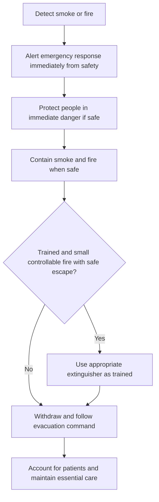

# 📚 Environmental and equipment safety

**Study-ready, unattempted.** 🔴 MOST IMPORTANT. [26 new MCQs](../MCQs/04E-Environmental-and-Equipment-Safety-26-MCQs.md) plus original Group 04 Q7, Q8, Q9 and Q14 = 30 allocated. This guide is a nursing exam resource, not a substitute for authorized facility emergency training.

## 🔹 Fire response and evacuation

<!-- job4-metadata -->
**▶️ [YouTube MCQ practice — Fire response, Nursing Wallah by PW (17:13)](https://www.youtube.com/watch?v=1EIouS8ulsY&t=1033s)** · Published rescue-first MCQ chapter, exact item and playback pending. [PASS teaching chapter (21:45)](https://www.youtube.com/watch?v=1EIouS8ulsY&t=1305s) is separate. JIPMER 2020, RRB 2026 and AIIMS Bathinda 2019 reports reopened. Apply the facility fire plan and current scenario.
<!-- /job4-metadata -->

Fire lagne ke liye fuel, heat aur oxidizer ki zarurat hoti hai. Hospital mein oxygen ki zyada concentration, electrical faults aur jalne wale materials ki wajah se fire ka risk badh sakta hai. Nurse ensure karti hai ki fire exits aur emergency equipment tak pahunchne ka raasta clear ho. Designated fire doors ko kisi cheez se atka kar khula nahi rakhna chahiye, kyunki unka kaam smoke aur fire ko phailne se rokne mein madad karna hai. Staff ko pehle se pata hona chahiye ki manual alarm point kahan hai, approved evacuation route kya hai aur emergency mein kiski kya responsibility hai.

**🔴 MOST IMPORTANT — RACE and PASS.** RACE = Rescue, Alarm, Contain, Extinguish/Evacuate. Rescue ka matlab hai immediate danger mein maujood logon ko safely bahar nikalna, lekin staff ko khud unsafe fire ya smoke mein nahi jaana chahiye. Alarm jaldi activate karo aur saath hi help bulao. Containment mein, jab safe ho, fire doors close kiye jaate hain taaki fire aur smoke ka spread kam ho. Extinguisher sirf trained staff use kare jab fire chhoti aur controllable ho, appropriate extinguisher available ho aur escape route clear ho. Agar smoke ya fire badh rahi hai ya escape ka raasta unsafe ho sakta hai, toh staff ko withdraw karke facility evacuation plan follow karna chahiye.

PASS = Pull pin, Aim at base, Squeeze handle, Sweep side to side. Yeh mnemonic trained staff ko extinguisher operation ke steps yaad dilata hai. Actual use mein extinguisher ka label aur local training follow ki jaati hai. RACE ko aisa rigid sequence mat samjho jisme har situation mein pehla step khatam hone tak alarm nahi bajana hai. Ministry of Health and Family Welfare ki 2026 guidance fire detect hote hi manual call point activate karne par zor deti hai. Agar koi person immediate danger mein nahi hai aur alarm accessible hai, toh turant alarm activate karna appropriate hai.

Horizontal evacuation ka matlab hai patient ko usi floor par kisi protected compartment mein shift karna. Vertical evacuation mein patient ko authorized safe route se doosre floor par shift kiya jaata hai. Ordinary lifts use nahi karni chahiye jab tak emergency plan mein unka use specifically approved na ho. Critically ill patients ko shift karne ke liye trained transport support ki zarurat hoti hai. Patient ki need aur situation ke hisaab se portable ventilation ya oxygen, monitoring, identification aur handover maintain kiye jaate hain. Emergency incident command decide karta hai ki kaunsa route aur evacuation sequence follow hoga.

[MCQs Q1–7](../MCQs/04E-Environmental-and-Equipment-Safety-26-MCQs.md). [🟣 Related JIPMER 2020 and RRB 2026 Shift 3 RACE concept and AIIMS Bathinda 2019 fire response](../Previous-Year-Questions/04E-Environmental-Safety-Reported-Evidence.md).

## 🔹 Oxygen and medical gas safety

<!-- job4-metadata -->
**▶️ [YouTube MCQ practice — Oxygen supports combustion, Nursing Wallah by PW (08:08)](https://www.youtube.com/watch?v=1EIouS8ulsY&t=488s)** · Published MCQ chapter. Exact item/playback pending. Cylinder identification, storage and pipeline-specific question coverage remains pending. Never rely on cylinder paint alone.
<!-- /job4-metadata -->

Oxygen khud fuel nahi hai, lekin combustion, yaani jalne ki process, ko support karta hai. Jab kisi area mein oxygen ki concentration zyada hoti hai, toh materials aasani se ignite ho sakte hain aur zyada intensity se jal sakte hain. Oxygen equipment ke paas smoking, open flame, oil aur grease avoid karne chahiye. Petroleum products ki jagah approved oxygen-compatible alternatives use karo. Agar regulator contaminate ho gaya hai, toh use service se hata kar authorized channel se replacement arrange kiya jaata hai.

Cylinder mein kaunsi gas hai, yeh verify karne ke liye uska label check karo, kyunki sirf color se gas ki identity reliably confirm nahi hoti. Cylinder ko approved ventilated location mein girne se bachane ke liye secure kiya jaata hai aur heat aur jalne wale materials se door rakha jaata hai. Exit ka raasta block nahi hona chahiye. Medical gas valves ka operation sirf authorized staff incident leadership ke coordination mein karta hai. Agar patient oxygen par dependent hai, toh alternate oxygen support ensure kiye bina sabki supply band karna dangerous ho sakta hai.

[MCQs Q8–12](../MCQs/04E-Environmental-and-Equipment-Safety-26-MCQs.md).

## 🔹 Electrical and power safety

<!-- job4-metadata -->
**YouTube MCQ practice: verification pending** — specific electrical hazard and power failure questions not established. Existing broad safety quiz lead remains supplementary.
<!-- /job4-metadata -->

Device use karne se pehle nurse cord, plug, outer casing aur approved maintenance status check karti hai. Agar wire exposed ho, socket garam ho ya device damaged ho, toh safe isolation aur biomedical engineering review arrange kiya jaata hai. Bijli se connected wet equipment ko touch nahi karna chahiye. Unapproved adapters aur socket overloading se bacho. Electrical fire par water use karna unsafe ho sakta hai, kyunki electricity conduct ho sakti hai. Appropriate approved extinguisher aur trained emergency response follow kiya jaana chahiye.

Power cut hone par agar battery backup apne aap start ho jaaye, tab bhi nurse verify karti hai ki patient ko required support mil raha hai aur battery mein kitni capacity bachi hai. Essential care rukni nahi chahiye, isliye facility ke approved backup device aur electrical supply plan ka use kiya jaata hai. Bedside par unauthorized electrical repair nahi karni chahiye.

[MCQs Q13–16](../MCQs/04E-Environmental-and-Equipment-Safety-26-MCQs.md).

## 🔹 Equipment and alarms

<!-- job4-metadata -->
**YouTube MCQ practice: verification pending** — specific infusion pump, alarm and ventilator scenarios not established. Existing clinical references and broad quiz lead retained.
<!-- /job4-metadata -->

Alarm staff ko alert karta hai ki patient ya equipment mein koi possible problem ho sakti hai. Nurse pehle patient ki condition assess karti hai, phir device, access site aur tubing check karti hai. Baar-baar alarm aane par use ignore ya permanently disable karna safe nahi hai. Patient ki zarurat ke hisaab se approved settings aur sahi sensor placement unnecessary alarms kam kar sakte hain. Occlusion alarm ka matlab flow mein rukawat ho sakti hai. Is situation mein force se flush karna ya bina assessment pressure badha dena unsafe hai. Nurse device-specific troubleshooting protocol follow karti hai.

Agar essential device malfunction karta hai, toh nurse safe replacement arrange karti hai aur correct settings verify karke prescribed therapy continue karne mein madad karti hai. Defective equipment ko label karke use se alag rakha jaata hai, taaki koi doosra staff member galti se use na kare. Nurse device ID, alarm ki details, patient par clinical effect aur liye gaye actions record karti hai. Local incident reporting aur biomedical reporting channels follow kiye jaate hain aur relevant evidence preserve kiya jaata hai. FDA infusion-pump guidance clinical safety principles samjhati hai, lekin woh apne aap India ki legal reporting requirement nahi ban jaati.

[MCQs Q17–20 and Q26](../MCQs/04E-Environmental-and-Equipment-Safety-26-MCQs.md).

## 🔹 Latex and chemical exposure

<!-- job4-metadata -->
**▶️ [YouTube MCQ practice — Latex allergy prioritization, ADAPT NCLEX REVIEW (06:47)](https://www.youtube.com/watch?v=toTwrTkRX2Y&t=407s)** · Published practice chapter, specific product-selection item and playback pending. Chemical spill-specific MCQ video verification pending.
<!-- /job4-metadata -->

Natural rubber latex se patient aur healthcare worker dono ko allergy ho sakti hai. Powder-free, low-protein ya hypoallergenic likha hone ka matlab yeh nahi hai ki product latex-free hai. Confirmed latex allergy mein nurse material verify karti hai aur suitable non-latex gloves aur devices use karti hai, jisme relevant catheters bhi include hote hain. Irritant dermatitis mein skin irritation ho sakti hai, delayed contact allergy mein reaction der se aa sakta hai aur immediate IgE-mediated allergy mein jaldi allergic reaction develop ho sakta hai. Inko differentiate karne ke liye exposure history aur clinical evaluation zaruri hain.

Agar exposure ke baad patient ko achanak wheeze, low blood pressure aur generalized urticaria yaani sharir par hives ho jaate hain, toh anaphylaxis ka doubt hona chahiye. Suspected exposure ko stop karo, emergency response activate karo aur airway, breathing aur circulation support karo. Applicable emergency protocol ke hisaab se management initiate kiya jaata hai, jisme indicated IM adrenaline bhi include hai. Allergy test ke result ka wait karke emergency care delay nahi karni chahiye.

Agar unknown chemical spill ho, toh staff area isolate karta hai aur affected persons ko sirf safe tareeke se danger se door karta hai. Trained responders ko notify kiya jaata hai aur chemical ki safety data sheet aur appropriate PPE ke hisaab se response decide hota hai. Chemicals ko aapas mein mix nahi karna chahiye aur pehchanne ke liye jaan-boojhkar smell nahi karna chahiye. Spill ka type aur local policy decide karte hain ki cleanup kaise aur kis trained team se hoga.

[MCQs Q21–25](../MCQs/04E-Environmental-and-Equipment-Safety-26-MCQs.md).

## ▶️ Teaching and question-practice evidence

| Section | Teaching | MCQ practice |
|---|---|---|
| Fire and evacuation | [Level Up RN — Inpatient Safety](https://www.youtube.com/watch?v=RsZZ1WhtM40) | Same video description advertises quiz, Q1–4 and Q6 related leads only |
| Oxygen and medical gas | [MoHFW oxygen guidance](https://www.mohfw.gov.in/sites/default/files/Oxygen%20Guideline%20finalized%202025.pdf), written source | Verification pending Q8–12 |
| Electrical and power | Level Up RN broad equipment teaching | Q13 related quiz lead, Q14–16 pending |
| Equipment and alarms | Level Up RN broad malfunction teaching | Q17 related quiz lead, Q18–20 and Q26 pending |
| Latex and chemicals | [OSHA latex allergy](https://www.osha.gov/etools/hospitals/hospital-wide-hazards/latex-allergy), written source and Level Up RN chemical exposure teaching | Q25 related quiz lead, Q21–24 pending |

Q5 and Q7 specialist evacuation/oxygen coordination practice also pending. Total 8 description-level quiz leads, 18 no specific practice lead, 0 fully verified question-level matches and 0 fully confirmed topic-level question-solving matches. Playback, exact quiz questions and timestamps pending. No lecture or written source counted as verified video question practice.

## ▶️ References

- [MoHFW National Guidelines on Fire and Life Safety in Healthcare Facilities 2026](https://www.mohfw-dohfw.gov.in/static/uploads/2026/05/62dc36c7ac9aeedefb0e969de50686d1.pdf), extracted text directly retrieved, including ICU RACE section. Screenshot failed, visual verification pending.
- [MoHFW National Guidelines on Medical Oxygen Management 2025](https://www.mohfw.gov.in/sites/default/files/Oxygen%20Guideline%20finalized%202025.pdf), indexed guidance on storage, labels, clean handling.
- [Open RN Safety](https://www.ncbi.nlm.nih.gov/books/NBK610816/?report=classic), indexed environmental safety guidance. Direct Pressbooks page returned 403.
- [FDA infusion pump clinician guidance](https://www.fda.gov/medical-devices/infusion-pumps/infusion-pump-risk-reduction-strategies-clinicians), directly retrieved.
- OSHA latex source above indexed, plus [HSE latex allergies](https://www.hse.gov.uk/healthservices/latex/).
- [Reported exam evidence](../Previous-Year-Questions/04E-Environmental-Safety-Reported-Evidence.md). Official question booklets and keys, comprehensive clinical, semantic and syllabus-depth audits pending.
