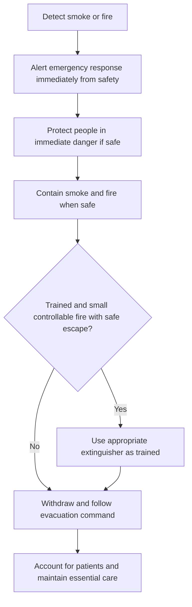

# 📚 Environmental and equipment safety

**Study-ready, unattempted.** 🔴 MOST IMPORTANT. [26 new MCQs](../MCQs/04E-Environmental-and-Equipment-Safety-26-MCQs.md) plus original Group 04 Q7, Q8, Q9 and Q14 = 30 allocated. This guide is a nursing exam resource, not a substitute for authorized facility emergency training.

## Fire response and evacuation

Fire needs fuel, heat and an oxidizer. Hospital mein oxygen enrichment, electrical faults and combustible material important risks hain. Fire exits aur emergency equipment access clear rakho. Designated fire doors ko wedge open mat karo. Staff ko manual alarm point, approved evacuation route and role allocation pata hona chahiye.

**🔴 MOST IMPORTANT — RACE and PASS.** RACE = Rescue, Alarm, Contain, Extinguish/Evacuate. Rescue means immediately endangered people ko safely move karna, without entering an unsafe fire or smoke environment. Alarm early activate karo, parallel help request karo. Containment mein safe ho toh fire doors close karna important hai. Extinguisher use only trained staff, small controllable fire, correct extinguisher and clear escape route. Agar smoke, fire growth ya escape risk hai toh withdraw and evacuate according to plan.

PASS = Pull pin, Aim at base, Squeeze handle, Sweep side to side. Extinguisher label aur local training follow karo. RACE mnemonic ko rigid sequential rule mat samjho. Ministry of Health and Family Welfare 2026 guidance emphasizes activating the manual call point immediately on detection. Agar no person endangered aur alarm accessible hai toh immediate alarm appropriate hai.

Horizontal evacuation = same floor ke protected compartment mein move karna. Vertical evacuation = different floor via authorized safe route. Ordinary lifts use mat karo unless explicitly approved in the emergency plan. Critical patients need trained transport support, portable ventilation/oxygen as indicated, monitoring, identification and handover, as circumstances permit. Emergency incident command directs route and sequencing.

[MCQs Q1–7](../MCQs/04E-Environmental-and-Equipment-Safety-26-MCQs.md). [🟣 Related JIPMER 2020 and RRB 2026 Shift 3 RACE concept and AIIMS Bathinda 2019 fire response](../Previous-Year-Questions/04E-Environmental-Safety-Reported-Evidence.md).

## Oxygen and medical gas safety

Oxygen khud fuel nahi hai, combustion support karta hai. Oxygen-enriched area mein materials easily ignite aur intensely burn kar sakte hain. No smoking, no open flame, no oil or grease on oxygen equipment. Petroleum products near oxygen avoid karo and approved compatible alternatives use karo. Contaminated regulator remove from use and replace through authorized channel.

Cylinder label se gas verify karo, color alone sufficient nahi. Store secured against falling in approved ventilated location, away from heat and combustible materials. Do not block egress. Medical gas valve operation only authorized staff and incident leadership coordinate karein. Dependent patients ke alternate oxygen support ko ensure kiye bina blanket shutoff dangerous hai.

[MCQs Q8–12](../MCQs/04E-Environmental-and-Equipment-Safety-26-MCQs.md).

## Electrical and power safety

Pre-use inspection mein cord, plug, casing and approved maintenance status check karo. Exposed wiring, hot socket or damaged device ho toh safe isolation and biomedical engineering review arrange karo. Energized wet equipment ko touch mat karo. Unapproved adapters and overloading avoid karo. Electrical fire mein water use unsafe ho sakta hai. Approved extinguisher and trained response follow karo.

Power cut ke baad battery backup automatically work kare toh bhi patient support and battery capacity verify karo. Essential care uninterrupted rakhne ke liye approved backup device and electrical supply plan use karo. Unauthorized electrical repair bedside par nahi karni chahiye.

[MCQs Q13–16](../MCQs/04E-Environmental-and-Equipment-Safety-26-MCQs.md).

## Equipment and alarms

Alarm ka purpose possible patient or equipment problem identify karna hai. Pehle patient assess karo, phir device, access site and tubing check karo. Repeated alarms ignore ya permanently disable mat karo. Patient-specific settings and approved sensor placement unnecessary alarms reduce kar sakte hain. Occlusion alarm mein force flushing or arbitrary pressure increase unsafe hai. Device-specific troubleshooting follow karo.

If an essential device malfunctions, safe replacement aur correct settings verify karke prescribed therapy continue karo, defective equipment label and quarantine karo. Device ID, alarm details, clinical effects and action record karo. Local incident and biomedical reporting channels follow karo. Preserve evidence. FDA infusion-pump guidance provides clinical safety principles, not an Indian legal reporting requirement.

[MCQs Q17–20 and Q26](../MCQs/04E-Environmental-and-Equipment-Safety-26-MCQs.md).

## Latex and chemical exposure

Natural rubber latex allergy patient and healthcare workers dono mein possible hai. Powder-free, low-protein or hypoallergenic latex label non-latex guarantee nahi karta. Confirmed allergy mein material verify karo, suitable non-latex protective gloves and devices use karo, including catheters where relevant. Irritant dermatitis and delayed contact allergy are distinct from immediate IgE-mediated allergy. Exposure history and clinical evaluation needed.

Sudden wheeze, hypotension and generalized urticaria after exposure may indicate anaphylaxis. Stop suspected exposure, activate emergency response, support ABC and initiate protocol-directed management including IM adrenaline when indicated. Do not wait for allergy test results.

Unknown chemical spill mein area isolate karo, affected persons ko safely remove karo, notify trained responders, consult safety data sheet and use appropriate PPE. Do not mix chemicals or deliberately smell them. Spill type and local policy determine cleanup.

[MCQs Q21–25](../MCQs/04E-Environmental-and-Equipment-Safety-26-MCQs.md).

## ▶️ Teaching and question-practice evidence

| Section | Teaching | MCQ practice |
|---|---|---|
| Fire and evacuation | [Level Up RN — Inpatient Safety](https://www.youtube.com/watch?v=RsZZ1WhtM40) | Same video description advertises quiz, Q1–4 and Q6 related leads only |
| Oxygen and medical gas | [MoHFW oxygen guidance](https://www.mohfw.gov.in/sites/default/files/Oxygen%20Guideline%20finalized%202025.pdf), written source | Verification pending Q8–12 |
| Electrical and power | Level Up RN broad equipment teaching | Q13 related quiz lead, Q14–16 pending |
| Equipment and alarms | Level Up RN broad malfunction teaching | Q17 related quiz lead, Q18–20 and Q26 pending |
| Latex and chemicals | [OSHA latex allergy](https://www.osha.gov/etools/hospitals/hospital-wide-hazards/latex-allergy), written source and Level Up RN chemical exposure teaching | Q25 related quiz lead, Q21–24 pending |

Q5 and Q7 specialist evacuation/oxygen coordination practice also pending. Total 8 description-level quiz leads, 18 no specific practice lead, 0 fully verified question-level matches and 0 fully confirmed topic-level question-solving matches. Playback, exact quiz questions and timestamps pending. No lecture or written source counted as verified video question practice.

## References

- [MoHFW National Guidelines on Fire and Life Safety in Healthcare Facilities 2026](https://www.mohfw-dohfw.gov.in/static/uploads/2026/05/62dc36c7ac9aeedefb0e969de50686d1.pdf), extracted text directly retrieved, including ICU RACE section. Screenshot failed, visual verification pending.
- [MoHFW National Guidelines on Medical Oxygen Management 2025](https://www.mohfw.gov.in/sites/default/files/Oxygen%20Guideline%20finalized%202025.pdf), indexed guidance on storage, labels, clean handling.
- [Open RN Safety](https://www.ncbi.nlm.nih.gov/books/NBK610816/?report=classic), indexed environmental safety guidance. Direct Pressbooks page returned 403.
- [FDA infusion pump clinician guidance](https://www.fda.gov/medical-devices/infusion-pumps/infusion-pump-risk-reduction-strategies-clinicians), directly retrieved.
- OSHA latex source above indexed, plus [HSE latex allergies](https://www.hse.gov.uk/healthservices/latex/).
- [Reported exam evidence](../Previous-Year-Questions/04E-Environmental-Safety-Reported-Evidence.md). Official question booklets and keys, comprehensive clinical, semantic and syllabus-depth audits pending.
