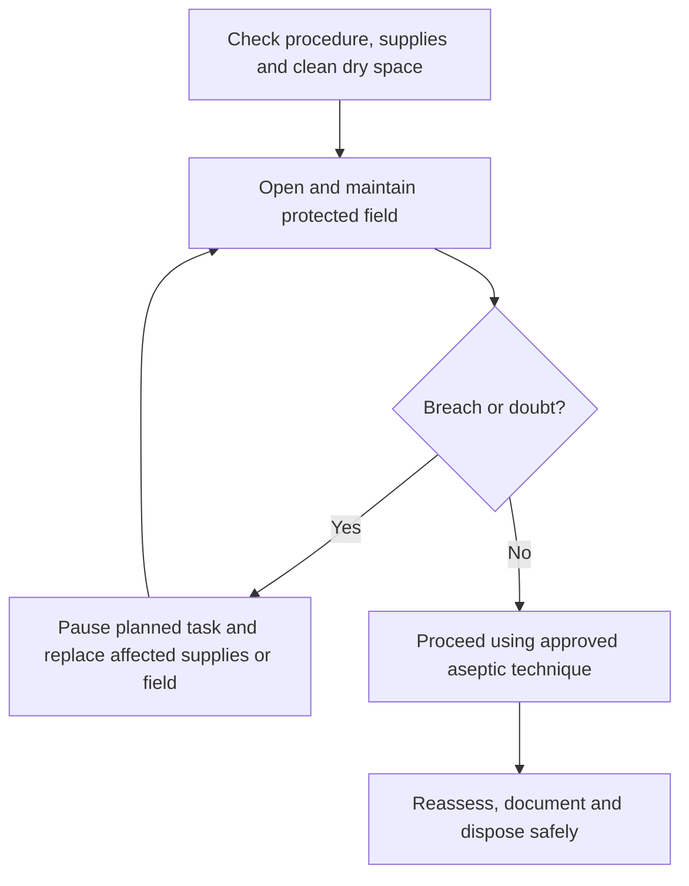

# 📚 Medical and surgical asepsis — bedside sterile-field clinical judgment

**Study-ready, not studied.** **Topic priority:** 🔴 MOST IMPORTANT — patient safety. [26 additional original MCQs](../MCQs/05A-Bedside-Sterile-Field-Clinical-Judgment-26-MCQs.md) plus Group 05 Q4, Q5, Q13 and Q14 give 30 allocated. Follow local clinical protocols and supervised competency training.

## 🔹 Field preparation and boundaries

Medical asepsis ka meaning microorganisms ki quantity aur spread reduce karna hai. Surgical asepsis ka goal required working field aur critical supplies ko sterile maintain karna hai. Example: routine clean bed preparation aur sterile invasive procedure ke setup ka risk same nahi hota. Sterile field create karne se pehle patient ki condition, planned procedure, required supplies, lighting, dry working surface aur assistant ki need assess karo. Opened supplies ko unnecessary delay tak expose mat rakho.

| Situation | Nursing judgment |
|---|---|
| Wet work surface | Required disinfectant contact time complete karke surface dry hone do |
| Package integrity doubtful | Suitable intact verified replacement arrange karo |
| Four-flap wrapper | Far flap, side flaps individually, near flap last. Exposed center ke upar nonsterile arm cross na kare |
| Outer one-inch margin | Conventional teaching mein contaminated boundary maana jaata hai |
| Drape hanging below tabletop | Sterile working plane ke outside |
| Heavy sterile item | Trained sterile-gloved assistant se controlled transfer |
| Sterile solution | Side se controlled no-contact pour, splashing avoid karo |
| Open field unattended | Integrity uncertain hai, policy ke according fresh setup |

Example: ek sterile instrument outer border par touch ho gaya. Usko center mein move karne se microorganisms remove nahi honge. Item replace karo and check whether other supplies were affected. Aseptic technique mein appearance se zyada actual contact history important hai.

[Questions Q1–10](../MCQs/05A-Bedside-Sterile-Field-Clinical-Judgment-26-MCQs.md#q1-a-disinfected-bedside-table-is-still-wet-before-the-nurse-opens-a-sterile-kit-which-preparation-is-appropriate).

## 🔹 Gloves and breach response

Open sterile gloving mein bare hand se folded inner cuff ke intended skin-contact area ko handle karte hain. Outer working surface protect karo. Gloving central sterile field ke above perform mat karo. Bare wrist, unsterile clothing, damaged gloves ya uncertain contact compromise create kar sakte hain. Pause karke affected gloves and supplies replace karo. Hand hygiene glove use se pehle aur removal ke baad applicable policy ke according required hai. Gloves ko hand rub se sterile restore karne ka attempt mat karo.

Patient ya visitor ko respectfully explain karo ki field boundary kyun maintain karni hai. Coughing or unexpected movement ho toh patient ki needs address karo, field exposure assess karo aur compromised supplies replace karo. Emergency care ko routine aseptic setup preserve karne ke liye delay mat karo.

[Questions Q11–17](../MCQs/05A-Bedside-Sterile-Field-Clinical-Judgment-26-MCQs.md#q11-during-open-sterile-gloving-why-may-an-ungloved-hand-touch-the-folded-inner-cuff-as-instructed).

## 🔹 Clean versus sterile and key parts

| Term | Meaning and example |
|---|---|
| Key part | Device ka critical contact surface, e.g. sterile connector that contacts access site |
| Key site | Patient ka vulnerable site, e.g. access site or open wound |
| Aseptic non-touch technique | Key part and site ko unnecessary contact se protect karna |
| Critical sterile field | Complex procedures mein several exposed key parts protect karne ke liye appropriate controlled field |

Simple approved non-touch task mein barriers risk and policy ke hisaab se select karo. Complex invasive procedure with exposed key parts may require sterile gloves and critical field. Clean gloves sterile working surface create nahi karti. Antisepsis living tissue par microbial load reduce karti hai, complete sterility guarantee nahi karti.

[Questions Q18–21](../MCQs/05A-Bedside-Sterile-Field-Clinical-Judgment-26-MCQs.md#q18-which-item-is-a-key-part-in-an-aseptic-procedure-because-contamination-could-directly-introduce-microbes-to-the-patient).

## 🔹 Clinical judgment and audit

Surgical conscience ka meaning hai ki suspected contamination ko honestly identify, report and correct karo, even if nobody else noticed. Supplies missing hon toh stable patient's planned sterile procedure pause karke correct items arrange karo. Unnecessary exposure aur crowding avoid karo. Competency assessment mein nurse ka actual technique, field monitoring, breach recognition and safe corrective response observe karo. Definition ya attendance alone competence prove nahi karte.

[Questions Q22–26](../MCQs/05A-Bedside-Sterile-Field-Clinical-Judgment-26-MCQs.md#q22-a-sterile-kit-has-been-opened-for-a-procedure-that-is-postponed-a-colleague-proposes-keeping-it-open-until-the-next-shift-what-should-guide-the-decision) · [Reported evidence](../Previous-Year-Questions/05A-Asepsis-Reported-Evidence.md).

## 📖 Clinical references and cross-chapter boundaries

**Related tested concepts:** [🟣 UPSC ESIC Nursing Officer — 7 July 2024](https://testbook.com/question-answer/consider-the-following-statements-regarding-the-pr--668e5c23740a221bd11bef8a) — sterile working plane (Q5). [🟣 MPESB Nursing Officer — 25 November 2022 Shift 2](https://testbook.com/question-answer/which-one-of-the-following-is-true-of-surgical-ase--677e31cec4ab74accceeaef8) — clean versus sterile technique (Q21). Both third-party report pages retrieved, related concepts only. Official keys not authenticated.

[Open RN Aseptic Technique](https://www.ncbi.nlm.nih.gov/books/NBK596727/) directly retrieved field boundaries, handling and solution guidance. [Open RN key-part and field selection table](https://www.ncbi.nlm.nih.gov/books/NBK593203/table/ch4aseptic.T.infection_control_measures/) indexed. [OpenStax Sterile Technique](https://openstax.org/books/clinical-nursing-skills/pages/6-3-sterile-technique) indexed, direct retrieval failed.

Existing Infection Control resources cover [surgical hand preparation](../../Infection-Control-and-Microbiology/MCQs/01A-Surgical-Hand-Preparation-30-MCQs.md), [sterilization and CSSD](../../Infection-Control-and-Microbiology/MCQs/02-Sterilization-Disinfection-and-CSSD-40-MCQs.md), [standard precautions](../../Infection-Control-and-Microbiology/MCQs/03A-Standard-Precautions-and-Safe-Patient-Care-30-MCQs.md) and [SSI prevention](../../Infection-Control-and-Microbiology/MCQs/29-VAP-and-Surgical-Site-Infection-Prevention-40-MCQs.md). These are linked for revision, not counted again as Nursing Foundations originals. Full semantic overlap audit pending.

## ▶️ Teaching and MCQ practice

| Section | Teaching | Question practice |
|---|---|---|
| Field setup and boundary | [Lecturio Nursing](https://www.youtube.com/watch?v=B35gtcgxQ9M), published 1:18 inspection, 2:20 opening, 6:30 border | Dedicated MCQ video pending. [NurseMinder sterile tray error-spotting exercise](https://www.youtube.com/watch?v=OIPjtclwP6k), indexed description covers field boundaries, observation and pouring. Supplementary practical exercise, not verified MCQ solving. |
| Breach and gloving | [Level Up RN](https://www.youtube.com/watch?v=KzUL1thZM6g), published 1:27 sterile best practices, 3:33 preparation | Specific MCQ video pending |
| Clean vs sterile and key parts | Level Up RN, published 1:14 medical asepsis | [Sahu Sir / Voogly](https://www.youtube.com/watch?v=VzpNPFxvlBo), existing broad lead, direct recheck failed. [Bhushan Science - Nursing MCQ practice](https://www.youtube.com/watch?v=OvVeBRQ9t2E), indexed description confirms clean vs sterile comparison MCQs (Q21 topic only). Q18–20 key-part-specific coverage pending. |
| Judgment and audit | Open RN written source | Specific MCQ video pending |

No exact question timestamps or full video playback verified. Teaching chapters are not counted as dedicated practice evidence.
