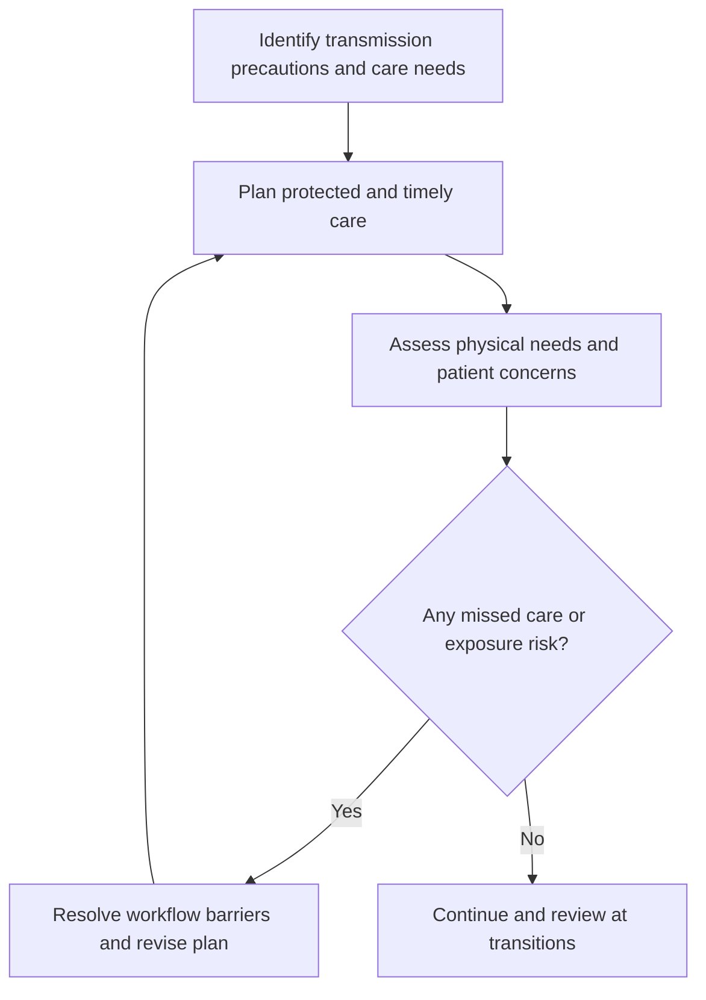

# 📚 Isolation care continuity and patient participation

**Study-ready, not studied.** [20 new original MCQs](../MCQs/05B-Isolation-Care-Continuity-and-Patient-Participation-20-MCQs.md), partial individual-topic allocation 20/30. Core pathogen-specific precautions and PPE are already taught in the Infection Control chapter. This guide covers nursing care that must continue despite isolation. Follow facility policy, clinical assessment and pathogen-specific guidance.

## Essential care

🔴 **MOST IMPORTANT.** Isolation ka purpose infection transmission reduce karna hai, patient ki required care reduce karna nahi. PPE aur room-entry preparation time le sakte hain. Nurse ko care efficiently organize karni hai but time-sensitive assessment, pain reassessment, feeding assistance, toileting, repositioning, prescribed mobility and monitoring delay nahi karni chahiye. Care clustering convenient ho sakti hai, but clinical schedule needs ke according decide karo. Example: analgesia dene ke baad required response assessment next medicine round tak postpone nahi karna chahiye just to save PPE.

Patient ke reachable call bell aur working response system ko check karo. Meals deliver hone ka matlab patient ne khana kha liya nahi hai. Actual intake aur assistance needs assess karo. Isolation alone bed rest ka indication nahi hai. Approved setting mein supervised mobility preserve karo. Delirium-prone patients ke liye orientation cues aur day-night routine maintain karo.

[MCQ Q1–6](../MCQs/05B-Isolation-Care-Continuity-and-Patient-Participation-20-MCQs.md).

## Psychosocial and accessible care

🟠 **HIGH YIELD.** Isolation patient ko lonely, anxious ya stigmatized feel kara sakta hai. Simple language mein precautions ka purpose, current restrictions and review process explain karo. Punishment jaisi language use mat karo. Duration uncertain ho toh false promise mat karo. Withdrawal ko automatically adjustment mat samjho, patient ka mood, unmet needs and safety assess karo.

Masks and respirators communication difficult bana sakte hain. Required protective equipment remove karne ke bajay written instructions, approved communication aids, visual cues and confirmation of understanding use karo. Safe telephone or video interaction, reading and other preferred activities offer karo. Privacy aur patient preference protect karo.

[MCQ Q7–10](../MCQs/05B-Isolation-Care-Continuity-and-Patient-Participation-20-MCQs.md).

## Family and visitor participation

Family caregiver ko patient care mein include karna helpful ho sakta hai, especially child or distressed patient. Visitor ki susceptibility, symptoms, exposure risk and local policy assess karo. Appropriate precautions and exit hygiene explain karo. Family caregiver ko doosre patients ki care directly karne ke liye encourage mat karo. Staff ko notify karna better hai. Wound covering unnecessarily remove mat karo. Required clinical wound review trained staff arrange karein.

Terminal illness mein symptomatic family visitor ka request aaye toh responsible team ke saath individualized compassionate risk assessment karo. Exception automatic nahi hoti. Protected visit where permitted or remote alternatives discuss karo. Other patients and staff ke exposure risk ko consider karo.

[MCQ Q11–14](../MCQs/05B-Isolation-Care-Continuity-and-Patient-Participation-20-MCQs.md).

## Transfer and home continuity

Medically necessary examination isolation ke karan cancel nahi karna chahiye. Agar equally suitable bedside service available hai, team se arrange karo. Transport required ho toh affected site containment, appropriate precautions, receiving department readiness and equipment processing plan karo. Contact precautions transport ke liye contaminated PPE remove karke hand hygiene karo, destination par indicated clean PPE use karo. Pathogen-specific respiratory protection and local transport protocol alag se follow karo.

Receiving residential facility ki layout aur residents ka risk acute hospital se different ho sakta hai. Relevant infection status and precautions securely communicate karo. Home advice disease-specific honi chahiye. Har family ko indefinitely hospital-level PPE use karne ko mat bolo, aur har infection mein all precautions immediately stop karne ka advice bhi mat do.

[MCQ Q15–18](../MCQs/05B-Isolation-Care-Continuity-and-Patient-Participation-20-MCQs.md).

## Quality evaluation

Audit mein sirf PPE consumption ya isolation sign count nahi, timely clinically required assessments, actual care delivery, patient concerns and adherence examine karo. Missed care mile toh blame karne ke bajay supply, workload, workflow and access barriers identify karo. Precautions remove karna quality gap ka automatic solution nahi hai.

[MCQ Q19–20](../MCQs/05B-Isolation-Care-Continuity-and-Patient-Participation-20-MCQs.md).

## 📖 Clinical sources and practice

- [Open RN Nursing Fundamentals, Infection](https://www.ncbi.nlm.nih.gov/books/NBK610837/) — directly retrieved client transport and psychosocial effects of isolation sections.
- [CDC Core IPC Practices](https://www.cdc.gov/infection-control/hcp/core-practices/) and [Isolation Recommendations](https://www.cdc.gov/infection-control/hcp/isolation-precautions/recommendations.html) — directly retrieved clinical guidance on precautions, transport and care settings.
- [CDC fundamental elements](https://www.cdc.gov/infection-control/hcp/isolation-precautions/prevention.html) — indexed compassionate visitor guidance, not a blanket exception.
- [UCLH patient isolation information](https://www.uclh.nhs.uk/patients-and-visitors/patient-information-pages/patient-information-isolation-procedures) — directly retrieved patient and visitor education and discharge context. Facility-specific rules not universal.

Teaching for background: [RegisteredNurseRN standard and isolation precautions](https://www.youtube.com/watch?v=vLq6B3Qjy98), indexed general IPC lecture. Supplementary practice lead: [NCLEX Infection Control Made Easy](https://www.youtube.com/watch?v=8uiMSnMblXA), indexed 19:25 isolation case review, exact question/channel/playback unverified. Neither proves specific care-continuity question coverage. All 20 dedicated practice mappings pending.

[Group 05 cross-chapter allocation](05-IPC-Cross-Chapter-Allocation.md) · [Reported evidence gaps](../Previous-Year-Questions/05B-Isolation-Care-Reported-Evidence-Gaps.md).
