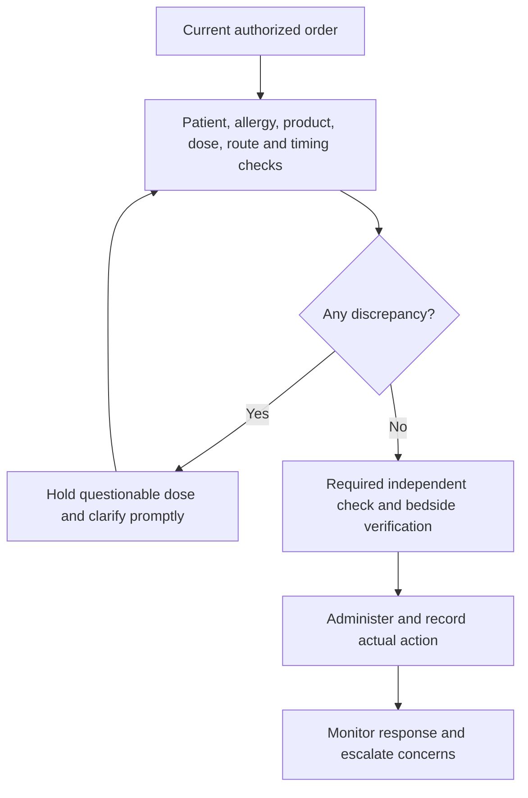

# 📚 Medication verification and error prevention

**Study-ready, not studied.** [22 additional original questions](../MCQs/06A-Medication-Verification-and-Error-Prevention-22-MCQs.md) plus Group 06 Q1,2,3,10,12,18,19 and Group 04 Q12 = 30 allocated. Medication-specific clinical decisions require authorized orders, current references and local policy.

## 🔴 High-alert and LASA

🔴 **MOST IMPORTANT.** Medication safety sirf medicine dene ka skill nahi hai. Prescribing se dispensing, administration aur monitoring tak multiple barriers chahiye. High-alert medicine ka meaning hai error hone par serious harm ka increased risk. Error frequency necessarily higher nahi hoti. Examples include insulin, concentrated electrolytes, selected opioids and anticoagulants. Non-oncology methotrexate ke weekly regimen ko accidental daily order mein change karna serious toxicity cause kar sakta hai. Schedule discrepancy urgently clarify karo, independently change mat karo.

LASA = look-alike, sound-alike. Similar cartons, names, strengths and dosage forms confuse kar sakte hain. Complete generic name, formulation and strength compare karo. Tall Man lettering similar names ke distinguishing letters emphasize karti hai, full label check replace nahi karti. Pharmacy separation, restricted stock and standardized products as appropriate improve system safety.

Independent double check mein second clinician first clinician ka answer pehle copy nahi karta. Authorized protocol ke mutabik order, product, concentration, dose calculation and patient-specific parameters separately verify karta hai. Dono results compare karke discrepancy resolve karo. Selected high-risk medicines ke liye double check important layer hai, system design aur individual verification bhi required hain.

[MCQ Q1–8](../MCQs/06A-Medication-Verification-and-Error-Prevention-22-MCQs.md#q1-a-prescription-for-a-patient-with-rheumatoid-arthritis-lists-oral-methotrexate-daily-but-the-previous-verified-regimen-was-once-weekly-what-should-the-nurse-do-before-the-next-dose).

## 🔴 Bedside verification

🔴 **MOST IMPORTANT.**

| Check | Practical meaning |
|---|---|
| Right patient | Two approved person-specific identifiers |
| Right medicine | Complete drug name, strength and formulation |
| Right dose | Current order, relevant clinical parameters and calculation |
| Right route | Confirm prescribed delivery method and suitable formulation |
| Right time | Prescribed schedule and clinically relevant timing |
| Right documentation | Actual administration promptly record karo |

Additional rights include reason, assessment, education, response and refusal in different teaching frameworks. Fixed count ko universally identical mat samjho. Medication label ko MAR se multiple appropriate steps par compare karo, including before administration at bedside. Allergy history and prior reactions verify karo. Barcode technology extra barrier hai, human verification replace nahi karti. Cabinet screen correct hone par bhi physical product wrong ho sakta hai. Scan mismatch or unreadable code mein authorized exception procedure use karo. Dummy barcode ya spare wristband se bypass unsafe hai.

Interruption ke baad uncertainty ho toh known safe point se recheck karo. Unidentifiable prepared syringe administer mat karo. Ambiguous order clarify karo. Decimal notation: 0.5 mg not .5 mg, 5 mg not 5.0 mg. Route or frequency guess mat karo.

[MCQ Q9–13](../MCQs/06A-Medication-Verification-and-Error-Prevention-22-MCQs.md#q9-a-nurse-scans-medications-for-several-patients-at-the-nursing-station-before-approaching-their-beds-which-workflow-change-is-most-relevant).

## 🟠 Reconciliation and clinical checks

🟠 **HIGH YIELD.**

Admission, transfer and discharge par current medicine list ko intended orders ke saath compare karo. Prescription drugs, OTC products, supplements, active ingredient, strength, dose, timing and recent changes collect karo. Different brands same ingredient contain kar sakte hain. Previous drug stopped hai ya continue karni hai, authorized plan clarify karo. Patient's report useful hai but appropriate sources se verify karo.

Pediatric weight-based dosing mein current measured kg weight and drug-specific limits essential hain. Renal function change relevant drug dose review require kar sakta hai. Nurse independently universal half-dose formula apply nahi karti. Patient says tablet different hai toh verify before administration. Uncertain prior dose mein repeat dose automatically mat do. Actual administration verify karo, clinical status assess karo and time-critical medicine decision promptly clarify karo.

[MCQ Q14–20](../MCQs/06A-Medication-Verification-and-Error-Prevention-22-MCQs.md#q14-a-patient-receives-a-new-prescription-for-a-medicine-also-present-in-the-home-list-under-a-different-brand-name-which-verification-prevents-unintended-duplication).

## 🟠 System review

🟠 **HIGH YIELD.**

Barcode audit mein scanner count ya alert dismiss speed se zyada actual bedside verification and resolved alerts matter karte hain. Electronic order discontinuation unclear ho toh old printed list se dose mat do. Current authorization clarify karo. Discrepancy ko report and correct karo. Existing incident classification and response remain covered in Group 04D.

[MCQ Q21–22](../MCQs/06A-Medication-Verification-and-Error-Prevention-22-MCQs.md#q21-a-ward-audits-barcode-use-and-discovers-staff-scan-medication-labels-but-frequently-bypass-alerts-which-outcome-best-measures-improvement).

## 📖 References and video resources

- [Open RN enteral medication administration](https://www.ncbi.nlm.nih.gov/books/NBK596740/), directly retrieved checks, barcode limitations and rights.
- [AHRQ medication administration errors](https://psnet.ahrq.gov/primer/medication-administration-errors), directly retrieved independent checks, LASA and barcode workflows.
- [WHO LASA technical document](https://www.who.int/publications/i/item/9789240058897), directly retrieved overview.
- [ASHP prevention guidance](https://academic.oup.com/ajhp/article/75/19/1493/5139896), indexed.
- Teaching: [Adda247 Nursing, Pari Ma'am — Drug Administration In One Shot](https://www.youtube.com/watch?v=v1t6-BMsL08), retrieved description covers rights, errors, precautions and routes.
- MCQ practice lead: [Drug Administration & Safety_Nursing MCQs](https://www.youtube.com/watch?v=EX8XBVIkUAk), indexed rights and error-prevention description, direct retrieval failed. Channel and exact questions unverified, all 22 specific mappings pending.
- [Reported evidence](../Previous-Year-Questions/06A-Medication-Safety-Reported-Evidence.md).

Full clinical, semantic, curriculum and rendered UI audit pending.

## ▶️ Exam evidence and practice update — 27 November 2026

| Subsection | Related exam evidence and practice status |
|---|---|
| High-alert and LASA, Q1–8 | [IFC IQ- Healthcare teaching](https://www.youtube.com/watch?v=nzxQEVNw8Y8) covers high-alert and look-alike/sound-alike medication safety. Dedicated specific MCQ practice pending. |
| Bedside verification, Q9–13 | **[🟣 HPRCA Assistant Staff Nurse, 20 March 2026 morning session — related tested concepts only](https://www.scribd.com/document/1045794040/20-March-HPRCA-Nursing-Staff-paper)**. Third-party response-sheet text includes Q74 (ID 4410091671169, identity verification before medication documentation) and Q108 (ID 4410091002742, medication rights). Source header retrieved. Original color markings and official final key not authenticated. **[🟣 NHM MP CHO, 27 Jan 2021 Shift 1 — related tested concept only](https://testbook.com/question-answer/nurses-must-consider-the-following-five-rights-whi--62e80544dc9b900c1485fb02/amp)**. General rights practice only, not specific barcode or preparation scenarios. |
| Reconciliation and clinical checks, Q14–20 | **[🟣 RRB Nursing Superintendent, 12 March 2026 Shift 3 — related tested concept only](https://testbook.com/question-answer/what-is-the-most-appropriate-action-for-a-nurse-if--69df4796a0ef8fa701f49667)**. Reported item tests escalation of record discrepancies. Specific practice verification pending. |
| System review, Q21–22 | Specific practice verification pending. |

The previously linked Drug Administration & Safety_Nursing MCQs video is by Health Notes & Mcqs (6 May 2025). Its indexed description confirms general rights and error-prevention MCQs. Direct playback, exact items and specific coverage of all 22 scenarios remain unverified. [Historical evidence and gap register](../Previous-Year-Questions/06A-Medication-Safety-Reported-Evidence.md). No new adaptation count.
