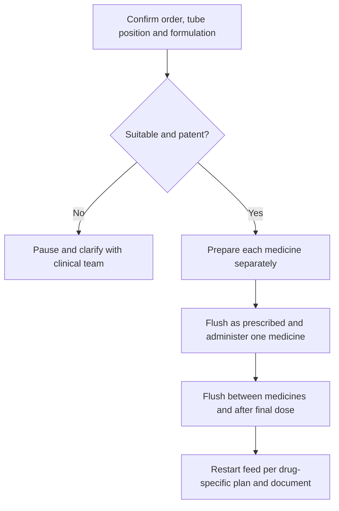

# 📚 Medication routes and formulations

**Study-ready, not studied.** [25 additional original MCQs](../MCQs/06B-Medication-Routes-and-Formulations-25-MCQs.md) + original Group 06 Q4,5,6,14,16 = 30 allocated. Injection site, angles and technique remain Group 19. Calculations remain Group 07. Medication-specific administration requires product instructions and authorized local policy.

## Oral formulations

🟠 **HIGH YIELD.** Route means drug body mein kis pathway se diya jaata hai. Formulation means drug ka physical preparation aur delivery design, e.g. tablet, suspension, capsule or patch. Same active ingredient hone se formulations interchangeable nahi ho jaati.

| Formulation | Practical nursing reasoning |
|---|---|
| Immediate release | Drug relatively promptly release hota hai. Dose schedule formulation-dependent hai. |
| Modified release (MR, SR, XL, LA) | Extended delivery design. Crushing can change release and cause excessive early exposure. Product-specific instructions verify karo. |
| Enteric coated | Stomach mein release delay karne ke liye coating hoti hai. Crushing generally defeats its purpose. |
| Orally disintegrating tablet | Mouth mein disintegrate hoti hai, but absorption necessarily sublingual nahi. Instructions follow karo. |
| Sublingual or buccal | Intended mucosal absorption, swallowing can alter effect. |
| Suspension | Label ke according resuspend before measuring so drug particles evenly distributed hon. |
| Effervescent | Specified water volume mein dissolve karke administer karo. Sodium and fluid restrictions consider karo. |

Dysphagia mein liquid automatically safer nahi. Thin liquid bhi aspiration risk create kar sakti hai. Swallowing plan aur pharmacy advice ke according suitable formulation choose karo. Tablet splitting ke liye score line alone sufficient nahi. Some capsules open karna allowed hota hai but granules chew or crush nahi kar sakte. Hazardous drugs manipulate karne se staff exposure ho sakta hai, pharmacy-approved handling required. Oral liquid accurately measure karne ke liye graduated oral syringe use karo. Household spoon reliable nahi hai.

[Q1–8](../MCQs/06B-Medication-Routes-and-Formulations-25-MCQs.md).

## Enteral tube safety

🔴 **MOST IMPORTANT.** Tube tip location (gastric vs jejunal), tube patency, drug absorption site, formulation and feed interaction check karo. Tube placement verification prescribed protocol se karo. Drug enteral tube ke liye unsuitable ho toh alternative route ya formulation authorized clinician and pharmacist se arrange karo.

Separate medicines, prescribed water type and volume, enteral-specific syringe use karo. Feed container mein medicine mix karna dose delivery uncertain bana sakta hai. Fluid restriction mein flush omit mat karo, safe individual volume agree karke intake record karo. Resistance ho toh force mat karo. Blockage protocol follow karo. Feed break drug-specific hota hai, every drug ke liye long break necessary nahi. Enteral and IV connector incompatibility wrong-route errors prevent karne ke liye useful design barrier hai.

[Q9–14](../MCQs/06B-Medication-Routes-and-Formulations-25-MCQs.md).

## Topical and transdermal

Topical application usually local treatment target karti hai, but systemic absorption possible hai. Inunction means medicine ko prescribed way mein skin par rub karna. Transdermal system skin ke through sustained systemic delivery ke liye designed ho sakta hai. Local cream aur systemic patch automatically interchangeable nahi.

Patch ke product-specific instructions check karo: site, skin condition, replacement schedule, old patch removal, disposal, external heat, MRI compatibility and detachment. Fentanyl patch par external heat avoid karo because increased absorption overdose risk cause kar sakti hai. Patch cut karna routine safe practice nahi. MRI mein some patches metal-containing hote hain, specific product and MRI team se removal/replacement plan confirm karo. Used patch mein residual medicine ho sakti hai, children and pets se safely away dispose karo. Detachment ke liye extra patch automatically mat apply karo.

[Q15–20](../MCQs/06B-Medication-Routes-and-Formulations-25-MCQs.md).

## Route-specific decisions

Oral medicine ka food timing drug-specific hai. Vomiting after administration mein absorbed dose uncertain ho sakti hai. Full dose automatically repeat mat karo, timing and formulation review karke authorized decision lo. Rectal administration mein indication, product and patient-specific contraindications check karo. Oral to parenteral conversion mein dose same hona necessary nahi because absorption and first-pass metabolism vary karte hain. Prescriber and pharmacist conversion verify karte hain.

[Q21–25](../MCQs/06B-Medication-Routes-and-Formulations-25-MCQs.md).

## 📖 References and practice

- [NHS SPS formulation choice](https://sps.nhs.uk/articles/choosing-medicines-formulations-in-swallowing-difficulties/) indexed and [crushing and opening capsules](https://sps.nhs.uk/articles/checking-if-tablets-can-be-crushed-or-capsules-opened/) directly retrieved.
- [NHS SPS enteral administration](https://sps.nhs.uk/articles/administering-a-medicine-through-an-enteral-feeding-tube/) directly retrieved, updated 9 February 2026. [Feed interactions](https://sps.nhs.uk/articles/managing-interactions-between-medicines-and-enteral-feeds/) and [blockage guidance](https://sps.nhs.uk/articles/preventing-and-managing-enteral-feeding-tube-blockages/) indexed.
- [Open RN enteral](https://www.ncbi.nlm.nih.gov/books/NBK596740/) indexed and [other routes](https://www.ncbi.nlm.nih.gov/books/NBK596720/?report=printable) directly retrieved. [FDA scopolamine safety communication](https://www.fda.gov/drugs/drug-safety-communications/fda-adds-warning-about-serious-risk-heat-related-complications-antinausea-patch-transderm-scop) indexed, product-specific safety checks.
- Teaching: [Level Up RN, Routes of administration](https://www.youtube.com/watch?v=UVKl8uX6vUA), indexed oral, NG/G-tube, sublingual, transdermal content. [Adda247 Nursing drug administration](https://www.youtube.com/watch?v=v1t6-BMsL08), indexed general routes teaching.
- Dedicated practice lead: [NORCET 10 MCQ marathon](https://www.youtube.com/watch?v=IKr6dpLQfk4), indexed chapter 56:39 routes of drug administration. Channel and actual question coverage not verified. Not a confirmed specific match for Q1–25. All specific video mappings pending.
- [Reported exam adaptations](../Previous-Year-Questions/06B-Routes-Reported-Evidence.md).
