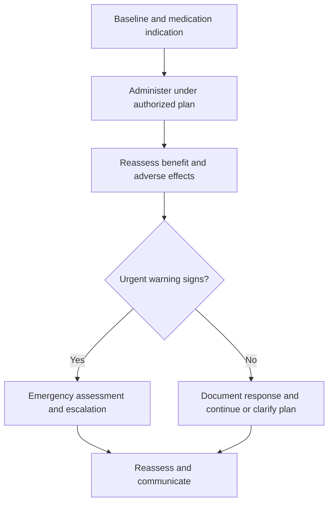

# 📚 Medication monitoring and response

**Study-ready, not studied.** [26 additional original questions](../MCQs/06C-Medication-Monitoring-and-Response-26-MCQs.md) plus original Group 06 Q11,13,15,20 = 30 allocated. This guide emphasizes nursing evaluation, early deterioration recognition and escalation. It is not a prescribing or emergency dosing manual. Use drug-specific references, authorized clinical protocols and supervised competence.

## Therapeutic response

🟠 **HIGH YIELD.** Medication dene ke baad nursing responsibility finish nahi hoti. Assess karo ki intended effect achieve hua ya nahi and unintended effects develop hue ya nahi. Baseline assessment se comparison possible hota hai. Reassessment timing onset, route, clinical urgency and hospital policy par depend karti hai.

| Treatment purpose | Meaningful response |
|---|---|
| Analgesia | Pain score plus movement, comfort or functional ability |
| Antipyretic | Temperature and comfort trend, not proof of cure |
| Antihypertensive | BP trend, symptoms and postural tolerance |
| Sedating medication | Intended response plus alertness, respiratory rate and ventilation |

Example: oxygen support par SpO2 normal ho sakti hai despite inadequate ventilation. New shallow breathing, difficulty waking or severe circulatory changes ko normal reading ke basis par ignore mat karo. Urgent assessment and escalation required. Opioid toxicity suspected ho toh emergency support, ventilation and authorized reversal protocol follow karo.

[Q1–6](../MCQs/06C-Medication-Monitoring-and-Response-26-MCQs.md).

## Adverse reactions

🔴 **MOST IMPORTANT.** Therapeutic effect intended benefit hai. Side effect additional effect hai jo known ho sakta hai. ADR harmful unintended reaction hai during medicine use, even when medicine correctly given. Side effect and ADR terminology may overlap. Allergy immune-mediated reaction ho sakti hai, intolerance alag mechanism se ho sakti hai. Report exact symptoms and timing rather than automatically assign allergy label.

Anaphylaxis mein airway, breathing or circulation compromise rapidly develop ho sakta hai, visible rash absent bhi ho sakti hai. Suspected anaphylaxis mein trigger exposure stop where feasible, urgent help, ABCDE assessment and immediate IM adrenaline according to emergency protocol. Antihistamine alone severe airway/circulation compromise treat nahi karta. Patient ko stand or walk karne ke liye mat bolo. Appropriate positioning and ongoing monitoring follow clinical protocol. Blistering rash plus mucosal lesions urgent severe-reaction assessment require karte hain.

Suspected ADR ka record: medicine, dose, route, timing, symptoms, observations, actions and outcome. Causality fully proven hona necessary nahi for suspected reaction reporting. Local pharmacovigilance route follow karo. Report patient response and update allergy or adverse reaction record after appropriate clinical review.

[Q7–12](../MCQs/06C-Medication-Monitoring-and-Response-26-MCQs.md).

## Therapeutic monitoring

Narrow therapeutic window mein effective exposure and toxic exposure ke beech safety margin limited ho sakti hai. Drug-specific concentration monitoring required ho sakti hai. Trough sample usually next dose se pehle specified timing par collect hota hai. Exact sampling schedule drug-specific hai. Mistimed sample ko valid trough label mat karo. Actual sample and dose time record karke laboratory and clinical team ko clarify karo. Unexpected level mein symptoms, dosing timeline and organ function assess karo. Independently dose change mat karo.

Some therapies ka expected benefit weeks mein develop hota hai. Patient ko realistic response timing and follow-up explain karo. Early lack of relief se automatic extra dose safe nahi ho jaati.

[Q13–16](../MCQs/06C-Medication-Monitoring-and-Response-26-MCQs.md).

## Clinical warning signs

| Scenario | Nursing judgment |
|---|---|
| Anticoagulant and melena with weakness | Possible bleeding, prompt clinical assessment and escalation |
| Diuretic and weakness or palpitations | Review electrolytes, vital signs and rhythm as appropriate |
| CNS depressant and impaired coordination | Safety precautions, avoid driving while impaired |
| Potential nephrotoxin and worsening renal trend | Prompt clinical review of renal function and treatment |
| Antibiotic and new culture results | Review treatment appropriateness with responsible team |
| PRN medicine with benefit and excessive sedation | Record both, assess safety and escalate concerning findings |

Disease-specific pharmacology and exact therapeutic ranges remain in the relevant system and drug-class packages. A single finding does not establish the cause. Monitor actual response and communicate trends.

[Q17–22](../MCQs/06C-Medication-Monitoring-and-Response-26-MCQs.md).

## Continuity and refusal

Patient refusal mein concern explore karo, understanding assess karo and authorized alternatives discuss karo. Coercion or false administration record unacceptable hai. Time-critical medicine ke essential pre-check pending ho toh urgent assessment and escalation arrange karo, silent omission or unsafe administration nahi. Handover mein intended response, adverse effects, upcoming tests and escalation triggers include karo. Recurrent hypoglycemia mein immediate protocol-based treatment ke baad pattern review and recurrence prevention plan necessary hai.

[Q23–26](../MCQs/06C-Medication-Monitoring-and-Response-26-MCQs.md).

## 📖 References and practice

- [Open RN pharmacokinetics and pharmacodynamics](https://www.ncbi.nlm.nih.gov/books/NBK595006/) and [CNS nursing pharmacology](https://www.ncbi.nlm.nih.gov/books/NBK594993/) directly retrieved. Drug-specific monitoring and patient education.
- [Open RN legal and ethical guidance](https://www.ncbi.nlm.nih.gov/sites/books/NBK597872/) indexed, direct open failed.
- [Resuscitation Council UK anaphylaxis guideline landing page](https://www.resus.org.uk/library/additional-guidance/guidance-anaphylaxis/emergency-treatment-anaphylactic-reactions) directly retrieved and [2025 first aid guidance](https://www.resus.org.uk/professional-library/2025-resuscitation-guidelines/first-aid-guidelines) indexed. Follow local clinical emergency policy.
- Teaching: [Adda247 Nursing NORCET 11 Pharmacology Complete Episode 1](https://www.youtube.com/watch?v=ELnHRHgqIIQ), indexed description mentions monitoring and ADRs.
- MCQ practice leads: [NORCET 7 MSN/Pharmacology MCQ series](https://www.youtube.com/watch?v=qykY09t1nFI), indexed ADR and interaction description, [NORCET 10 most important questions](https://www.youtube.com/watch?v=2ImABAT3XTA), indexed chapter 08:32:15 dose-response and ADRs. Channel and actual question discussion not verified. No specific item mapping confirmed. All Q1–26 remain pending.
- [Reported HPSSC question adaptation](../Previous-Year-Questions/06C-Monitoring-Reported-Evidence.md).
