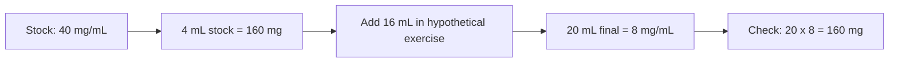
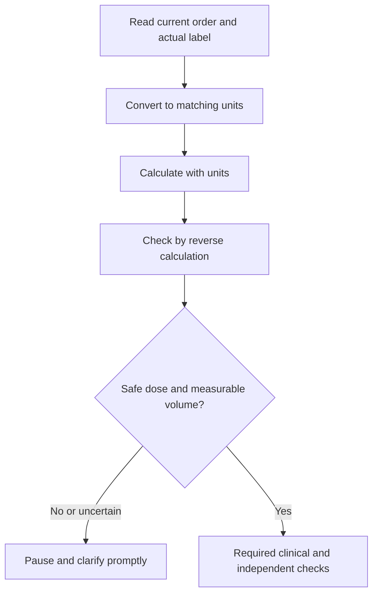

# 📚 Dose units, concentration and reconstitution

**Study-ready, not studied.** [20 new original MCQs](../MCQs/07A-Dose-Units-Concentration-and-Reconstitution-20-MCQs.md) plus Group 07 Q1–4, Q14–17, Q19 and reserved Group 06 Q17 give 30 allocated. These numerical exercises are not patient-specific prescribing instructions.

[Chapter](../README.md) · [MCQs](../MCQs/07A-Dose-Units-Concentration-and-Reconstitution-20-MCQs.md) · [Previous Year Questions](../Previous-Year-Questions/07A-Dose-Calculation-Reported-Evidence.md)

## Units and dose

🔴 **MOST IMPORTANT.** Dose ka matlab medicine ka prescribed amount hai. Concentration ka matlab kisi given volume mein medicine kitni hai. Jaise 50 mg/mL ka matlab har 1 mL mein 50 mg drug hai. Agar amount poocha hai toh answer mg mein ho sakta hai. Agar syringe mein kitna liquid lena hai poocha hai toh answer mL mein hoga. Dono units ko mix mat karo.

| Conversion | Value |
|---|---|
| 1 g | 1000 mg |
| 1 mg | 1000 micrograms |
| 1 L | 1000 mL |

Desired over have formula: **Required quantity = (ordered amount ÷ available amount) × supplied quantity.** Pehle ordered aur available amount ki units same karo. Agar available 80 mg in 5 mL hai, toh 80 mg ko 5 mL se relate karna hai, na ki 80 mg/mL assume karna hai.

Example: 225 micrograms order hai, stock 0.15 mg/mL hai. Pehle 225 micrograms ko 1000 se divide karo, 0.225 mg milega. Ab 0.225 mg ÷ 0.15 mg/mL = 1.5 mL. Reverse check mein 1.5 mL × 0.15 mg/mL = 0.225 mg, jo order ke equal hai. Is reverse check se decimal mistakes pakadne mein madad milti hai.

Agar 75 mg/mL solution ka 2.4 mL diya gaya hai, toh documented dose 75 × 2.4 = 180 mg hai. Dekho, jab volume se mass nikalna hai toh multiply karte hain. Jab mass se volume nikalna hai toh divide karte hain.

[Practice Q1–6](../MCQs/07A-Dose-Units-Concentration-and-Reconstitution-20-MCQs.md).

## Reconstitution and labels

Reconstitution mein powder ko product ke approved diluent se prescribed instructions ke according solution banaya jaata hai. Final volume aur added diluent volume hamesha equal nahi hote, kyunki powder bhi volume occupy kar sakta hai. Actual label par stated final concentration use karo.

Worked example: fictional powder vial 2 g hai. Label kehta hai 7 mL diluent add karne ke baad final 8 mL hai. 2 g = 2000 mg. Final concentration 2000/8 = 250 mg/mL. 625 mg order ka calculated volume 625/250 = 2.5 mL hai. Agar 7 mL use karoge toh concentration wrong ho jaayegi. Clinical preparation mein compatible diluent, final concentration, storage, route, stability and sterile procedure independently verify karo.

Agar 1250 mg required hai aur each vial 500 mg in 2 mL provide karti hai, toh 250 mg/mL concentration se 5 mL chahiye. Two vials mein sirf 4 mL available hai. Isliye three vials required hain. Single-dose containers ka unused remainder facility policy se dispose karo, routine reuse mat assume karo.

Units aur mEq ko mg mein directly convert nahi kar sakte. Drug-specific definition required hai. For a hypothetical stock of 400 units in 2 mL, 150 units = 150/400 × 2 = 0.75 mL. High-alert products require correct device, concentration and authorized independent checks as indicated.

[Practice Q7–11](../MCQs/07A-Dose-Units-Concentration-and-Reconstitution-20-MCQs.md).

## Concentration and dilution

w/v ka matlab weight per final volume hai. 1% w/v = 1 g per 100 mL = 10 mg/mL. Yeh shortcut w/v ke liye hai, w/w aur v/v par apply nahi hota.

| Given concentration | Conversion |
|---|---|
| 2.5% w/v | 2500 mg/100 mL = 25 mg/mL |
| 18 mg/100 mL | 180 micrograms/mL |
| Explicit 1 g/2000 mL | 0.5 mg/mL |

Agar nonclinical exercise mein 40 mg/mL stock se 20 mL at 8 mg/mL banana hai, toh final mass 8 × 20 = 160 mg hona chahiye. Stock ka 160/40 = 4 mL contains that mass. Agar volumes additive hain aur koi loss nahi hai, toh remaining 16 mL diluent chahiye. Real medicines ke liye mathematical dilution alone safe preparation establish nahi karti. Product instructions and pharmacy-approved procedure must govern.

Dilution mein solute mass conserve hota hai if no loss. Formula C1 × V1 = C2 × V2. C1 and C2 ki units same rakho. V2 final volume hai, added diluent volume nahi. Ratio shorthand ko ambiguous medication orders mein use mat karo. Explicit concentration verify karo.

[Practice Q12–17](../MCQs/07A-Dose-Units-Concentration-and-Reconstitution-20-MCQs.md).

## Rounding and safety

Intermediate calculations ko jaldi round karne se final dose change ho sakti hai. Example 17/6 = 2.8333... mL. Agar exercise nearest tenth poochti hai toh 2.8 mL answer hai. Real practice mein syringe graduation, patient-specific dose tolerance and rounding policy decide karte hain. Calculator ka answer correct hone se dose automatically safe nahi ho jaati.

Combination products mein same active ingredient multiple times mil sakta hai. Example 2 doses of 325 mg and 3 doses of 500 mg = 2150 mg. If fictional daily limit 2000 mg hai, excess 150 mg hai. Clinical review urgently arrange karo if actual excessive administration suspected.

[Practice Q18–20](../MCQs/07A-Dose-Units-Concentration-and-Reconstitution-20-MCQs.md).

## ▶️ Sources and videos

| Section | Teaching | MCQ practice |
|---|---|---|
| Units and desired over have | [RegisteredNurseRN formula method](https://www.youtube.com/watch?v=hQY4otRR4TA), indexed description | [Ritika Mam drug dose calculation MCQ session](https://www.youtube.com/watch?v=b6CtL33WFQQ), general numerical session, indexed description only |
| Reconstitution and concentration | [Open RN chapter 5](https://www.ncbi.nlm.nih.gov/books/NBK593207/), written worked examples | Same general session lead, exact concept coverage pending |
| Dilution and rounding | [OpenStax Dosing](https://openstax.org/books/clinical-nursing-skills/pages/11-2-dosing), written reference directly retrieved | Specific MCQ video pending |

[OpenStax Pharmacology for Nurses](https://openstax.org/books/pharmacology/pages/2-4-dosage-calculations) indexed. [Open RN newer Math Calculations](https://www.ncbi.nlm.nih.gov/books/NBK596732/?report=classic) indexed, direct retrieval failed. Video descriptions indexed but direct question-session open failed. Actual channel, exact concept-specific coverage and playback pending. No invented timestamps. [Reported exam adaptations](../Previous-Year-Questions/07A-Dose-Calculation-Reported-Evidence.md).
